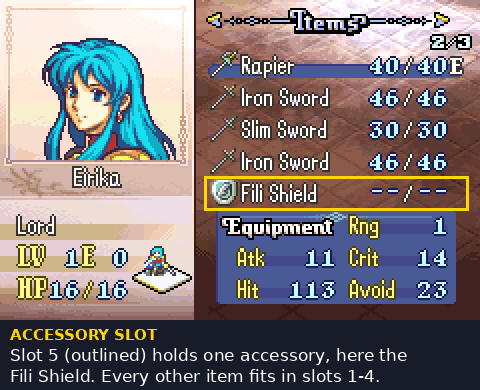

# Accessory Slot

<p align="center">
  
</p>

*Demo, with the Guiding Ring and Fili Shield (Delphi Shield) set as accessories. Slot 5 holds the accessory; slots
1-4 hold everything else. Eirika has four weapons: an Iron Sword drop doesn't fit (slot 5 takes accessories only), so
it is thrown away. A Guiding Ring drop goes straight into slot 5. A second accessory, the Fili Shield, can only replace
the Guiding Ring: her weapons are grayed out.*

Reserves the last inventory slot for accessories, chosen by item ID.

- A unit carries at most **four** other items and at most **one** accessory.
- The accessory is always the unit's **last item**: with four other items it is in the fifth slot. With fewer items it
  sits right after them, so there are never empty slots between items (vanilla's menus expect that).
- Getting an item the unit can't carry (a second accessory, or a fifth other item) works like a full inventory:
  - Chests, villages, drops, events: vanilla's "Your inventory is full" menu appears. Only items of the same kind as the
    new one (accessory or not) can be sent to the convoy or discarded to make room; the others are grayed.
  - Shops: "Your hands are full" (and the offer to send it to the convoy, where there is one).
  - Steal: the items the thief can't carry are grayed, with "Your inventory is full." An enemy thief doesn't steal
    them.
  - Trade (map and preparations), Supply (Take), List (take or swap): the move is refused with the error sound.
  - Bonus claims: the unit is refused, as when it is full.

The patch only controls where accessories sit. What they do (stat bonuses, skills) comes from your other patches or
item data.

## Choose the accessories

Edit `AccessoryItems.event`. Add one `AccessoryItem($ID)` line per item, using the item IDs from FEBuilder's item
editor, before the `BYTE $00` end line:

```
AccessorySlotItems:
AccessoryItem($AB) // Power Ring
AccessoryItem($AC) // Speed Ring
BYTE $00 // end of the list
```

With an empty list there are no accessories, but units still carry at most four items.

## Install (FEBuilder)

1. Copy the `accessory_slot` folder.
2. Edit `AccessoryItems.event`.
3. Open a clean FE8U (USA) ROM, **Advanced Editors → Insert EA →** `Installer.event` → **Load Script**.

No compile needed. To change the list later, insert again on the same ROM.

### Event Assembler

From a copy of a clean `fe8.gba`, with this folder as the working directory and the EA standard library and
`Extensions/Hack Installation.txt` included (FEBuilder includes them itself):

```bash
ColorzCore A FE8 -input:Installer.event -output:/path/to/fe8-accessory.gba
```

## Files

| File | Purpose |
|------|---------|
| `Installer.event` | Hooks, menu table patches and free-space placement |
| `AccessoryItems.event` | The accessory item IDs |
| `Source/AccessorySlot.c` | C implementation |
| `Source/AccessorySlot.lyn.event` | Checked-in lyn output (rebuild with `make` after editing the `.c`) |
| `makefile` | Compiles the C to `.lyn.event` (devkitARM, run from `Commissions/accessory_slot/` in this repo) |

## Hooks and free space

Body and item list at **`$1000000`** (about 2.4 KB).

| Address | Vanilla function | Change |
|---------|------------------|--------|
| `$17948` | `UnitAddItem` | Refuses an item the unit can't carry; puts the accessory last |
| `$17984` | `UnitRemoveInvalidItems` | Packs the items, accessory last (runs after every removal, trade and broken item) |
| `$24304`, `$24348`, `$2439C` | `StealItemMenuCommand_Usability`, `_Draw`, `_Effect` | Steal list |
| `$2D72C` | `TradeMenu_ApplyItemSwap` | Map trade |
| `$3A134` | `AiStartStealAction` | Enemy thieves |
| `$9B538` (16 bytes) | `PrepItemTrade_ApplyItemSwap` | Preparations trade (jumps through r12: it takes four arguments) |
| `$9E2D0` | inside `sub_809E2C8` | Supply, Take: the "is the unit full" count |
| `$9F4A0` | inside `sub_809F498` | List, take: the same count |
| `$9FB70` | `sub_809FB70` | List, swap |
| `$B11E4` | `TryClaimBonusItem` | Bonus claims |
| `$B464C` | `Shop_TryAddItemToInventory` | Shops |
| `$59C350`, `$59C44C` | `gConvoyMenuItems`, `gSendToConvoyMenuItems` rows 0-4 | Usability, draw and select pointers of the "inventory full" menus |

Each `jumpToHack` hook overwrites 8 bytes.

## Notes

- An enemy that drops its last item drops its accessory if it carries one (the accessory is always last).
- Units loaded from chapter data keep the rule: a second accessory or a fifth other item in a unit's starting
  inventory is not given.

## Conflicts

- The C Skill System (it replaces several of these functions), and any patch that changes the functions or menu rows in
  the table above.
- Other patches placed at `$1000000`: move `ORG FE8U_StandaloneFreeSpace` in `Installer.event` to free space of your own.

## Testing

Tested on a clean FE8U ROM in the prologue, with test accessories (Vulnerary, Guiding Ring, Delphi Shield): drops
with and without a full inventory (discard and send-to-convoy menus), map trades, shop buys, Supply takes, steal (as a
thief), and the List and preparations trade swaps (called directly). The enemy thief and bonus claim changes were not
run in the game.
