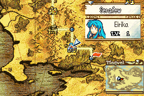

# Base Chapters

  

---

## 📑 Index
- [Introduction](#introduction)
- [Plan](#plan)
- [Code Locations](#code-locations)
- [TODO](#todo)
- [Limitations & Bugs](#limitations--bugs)

---

## 🧩 Introduction

`gpKernelDesignerConfig->base_chapters`

This feature is a C-based rewrite of **Myi64’s** `Enter Town` ASM hack (not to be confused with Huicheelar’s Base Chapters system).

The goal is to provide **dedicated base maps** separate from the main campaign, similar to the **Monastery** from *Fire Emblem: Three Houses*.

### What happens in a Base Chapter?

- The **first playable unit** (in deployment order) automatically enters **Free Movement mode** (via Mokha’s hack)  
- Movement becomes subject to **real-time D-pad control** instead of turn-based tiles  
- The player can:
  - Talk to NPC units  
  - Trigger events  
  - Visit houses and shops  
  - Use arenas normally  
- The player **cannot fight enemies** on the base map outside of arenas

### Why rewrite the ASM hack?

- The original ASM version was **very hardcoded** and was tightly coupled with FEBuilder to install
- The other base chapter hack has a tendency to **overwrite existing chapters** unless heavily customized
- This rewrite gives **full control** over:
  - Which world map nodes count as bases  
  - Which maps are used as bases  
  - How events behave or appear based on flags, conditions, and story milestones  

---

## 🛠️ Plan

In vanilla FE8, there are **0x4F (80)** usable map slots.  
Large portions of these are duplicated between Eirika's and Ephraim's routes. Meaning many maps are effectively **free real estate** for base map usage — even more if creating a custom story.

### How Bases Work

- You define **which world map nodes** receive base chapters in the `gDistrictNodes` table (`Kernel/Wizardry/EnterTown/District.c`).
  Each row has:
  - the world map node (`NODE_*`) the base appears on,
  - the base chapter to load at that node,
  - the story chapter whose move-on unlocks the base, and
  - the unlock flag.
- The base unlocks when the story moves on from its story chapter. See [Unlocking](./Districts.md#unlocking).
- The four districts, and how to add one, are in [Districts](./Districts.md).
- The intro card is skipped when a base is entered from the node menu (`GLOBAL_FLAG_BASE_CHAPTER_INTRO_SKIP`).
- Bases can be **entered and exited freely** afterward. The gate tile (`TRAP_DISTRICT_GATE`) is the escape tile: stepping on it asks to leave.
- Global flags can be checked to:
  - Spawn new units  
  - Change dialogue  
  - Update events dynamically based on story progress  

This allows bases to evolve narratively over time.

---

## 🗂️ Code Locations

| Feature | Location | Description |
|--------|----------|-------------|
| **Base chapter node assignment** | `gDistrictNodes` — [`District.c`](../../Kernel/Wizardry/EnterTown/District.c) | Controls which world map nodes become base chapters, which map each base uses and how each unlocks |
| **Node menu row** | [`EnterTown.c`](../../Kernel/Wizardry/EnterTown/EnterTown.c) | The `Enter District` row of the node menu |
| **Districts** | [`Districts.md`](./Districts.md) | The four districts, their maps and NPCs, and how to add one |

---

## 📝 TODO

- Fix the **black screen flashing** when entering a base map  
- Improve camera behavior to **smoothly follow the player**, similar to Vesly’s *PokéEmblem*  

---

## 🐛 Limitations & Bugs

Please report issues via the repository’s **Issues** tab.

- This hack **does not extend the map list**, so you remain limited to FE8’s **0x4F maps**. This may change in the future.

---