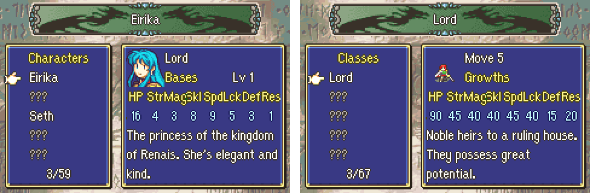

# Bestiary

<p align="center">
   Bestiary: a character met, with her bases, and the Classes tab" width="720"/>
</p>

---

## 📑 Index
- [Introduction](#introduction)
- [The lists](#the-lists)
- [Meeting](#meeting)
- [How it works](#how-it-works)
- [Testing](#testing)
- [Code Locations](#code-locations)
- [Limitations & Bugs](#limitations--bugs)

---

## 🧩 Introduction

**Extras > Bestiary**, the last Extras row, shows every character and class the player has met:

- **The banner** on top (the Sound Room's song banner) shows the name under the cursor, or "???" for one not met yet.
- **The list** on the left, in a window: the tab ("Characters" or "Classes"), five names, and how many of the tab are
  met (3/59). A name not met yet shows as "???", in grey. Up and down move the hand; left and right move five rows;
  L or R changes the tab.
- **The info** on the right, in a window:
  - a character: the mini portrait, the class, "Bases" with the base level, or "Growths" (A switches);
  - a class: its map sprite, its movement, "Bases" or "Growths";
  - the stats (HP, Str, Mag, Skl, Spd, Lck, Def, Res): a character's bases are its own plus its class's (as when it
    joins), magic from the magic tables (`gMagicPInfos`, `gMagicJInfos`); a class has no base luck (0);
  - the description (the character's or the class's help text), wrapped to the window, up to three lines.
- B goes back to Extras.

---

## 📋 The lists

The screen shows `gBestiaryCharacters` and `gBestiaryClasses` (`Data/Bestiary/Bestiary.c`), in that order, each a list
of ids ended by 0:

```c
const u8 gBestiaryCharacters[] = {
	CHARACTER_EIRIKA, CHARACTER_EPHRAIM, CHARACTER_SETH, ...
	0,
};
```

- A row shows under its character's (or class's) name. A row whose name an earlier row already has is skipped, so a
  character with several ids (Lyon the boss, Lyon in the Creature Campaign) or a class with a male and a female id is
  listed once. List the id whose data the screen should show.
- A character with no portrait is skipped (the generic soldiers' ids, the monsters' named ids).
- At most 128 rows a tab are shown (`MAX_ROWS`).
- The unlocks are kept by id, not by row: rows can be added, moved or removed without losing any.

---

## 👁️ Meeting

At the start of every phase (`gPrePhaseFuncs`), every unit on the map that the player can see is marked: its
character and its class. A unit is seen if it is alive and deployed, not hidden, and, in fog, on a tile the player can
see (the player's own units always). A row is met when any character (or class) of its name has been marked.

`Bestiary_MarkSeen(pid, jid)` marks one from other code (an event's ASMC, for instance).

**Where it is kept.** Every byte of SRAM already has an owner (the save blocks, then from 0x7DEC the vanilla records
`RelocMiscChunks.event` moved there), so the Bestiary is kept in the saves themselves, as one record for the cartridge:

- While playing, in RAM (`gBestiarySeen`, `struct BestiaryBits`: a magic word and 256 bits for characters, 256 for
  classes).
- In the game save and in the suspend save, in the bytes after the save tables, after New Game+'s
  (`Kernel/Wizardry/SaveData/Source/SaveTail.c`). Those bytes are not a chunk: **the save layout and its signature do
  not change**, and saves from before the Bestiary load as usual (they have no magic there and add nothing).
- Starting a new game, loading a game save or resuming a suspend, the game takes in every other save's bits too
  (`Bestiary_ReadCart`): each save written from then on holds everything met so far.
- The title's Bestiary shows what the three game saves and the suspend save hold together. Met units are written at
  the next save (a game save or a suspend): a unit met and never saved is not kept. Erasing a file loses only what no
  other save holds.

---

## 🛠️ How it works

- **The Extras row.** Vanilla's trial-map row (bit 6, `EXTRA_MENU_OPTION_BESTIARY`), which this hack never showed.
  `InitSaveMenuChoice` (`ExtrasMenu/Source/SupportMenu.c`) always adds it. The Extras list (`sub_80A9B90`,
  `NewGamePlus/Source/NgpSaveMenu.c`) opens it as the Sound Room is opened; `SaveMenuStartExtraMiscScreen` and
  `SaveMenuPostExtraMiscScreen` (`Gallery/Source/Gallery.c`) start it and come back to the Extras list. The trial
  map's cases in the save picker (`sub_80A9E1C`) and its header label (`sub_80ABF74`) are gone.
- **The row's label.** "Bestiary" is put together from the letters of vanilla's own labels (the "B" of Battle History,
  "est" and "ar" of Restart, the "i" of Link Arena, the "y" of History), in the Extras label sheet
  (`NewGamePlus/Gfx/Img_NgpMenuObjs.png`). The sheet has no free 112-pixel slot, so the label is in two pieces: tiles
  0-3 and 10-11 of the Gallery's sheet row, round the Gallery's letters (tiles 4-9). The Extras list reads its label
  sprites from `gExtrasLabelSprites` (`NgpSaveMenu.c`; the installer points vanilla's `sub_80AAC40` at it): vanilla's
  sprites for the rows still where vanilla drew them, New Game+'s, the Gallery's cut to its letters, and the
  Bestiary's.
- **The screen** (`BestiaryScreen.c`): BG0 the text; BG1 the two windows (`DrawUiFrame`); BG2 the banner (the Sound
  Room's, from `Img_PlayStatusSprites`) and the mini portrait (`PutFaceChibi`, BG palette 4); BG3 the mural
  (`StartMuralBackground`). Sprites: the hand (`LoadObjUIGfx`, `DisplayUiHand`) and a class's map sprite
  (`PutUnitSpriteForClassId`, the red army's palette, the map's sprite sheet synced each frame).
- **The rows** are built when a tab opens (`Bestiary_BuildRows`): the shown ids, and which are met.

---

## 🧪 Testing

`python3 Tools/cloud/smoketest.py --only bestiary`: the prologue's first phase marks Eirika, Seth and O'Neill and
the Lord, Paladin and Fighter classes in `gBestiarySeen`; the debugger's "Save & restart ch." writes them to the game
save; after a reset Extras has the Bestiary row; it opens on Characters with three met, Eirika first; Ephraim (the
second row) is not met; A shows Eirika's growths; R shows the classes, three met; B goes back to the save menu.

---

## 🗂️ Code Locations

| What | Where |
|---|---|
| The lists | `gBestiaryCharacters`, `gBestiaryClasses` in `Data/Bestiary/Bestiary.c` |
| The bits, the phase sweep, the save tail | `Kernel/Wizardry/Bestiary/Source/Bestiary.c` |
| The screen | `Kernel/Wizardry/Bestiary/Source/BestiaryScreen.c` |
| The bytes after the save tables | `Kernel/Wizardry/SaveData/Source/SaveTail.c`; `gpMsa_Saver` and the other three in `Preload/Reloc.event` |
| The Extras row | `InitSaveMenuChoice` (`ExtrasMenu/Source/SupportMenu.c`); `sub_80A9B90` (`NewGamePlus/Source/NgpSaveMenu.c`); `SaveMenuStartExtraMiscScreen` (`Gallery/Source/Gallery.c`) |
| The label | `NewGamePlus/Gfx/Img_NgpMenuObjs.png`; `gExtrasLabelSprites` in `NgpSaveMenu.c`; the `sub_80AAC40` patch in `NewGamePlus_Installer.event` |
| Hook entries | `gPrePhaseFuncs` (`PrePhaseHook/data.event`), `gNewSaveHooks` (`SaveData/data.event`) |
| Struct, constants | `include/kernel/bestiary.h` |
| RAM | `gBestiarySeen`, `gBestiaryScreen` in `include/link/config-memmap.s` |
| Messages | `MSG_BESTIARY_*` at the end of `Contents/Texts/Source/texts/Districts.txt` |
| Smoke test | `test_bestiary` in `Tools/cloud/smoketest.py` |

---

## 🐛 Limitations & Bugs

- Character and class ids above 0xFF are not kept.
- A unit met after the last save is lost if the game is reset without saving (or suspending).
- Only the units on the map at a phase start are marked: a unit that appears and leaves within one phase is not.
- A description longer than three lines is cut short.
- A character's stats are its data's (its base class's bases added); a unit's own load data (levels, autolevelling) is
  not shown.
