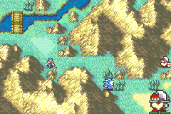

# 2x2 Units

---

## 📑 Index
- [Introduction](#introduction)
- [Making a Unit 2x2](#making-a-unit-2x2)
- [How It Plays](#how-it-plays)
- [How It Works](#how-it-works)
- [Code Locations](#code-locations)
- [Tests](#tests)
- [Limitations](#limitations)

---

## 🧩 Introduction

A **2x2 unit** takes up four tiles. It is drawn once, its map sprite at twice the size, and each of its four tiles is a
**corner** with its own HP bar that is attacked on its own. A corner at 0 HP breaks and its tile empties; the others fight
on. The unit is gone when all four corners are.



Use it for bosses and monsters: an enemy, an NPC or a fourth-allegiance unit. Allies cannot be 2x2 (see
[Limitations](#limitations)).

## 🛠️ Making a Unit 2x2

List its character or its class in `Data/BigUnits/BigUnits.c`:

```c
const u8 gBigUnitCharacters[0x10] = {
	CHARACTER_ONEILL,
	0,
};

const u8 gBigUnitClasses[0x10] = {
	CLASS_DRACO_ZOMBIE,
	0,
};
```

Each list ends with `0` and has room for 15 entries. In the build, the class list has Draco Zombies and the character
list is empty.

A listed unit loads as usual (from a chapter's unit group, a reinforcement or an event) on the **top-left** tile of its
block. The other three corners are made right after, on the tiles to its right, below it and diagonal from it. Leave those
three tiles free, and passable for its class. Nothing checks them at load.

At most 8 2x2 units can be on a map at once (`BIG_UNIT_GROUPS` in `include/kernel/big-unit.h`). A listed unit loaded when
all 8 are in use stays 1x1.

## 🎮 How It Plays

- **Drawn once.** The block shows the map sprite of its first standing corner. A 16x16 or 16x32 sprite is pixel-doubled
  (an OBJ affine matrix), bottom-centred on the block. A 32x32 sprite (a dragon, say) already fills the block and is
  drawn as it is (Draco Zombies). Mirrored sprites stay mirrored. The block's walk (its MU) and its map battles follow
  the same rule: doubled, or as they are for a 32x32 sprite.
- **Four HP bars.** Each corner shows its HP bar under its own tile, even at full HP, so the four can be told apart.
- **Attacked one corner at a time.** Each corner is a unit of its own: the attacker picks which one, and the forecast
  shows that corner's HP. A corner can counter.
- **Breaking.** A corner at 0 HP breaks: its tile empties and it leaves the block, with no death fade. Its defeat
  quote, and the defeated flag that ends a "defeat the boss" chapter, wait for the **last** corner of that character.
- **One action per phase.** The block acts once. The AI asks each corner in turn: the first one that can fight (or use a
  staff or an item) acts. If none can, the first corner's move stands. Once a corner has acted, the whole block is
  grayed.
- **A ghost of where it goes.** With the [translucent unit sprite](./TranslucentUnitSprite.md) on
  (`alpha_blend_movement_sprites`), a faded double-size copy of the block shows on the tiles it is walking to, from the
  start of its walk until it gets there.
- **Moving as one.** The block needs its four tiles free: every tile it moves through or stops on must leave room for
  the other corners, passable for its class and with no other unit on them. The corner that moved takes the others along.
- **Its range.** Selecting a corner shows every tile the block can cover, and the attack range of all four corners. The
  danger zone counts all four corners too.

## ⚙️ How It Works

Each corner is a real unit in the enemy (or NPC) array: a copy of the loaded unit (`CopyUnit`), so it has the same
character, class, stats, items, skills and AI, and its own HP. A RAM table links them:

```c
struct BigUnitGroup {
	u8 uid[BIG_CORNERS];	/* TL, TR, BL, BR; 0 once broken */
	u8 x, y;		/* the block's top-left tile */
};
extern struct BigUnitGroup gBigUnitGroups[BIG_UNIT_GROUPS];
```

| When | What happens | Where |
|---|---|---|
| A unit loads | A listed unit gets its three other corners and a group | `BigUnit_OnLoadUnit`, end of `LoadUnit` |
| Each frame on the map | A corner that moved (it acted, or an event moved it) takes the others along, on the unit map and their sprite handles. Once the active corner has acted, the other corners are grayed. | `BigUnit_SyncAll`, start of `PutUnitSpritesOam`, and before each AI decision |
| Sprites refresh | Each corner's sprite handle is tagged (`SMSHandle._u0A` bit 1, and bit 2 on the first standing corner, group index in bits 4-7) | `BigUnit_SmsTag`, `RefreshUnitSprites` |
| Sprites draw | Tagged handles are skipped; the shown corner's draws the block. The block hides while a corner's sprite does (a walk, an event). | `BigUnit_PutBlockSprite`, `PutUnitSpritesOam` |
| HP bars draw | Corners always get theirs, while the block shows | `PutUnitSpriteIconsOam` (`map-task.c`) |
| A corner walks | The MU's frame is drawn again at twice the size, around the block's bottom centre. On the AI's walk, a faded copy (semi-transparent OBJ, alpha 8/8 over BG2 and BG3) goes on the destination (`gAiDecision`). | `BigUnit_PutMu`, `BigUnit_PutMuGhost`, `MU_DisplayAsMMS` |
| A movement map | A tile is a barrier unless the other corners' tiles (the same offset away) are on the map, passable and free of other units | `BigUnit_MarkFootprintBarriers`, end of `PreGenerateMovementMap` |
| The AI decides | Each corner is asked in turn, the others off the unit map so the block can move onto their tiles | `BigUnit_AiDecide`, `CpDecide_Main` |
| The player selects a corner | The movement map is widened to every tile the block covers | `BigUnit_ExpandMovementMap`, `DisplayUnitEffectRange` |
| A defeat quote | Skipped while another corner of that character stands | `BigUnit_PidStillStanding`, `CheckBattleDefeatTalk`, `DisplayDefeatTalkForPid` |
| A corner dies or is cleared | It leaves its group. A battle unit's copy is ignored. | `BigUnit_OnUnitKill`, `BigUnit_OnClearUnit` (`gKillUnitHooks`, `gClearUnitHooks`) |
| The chapter ends | The groups are cleared | `BigUnit_ChapterEnd`, `ChapterChangeUnitCleanup` |
| Suspend | The table is a suspend-save chunk (`$0030`) | `BigUnit_Save`, `BigUnit_Load` |

Adding the suspend chunk changed the save layout: saves from before it show as NO DATA (the
[save layout guard](../FeatureTypes/SaveData.md#layout-guard)).

The doubled sprites use OBJ affine slots 26 (facing left) and 27 (mirrored). The text engine uses 29-31 and the skill
wheel 30.

## 📍 Code Locations

| File | Role |
|---|---|
| `include/kernel/big-unit.h` | The group struct, the tables and every function |
| `Kernel/Wizardry/BigUnits/Source/BigUnit.c` | Groups, spawning, the sync, the AI, movement footprint, range, defeat check, hooks, save |
| `Kernel/Wizardry/BigUnits/Source/BigUnitDraw.c` | The sprite tag, the block sprite, the doubled walk |
| `Kernel/Wizardry/BigUnits/BigUnits.event` | Installer (`WIZARDRY_CUSTOM` block of `Kernel/Wizardry/wizardry.event`) |
| `Data/BigUnits/BigUnits.c` | The designer lists |
| `include/link/config-memmap.s` | `gBigUnitGroups` (0x30 bytes) |
| `Kernel/Wizardry/UnitHooks/Source/LoadUnit.c`, `UnitRefrain.c`, `data.event` | Load, chapter end, kill and clear hooks |
| `Kernel/Wizardry/MirrorMapSprites/MirrorSprites.c` | Sprite tag, skip and block draw, the doubled MU |
| `Kernel/Wizardry/MapTask/Source/map-task.c` | The corners' HP bars |
| `Kernel/Wizardry/Movement/Source/Movement.c` | The footprint barrier |
| `Kernel/Wizardry/AiHack/AiOptimization/Source/AiOptimization.c` | The AI's corner choice |
| `Kernel/Wizardry/WeaponRange/Source/MiscHooks.c` | The widened range |
| `Kernel/Wizardry/Quotes/Source/DefeatQuotes.c` | Defeat quotes wait for the last corner |
| `Kernel/Wizardry/SaveData/data.event` | The suspend chunk |

## 🧪 Tests

`python3 Tools/cloud/smoketest.py --only bigunit`:

- A test ROM lists O'Neill: he loads as four corners on (10, 8) to (11, 9), drawn as one double-size affine sprite.
- Eirika breaks his top-left corner (1 HP): it leaves the group, and his defeat (chapter flag 2, which a 1x1 O'Neill's
  defeat sets) waits.
- On the plain ROM, the fighter next to Eirika is made a 2x2 block in RAM at (2, 3), where only its bottom-right
  corner reaches Seth: the block fights once, from that corner (only it is hurt), and all four corners are grayed.
  Seth then breaks that corner: the other three stand.
- The same block at (12, 7) moves a tile left on the enemy phase (O'Neill blocks the next tile), and its shown range is
  exactly the 4x3 tiles the block can cover.

The suspend test (`--only suspend`) saves, wipes and reloads the group table with the other chunks.

## ⚠️ Limitations

- **No allies.** All four corners share a character, so for an ally they would all be in the roster, the prep screen
  and the game save, and events that find a unit by character would get any one of them. Listed allies stay 1x1.
- **Events see four units.** An event command that finds a unit by character (`MOVE`, `REMOVE`, `CHECK_HP`...) acts on
  one corner. A moved corner takes the others along. To remove a 2x2 unit, remove each of its corners.
- **Each corner is a kill.** Breaking a corner gives its EXP and counts as a kill. A "rout" goal needs all four.
- **The sprite covers broken corners.** The block is drawn over all four tiles even when one has broken.
- **Load placement is not checked.** The three tiles next to the loaded unit must be free and passable.
- **Shove, Swap and the like.** A skill that moves a corner moves the whole block, which may then overlap other units.
- **Fog.** The block hides while any corner is hidden by fog.
