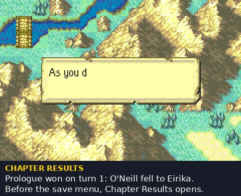

# Chapter Results

<p align="center">
  
</p>

*The prologue with only O'Neill left, next to Eirika: he falls to her on turn 1 and the chapter ends. The results
screen counts up its lines, shows Eirika as MVP and stamps an A; A goes on to the save menu. The same win set up in RAM
as a slow, costly one (turn 7, Seth fallen, 1200 gold picked up): A during the count shows it all, and the rank is D.
Options > Chapter Results OFF: the same win goes straight to the save menu.*

---

## 📑 Index
- [Introduction](#introduction)
- [Toggle](#toggle)
- [When it shows](#when-it-shows)
- [The numbers](#the-numbers)
- [MVP and rank](#mvp-and-rank)
- [How it works](#how-it-works)
- [Testing](#testing)
- [Code Locations](#code-locations)
- [Limitations & Bugs](#limitations--bugs)

---

## 🧩 Introduction

When a story chapter is cleared, before the save menu, a one-page results screen sums up the chapter:

- on the left, seven numbers counted up one line after another, with a tick: **Turns**, **Units fielded**,
  **Units lost**, **Foes defeated**, **Damage dealt**, **Damage taken** and **Funds** (the gold gained this chapter);
- on the right, the **MVP**: the chibi portrait, the name, the damage dealt and the foes defeated;
- then the **rank**, a round stamp with a letter S, A, B, C or D, that drops onto the window with a sound.

A or B during the count shows everything at once; A or B again goes on. START does nothing here, so skipping the
chapter's ending scenes with START does not skip the results. The screen uses the Extras screens' look (the title on the
Bestiary's banner over the scrolling mural, a blue window), like the [chapter awards](./GuildBoard.md#chapter-awards).

---

## ⚙️ Toggle

Two switches; the screen shows only when both are on.

- **Designer:** `chapter_results_screen` in `KernelDesigerConfig` (`include/kernel/kernel-lib.h`, the struct's last
  field), `true` in `Data/DesignerConfig/designer-config.c`. Off: no screen and no Options row. See
  [SystemConfig](./SystemConfig.md).
- **Player:** the Options screen's **Chapter Results** row (ON/OFF, icon 0x56: a results sheet with an orange seal), the
  last row. It is `gPlaySt.config2.chapter_results_off` (bit 1 of `PLAYST + 0x21`, 0 = ON;
  [MenuOptions](./MenuOptions.md#config2-more-options-bits)). ON in a new game and in saves from before it. Saved with
  the game and suspend saves; no save layout change.

The feature needs `CONFIG_DISTRICT_GUILD` (`include/configs/configs.h`, on): its counts are the chapter awards'. Without
it the screen and the row are not built.

---

## 🗺️ When it shows

`GameControl_CallPostChapterSaveMenu` (vanilla's step that starts the save menu after a chapter, replaced in
`Kernel/Wizardry/Guild/Source/ChapterAwards.c`) starts the screen when:

- the chapter was cleared (event flag 3) and was not a district visit (`gDistrictNodes`), as for the awards;
- the chapter had a player phase: its snapshot (below) is taken at the first one. Cutscene chapters, such as the
  Intermission at Castle Frelia (`0x38`), have none and show no results.

So every story chapter shows it, the stub chapters (Chapters 10-22, [StoryStubs](./StoryStubs.md)) included: they end
through the same path. After the screen comes what vanilla would have started: the [awards](./GuildBoard.md#chapter-awards)
if they are on and due, then the save menu. After Chapter 1 vanilla has no save menu (the next chapter, `0x38`, is the
Intermission, which ends in one), so the screen shows and the game goes on to the Intermission.

---

## 📊 The numbers

| Line | What it counts | Where it comes from |
|---|---|---|
| Turns | the chapter's turn when it ended | `gPlaySt.chapterTurnNumber` |
| Units fielded | the most player units on the map at a player phase's start, those fallen since the first included, and at least every unit that fought | snapshot byte, updated at each player phase; `gChapterAwards.count` |
| Units lost | player units that died this chapter | the dead player units now, less those dead at the first player phase |
| Foes defeated | enemies that fell in a battle with a player unit | the sum of `gChapterAwards.units[].kills` |
| Damage dealt | damage player units dealt to enemies in battle | the sum of `.dealt` |
| Damage taken | damage player units took from enemies in battle | the sum of `.taken` |
| Funds | the gold now, less the gold at the first player phase ("+1200", or "-300" after shopping) | `GetPartyGoldAmount()` and the snapshot |

The battle counts are the [chapter awards](./GuildBoard.md#chapter-awards)' (`gChapterAwards`), kept whether or not the
awards are on: every battle a player unit fights against an enemy (red) unit, from either side.

There is no turn par: no chapter data in the tree has one. FE8's chapter data still holds FE7's tactics-rank turn
counts (`turnsForTacticsRank*`), but they are the placeholders 5/6/7/8 in every chapter, so the screen skips par and the
rank uses a pace instead (below).

---

## 🏅 MVP and rank

**MVP:** the living player unit with the highest damage dealt + 10 per foe defeated this chapter
(`ChapterAwards_Winner(CHAPTER_AWARD_MVP)`, the same rule as the MVP award). Nobody, if no unit dealt damage: "No one
this time."

**Rank** (`ChapterResults_Rank`):

```
pace  = max(3, 2 + (foes defeated + 1) / 2)       turns: half a turn per foe, plus two, at least three
over  = min(8, max(0, turns - pace))
score = 85 + min(foes defeated, 10) - 25 * units lost - 5 * over

S: score >= 90    A: >= 80    B: >= 70    C: >= 55    D: below
```

| Chapter | Score | Rank |
|---|---|---|
| 6 foes in 4 turns, nobody lost | 85 + 6 = 91 | S |
| 1 foe on turn 1, nobody lost (the prologue in the GIF) | 85 + 1 = 86 | A |
| a seize with no foes on turn 3 | 85 | A |
| 10 foes in 10 turns (pace 7), nobody lost | 85 + 10 - 15 = 80 | A |
| 4 foes in 8 turns (pace 4), nobody lost | 85 + 4 - 20 = 69 | C |
| 1 foe on turn 7, one unit lost (the GIF's second scene) | 85 + 1 - 25 - 20 = 41 | D |

Two units lost always give D (at most 95 - 50 = 45); one loss gives B at best (85 + 10 - 25 = 70, with 10 foes or more and no turn over the pace).

The stamp's colour follows the rank: S gold, A red, B blue, C green, D grey.

---

## 🔧 How it works

- **The snapshot.** `ChapterResults_PrePhase` (in `gPrePhaseFuncs`, `Kernel/Wizardry/PrePhaseHook/data.event`) runs at
  every phase start. At the chapter's first player phase it stores the funds (24 bits) and the number of dead player
  units, and marks the snapshot taken; at every player phase it raises the fielded count. Prep-screen shopping comes
  before it, so it is not counted in Funds.
- **Storage.** The snapshot lives in the `spare` byte of `gChapterAwards`' unit rows (once `pad`), bytes 0-5
  (`enum chapter_results_spare`, `include/kernel/chapter-results.h`). `gChapterAwards` is already a suspend-save chunk
  cleared at each chapter start, so the snapshot survives a suspend and starts over with the chapter, and the save
  layout does not change (no chunk added or resized).
- **The screen.** `ProcScr_ChapterResults` (a blocking child of the game-control proc). Its state is
  `gChapterResultsScreen`, which shares `gChapterAwardsScreen`'s 0x60 bytes (`SET_DATA` in
  `include/link/config-memmap.s`): the awards screen only starts after the results end, so no new RAM. BG0 holds the
  text and the chibi, BG1 the window (`DrawUiFrame2`), BG2 the banner (`ExtrasUi_LoadBanner`), BG3 the mural
  (`StartMuralBackground`). The seven lines are `struct Text`s redrawn on each tick; the other texts are drawn once.
- **The stamp.** A 64x64 OBJ drawn at run time into OBJ tile 0x300 (2D mapping; one 32-bit word per tile row, as OBJ
  VRAM takes no byte writes): a cream disc in an ink ring, the rank's 16x16 letter (`sRankGlyphs`) at twice its size.
  It is drawn double-size affine (`OBJ affine 1`, OBJ palette 2), dropping from twice its size to its own in 10
  frames with a small squash, and the sound (`SONG_SE_UPDATE`) plays as it lands.
- **Timing.** A tick (`SONG_SE_SYS_CURSOR_UD1`) every 4 frames, at most 8 ticks a line, 12 frames between lines, 60
  frames from the MVP to the stamp.

---

## 🧪 Testing

`python3 Tools/cloud/smoketest.py --only results` (also in `--quick`):

- the prologue with only O'Neill, who falls to Eirika in the enemy phase of turn 1 (`oneill_end`, shared with the
  awards test): START skips the ending's scenes but not the screen; its step goes through every line, the MVP and the
  stamp in order;
- the numbers are 1 turn, 2 fielded (Eirika and Seth), 0 lost, 1 defeated, her damage, 0 taken and 0 funds; the MVP is
  Eirika and the rank A, as the formula gives;
- the stamp is in OAM (double-size affine, tile 0x300, palette 2);
- A leaves the screen for the save menu (`gProcScr_SaveMenuPostChapter`), and after the save Chapter 1 starts and takes
  its own snapshot;
- with the Options row OFF, or `chapter_results_screen` off in a test ROM, the screen never starts.

The tests that time their keys after a chapter's end (`stubs`, `postgame`) turn the row OFF (`RESULTS_OFF`), and the
awards test turns the designer switch off in its awards ROM.

Checked by hand in the emulator: Chapter 1's end (the screen, then the Intermission and its save menu, no screen
after the Intermission) and a stub chapter (Chapter 10: the screen, the save menu, then the world map on Chapter 11 with
the lord on its node).

---

## 📂 Code Locations

| Feature | Location | Description |
|---|---|---|
| Screen, snapshot, rank | [`ChapterResults.c`](../../Kernel/Wizardry/ChapterResults/Source/ChapterResults.c) | `ProcScr_ChapterResults`, `ChapterResults_PrePhase`, `ChapterResults_Rank`, the stamp |
| Header | [`chapter-results.h`](../../include/kernel/chapter-results.h) | the snapshot bytes, `ChapterResults_Start` |
| Installer | [`ChapterResults_Installer.event`](../../Kernel/Wizardry/ChapterResults/ChapterResults_Installer.event) | included in `wizardry.event` under `CONFIG_DISTRICT_GUILD` (WIZARDRY_CUSTOM) |
| Start | [`ChapterAwards.c`](../../Kernel/Wizardry/Guild/Source/ChapterAwards.c) | `GameControl_CallPostChapterSaveMenu`, `ChapterAwards_ChapterCleared`, `ChapterAwards_StartOrSaveMenu` |
| Counts | [`chapter-awards.h`](../../include/kernel/chapter-awards.h) | `gChapterAwards`, the `spare` bytes |
| Phase hook | [`PrePhaseHook/data.event`](../../Kernel/Wizardry/PrePhaseHook/data.event) | `ChapterResults_PrePhase` |
| RAM | [`config-memmap.s`](../../include/link/config-memmap.s) | `gChapterResultsScreen` (shares `gChapterAwardsScreen`) |
| Options row | [`MenuOptions.c`](../../Kernel/Wizardry/MenuOptions/MenuOptions.c) | `GAME_OPTION_CHAPTER_RESULTS`, icon 0x56 in `FE8_All_System_Icons.png` |
| Option bit | [`types.h`](../../Tools/FE-CLib-Mokha/include/types.h) | `struct PlaySt_OptionBits2`: `chapter_results_off` |
| Designer toggle | [`designer-config.c`](../../Data/DesignerConfig/designer-config.c) | `chapter_results_screen` |
| Text | `Contents/Texts/Source/texts/Districts.txt` (end) | `MSG_CHAPTER_RESULTS_*`, `MSG_MENU_OPTION_CHAPTER_RESULTS_*`; the MVP's details reuse `MSG_AWARDS_*` |
| Smoke test | [`smoketest.py`](../../Tools/cloud/smoketest.py) | `test_results` |

---

## ⚠️ Limitations & Bugs

- Damage and foes count battles against enemy (red) units only, as the awards do: staff use, traps, poison and other
  damage outside a battle, and battles with green or purple units do not count. Up to 12 player units are counted
  (`CHAPTER_AWARDS_UNITS`); a 13th unit's battles are left out.
- Units fielded is counted at player phase starts: a unit that joins and leaves (or the chapter ends) before the next
  player phase is counted only if it fought.
- Funds is the net change from the first player phase: buying in a shop during the chapter lowers it, and gold spent
  in the preparations screen is not counted.
- With `casual_mode` on, a fallen unit retreats instead of dying (`UnitKill`), so Units lost stays 0.
- A chapter suspended before this feature existed (no snapshot) shows no results when it ends.
- No turn par (see [The numbers](#the-numbers)): the rank's pace is a fixed rule, not tuned per chapter.
