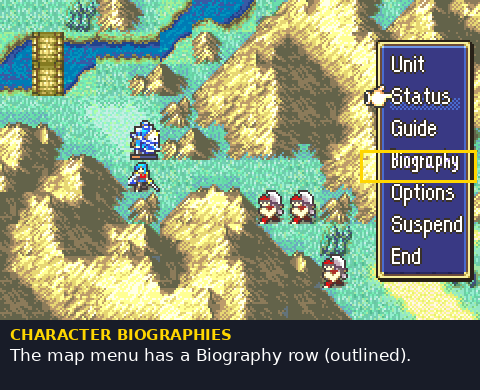

# Character Biographies

<p align="center">
  
</p>

---

## 📑 Index
- [Introduction](#introduction)
- [How-To-Use](#how-to-use)
- [Code Locations](#code-locations)
- [TODO](#todo)
- [Limitations & Bugs](#limitations--bugs)

---

## 🧩 Introduction

``MapMenu_BiographyCommand``  
``ProcScr_MenuMap_BIOGRAPHY``

This feature adds a **Character Biographies** command to the map menu.

The aim is to ensure:

- A scrollable list of the biographies of the characters who have joined the army (the others are not listed)
- Per-character music selection
- Multi-page CG-style biography presentation (4 entries per character)

Each character biography consists of:

- Character ID
- Subtitle string
- Song ID (or random fallback)
- Four `(textId, backgroundId)` pairs

---

## 🛠️ How To Use

- Add entries inside the ``gCharacterBiographies`` table:
  - `characterId`
  - `subtitle`
  - `songId`
  - Four biography entries `{ textId, backgroundId }`
- Ensure all `MSG_*` text IDs exist in your text buildfile.
- Ensure all background IDs correspond to valid CG/background resources.
- The command is triggered via:

  ```
  MapMenu_BiographyCommand
  ```

- The event script `EventScr_CharacterBiographies` automatically:
  - Prevents skipping
  - Fades in
  - Displays 4 CG/text entries sequentially

The visible list count is controlled by:

```
#define BASE_VISIBLE_COUNT 5
```

---

## 🗂️ Code Locations

All functions can be found in [`CharacterBiographies.c`](../../Data/MapMenus/CharacterBiographies.c)

| Feature | Location |
|----------|----------|-------------|
| **Biography Table** | `gCharacterBiographies` | Stores all character data, subtitles, music, and entry pages |
| **List Count Function** | `NumberOfCharacterBiographies` | Returns total biography entries |
| **Menu Draw Function** | `DrawBaseConversations` | Draws visible character names and subtitles |
| **Initialization** | `Biography_Init` | Sets up backgrounds, UI frame, scroll bar, cursor, and music |
| **Input Handler** | `MainKeyHandler_Biography` | Handles A/B/Up/Down input and scrolling |
| **Event Script** | `EventScr_CharacterBiographies` | Controls multi-page CG biography flow |
| **Event Caller** | `CallBiographyEvent` | Starts selected character’s biography event |
| **Prep Cleanup** | `DisablePrepScreenDisplay` | Clears UI before entering event |
| **Map Restore** | `Biography_RestoreMapGraphics` | Restores map graphics and interface |
| **Proc Definition** | `ProcScr_MenuMap_BIOGRAPHY` | Full lifecycle controller for biography screen |
| **Menu Command Hook** | `MapMenu_BiographyCommand` | Entry point from map menu |

---

## 🧠 System Overview

### 📜 Biography Data Structure

Each entry in:

```
gCharacterBiographies[]
```

Contains:

```
{
    characterId,
    subtitle,
    songId,
    {
        { textId, backgroundId },
        { textId, backgroundId },
        { textId, backgroundId },
        { textId, backgroundId }
    }
}
```

This allows:

- 4 CG pages per character
- Automatic sequencing through `SetIndexes`
- Event-driven background and text loading

---

### 🎮 Input Behavior

- **A Button**
  - Triggers biography event
  - Plays selected song (or random if 0)
  - On a character who has not joined the army (grey in the list), plays the "can't" sound and does nothing

- **B Button**
  - Exits menu
  - Restores map graphics

- **D-Pad Up/Down**
  - Scrolls character list
  - Updates:
    - Cursor position
    - Scrollbar
    - Visible entries

---

### 🎵 Music Handling

Inside `CallBiographyEvent`:

- If `songId == 0`
  - Plays a random track
- Otherwise
  - Plays the assigned BGM

The list itself plays its own song (`Biography_Init`). Leaving the list with B starts the map's music again
(`StartMapSongBgm` in `ProcScr_MenuMap_BIOGRAPHY`); before, the list's or the last biography's song kept playing on
the map.

---

### 🧾 Event Flow

The event script:

```
EventScr_CharacterBiographies
```

- Disables skipping
- Fades from black
- Calls `SetIndexes` before each page
- Displays 4 CG biography entries
- Fades to black at its end (`FADE_TO_BLACK`)
- Returns to biography menu

### 🎞️ Transitions

Every switch between the list and a biography goes through black:

- A: the list fades out as it is, then it is cleared (`DisablePrepScreenDisplay`; BG3's tile 0, a map grass tile, is
  blanked so the cleared screen is black). Two frames later, once the list's sprites are gone (the event's CG mode
  keeps the last sprites), the event starts and fades its first page in.
- The proc yields after `CallBiographyEvent`: `KernelCallEvent` blocks it only from the next frame, and without the
  yield the proc went on to draw the list again before the event began (the list under the first page, and garbage
  over the last page on the way back).
- The event fades to black; `Biography_Init` draws the list with the screen held dark (`SetBlendDarken`), and
  `NewFadeIn` brings it up.

---

## 📚 The biographies

| Character | Subtitle |
|---|---|
| Eirika | Restoration Lady |
| Seth | The Silver Knight |
| Franz | The Faithful |
| Gilliam | Wall of Silence |
| Tana | Winged Princess |
| Artur | The Devout |
| Amelia | The Hopeful |
| Ephraim | Restoration Lord |
| Innes | Regal Bowman |
| Lute | Prodigy |
| Natasha | Gentle Cleric |
| Cormag | Wyvern Knight |
| Forde | Easygoing Knight |
| Kyle | Earnest Knight |
| Gerik | Mercenary Leader |
| Tethys | Graceful Dancer |
| Marisa | Crimson Flash |
| Ewan | Playful Pupil |
| L'Arachel | Holy Princess |
| Dozla | Jovial Warrior |
| Rennac | Reluctant Rogue |
| Duessel | Obsidian |
| Myrrh | Great Dragon |
| Knoll | Dark Scholar |
| Joshua | Lucky Gambler |
| Syrene | Falcon Knight |
| Ross | Eager Trainee |
| Neimi | Teary Archer |
| Colm | Brash Thief |
| Garcia | Retired Warrior |
| Lyon | Prince of Grado |
| Orson | Devoted Knight |
| Glen | Sunstone |
| Selena | Fluorspar |
| Valter | Moonstone |
| Riev | Fallen Bishop |
| Caellach | Tiger Eye |

Their pages are `CustomCampaign/Text/HeroesCards/<Name>.txt` with the `BG_Heroes_<Name>_0N` backgrounds. Every
character who can join has one, except:

- Moulder, who is not in Fire Emblem Heroes (no CG);
- Vanessa, who has no CG art in `gfx/BG/FireEmblemHeroesCards`;
- Saleh, whose folder holds only unconverted art (no `BG_Heroes_Saleh_0N` in `BG.event`).

The postgame recruits (Lyon, Orson, Glen, Selena, Valter, Riev, Caellach) use their Creature Campaign characters
(`CHARACTER_*_CC`), so theirs open when they join. Morva, Formortiis and Vigarde never join and have no row; their card
files are still empty.

The text box shows two lines. Put an `[A]` after every second line of a passage (`line[N]line[A][N]line...`): a third
line before an `[A]` scrolls the first one away before the player can read it.

The list shows five rows and scrolls (UP and DOWN past its ends), with the scroll bar sized to the table.

## 👥 Who is listed

Only the biographies whose character has joined the army are listed (a blue unit of that character, alive or not:
`BiographyUnlocked`); the others are left out until then.

`python3 Tools/cloud/smoketest.py --only biography` opens the menu: in the prologue it lists Eirika and Seth only (DOWN
stops on Seth), and A on Eirika plays her first page.

---

## 📖 Pages

Every biography plays its four pages. (The last page once waited on its character's guild board quest; that lock
is gone, and the quests now give tokens only.)

The map menu's Biography command is on by default (`map_menu_character_biographies` in
`Data/DesignerConfig/designer-config.c`). It is the row after Guide and Goals.

---

## 📝 TODO

- Add portrait preview on selection

---

## 🐛 Limitations & Bugs

Please report issues in the repository’s **Issues** tab.

---