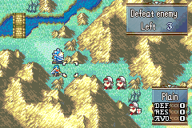

# Character Biographies

<p align="center">
  
</p>

---

## 📑 Index
- [Introduction](#introduction)
- [How-To-Use](#how-to-use)
- [Code Locations](#code-locations)
- [TODO](#todo)
- [Limitations & Bugs](#limitations--bugs)

---

## 🧩 Introduction

``MapMenu_BiographyCommand``  
``ProcScr_MenuMap_BIOGRAPHY``

This feature adds a **Character Biographies** command to the map menu.

The aim is to ensure:

- A scrollable list of playable character biographies
- Per-character music selection
- Multi-page CG-style biography presentation (4 entries per character)

Each character biography consists of:

- Character ID
- Subtitle string
- Song ID (or random fallback)
- Four `(textId, backgroundId)` pairs

---

## 🛠️ How To Use

- Add entries inside the ``gCharacterBiographies`` table:
  - `characterId`
  - `subtitle`
  - `songId`
  - Four biography entries `{ textId, backgroundId }`
- Ensure all `MSG_*` text IDs exist in your text buildfile.
- Ensure all background IDs correspond to valid CG/background resources.
- The command is triggered via:

  ```
  MapMenu_BiographyCommand
  ```

- The event script `EventScr_CharacterBiographies` automatically:
  - Prevents skipping
  - Fades in
  - Displays 4 CG/text entries sequentially

The visible list count is controlled by:

```
#define BASE_VISIBLE_COUNT 5
```

---

## 🗂️ Code Locations

All functions can be found in [`CharacterBiographies.c`](../../Data/MapMenus/CharacterBiographies.c)

| Feature | Location | Description |
|----------|----------|-------------|
| **Biography Table** | `gCharacterBiographies` | Stores all character data, subtitles, music, and entry pages |
| **List Count Function** | `NumberOfCharacterBiographies` | Returns total biography entries |
| **Menu Draw Function** | `DrawBaseConversations` | Draws visible character names and subtitles |
| **Initialization** | `Biography_Init` | Sets up backgrounds, UI frame, scroll bar, cursor, and music |
| **Input Handler** | `MainKeyHandler_Biography` | Handles A/B/Up/Down input and scrolling |
| **Event Script** | `EventScr_CharacterBiographies` | Controls multi-page CG biography flow |
| **Event Caller** | `CallBiographyEvent` | Starts selected character’s biography event |
| **Prep Cleanup** | `DisablePrepScreenDisplay` | Clears UI before entering event |
| **Map Restore** | `Biography_RestoreMapGraphics` | Restores map graphics and interface |
| **Proc Definition** | `ProcScr_MenuMap_BIOGRAPHY` | Full lifecycle controller for biography screen |
| **Menu Command Hook** | `MapMenu_BiographyCommand` | Entry point from map menu |

---

## 🧠 System Overview

### 📜 Biography Data Structure

Each entry in:

```
gCharacterBiographies[]
```

Contains:

```
{
    characterId,
    subtitle,
    songId,
    {
        { textId, backgroundId },
        { textId, backgroundId },
        { textId, backgroundId },
        { textId, backgroundId }
    }
}
```

This allows:

- 4 CG pages per character
- Automatic sequencing through `SetIndexes`
- Event-driven background and text loading

---

### 🎮 Input Behavior

- **A Button**
  - Triggers biography event
  - Plays selected song (or random if 0)
  - On a character who has not joined the army (grey in the list), plays the "can't" sound and does nothing

- **B Button**
  - Exits menu
  - Restores map graphics

- **D-Pad Up/Down**
  - Scrolls character list
  - Updates:
    - Cursor position
    - Scrollbar
    - Visible entries

---

### 🎵 Music Handling

Inside `CallBiographyEvent`:

- If `songId == 0`
  - Plays a random track
- Otherwise
  - Plays the assigned BGM

---

### 🧾 Event Flow

The event script:

```
EventScr_CharacterBiographies
```

- Disables skipping
- Fades from black
- Calls `SetIndexes` before each page
- Displays 4 CG biography entries
- Fades to black at its end (`FADI`: in this codebase `FADE_TO_BLACK` is `FADU`, which fades *from* black)
- Returns to biography menu

### 🎞️ Transitions

Every switch between the list and a biography goes through black:

- A: the list fades out as it is, then it is cleared (`DisablePrepScreenDisplay`; BG3's tile 0, a map grass tile, is
  blanked so the cleared screen is black). Two frames later, once the list's sprites are gone (the event's CG mode
  keeps the last sprites), the event starts and fades its first page in.
- The proc yields after `CallBiographyEvent`: `KernelCallEvent` blocks it only from the next frame, and without the
  yield the proc went on to draw the list again before the event began (the list under the first page, and garbage
  over the last page on the way back).
- The event fades to black; `Biography_Init` draws the list with the screen held dark (`SetBlendDarken`), and
  `NewFadeIn` brings it up.

---

## 📚 The biographies

| Character | Subtitle | Last page unlocked by |
|---|---|---|
| Eirika | Restoration Lady | Serafew: Eirika wins 25 battles |
| Seth | The Silver Knight | Serafew: Seth wins 25 battles |
| Franz | The Faithful | Port Kiris: Franz wins 20 battles |
| Gilliam | Wall of Silence | Port Kiris: Gilliam wins 20 battles |
| Tana | Winged Princess | Caer Pelyn: Tana wins 15 battles |
| Artur | The Devout | Serafew: Artur wins 15 battles |
| Amelia | The Hopeful | Jehanna Hall: Amelia wins 15 battles |

Their pages are `CustomCampaign/Text/HeroesCards/<Name>.txt` with the `BG_Heroes_<Name>_0N` backgrounds. The other
characters' card files are still empty; a biography for one is a table row once its four pages are written.

The list shows five rows and scrolls (UP and DOWN past its ends), with the scroll bar sized to the table.

## 👥 Who is listed

Every biography in the table is in the list. One whose character has not joined the army yet (no blue unit of that
character, alive or not: `BiographyUnlocked`) is drawn in grey, name and subtitle, and A on it does nothing.

`python3 Tools/cloud/smoketest.py --only biography` opens the menu, scrolls to the last biography (Amelia, not in the
prologue's army: A does nothing), then back to Eirika, and plays her first page.

---

## 🔒 Locked pages

A page can wait on a [guild board](./GuildBoard.md#story-and-support-quests) quest: `UNLOCK_BIOGRAPHY(quest,
character, page)` in `gGuildUnlocks` (`Data/Guild/Guild.c`) keeps that page, and the ones after it, locked until the
quest is claimed. The biography stops before the first locked page. Each written biography's last page waits on its character's quest ("Eirika: win 25 battles" and so on).

The map menu's Biography command is on by default (`map_menu_character_biographies` in
`Data/DesignerConfig/designer-config.c`). It is the row after Guide and Goals.

---

## 📝 TODO

- Add portrait preview on selection

---

## 🐛 Limitations & Bugs

Please report issues in the repository’s **Issues** tab.

---