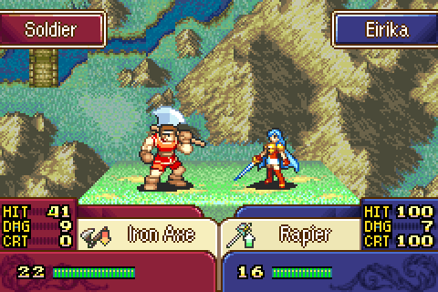

# Critical Cut-in

  

---

## 📑 Index
- [Introduction](#introduction)
- [How It Plays](#how-it-plays)
- [Editing the Band](#editing-the-band)
- [Code Locations](#code-locations)
- [Limitations & Bugs](#limitations--bugs)

---

## 🧩 Introduction

Critical hits get a portrait cut-in in the battle animation, in the style of Lex Talionis' FE7 remake. Just before the critical attack, an electric band opens across the middle of the screen with the attacker's portrait held still in it, above the attacker's battle animation. Then the band closes and the attack plays as normal.

The cut-in is gated behind `gpKernelDesignerConfig->crit_cutin` (on by default). With it off, critical hits play exactly as vanilla.

## 🎬 How It Plays

- The cut-in plays for a round that is a critical hit when the attacker has **its own portrait** (`portraitId` in its character data). Generic units, who only have their class card, attack without one.
- It runs at the start of the attack (banim command `C07`), after any HP cost and skill activation boxes, while the attacker's animation is held.
- The band opens with a white flash line, crackles for 48 frames (about 0.8 seconds), then closes: 58 frames in all.
- The band is 80px tall, the full height of a portrait, and fills the space between the battle name boxes and the UI panels (y 27-106).
- The portrait stays still, centred on the attacker's battle animation (kept fully on screen) and standing on the band's bottom border, while the band is fully open, and is gone before it closes. Attackers on the left are flipped so they face right.
- Both battle sprites are hidden under the band while it plays and come back when it closes.
- For combo attacks, the combo partner's portrait is used for its round.

## 🎨 Editing the Band

The band frames are a spell BG animation in [`Contents/EfxAnim/Source/CritCutin`](../../Contents/EfxAnim/Source/CritCutin):

- `generate_crit_cutin.py` draws the frames (`CritCutin_*.png`) with a fixed seed, so rerunning it gives the same frames. Change its palette, bolt counts or band position and run it again.
- `CritCutin.efx.txt` is the frame list (duration and PNG per line), which the build turns into the `EfxCritCutin` table with the other efx animations. Repeating a PNG costs no extra ROM.
- Frames are 240x160, 16 colours with colour 0 transparent, and must stay within 256 unique 8x8 tiles. A full 80px band would be 300 tiles, so the generator keeps everything that varies across the screen (bolts, arcs, speed lines) in tile rows 4-11 (y 32-95, 240 tiles). The rows above and below hold only the border and gradient, which are the same all the way across and reduce to one tile per row.

The portrait's position and the frames it shows on are in the enum at the top of `CritCutin.c`. They are tied to the band's position and to the 6-frame open and 4-frame close in the frame list, so change them together.

## 🗂️ Code Locations

| Feature | Location | Description |
|--------|----------|-------------|
| Designer config field | `crit_cutin` in [`kernel-lib.h`](../../include/kernel/kernel-lib.h) | On/off. |
| Default value | `gKernelDesigerConfig` in [`designer-config.c`](../../Data/DesignerConfig/designer-config.c) | On by default. |
| Hook | `C07Handler_CritCutin` in [`C07.c`](../../Kernel/Wizardry/BanimHack/Source/C07.c) | Starts the cut-in at attack start and waits for it, after the HP cost and skill boxes. |
| Cut-in | [`CritCutin.c`](../../Kernel/Wizardry/CritCutin/Source/CritCutin.c) | Checks the round, plays the band on BG1 through the spell BG helpers, shows the portrait (a face sprite in the battle face slot) and hides the battle sprites. |
| Band frames | [`Contents/EfxAnim/Source/CritCutin`](../../Contents/EfxAnim/Source/CritCutin) | Generator, PNG frames and frame list for `EfxCritCutin`. |

The module lives in `FreeSpaceDEMO` (`WIZARDRY_CUSTOM` in `wizardry.event`). Only the `C07` hook is in kernel `.text`.

## 🐛 Limitations & Bugs

- No cut-in at far-far range (siege tomes and the like). The small far animation shown there stays on screen and shares the face palette.
- `Patches/PATCH_DesignerConfig.txt` does not list `crit_cutin` (it was already behind the struct before this feature).

Please report any issues in the repository's Issues tab.
