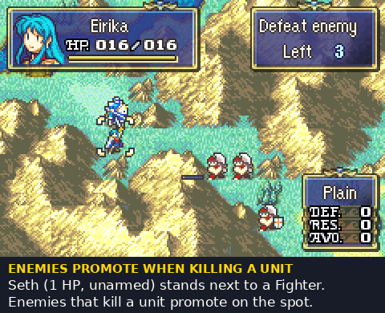

# Enemies Promote When Killing a Unit

  

---

## 📑 Index
- [Introduction](#introduction)
- [Plan](#plan)
- [Code Locations](#code-locations)
- [TODO](#todo)
- [Limitations & Bugs](#limitations--bugs)

---

## 🧩 Introduction

`gpKernelDesignerConfig->promote_enemies_on_kill`

Inspired by the **Shiren the Wanderer** DS games, this feature allows enemy units to **promote** when they successfully kill one of your units.

If the enemy has at least one valid promotion option, they immediately transform into their promoted class—granting them their promotion bonuses and custom bonuses on top (by default an omni boost of +3 determined by the value of     ``ONFIG_ENEMY_PROMOTION_BOOST``).

---

## 🛠️ Plan

When an enemy unit defeats a player unit:

- If the enemy has **promotion options**, they automatically promote  
- They gain flat stat boosts (default: **+3 to all stats**)  
- The boost amount can be modified using:  ``CONFIG_ENEMY_PROMOTION_BOOST``

This creates dynamic, high-tension gameplay: careless unit deaths now empower the enemy forces.

Only a real kill promotes. The battle forecast and the AI's target choice simulate battles (`BATTLE_CONFIG_SIMULATE`),
and a simulated kill no longer promotes the enemy.

### Map effect

The promotion has its own short effect on the map, after the action, instead of the promotion animation:

1. The camera moves onto the enemy.
2. Its old class's map sprite fades to white (`StartMuFadeIntoFlash`) with a shimmer sound.
3. The new class's sprite takes its place with a white flash (`StartMuHitFlash`) that fades back to its colours.
4. A popup reads "Enemy *Old class* promoted to *New class*" ("Enemy Fighter promoted to Warrior"), the classes in gold.

`BattleHit.c` queues the enemy in `gEnemyPromoFx` (its index, its old class and, for the popup, both classes' names,
15 characters each at most; `include/kernel/enemy-promo-fx.h`, 0x24 bytes from `_kernel_malloc2`, RAM only, so no save layout change). The post-action hook `PostAction_EnemyPromoFx`
(`Kernel/Wizardry/EnemyPromoFx/Source/EnemyPromoFx.c`, after `PostAction_AutoPromotion`) starts the effect as a blocking
proc. A chapter-init hook clears the queue.

---

## 🗂️ Code Locations

| Feature | Location | Description |
|--------|----------|-------------|
| **Enemy promotion logic** | `promote_enemy_on_kill` section inside `BattleGenerateHit` — [`BattleHit.c`](../../Kernel/Wizardry/BattleSys/Source/BattleHit.c) | Handles enemy auto-promotion after killing a player unit |
| **Map effect** | `PostAction_EnemyPromoFx` — [`EnemyPromoFx.c`](../../Kernel/Wizardry/EnemyPromoFx/Source/EnemyPromoFx.c) | The flash, the sprite change and the popup after the action |
| **Popup text** | `MSG_ENEMY_PROMOTED_ENEMY` ("Enemy") and `MSG_ENEMY_PROMOTED` ("promoted to") — end of [`Districts.txt`](../../Contents/Texts/Source/texts/Districts.txt) | |

---

## 📝 TODO

- Allow enemies with **multiple promotion paths** to pick randomly  
- Enemies who are **already promoted** should still gain stat boosts  
- Make stat gains **modular**, randomized, or defined via a struct  

---

## 🐛 Limitations & Bugs

Please report issues or enhancement requests in the repository’s **Issues** tab.

---

