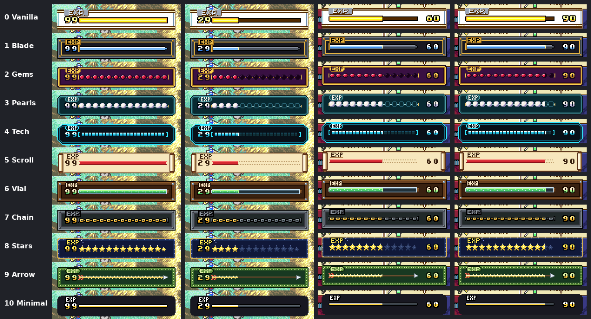
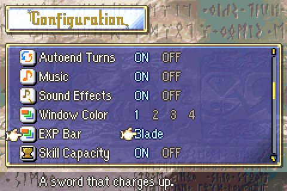

# EXP Bar Styles

  

---

## 📑 Index
- [Introduction](#introduction)
- [Styles](#styles)
- [Plan](#plan)
- [Adding a style](#adding-a-style)
- [Layouts](#layouts)
- [Testing](#testing)
- [Code Locations](#code-locations)
- [Limitations & Bugs](#limitations--bugs)

---

## 🧩 Introduction

The EXP bar that fills after a battle can take one of eleven looks. The player picks one on the Options screen, in the
**EXP Bar** row under Window Color: left and right go through the styles, and the help line describes each. Both EXP
bars follow it: the one on the map (battle animations off) and the one in a battle animation.

  

A new game starts on Vanilla. The choice is kept in the save with the other options.

---

## 🎨 Styles

| # | Style | Look |
|---|---|---|
| 0 | Vanilla | The original bar |
| 1 | Blade | A sword (crossguard, blade and point) whose blade charges from dull steel to glowing blue, a spark at the edge; iron frame with gold trim and rivets |
| 2 | Gems | Rubies in gold settings that light up from dark sockets; gold, rounded jewel-box window on purple velvet |
| 3 | Pearls | Pearls on a thread; unearned ones are empty rings; teal pill-shaped window |
| 4 | Tech | LED segments between brackets with a white cursor at the edge; cyan chamfered frame |
| 5 | Scroll | A red ribbon along a dotted pencil line on a parchment scroll with wooden rollers; inked "EXP" |
| 6 | Vial | A corked glass vial filling with bubbly green potion, on a dark wooden plank with nails; paper "EXP" tag |
| 7 | Chain | Chain links that turn from iron to gold, on a bolted iron plate |
| 8 | Stars | A row of stars lighting up across a night-sky window with a gold border |
| 9 | Arrow | A fletched arrow whose shaft glows from the feathers to the arrowhead, on green stitched leather |
| 10 | Minimal | A thin bar in a borderless dark window |

---

## 🛠️ Plan

Vanilla FE8 draws both EXP bars from the same four blocks: `Img_EkrExpBar` (the window: 9 frame tiles and 4 label
tiles), `Img_EkrExpBarChange` (24 tiles: every fill step of the bar's left cap, body tile and right cap),
`Img_BarNumfx` (the digits 0-9 and a blank) and `Pal_ExpBar`. A style is the same blocks, redrawn. The window tilemaps
(`gUnknown_089AD498` on the map, `Tsa_EkrExpBar` in battle) stay vanilla's, so every style has vanilla's layout.

- **The map bar.** `ProcMAExpBar_OnDraw` is rewritten in C (LynJump): it loads the chosen style's tiles, palette and
  window map, then calls vanilla's `DrawMAExpBar`, which places the fill steps and digits.
- **The battle bar.** Vanilla's `ekrBattleExecExpGain` and `ekrBattleWaitExpBarIdle` keep running. The installer points
  the battle proc's step at `ExpBarStyle_ExecExpGain` and `ExpBarStyle_WaitExpBarIdle`, which call vanilla first and
  then draw the same frame again from the style (the 13 bar tiles and 2 digits go to vanilla's buffer at
  `gEkrBarfxBuf + 0x100`, which is copied to VRAM at the next VBlank). With Vanilla they do nothing more.
- **The option.** `gPlaySt.config.exp_bar_style` (4 bits, from what were `custom_option_23`-`26`). The row shows one
  value, the style's name, instead of a list of selectors; `GetGameOptionRowCount` gives the number of styles.

### The art

Each style is a 64x64 indexed PNG in `Kernel/Wizardry/ExpBarStyles/Gfx/`: 8 tiles a row, the three vanilla blocks one
after the other (the window at tile 0, the fill steps at tile 28, the digits at tile 52), and its 16-colour palette
(colour 0 is transparent). The build makes a `.4bpp` and a `.gbapal` from it.

The PNGs are drawn by `Tools/expbar/expbar.py` from `Tools/expbar/styles.py`. A style there describes its parts, and
the script draws every tile:

- **The window**: border colours from the outside in, the inside colour, square, round or cut corners, and decorations
  (rivets, a dotted stitch line, or pixel art over the frame, as the Scroll's rollers are).
- **The label**: "EXP" in a bold or slim font, on a plate or straight on the frame.
- **The bar**: three 8x8 drawings (the left cap, a body tile, the right cap), each once full and once empty, and the
  column just after the fill. The script makes all 24 fill steps from them, column by column: full up to the fill, the
  edge column, empty after it. With vanilla's own full and empty bar this gives back vanilla's 24 tiles exactly.
- **The digits**: an original 5x6 font, in the style's colours.

---

## ➕ Adding a style

1. Add a dict to `STYLES` in `Tools/expbar/styles.py` (copy the nearest one; the file's docstring lists every key).
2. Run `python3 Tools/expbar/expbar.py --only <Name> --preview /tmp/expbar.png` and look at the preview.
3. In `Kernel/Wizardry/ExpBarStyles/ExpBarStyles_Installer.event`, add its `Img_ExpBarStyle_<Name>` and
   `Pal_ExpBarStyle_<Name>` labels; in `Source/ExpBarStyles.c`, add `EXP_BAR_STYLE_IMG(<Name>);` and an
   `EXP_BAR_STYLE(<Name>, "description")` row. The order of the rows is the order on the Options screen.
4. Build (`Tools/cloud/build.sh`), which makes the `.4bpp` and `.gbapal`, and commit the PNG with them.

The option has 4 bits: 16 values, so up to 15 styles besides Vanilla.

The PNGs can also be edited by hand in an editor that keeps the indexed palette. `expbar.py` overwrites them, so a hand-
edited style should be taken out of `styles.py`.

---

## 📐 Layouts

Every style uses vanilla's layout, because the code that places things does: the window is 3 tiles tall (17 wide on
the map, 18 in battle), the bar is one row of 13 tiles (8 pixels tall) in its middle row, and the two digits sit
left of the bar on the map and right of it in battle. Inside that, a style can change every pixel.

Each style row already carries its two window tilemaps (`tsa_map`, `tsa_battle`; all are vanilla's for now), so a style
can rearrange its 13 window tiles (with flips) without code. A different layout needs code:

- **A taller or wider window, or the label elsewhere**: more window tiles, and new tilemaps. On the map the window's
  tiles sit at VRAM tile 0x200 onward on BG0, in battle at 0x100 onward on BG1. Whether the tiles after them are free
  has not been checked.
- **A taller bar, two rows, or a vertical bar**: a new `DrawMAExpBar` (the map) and a new battle draw in place of the
  redraw in `ExpBarStyle_DrawBattleBar`, with a step table for the new shape.
- **Moving or animated parts** (a spark running along the fill, a glowing gem): OBJ sprites drawn each frame by a
  proc next to the bar.

---

## 🧪 Testing

`python3 Tools/cloud/smoketest.py --only expbar` sets the option in RAM and fights once on the map and once with battle
animations, for the second and the last style and for Vanilla. It checks that the map bar loads the style's palette
(bank 5), that the battle bar loads its palette (bank 1) and its 13 window tiles (VRAM `0x6002000`), and that Vanilla
keeps vanilla's palette in battle.

---

## 🗂️ Code Locations

| What | Where |
|---|---|
| Style table, map draw, battle redraw | `Kernel/Wizardry/ExpBarStyles/Source/ExpBarStyles.c` |
| LynJump (`ProcMAExpBar_OnDraw`), battle step pointers, art labels | `Kernel/Wizardry/ExpBarStyles/Source/LynJump.event`, `ExpBarStyles_Installer.event` |
| Style art (PNG, and the `.4bpp` / `.gbapal` the build makes) | `Kernel/Wizardry/ExpBarStyles/Gfx/` |
| Style definitions and the drawing script | `Tools/expbar/styles.py`, `Tools/expbar/expbar.py` |
| Option row | `GAME_OPTION_EXP_BAR` in `Kernel/Wizardry/MenuOptions/MenuOptions.c`; `Tools/FE-CLib-Mokha/include/uiconfig.h` |
| Option value | `exp_bar_style` in `struct PlaySt_OptionBits` (`Tools/FE-CLib-Mokha/include/types.h`) |
| Row title | `MSG_MENU_OPTION_EXP_BAR_TITLE` at the end of `Contents/Texts/Source/texts/Districts.txt` |
| Smoke test | `test_expbar` in `Tools/cloud/smoketest.py` |

---

## 🐛 Limitations & Bugs

- Style names and descriptions are C strings in the style table, not text messages, so they are not translated (the
  custom options' ON/OFF are the same).
- Every style keeps vanilla's layout (see [Layouts](#layouts)).
- In battle, vanilla draws its own bar first and the style's is drawn over it in the same frame, before VBlank: nothing
  of vanilla's shows, but a change to how vanilla queues the copies would need a look here.
