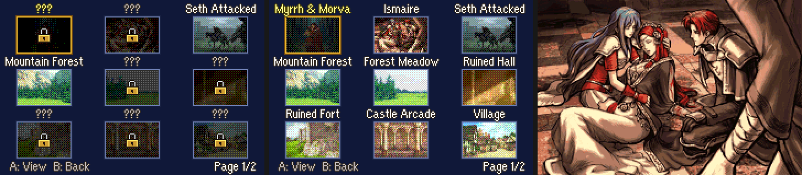

# Gallery

<p align="center">
  
</p>

---

## 📑 Index
- [Introduction](#introduction)
- [Adding a CG](#adding-a-cg)
- [Unlocking](#unlocking)
- [How it works](#how-it-works)
- [Testing](#testing)
- [Code Locations](#code-locations)
- [Limitations & Bugs](#limitations--bugs)

---

## 🧩 Introduction

**Extras > Gallery**, next to the Sound Room, shows the game's CGs:

- **The grid.** Nine CGs a page, 3x3, each a small version (48x32, a fifth of the CG) in a frame, its name above. The
  frame under the cursor is gold and glows. A CG not seen yet is dimmed, with a padlock, and "???" above it.
- **Moving.** The D-pad moves the cursor (it goes on to the next or previous page at the edges); L and R turn a page.
  The footer shows the page.
- **Full size.** A on an unlocked CG shows it full screen. Left and right go to the previous and next unlocked CG, around
  the ends; B goes back to the grid, on that CG.
- B on the grid goes back to Extras.

---

## ➕ Adding a CG

The Gallery shows the backgrounds listed in `gGalleryEntries` (`Data/Gallery/Gallery.c`), in that order:

```c
const struct GalleryEntry gGalleryEntries[] = {
	{ 0x38, MSG_GALLERY_CG_MYRRH_MORVA },
	...
	{ GALLERY_END, 0 },
};
```

1. Put the image in the background table first (`Kernel/Wizardry/Backgrounds_224_256_Colors/gfx/BG/BG.event`; see
   [Max Color Backgrounds](./MaxColorBackgrounds.md)). 16-, 224- and 256-colour backgrounds all work.
2. Add a row: its background index and a name message. Add the message at the end of
   `Contents/Texts/Source/texts/Districts.txt` (`## MSG_GALLERY_CG_...`, then the name and `[X]`).
3. Show it in an event (`TEXT_BG`, `TEXT_BG_HIDE_MAP`, `BACG` and the background fades), and it unlocks there.

At most 96 rows (`GALLERY_MAX`). The list starts with the three custom CGs (0x38-0x3A) and the ten vanilla backgrounds
the story shows so far. Its order is the unlock bits' order: insert a row in the middle and the unlocks already made
move to the rows after it, so add new CGs at the end.

---

## 🔓 Unlocking

A CG unlocks the first time an event shows its background, in any save file, and stays unlocked for all of them, as
the Sound Room's songs do. Event command `0x21` (`gEventLoCmdTableRe`) is `Gallery_Event21`: for `TEXT_BG` / `BACG`,
the background transition and the fade in, it unlocks the background, then runs vanilla's `Event21_TextBg`. A skipped
scene counts. The fade's "fade out" form passes background 0, so it unlocks nothing.

The unlocks are 96 bits behind a magic word ("GLRY") in the SRAM entry vanilla keeps for the e-Reader trial map's save
block (`gSram->saveBlockInfo[SAVE_ID_XMAP]`, 16 bytes at `0x0E0000C4`). This hack has no trial maps, and that entry
is only read by the trial-map check, which sees no trial map. It is outside the game and suspend saves, so the save
layout and its signature do not change, and erasing a file keeps them. Only wiping all of SRAM (vanilla's first boot)
clears them.

---

## 🛠️ How it works

- **The Extras row.** Vanilla's Map row (bit 4), which the [Creature Campaign](./WorldMapStoryChapters.md#the-postgame)
  no longer needs. Its label is drawn in the Extras label sheet (`Kernel/Wizardry/NewGamePlus/Gfx/Img_NgpMenuObjs.png`)
  where "Map" was. `InitSaveMenuChoice` adds it; the Extras list (`sub_80A9B90`) opens it like the Sound Room;
  `SaveMenuStartExtraMiscScreen` and `SaveMenuPostExtraMiscScreen` are rewritten with a case for it.
- **The thumbnails.** Each CG is drawn with the game's own loader (`EventShowTextBgDirect`, which Max Color Backgrounds
  hooks for 224- and 256-colour CGs) while the screen is dark, then read back: its tile map (`gBG3TilemapBuffer`), its
  tiles (VRAM) and the palette, four samples to a thumbnail pixel. The thumbnails are 256-colour sprites (a 32x32 and
  a 16x32 each): the OBJ palette holds a 6x6x6 colour cube (colours 16-231), and each pixel goes on the cube with a
  2x2 ordered dither. One thumbnail a frame; a page takes about 9 frames, behind a fade.
- **Why sprites.** The loader writes only the BG side (tiles, maps, the BG palette), so the thumbnails survive the full
  view: going back to the grid only redraws its text and frames. A new page makes new thumbnails.
- **The grid.** BG0 the names and the footer (`Text`), BG1 the frames (`Gfx/Img_GalleryFrame.png`, palettes 13 and
  14; 14 glows), sprites the thumbnails and the padlocks (`Gfx/Img_GalleryLock.png`, OBJ palette 15). Sprites use
  1D mapping while the Gallery is open.
- **The full view.** The loader again, on BG3 alone.

---

## 🧪 Testing

`python3 Tools/cloud/smoketest.py --only gallery`: the prologue's opening unlocks Mountain Forest (0x1D) and Seth
Attacked (0x3A) in SRAM; after a reset Extras has the Gallery row; its first page builds 9 thumbnails; A on a locked
CG does nothing; A on Mountain Forest shows it full size; right goes to Seth Attacked (around the end); B goes back to
the grid on it, and B again to Extras.

---

## 🗂️ Code Locations

| What | Where |
|---|---|
| The CG list | `gGalleryEntries` in `Data/Gallery/Gallery.c` |
| Unlocks, the event hook, the Extras screens | `Kernel/Wizardry/Gallery/Source/Gallery.c` |
| The screen | `Kernel/Wizardry/Gallery/Source/GalleryScreen.c` |
| LynJump, art, the event-table patch | `Kernel/Wizardry/Gallery/Source/LynJump.event`, `Gallery_Installer.event` |
| Frame and padlock art | `Kernel/Wizardry/Gallery/Gfx/` |
| The Extras row | `InitSaveMenuChoice` (`Kernel/Wizardry/ExtrasMenu/Source/SupportMenu.c`); `sub_80A9B90` (`Kernel/Wizardry/NewGamePlus/Source/NgpSaveMenu.c`) |
| Struct, constants | `include/kernel/gallery.h` |
| RAM | `gGalleryScreen` in `include/link/config-memmap.s` |
| Messages | `MSG_GALLERY_*` at the end of `Contents/Texts/Source/texts/Districts.txt` |
| Smoke test | `test_gallery` in `Tools/cloud/smoketest.py` |

---

## 🐛 Limitations & Bugs

- Thumbnails have 216 colours between them, dithered: fine detail and smooth gradients are rough at that size.
- Only backgrounds shown through event command `0x21` unlock. A CG drawn some other way (an ASMC, vanilla's CG
  table) needs a `0x21` command in its event too, or `Gallery_UnlockBackground(bg)`.
- The unlocks live outside the saves: copying a save to another cartridge does not carry them.
