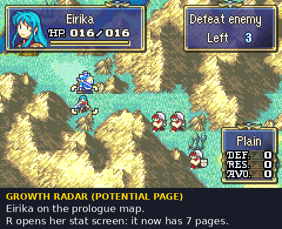
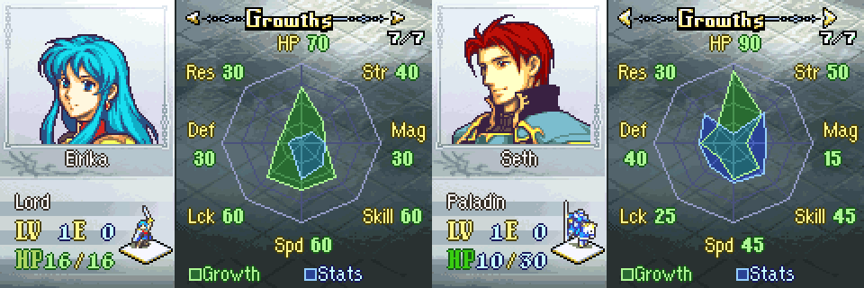

# Growth Radar

  

*In the prologue, R opens Eirika's stat screen and LEFT wraps to its new last page, Growths: the chart grows in from
the centre, her growths in green, her stats against their caps in blue. DOWN shows Seth (a Paladin, near his caps), R
gives the help of an axis and of the green layer. Options > Growths Page OFF takes the page away: 6 pages again.*

  

---

## 📑 Index
- [Introduction](#introduction)
- [Toggle](#toggle)
- [What the chart shows](#what-the-chart-shows)
- [How it works](#how-it-works)
- [Testing](#testing)
- [Code Locations](#code-locations)
- [Limitations & Bugs](#limitations--bugs)

---

## 🧩 Introduction

The stat screen has a new last page, **Growths** (page id 8, `PAGE_GROWTH_RADAR`): a radar ("spider") chart with one
axis per stat, an octagon with HP at the top and then, clockwise, Str, Mag, Skill, Spd, Lck, Def and Res.

- **Green layer: growth rates.** The chance each stat rises on a level-up, the same values the level-up rolls against
  (`GetUnitGrowthByStat`, `Kernel/Wizardry/ClassGrowths/Source/ClassGrowths.c`): with [Class Growths](./ClassGrowths.md)
  on they include the class's, and skills, Prestige and statuses that change growths count too. 100% reaches the
  chart's edge; a growth over 100% stays at the edge.
- **Blue layer: stats against their caps.** Each base stat as a share of its cap, the caps page 1's bars use (the
  class caps, `GetUnitMaxMagic` for magic, the class's luck cap, Limit Breaker's bonus; HP against its class cap). A
  capped stat reaches the edge.
- Where the two layers overlap the fill is teal; each layer has a bright outline.
- Beside each axis: the stat's name (gold) and its growth (green). A legend at the bottom names the two layers,
  Growth and Stats, each after a 7x7 swatch centred on its word.
- The grid has rings at 25%, 50% and 75% and a lighter ring at 100%; the lines show through the fills.
- The chart **grows in from the centre** over 16 frames when the page opens (it keeps going while the page slides
  in) and again when UP or DOWN changes the unit.
- **R** gives help: each axis shows the stat's own description, the legend's two entries explain the layers, and the
  left panel works as on the other pages.

The page counts and titles like the other optional pages (Magic List, Promotions...): it is the last page, so the
page number reads "7/7" with the default config, and "Growths" is its title sprite.

---

## ⚙️ Toggle

- **Designer config:** `stat_page_growth_radar` in [`designer-config.c`](../../Data/DesignerConfig/designer-config.c),
  on by default. Off, the page and its Options row are gone.
- **Options screen:** the last row, **Growths Page** (ON/OFF, its own radar icon, 0x52), **ON by default**, backed by
  `gPlaySt.config.growth_radar_off` (bit 7 of `PLAYST + 0x43`, the last spare bit, the old `unk43_7`; 1 = OFF, so a
  zeroed config, a new game or an older save, shows the page). `InitPlayConfig` sets it to 0. The bit is in the play
  state every save already keeps: **the save layout and its signature do not change.**
- The page and the row are also left out when growths are hidden (`lvup_stat_points` without `lvup_stat_timing`,
  `KernelLvupHidesGrowthDisplay`): there is no growth to chart.

`GrowthRadarEnabled()` (`include/kernel/growth-radar.h`) is the one check; `IsStatScreenPageEnabledByConfig`
(`HelpBox.c`) uses it, so `GetStatPageCount`, `TranslateStatPageId` and the page title follow.

---

## 📐 What the chart shows

| Axis | Growth | Stat | Cap |
| :--- | :----- | :--- | :-- |
| HP | `GetUnitHpGrowth` | max HP | `UNIT_MHP_MAX` |
| Str | `GetUnitPowGrowth` | `pow` | `UNIT_POW_MAX` |
| Mag | `GetUnitMagGrowth` | `UNIT_MAG` | `GetUnitMaxMagic` |
| Skill | `GetUnitSklGrowth` | `skl` | `UNIT_SKL_MAX` |
| Spd | `GetUnitSpdGrowth` | `spd` | `UNIT_SPD_MAX` |
| Lck | `GetUnitLckGrowth` | `lck` | `UNIT_LCK_MAX` |
| Def | `GetUnitDefGrowth` | `def` | `UNIT_DEF_MAX` |
| Res | `GetUnitResGrowth` | `res` | `UNIT_RES_MAX` |

Each cap has Limit Breaker's (or Limit Breaker+'s) bonus added when the unit has it, as on page 1.

---

## 🔧 How it works

1. `DisplayPage` (`Kernel/Wizardry/StatScreen/DrawPages/HelpBox.c`) calls `gStatScreenDrawPages[8]`,
   `DrawPageGrowthRadar` (`Kernel/Wizardry/GrowthRadar/Source/GrowthRadar.c`). It draws the labels and the legend in
   the page's BG0 scratch tilemap (text slots 15-20 and 29-34, which the other optional pages clear and reuse too),
   maps the chart's 12x12 tiles in its BG2 scratch tilemap (page tiles 3-14 by 2-13, BG palette 10), loads the
   palette, computes the eight growth and stat shares, and starts `ProcScr_GrowthRadar` under the stat screen proc.
2. The chart is a bitmap drawn into 4bpp tiles in `gGenericBuffer` and copied to BG2 VRAM:
   - the grid is a fixed image, `Img_GrowthRadarGrid` (`Gfx/Img_GrowthRadarGrid.png`, built to `.4bpp`), copied in
     first; `Gfx/make-grid.py` draws it with the C code's geometry (centre 47.5 pixels, radius 44);
   - each layer is a scanline fill: each edge adds its crossing to the rows it spans, each row's crossings are sorted
     and filled in pairs, eight pixels (a word) at a time, recolouring the grid lines it covers;
   - the edges are drawn with Bresenham lines; the two 1x2-tile legend swatches go after the chart's tiles.
3. Each frame the proc draws the next step of the growth (an ease-out over 16 frames) and ends on the last one, or as
   soon as the page shown is not Growths any more.

### VRAM and palettes

The stat screen has no free run of 148 BG tiles, so the chart takes three runs of BG2 tiles (character base
`0x06008000`) that no page shows, found by filling them with a pattern and paging through every page, with the help
boxes, for two units:

| Tiles | What was there |
| :---- | :------------- |
| `0x82-0x9F` | the blank end of the stat screen's sheet at `0x40` (`gUnknown_08A01F24`, decompressed by `StatScreen_InitDisplay`) |
| `0xA0-0xDF` | tiles left over from the map |
| `0x4F-0x7F` | the blank middle of the same sheet |
| `0x37-0x3F` | after the stat bars (`0x01-0x36`, `DrawStatBarGfx`), left over from the map |

`DisplayPage` puts the sheet back (`GrowthRadar_RestoreVram`, one decompress of 0xC00 bytes) whenever another page is
drawn, so a page that maps one of its blank tiles still finds it blank. The chart's colours are BG palette 10, which
no stat screen page uses. The portrait (BG2 tiles from `0xE0`), the help box (OBJ VRAM) and the text (BG0) are not
touched.

The title "Growths" is a new row of the page name sheet (`Data/StatScreen/Data/Gfx_StatScreenObj_9pages_new.png`,
now 256x64: OBJ tiles `0x300-0x33F`, which held only tiles left over from the world map), built from the sheet's own
letters (r, o, s from "Personal data", t from the old "Potential" title) and three drawn in the same style (G, w, h),
with the outline drawn round them the way the sheet's words have it. Its sprite is `Sprite_Page8NameRework` (`Data/StatScreen/Source/PageNameSprite.c`). The page
number sprite now shows 8 and 9 for the page count too (`PageNumCtrl_UpdatePageNum`).

### Cost

About half a frame for each of the 16 steps of the growth, nothing once it has grown (measured with `gbarun cyc`).

---

## 🧪 Testing

`python3 Tools/cloud/smoketest.py --only growthradar`: LEFT from the first page wraps to Growths (7 of 7), its
chart tile and palette are on BG2, both layers are drawn, the borrowed sheet tiles are blank again on the first page,
and with the Options row OFF there are 6 pages. By hand: Seth, an enemy (a Fighter), Class Growths on (growths over
100% shown, the layer at the edge), half-body portraits on, the designer config off (no page, no row) and stat points
on (no page, no row).

---

## 📂 Code Locations

| Feature | Location | Description |
| :------ | :------- | :---------- |
| Page | [`Kernel/Wizardry/GrowthRadar/Source/GrowthRadar.c`](../../Kernel/Wizardry/GrowthRadar/Source/GrowthRadar.c) | `DrawPageGrowthRadar`, the chart renderer, the growth proc, `GrowthRadar_RestoreVram` |
| R text | [`Kernel/Wizardry/GrowthRadar/Source/GrowthRadarHelp.c`](../../Kernel/Wizardry/GrowthRadar/Source/GrowthRadarHelp.c) | `RTextPageGrowthRadar` |
| Grid image | [`Kernel/Wizardry/GrowthRadar/Gfx/`](../../Kernel/Wizardry/GrowthRadar/Gfx/) | `Img_GrowthRadarGrid.png` and `make-grid.py`, which draws it |
| Installer | [`Kernel/Wizardry/GrowthRadar/GrowthRadar_Installer.event`](../../Kernel/Wizardry/GrowthRadar/GrowthRadar_Installer.event) | WIZARDRY_CUSTOM (FreeSpaceDEMO) |
| Toggle check | [`include/kernel/growth-radar.h`](../../include/kernel/growth-radar.h) | `GrowthRadarEnabled` |
| Page list | [`Kernel/Wizardry/StatScreen/data.event`](../../Kernel/Wizardry/StatScreen/data.event), [`include/kernel/stat-screen.h`](../../include/kernel/stat-screen.h) | `gStatScreenDrawPages[8]`, `PAGE_GROWTH_RADAR` |
| Page logic | [`Kernel/Wizardry/StatScreen/DrawPages/HelpBox.c`](../../Kernel/Wizardry/StatScreen/DrawPages/HelpBox.c) | config gate, `TranslateStatPageId`, `StartStatScreenHelp`, `DisplayPage` (bound and restore) |
| Page count and title | [`Kernel/Wizardry/StatScreen/DrawMorePage/Source/DrawMorePage.c`](../../Kernel/Wizardry/StatScreen/DrawMorePage/Source/DrawMorePage.c), [`Data/StatScreen/Source/PageNameSprite.c`](../../Data/StatScreen/Source/PageNameSprite.c) | `GetStatPageCount`, `DisplayPageNameSprite`, the page number digits; the title sprite |
| Options row | [`Kernel/Wizardry/MenuOptions/MenuOptions.c`](../../Kernel/Wizardry/MenuOptions/MenuOptions.c) | `GAME_OPTION_GROWTH_RADAR` (`Tools/FE-CLib-Mokha/include/uiconfig.h`), icon 0x52 in `FE8_All_System_Icons.png` |
| Text | [`Contents/Texts/Source/texts/Districts.txt`](../../Contents/Texts/Source/texts/Districts.txt) | the row's title and help, the legend, the two layers' help |

---

## ⚠️ Limitations & Bugs

- The VRAM runs were found by testing (Tools/cloud, two units, every page and help box). A feature that later draws
  into BG2 tiles `0x37-0x3F`, `0x4F-0x9F` or `0xA0-0xDF` of the stat screen would clash with the chart; tiles
  `0x40-0x9F` are restored when another page is drawn, the others are not.
- Stats are base stats: a temporary bonus (a tonic, a skill) does not grow the blue layer, as on page 1's bars.
- The chart's radius and centre are in both `GrowthRadar.c` and `Gfx/make-grid.py`; change both (and run the script).
- The labels are drawn with the message ids of page 1's labels (`0x4E9` HP ... `0x4F0` Res); a translation that makes a
  name much wider than "Skill" may need the label widths in `sGrowthRadarLabels` changed.
- The page reveals an enemy's growth rates as well, like page 1's growth toggle.
