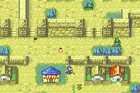

# Guild Board

<p align="center">
  
</p>

---

## 📑 Index
- [Introduction](#introduction)
- [Tokens](#tokens)
- [Quests](#quests)
- [Prizes](#prizes)
- [Records](#records)
- [Controls](#controls)
- [The Board on the Map](#the-board-on-the-map)
- [Adding Quests and Prizes](#adding-quests-and-prizes)
- [Save Data](#save-data)
- [Enabling and Disabling](#enabling-and-disabling)
- [Code Locations](#code-locations)
- [Limitations](#limitations)

---

## 🧩 Introduction

Each [district](./Districts.md) has a **guild board**, a small wooden notice board on its map next to the Hex shop.
Stand on it and press A: the board opens with three pages.

- **Quests**: the district's requests. Score so much in a minigame, catch so many kinds of fish, win battles, bring an
  item. A met quest is claimed here for tokens, and sometimes gold and an item.
- **Prizes**: items bought with tokens.
- **Records**: every minigame's bests on one page.

**Tokens** are the minigames' shared currency: every minigame pays some at its end, and so do quests. They tie the
district games to each other and to the main campaign.

---

## 🪙 Tokens

| Earned from | Tokens |
|---|---|
| [River Crossing](./Minigames/Crossing.md) | 1 per 100 points, at the end of a game (or when you leave with B) |
| [Tower Stack](./Minigames/Tower.md) | 1 per 20 points, the same way |
| [Fishing](./Minigames/Fishing.md) | 1 a catch; 3 for a new species or a record size; 10 for a legend |
| [Hex](./Minigames/Hex.md) | 5 for a win, 1 for a draw |
| [Snek](./Minigames/Snek.md) | 1 per 8 points (two coins) |
| A claimed quest | its reward |

- You can hold up to 9999 tokens. The board also counts the tokens earned in all (up to 65535): a quest can ask for it.
- The title line shows the tokens you hold.

---

## 📜 Quests

A board shows three quests at a time: the first three of its district's quests (and of the quests on every board) that
are not yet claimed, in the order of the table. Claim one and the next takes its place.

Each quest is two lines: the request, then its progress (`640 / 1500`) or **Done!**, and its reward. A met quest's
request is green.

A quest's progress is read from what the game already saves, so nothing has to be accepted or tracked:

| Kind | Progress | Parameter |
|---|---|---|
| `GUILD_QUEST_CROSSING_SCORE` | River Crossing's best score on a course | the course: 0 Serafew, 1 Port Kiris, 2 Caer Pelyn, 3 Jehanna Hall |
| `GUILD_QUEST_CROSSING_MEDAL` | that course's medal: 1 bronze, 2 silver, 3 gold | the course |
| `GUILD_QUEST_TOWER_SCORE` | Tower Stack's best score | |
| `GUILD_QUEST_SNEK_SCORE` | Snek's high score | |
| `GUILD_QUEST_FISH_SPECIES` | species in the fish journal (of 20) | |
| `GUILD_QUEST_FISH_LEGENDS` | legends caught (of 4) | |
| `GUILD_QUEST_FISH_RANK` | the angler's rank (0 Novice .. 4 Master) | |
| `GUILD_QUEST_HEX_CARDS` | cards in the Hex binder | |
| `GUILD_QUEST_WINS` | battles won (the battle records) | a character, or 0 for the whole army |
| `GUILD_QUEST_DELIVER` | copies of an item held by the army's units and in the convoy | the item; they are handed over when the quest is claimed |
| `GUILD_QUEST_TOKENS_EARNED` | tokens earned in all | |

A record you already hold counts: a quest posted after you reached it is met at once.

### The quests

| Board | Quest | Reward |
|---|---|---|
| Serafew | Score 800 in Serafew's crossing | 15 tokens |
| Serafew | Bring 2 Vulneraries | 10 tokens, 300 gold |
| Serafew | Catch 5 kinds of fish | 15 tokens |
| Serafew | Win 20 battles | 20 tokens, an Elixir |
| Serafew | Score 100 at Tower Stack | 15 tokens |
| Port Kiris | Earn a medal in Port Kiris's crossing | 15 tokens |
| Port Kiris | Reach the Angler rank | 20 tokens |
| Port Kiris | Hold 10 Hex cards | 15 tokens |
| Port Kiris | Bring a Pure Water | 15 tokens, 500 gold |
| Port Kiris | Score 40 at Snek | 15 tokens |
| Caer Pelyn | Score 1500 in Caer Pelyn's crossing | 25 tokens |
| Caer Pelyn | Land a legendary fish | 30 tokens, a Speedwing |
| Caer Pelyn | Win 60 battles | 30 tokens |
| Caer Pelyn | Earn 200 tokens in all | 20 tokens, 1000 gold |
| Jehanna Hall | Win gold in Jehanna's crossing | 50 tokens, a Master Seal |
| Jehanna Hall | Fill the fish journal | 50 tokens |
| Jehanna Hall | Hold 30 Hex cards | 30 tokens |
| Jehanna Hall | Win 150 battles | 50 tokens, an Energy Ring |
| Every board | Score 300 at Tower Stack | 30 tokens |
| Every board | Score 100 at Snek | 30 tokens |

---

## 🎁 Prizes

| Prize | Tokens | |
|---|---|---|
| Vulnerary, Antitoxin, Torch | 5 | |
| Door Key | 10 | |
| Pure Water | 15 | |
| Elixir | 25 | |
| Master Seal | 60 | |
| Each stat booster (Angelic Robe, Energy Ring, Secret Book, Speedwing, Goddess Icon, Dragonshield, Talisman) | 80 | once each |

- A prize you can't afford is grey. A one-time prize you bought shows **Sold out**.
- A, then A again, buys. The item goes to the unit, or to the convoy when its items are full.
- The page shows six prizes and scrolls.

---

## 📊 Records

| Line | What |
|---|---|
| Quests, Earned | quests claimed (of all), tokens earned in all |
| Crossing | the best score of each district's River Crossing course (S, P, C, J) |
| Tower, Snek | Tower Stack's best score, Snek's high score |
| Fishing, Journal | the angler's rank, species in the journal |
| Legends, Hex cards | legends caught, cards in the Hex binder |
| Battles | battles won by the army |

---

## 🎮 Controls

| Button | |
|---|---|
| L / R, LEFT / RIGHT | Turn the page |
| UP / DOWN | Move the hand |
| A | Quests: claim a met quest. Prizes: ask, then A again to buy |
| B | Leave |

The hint line at the bottom shows the page's buttons, and for a moment what just happened ("Quest complete! Reward
received.", "Not enough tokens.").

---

## 📍 The Board on the Map

| District | Board (x, y) |
|---|---|
| Serafew | (7, 18), beside the Hex shop |
| Port Kiris | (14, 14), east of the Hex shop |
| Caer Pelyn | (10, 9), by the Hex shop door |
| Jehanna Hall | (14, 6), west of the Hex shop |

- A board is `GUILD_BOARD(x, y)` in the district's `events/traps.c` (`TRAP_GUILD_BOARD`, 32, `bmtrick.h`).
- Rebuild the chapter's `events.lyn.event` after adding one: `traps.c` is included by `events.c`. In a cloud build run
  `make CustomCampaign/Chapters/<Name>/events/events.lyn.event` first; `Tools/cloud/build.sh` alone does not see the change.
- The marker is an 8x8 wooden board with white papers (two tiles at `MAPANIMFX_CHR_R + 0x22`, item icon palette 0),
  drawn by `DistrictNpc.c` with the other district markers. While a quest on that board is met and waiting, a red
  notice blinks on it.
- A on the board runs an event whose ASMC fades the map out, runs the board's screen and brings the map back, as the
  minigame spots do.

---

## ✍️ Adding Quests and Prizes

Both tables are in `Data/Guild/Guild.c`.

```c
QUEST(SERAFEW, GUILD_QUEST_CROSSING_SCORE, 0, 800, 15, 0, 0, MSG_GUILD_Q_SERAFEW_CROSSING),
/*    board    kind                        param target tokens gold item  its line            */
```

- `district` is the district chapter (`0x3B` Serafew, `0x3C` Port Kiris, `0x41` Caer Pelyn, `0x42` Jehanna Hall), or 0
  for every board. A board shows quests in table order, so put a district's easy ones first.
- At most 32 quests: each has a claimed bit in the save, by its place in the table. Add new quests at the end, so saved
  bits keep meaning the same quests.
- The quest's line is a message in `Contents/Texts/Source/texts/Districts.txt` (add it at the end of the file). Keep it
  under about 34 characters.
- Prizes: `{ .item = ITEM_X, .cost = N }`, and `.once = 1` for a one-time prize. One-time prizes have a bit each (16 at
  most), by their rank among the one-time prizes: add new ones at the end too.
- A new kind of quest: a `GUILD_QUEST_*` in `include/kernel/guild.h` and a case in `Guild_QuestProgress`
  (`GuildCore.c`) that reads the progress from saved data.

---

## 💾 Save Data

`gGuildSave` (`struct GuildSave`, 0x10 bytes, `include/kernel/guild.h`): a magic word, the tokens, the tokens earned
in all, the one-time prizes bought and the quests claimed (a bit each). It is a chunk in both save lists
(`Kernel/Wizardry/SaveData/data.event`), after Tower Stack's, and `Guild_NewGame` clears it on a new game. A save made
before the chunk existed loads an empty board. With it, the suspend save has 1371 bytes free and the game save 1149.

The screen's state is `gGuildScreen` (0x80 bytes, RAM only).

---

## ⚙️ Enabling and Disabling

The switch is `CONFIG_DISTRICT_GUILD` in `include/configs/configs.h` (on by default). Comment it out to remove the
board, its trap entry, its map markers, its save chunk and the minigames' token payouts. The boards stay in the trap
data but do nothing.

---

## 🗂️ Code Locations

| Feature | Location | Description |
|--------|----------|-------------|
| Installer | [`Guild_Installer.event`](../../Kernel/Wizardry/Guild/Guild_Installer.event) | Included from `Kernel/Wizardry/wizardry.event` (`WIZARDRY_CUSTOM`) |
| Rules | [`GuildCore.c`](../../Kernel/Wizardry/Guild/Source/GuildCore.c) | Tokens, quest progress and claiming, prizes, items, the save chunk |
| Screen | [`GuildScreen.c`](../../Kernel/Wizardry/Guild/Source/GuildScreen.c) | `ProcScr_GuildScreen`: the three pages |
| Map | [`GuildDistrict.c`](../../Kernel/Wizardry/Guild/Source/GuildDistrict.c) | `Guild_OnPressA`, `StartDistrictGuildASMC`, the marker |
| Tables | [`Guild.c`](../../Data/Guild/Guild.c) | `gGuildQuests`, `gGuildPrizes` |
| Header | [`guild.h`](../../include/kernel/guild.h) | Quest kinds, structs, the API |
| Token payouts | `Guild_AddTokens` in `CrossingScreen.c`, `TowerScreen.c`, `FishingScreen.c`, `HexScreen.c`, `Snek.c` | Each game's end |
| Trap type | [`bmtrick.h`](../../Tools/FE-CLib-Mokha/include/bmtrick.h) | `TRAP_GUILD_BOARD` (32) and `GUILD_BOARD(x, y)` |
| A-press hook | [`HookList.event`](../../Kernel/Wizardry/FreeMovement/cFreeMU/HookList.event) | `HookListFMU_TrapList_OnPressA` entry |
| Map markers | [`DistrictNpc.c`](../../Kernel/Wizardry/EnterTown/DistrictNpc.c) | `GUILD_CHR_MAP_BOARD` |
| Texts | [`Districts.txt`](../../Contents/Texts/Source/texts/Districts.txt) | `MSG_GUILD_*` |
| RAM | [`config-memmap.s`](../../include/link/config-memmap.s) | `gGuildSave`, `gGuildScreen` |
| Save chunk | [`data.event`](../../Kernel/Wizardry/SaveData/data.event) | `Guild_Save` / `Guild_Load` in both save lists, `Guild_NewGame` |
| Switch | [`configs.h`](../../include/configs/configs.h) | `CONFIG_DISTRICT_GUILD` |

---

## ⚠️ Limitations

- Progress counts what you have done in all, not since a quest was posted. A record set earlier meets a quest at once.
- A delivery counts every copy the army holds, including ones a unit has equipped; claiming takes them from the convoy
  first, then from the units.
- Tokens from minigames are paid without a pop-up in the games; the board's title line shows the total.
- Snek is not a district game, but its tokens and records still count.
