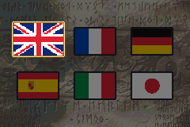

# Language Select

<p align="center">
  
</p>

After the health & safety, Nintendo and Intelligent Systems screens, the game shows a language selector before the title screen. It is a 2x3 grid of flags:

| | | |
| :-: | :-: | :-: |
| English | French | German |
| Spanish | Italian | Japanese |

- The D-pad moves the cursor. Left and right wrap within a row, and up and down switch rows.
- The selected flag is shown in full colour with a pulsing gold frame. It grows, lifts and floats a little. The other flags are darkened.
- A or START confirms the choice. The screen fades out and goes straight to the title screen. The opening cutscene still plays when the title screen is left idle.

The choice is saved in the global save header (`GlobalSaveInfo.unk10`, which vanilla never uses), so it survives resets and is preselected on the next boot.

## Using the language

The selector only records the choice. Translated text has to read it:

```c
#include "language-select.h"

if (GetKernelLanguage() == KERNEL_LANG_FRENCH)
	...
```

`SetKernelLanguage(lang)` changes it and writes it to SRAM.

## Config

Set `language_select` in [designer-config.c](../../Data/DesignerConfig/designer-config.c) to `false` to remove the screen and restore the vanilla boot (logos, opening cutscene, title).

## Code locations

- [LanguageSelect.c](../../Kernel/Wizardry/LanguageSelect/Source/LanguageSelect.c): screen, input and save
- [Img_LanguageSelectFlags.png](../../Kernel/Wizardry/LanguageSelect/Gfx/Img_LanguageSelectFlags.png): flag sheet, six 64x64 cells. The C palette table uses its indexed palette.
- [LanguageSelect_Installer.event](../../Kernel/Wizardry/LanguageSelect/LanguageSelect_Installer.event): replaces `ProcScr_GameEarlyStartUI` as the first child of `gProcScr_GameControl`
