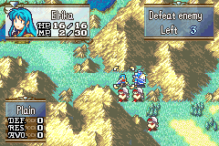

# Level Up Quotes

  

---

## 📑 Index
- [Introduction](#introduction)
- [Plan](#plan)
- [Code Locations](#code-locations)
- [TODO](#todo)
- [Limitations & Bugs](#limitations--bugs)

---

## 🧩 Introduction

``gpDesignerConfig->talk_on_level_up``

This feature adds a bit of personality to the level up screen by making units comment on their level ups

---

## 🛠️ Plan

Each unit has 3 quotes to speak based on how many points they gained in a level up.

- **0-2 points** -> Bad quote
- **2-5 points** -> Good quote
- **6+  points** -> Great quote

This feature makes use of the text engine rework ``CONFIG_TEXT_ENGINE_REWORK`` to display single line text boxes and thought bubbles, so make sure that remains enabled in ``configs.h``

---

## 🗂️ Code Locations

| Feature | Location | Description |
|--------|----------|-------------|
| **Level up quotes** | [`LevelUpQuotes.txt`](../../Contents/Texts/Source/texts/FE8_Rewritten/LevelUpQuotes.txt) | Holds all the text strings and labels for the quotes |
| **Level up quote struct** | `character_level_up_strings` in [`MapLvup.c`](../../Kernel/Wizardry/Lvupfx/Lvupfx/MapLvup.c) | The struct that we reference for the labels |
| **Quote display logic** | `LevelUpSpeech_*` in [`MapLvup.c`](../../Kernel/Wizardry/Lvupfx/Lvupfx/MapLvup.c) | Picks the quote from the stat-gain count in EVT_SLOT_9 (set in ``Levelup.c``) and shows it in a one-line box above the level-up window, spoken by the level-up portrait |

---

## 📝 TODO

- Nothing outstanding. The quote now shows in the normal text box above the level-up window, which stays on screen until the box closes, and the level-up portrait speaks it.

---

## 🐛 Limitations & Bugs

Please report issues in the repository’s **Issues** tab.

---
