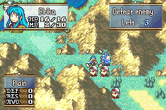

# Level Up Quotes

  

---

## 📑 Index
- [Introduction](#introduction)
- [Plan](#plan)
- [Code Locations](#code-locations)
- [TODO](#todo)
- [Limitations & Bugs](#limitations--bugs)

---

## 🧩 Introduction

``gpDesignerConfig->talk_on_level_up``

This feature adds a bit of personality to the level up screen by making units comment on their level ups

---

## 🛠️ Plan

Each unit has 3 quotes to speak based on how many points they gained in a level up.

- **0-2 points** -> Bad quote
- **2-5 points** -> Good quote
- **6+  points** -> Great quote

Poor quotes open with `[Sad]` and great ones with `[Happy]`: the level-up portrait changes to that expression when the
character has one (see [Portrait Expressions](PortraitExpressions.md#expressions-in-quotes)). In a `[LoadFaceFancy_X]`
quote the tag goes after `[FlipLeft]`, which is the rest of that command's arguments.

**With battle animations on**, the quote comes after the stats in the battle level-up screen (`ekrLevelup`), before
the window slides off: a one-line box above the window, its tail pointing at the level-up portrait, which takes the
quote's expression. A or B closes it early, as on the map. A promotion has no quote. How it fits in the battle screen
(`EkrLvup_Quote` in `MapLvup.c`):

- The step is vanilla's empty `EkrLvup_DoNothing`, after the stats are held. Its `PROC_REPEAT` in `ProcScr_EkrLevelup`
  points at `EkrLvup_Quote` (`Lvupfx/LynJump.event`). A jump in the 12-byte function itself would overwrite the next
  step, `EkrLvup_PutWindowOffScreen`, and the game would freeze there.
- BG0 is the battle HUD, drawn behind the window (BG1 frames, BG2 text). The talk prints into two BG0 rows below the
  screen (26-27), and each frame those cells are copied into the box on BG2. The box is on BG1, in rows 1-5, with BG1
  and BG2 scrolled to 0 while it is up (the window moves down 8 pixels).
- The glyphs and the box's 7 tiles go after the window's text, below tile 0x200. The talk's three lines share the
  first line's tiles (a quote is one line), and its nameplate is not drawn (`TALK_FLAG_NOBUBBLE`).
- The talk loads its text palette into bank 2, the HUD's. The text is shown in bank 5 with vanilla's text palette,
  and bank 2 is put back. The box is in bank 4. No battle tilemap uses banks 4 and 5.
- The talk blocks its parent, so a holder proc is its parent and the level-up proc keeps running to copy the text.
- Afterwards, the two BG0 rows, the three palette banks, the font and the scroll are put back from
  `gEkrLvupQuoteSave` (`include/link/config-memmap.s`).

This feature makes use of the text engine rework ``CONFIG_TEXT_ENGINE_REWORK`` to display single line text boxes and thought bubbles, so make sure that remains enabled in ``configs.h``

---

## 🗂️ Code Locations

| Feature | Location | Description |
|--------|----------|-------------|
| **Level up quotes** | [`LevelUpQuotes.txt`](../../Contents/Texts/Source/texts/FE8_Rewritten/LevelUpQuotes.txt) | Holds all the text strings and labels for the quotes |
| **Level up quote struct** | `character_level_up_strings` in [`MapLvup.c`](../../Kernel/Wizardry/Lvupfx/Lvupfx/MapLvup.c) | The struct that we reference for the labels |
| **Quote display logic** | `LevelUpSpeech_*` in [`MapLvup.c`](../../Kernel/Wizardry/Lvupfx/Lvupfx/MapLvup.c) | Picks the quote from the stat-gain count in EVT_SLOT_9 (set in ``Levelup.c``) and shows it in a one-line box above the level-up window, spoken by the level-up portrait |
| **Quote with battle animations** | `EkrLvup_Quote`, `EkrLvupQuote_*` in [`MapLvup.c`](../../Kernel/Wizardry/Lvupfx/Lvupfx/MapLvup.c); the `ProcScr_EkrLevelup` entry in [`LynJump.event`](../../Kernel/Wizardry/Lvupfx/Lvupfx/LynJump.event) | The same quote on the battle level-up screen, after the stats |
| **Smoke test** | `test_lvupanim` in [`smoketest.py`](../../Tools/cloud/smoketest.py) | Animations on: the quote is printed in its box, the portrait has its expression, and the battle ends on the map |

---

## 📝 TODO

- Nothing outstanding. The quote now shows in the normal text box above the level-up window, which stays on screen until the box closes, and the level-up portrait speaks it.

---

## 🐛 Limitations & Bugs

Please report issues in the repository’s **Issues** tab.

---
