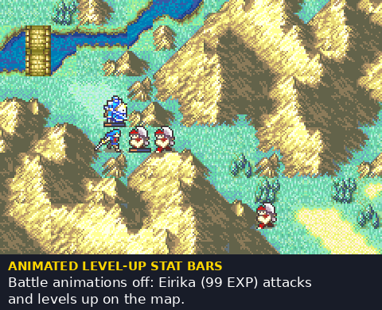

# Level-Up Stat Bars

  

*Eirika (99 EXP, Spd and Res at her Lord caps of 20 and 10, Str and Skl one short at 19) levels up twice from the same
state: on the map with battle animations off, then in the battle animation. Spd and Res start grey; HP and Skl go up
and their bars fill (the gained part green), and Skl, now at 20, turns grey with its label. Options > Level-Up Bars
OFF: the same level-up with no bars.*

---

## 📑 Index
- [Introduction](#introduction)
- [Toggle](#toggle)
- [What the bars show](#what-the-bars-show)
- [How it works](#how-it-works)
- [Testing](#testing)
- [Code Locations](#code-locations)
- [Limitations & Bugs](#limitations--bugs)

---

## 🧩 Introduction

Both level-up windows, the map's (battle animations off, BEXP, the debugger's level-up) and the battle animation's,
show a thin bar under each stat: the stat against its cap. As the level-up shows each gain, that stat's bar fills from
the old value to the new one, a point at a time, with a soft tick per point, while the "+N" shows as before. A stat
already at its cap is greyed: a full grey bar and a grey label. A stat that reaches its cap with this level-up turns
grey when its fill ends.

The caps are the ones the stat screen's bars use: the class caps (`UNIT_POW_MAX` and the others, `GetUnitMaxMagic` for
Mag, `UNIT_MHP_MAX` for HP) plus Limit Breaker / Limit Breaker+.

---

## ⚙️ Toggle

Two switches; the bars show only when both are on.

- **Designer:** `lvup_stat_bars` in `KernelDesigerConfig` (`include/kernel/kernel-lib.h`, the struct's last field),
  `false` (off) in `Data/DesignerConfig/designer-config.c`: set it to `true` to use the bars. Off: no bars, no grey labels, and no Options row. See
  [SystemConfig](./SystemConfig.md).
- **Player:** the Options screen's **Level-Up Bars** row (ON/OFF, icon 0x54: three small bars), the last row. It is
  `gPlaySt.config2.lvup_stat_bars_off` (bit 0 of `PLAYST + 0x21`, 0 = ON), the first bit of `config2`, the Options bits
  this feature added in the unused tactician-name bytes of `gPlaySt` ([MenuOptions](./MenuOptions.md#config2-more-options-bits)).
  ON in a new game and in saves from before it. Saved with the game and suspend saves; no save layout change. The row
  is hidden when the designer switch is off or the level-up screen is replaced (Allocate Stat Points, Timing Stat).

---

## 📐 What the bars show

| Bar | Meaning |
|---|---|
| Blue (light top row, darker bottom row) | The stat before the level-up, as a share of its cap |
| Green | The part this level-up added (the fill animates over it) |
| Navy | The rest of the way to the cap |
| Grey, and a grey label | The stat is at its cap |

A bar is 38 pixels wide (under the label and the value, five tiles). A point is `38 / cap` pixels: about 2 for a cap of
20, so a +1 is a short green step. HP's cap is 254 with `expanded_hp` on (this build's default; `UNIT_MHP_MAX`), so
HP's bar is short and a +1 HP does not move it by a whole pixel.

The fill moves a point every 4 frames (`LVUP_BARS_STEP`) with sound effect 0x66 (the menu cursor's tick) per point. On
the map the next stat starts `stat_gain_frame_speed` (10) frames after the previous one, so the fills overlap.

---

## 🔧 How it works

The windows draw a stat as a 3-tile gold label and a 2-tile blue value, each a `struct Text` with its own tiles. The
glyphs end on the lower tile's pixel row 4, so rows 6 and 7 are blank: the bar is drawn there, in the five lower tiles,
straight into BG VRAM (BG0 on the map, BG2 in the battle animation). Its colours are the system text palette's (bank 0
on both screens): the value's cyan and blue (8, 7), the green text's (14, 13), the grey text's (5, 4) and the digits'
navy outline (9) for the track. A glyph pixel already in those rows (the descender of Spd's "p") stays in front.

Being part of the text, the bars move with the window wherever it goes: the map's scroll in and out, the level-up
quote's row shift, the battle window's slide and its scroll for the quote. They need no OBJ tiles, OBJ palette or OAM
entries, which the battle screen has few of to spare (the window's "+N" labels, the portrait, the "xN" badge and the
battle animations use them).

A text redraw clears or replaces the tiles (a new value on the map is a new `Text`, so new tiles; the battle window's
`ClearText`s its own), so each change draws the bar again, finding the tiles through the tilemap buffer
(`LvupBars_Draw`). The state (old value, new value, cap, the fill's progress) is in a proc, `ProcScr_LvupBars`, a child
of the level-up proc, so it ends with the window:

- Map: `ManimLevelUp_InitMainScreen` starts it once the stats are drawn (`LvupBars_StartManim`), and
  `ManimLevelUp_PutStatGainLabels` starts a stat's fill after drawing its new value (`LvupBars_Gain`).
- Battle animation: `EkrLvup_InitStatusText` starts it for a level-up, not a promotion (`LvupBars_StartEkr`), and the
  replaced `EkrLvup_DrawUpdatedStatus` (vanilla's redraw of a stat's new value, called by `EkrLvup_MainAnime` every
  20 frames) starts the fill.
- The level-up quote ([LevelUpQuotes](./LevelUpQuotes.md)): before the map's talk shifts the window's tilemap rows, and
  before the battle's talk swaps the text font, `LvupBars_Finish` ends every fill at its new value and stops drawing.

Grey labels go through each window's label helper: `PutManimLevelUpLabel` (MapLvup.c) and `PutEkrLvupLabel`
(EfxLvup.c), which the windows also use for their gold labels.

Allocate Stat Points and Timing Stat Level-Up replace the level-up window with their own menus, so no bars appear there
(and the Options row is hidden while either is on). Promotions' stat boxes have no bars.

---

## 🧪 Testing

- `python3 Tools/cloud/smoketest.py --only lvupbars`: Eirika levels up with Spd at her cap, on the map and in battle
  animations. HP's bar holds the fill and track colours; Spd's bar and label are grey; with the Options row OFF there
  is no bar colour and Spd's label is gold.
- `lvupfont` (the map window's Mag digit is the promotion box's) leaves out the bar's two pixel rows; `lvupanim`,
  `battle` and `autopromo` (the quote, the portrait's palette, the automatic promotion) run with the bars on.

---

## 📂 Code Locations

| Feature | Location | Description |
|--------|----------|-------------|
| Bars | [`LvupStatBars.c`](../../Kernel/Wizardry/LvupStatBars/Source/LvupStatBars.c) | The proc, the caps, the drawing, the fills, `EkrLvup_DrawUpdatedStatus` |
| Installer | [`LvupStatBars_Installer.event`](../../Kernel/Wizardry/LvupStatBars/LvupStatBars_Installer.event) | `WIZARDRY_CUSTOM`; `Source/LynJump.event` replaces `EkrLvup_DrawUpdatedStatus` (`$738B8`) |
| Map window | [`MapLvup.c`](../../Kernel/Wizardry/Lvupfx/Lvupfx/MapLvup.c) | `PutManimLevelUpLabel`, `GetManimLevelUpLabelTm`; calls in `ManimLevelUp_InitMainScreen`, `ManimLevelUp_PutStatGainLabels`, `LevelUpSpeech_StartTalk`, `EkrLvup_Quote` |
| Battle window | [`EfxLvup.c`](../../Kernel/Wizardry/Lvupfx/Lvupfx/EfxLvup.c) | `PutEkrLvupLabel`; the start in `EkrLvup_InitStatusText` |
| Declarations | [`lvup.h`](../../include/kernel/lvup.h) | `LvupBars_*`, the label helpers |
| Designer switch | `lvup_stat_bars` in [`kernel-lib.h`](../../include/kernel/kernel-lib.h), [`designer-config.c`](../../Data/DesignerConfig/designer-config.c) | Off by default (set it to `true` to use the bars) |
| Options row | `GAME_OPTION_LVUP_STAT_BARS` in [`MenuOptions.c`](../../Kernel/Wizardry/MenuOptions/MenuOptions.c), `uiconfig.h` | Icon 0x54 in `FE8_All_System_Icons.png`; texts at the end of `Districts.txt` |
| Option bit | `struct PlaySt_OptionBits2` in [`types.h`](../../Tools/FE-CLib-Mokha/include/types.h) | `gPlaySt.config2.lvup_stat_bars_off`; zeroed in `WriteNewGameSave` |
| Smoke test | `test_lvupbars` in [`smoketest.py`](../../Tools/cloud/smoketest.py) | See Testing |

---

## ⚠️ Limitations & Bugs

- Small gains can be hard to see: a point is `38 / cap` pixels, and HP's cap is 254 with `expanded_hp` (a +1 HP moves
  its bar less than a pixel).
- A stat of 100 or more (drawn with shared UI digit tiles on the map) gets no bar.
- A grey label's descender in grey text uses palette index 5, one of the bar's colours, so the bar draws over that
  pixel (gold labels are not affected).
- The caps ignore Dismount's mounted-class caps (`CheckBattleUnitStatCapsVanilla`), as the stat screen's bars do.
