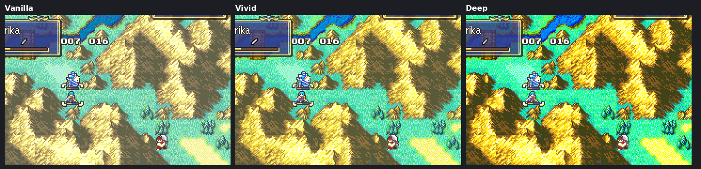

# Map Colors

  

---

## 📑 Index
- [Introduction](#introduction)
- [Modes](#modes)
- [Plan](#plan)
- [Tuning](#tuning)
- [Testing](#testing)
- [Code Locations](#code-locations)
- [Limitations & Bugs](#limitations--bugs)

---

## 🧩 Introduction

The map's colours can be changed from the Options screen. The **Map Colors** row sits right under **EXP Bar**, and has
three values: Vanilla, Vivid and Deep. Left and right go through them.

A new game starts on Vanilla. The choice is kept in the save with the other options.

Only the map tiles change. Their palettes are BG palettes 6-15, 160 colours in all. Units, menus and portraits keep
their colours.

---

## 🎨 Modes

| Mode | What it does |
|---|---|
| Vanilla | The map's original colours |
| Vivid | Richer, more saturated colours: saturation x22/16, contrast x17/16 around the middle |
| Deep | More saturated still, with darker mid-tones: saturation x26/16, contrast x19/16, then a curve `round(31*(i/31)^1.25)` on each 5-bit channel |

---

## 🛠️ Plan

The map palettes are loaded in two places. Both are rewritten in `Kernel/Wizardry/EnterTown/DistrictLife.c`, and both
call `MapColors_ApplyRange` and then `District_TintMapPalettes`:

- `UnpackChapterMapPalette`: the chapter start, and loading a save.
- `UnpackChapterMapGraphics`: the map redrawn after the Options and stat screens and after battles. This one is rewritten
  in C for this feature, replacing the literal-pool patch that `CustomCampaign/Event/PListSplit.event` used to make at
  `0x019968`. Before this, a district's time-of-day tint was lost after those screens; now it is kept.

The transform is `MapColors_Transform(color, mode)` in `Kernel/Wizardry/MapColors/Source/MapColors.c`, and
`MapColors_ApplyRange(pal, count)` runs it over a range of palette colours. Both are declared in
`include/kernel/map-colors.h`. The colours are computed from the 15-bit palette.

The map's palette animations (moving water and the like) are recoloured too. `BMapVSync_UpdateMapPalAnimations`
(vanilla `0x080300A4`) is rewritten in `MapColors.c` and hooked with `Kernel/Wizardry/MapColors/Source/LynJump.event`;
it recolours each animated colour it writes.

The value is `gPlaySt.config.map_colors`, a 2-bit field in `struct PlaySt_OptionBits` (it took `custom_option_27` and
`custom_option_28`). The row is `GAME_OPTION_MAP_COLORS` (38) in `Kernel/Wizardry/MenuOptions/MenuOptions.c`, and its
texts are `MSG_MENU_OPTION_MAP_COLORS_*` at the end of `Contents/Texts/Source/texts/Districts.txt`.

When the change shows: leaving the Options screen redraws the map, so the new colours show then. From the prep screen
or the world map, the colours show the next time a map is drawn.

---

## ⚙️ Tuning

The mode table `sMapColorsParams` in `MapColors.c` holds the saturation, contrast and curve for each mode.

To add a mode:

1. Add a value to the enum in `include/kernel/map-colors.h`, and a row for it in `sMapColorsParams`.
2. Add a fourth selector to the Options row (`GAME_OPTION_MAP_COLORS`).
3. If there are more than 3 values, the 2-bit field in `struct PlaySt_OptionBits` needs more bits.

---

## 🧪 Testing

`python3 Tools/cloud/smoketest.py --only mapcolors` (also run by `--quick`) sets Vivid and then Deep through the real
Options row, leaves the Options screen, and checks every one of the 160 map colours against a model of the transform.
It also boots a test ROM that gives the prologue Chapter 18's palette animation, and checks that the animated colours
cycle through the frames in its ROM data, and that with Deep set they are those frames recoloured.

---

## 🗂️ Code Locations

| What | Where |
|---|---|
| Transform, palette range apply, animation hook | `Kernel/Wizardry/MapColors/Source/MapColors.c` |
| LynJump (`BMapVSync_UpdateMapPalAnimations`) | `Kernel/Wizardry/MapColors/Source/LynJump.event` |
| Declarations | `include/kernel/map-colors.h` |
| Map palette loads (`UnpackChapterMapPalette`, `UnpackChapterMapGraphics`), tint | `Kernel/Wizardry/EnterTown/DistrictLife.c` |
| Option row | `GAME_OPTION_MAP_COLORS` in `Kernel/Wizardry/MenuOptions/MenuOptions.c` |
| Option value | `map_colors` in `struct PlaySt_OptionBits` (`Tools/FE-CLib-Mokha/include/types.h`) |
| Row texts | `MSG_MENU_OPTION_MAP_COLORS_*` at the end of `Contents/Texts/Source/texts/Districts.txt` |
| Smoke test | `--only mapcolors` in `Tools/cloud/smoketest.py` |

---

## 🐛 Limitations & Bugs

- The colours are computed from the 15-bit palette, so very dark or very bright colours can clip.
- Deep is strong on maps that are already saturated.
- Fog-of-war palettes (if a map uses banks 11-15 for fog) are recoloured the same way as the rest.
- Palette animations are recoloured: on a map whose palette animates (the smoke test gives the prologue Chapter 18's
  animation, palette entries 0x9C-0x9F), every animated colour in Deep is the transformed colour of a frame in its ROM
  data.
- The Vesly debugger's chapter jumps ("Jump to ch.", "Save & restart ch.") keep the previous chapter's map animations:
  the new chapter's palette animation does not start, and the old chapter's tile animation goes on. This is a debugger
  quirk that predates Map Colors; normal chapter starts set the animations up correctly.
