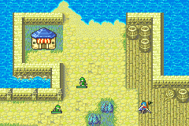
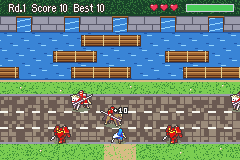
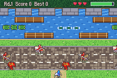

# River Crossing

  

---

## 📑 Index
- [Introduction](#introduction)
- [How to Play](#how-to-play)
- [Controls](#controls)
- [Score and Gold](#score-and-gold)
- [Game Feel](#game-feel)
- [District Twists](#district-twists)
- [Pickups and Helpers](#pickups-and-helpers)
- [Replay Goals](#replay-goals)
- [The Courses](#the-courses)
- [Crossing Spots](#crossing-spots)
- [The Screen](#the-screen)
- [Art](#art)
- [Enabling and Disabling](#enabling-and-disabling)
- [Code Locations](#code-locations)
- [Limitations](#limitations)

---

## 🧩 Introduction

**River Crossing** is a lane-crossing minigame in the [districts](../Districts.md). A small red flag marks a crossing
spot in each district. Stand on it and press A: the map fades to a field of 15 x 10 cells. Your unit starts at the bottom
and must reach the five docks on the far bank:

- **The road**: three lanes of enemy riders. Armor Knights plod, Cavaliers trot, Paladins gallop. A rider that touches
  you tramples you.
- **The median**: a strip of grass. Safe.
- **The river**: three lanes of rafts drifting left and right. Stand on a raft and it carries you. Step into the water,
  or let the raft carry you off the edge, and you drown.
- **The docks**: five gaps in the far bank. Hop into an empty one to fill it. The bank between the docks blocks you.

Fill all five docks to clear the round. Each round is faster. You have three lives, and 30 seconds for each one.

The riders are the walking map sprites of real FE8 classes, in the enemy colours. Your unit hops with its own walking
sprite, facing the way it moves.

---

## 🎮 How to Play

1. Press a direction to start. Each press hops one cell (8 frames).
2. Cross the road between the riders. A hop counts as the new cell once it is halfway there.
3. Wait on the median for a raft, then hop onto it. While on a raft you drift with it. You can hop along a raft too.
4. From the top river lane, hop up into an empty dock. You need to be within 10 pixels of it; the hop lines you up.
5. You start again at the bottom. Fill all five docks: **CLEAR!**, a bonus, and the next round.

Losing a life: **OUCH!** (a rider, or the time running out) or **SPLASH!** (the water). With no lives left: **GAME OVER**,
and your score is paid out in gold.

---

## 🕹️ Controls

The buttons that do something show at the bottom of the screen before you start, while paused and at the end. They
keep clear of the start cell in the middle.

| When | Buttons |
|---|---|
| Before you start | D-pad: hop (starts the game), B: exit, R: records, START: pause |
| Playing | D-pad: hop, B: exit, START: pause |
| Paused | START: resume, B: exit |
| Game over | A or B: done |
| Records | A, B or R: close |

**B leaves at any time** and pays out the score so far.

Before you start, the top line shows this story chapter's challenge for the district (see [Replay Goals](#replay-goals)),
or "Cross the road and the river!" once it is met. START still pauses there, but its label makes room for R.

The top line shows the round, the score and the best score for this district. The hearts are your lives. The bar at the
top right is the time left for this life; it turns red under 10 seconds.

---

## 💰 Score and Gold

| For | Points |
|---|---|
| Each row you reach for the first time in a life | 10 |
| Filling a dock | 50, plus the seconds left |
| Clearing a round (all five docks) | 250 |
| Clearing it without losing a life: **PERFECT!** | 500 more |
| A coin riding a raft | 50 |
| Bringing a lost child to a dock: **RESCUED!** | 200 more for that dock |
| A dock with a star: **BONUS!** | double that dock's points |

The gold paid out is the score divided by 10 (rounded down), when the game ends or when you leave with B.

The best score of each district is saved. It is `gCrossingRecords` (`struct CrossingRecords`, 0x0C bytes,
`include/kernel/crossing.h`): a magic word and four best scores (up to 65535). It is one chunk at the end of both save
lists (`Kernel/Wizardry/SaveData/data.event`), after the fishing records, and `CrossingRecords_NewGame` clears it on a
new game. A save made before the chunk existed loads no records. The suspend save had 32 bytes free after it when it was added.

The district progress is a second chunk right after it, `gCrossingProgress` (`struct CrossingProgress`, 0x10 bytes): a
magic word, the fastest round 1 of each district (seconds), the milestone bits and the story chapter whose challenge was
met in each district. `CrossingProgress_NewGame` clears it. With it, the suspend save has 1387 bytes free and the game
save 1165.

---

## 💥 Game Feel

  

| Moment | What happens |
|---|---|
| A hop | The unit stretches taller as it takes off, then lands with a squash (wider and flatter, then back). |
| Landing on the ground | Two puffs of dust go out from its feet. |
| Landing on a raft | A ring of ripples spreads round it. |
| A new row | "+10" rises from the unit in small digits. |
| A near miss | Hopping out of a road lane just ahead of a rider, or a rider going by within 5 pixels: **CLOSE!**, a small jolt and a click. |
| A dock | Sparks fly from the dock, "+NN" (its points) rises, and a note plays: each dock filled in a row without losing a life plays the next note of a major scale. |
| A cleared round | CLEAR! (or PERFECT! with no life lost in the round, and a fanfare), the round's points rise, and the screen jolts. |
| Trampled | The game freezes for 10 frames (hit-stop), then shakes hard; OUCH! and sparks. |
| Drowned | The unit shrinks down into the water (24 frames) in a spray of droplets; SPLASH!. |
| Game over | The score counts up, ticking, before the gold shows; a district record pops up **NEW BEST!** after GAME OVER. |

- Near the top of the field, OUCH! and SPLASH! pop up under the unit, not over it, so the effect stays visible.
- The squash, the stretch and the sinking use one affine slot (2) for the unit, anchored at its feet; between them the unit
  is drawn as a plain sprite. The score pop-up uses its own small 3x5 digit font (`DIGIT`, 8x8 tiles, 5 pixels apart).
- The state for all of it is in `struct CrossingState` (`hitStop`, `chain`, `roundDeaths`, `nearCool`, `squash`, `dustT`,
  `rippleT`, `sinkT`, `shownScore`, `numTimer` and the rest), in what was its padding; the struct stays 0x100 bytes.

---

## 🐢 District Twists

  

Each district's course has its own twist on top of its lanes.

| District | Twist |
|---|---|
| Serafew | The middle river lane is a line of **turtles**. Each group dives in turn: it swims (160 frames), shows only its shell as a warning (40), then is under water (56) and holds nothing up. The groups are a third of a cycle apart. |
| Port Kiris | A **gull** swoops along a random row (river, median or road). A red "!" blinks at the left edge for 45 frames, then the gull flies right at 3 pixels a frame. Standing in its row within 10 pixels of it costs a life (a hop dodges it). The next gull comes 3 to 7 seconds later. |
| Caer Pelyn | The rafts are **ice floes** (an icy palette). A sideways hop onto a floe slides one more cell; a hop the player makes cancels a slide, and a slide never slides again. Sliding off the end of a floe drowns you. |
| Jehanna Hall | **Sandstorms** blow along a random road lane every 6 to 10 seconds for 3 seconds. After a 30-frame build-up its riders can't be seen; they still trample. |

- The twists' clocks (`tick`, the gull, the storm) are in `struct CrossingExtra` (`gCrossingExtra`, 0x80 bytes, RAM only).
  `Crossing_UpdateTwists` runs them every frame from `Crossing_UpdateLanes`; new gulls and storms only start in play.

---

## 🪙 Pickups and Helpers

| What | How it works |
|---|---|
| A coin | Rides a random raft cell for about 8 seconds (it blinks before it goes). Stand on it: 50 points. |
| A potion | Instead of a coin, one time in four while you have fewer than 5 lives. Stand on it: a life back, **1UP!** |
| A lost child | A villager rides a raft until you hop onto it; then it rides on your back. Reach a dock with it: 200 more points and **RESCUED!**. Lose a life and the child is lost; another turns up 10 seconds later. |
| A star dock | Now and then an empty dock shows a star for 6 seconds: fill it for double that dock's points, **BONUS!** |
| A skull dock | One time in three the dock shows a skull instead: hopping into it is a trap and costs a life. |

- Pickups and children never ride Serafew's turtles.
- The child is the `CLASS_CIVILIAN_M3` map sprite, in the green NPC palette, its side frames at OBJ tile `0x340`.

---

## 🏅 Replay Goals

| Goal | What you get |
|---|---|
| A medal per district | The best score earns bronze (500), silver (1200) or gold (2500). A new medal pops up **MEDAL!** at the end, instead of NEW BEST!, and the game-over line shows it. |
| The fastest round 1 | The time to clear round 1 is saved for each district, shown as m:ss on the records screen. |
| A district's first clear | An **Elixir**, to the unit or else the convoy. The top line says "First clear! Got an Elixir." |
| A district's first round 5 | A random stat **booster** (HP, Strength, Skill, Speed, Luck, Defense or Resistance). |
| The chapter's challenge | One per district per story chapter (`gWmStoryChapter`), worth **1000 gold** and **DONE!**, once a chapter. |

The challenge for a district is `(gWmStoryChapter + course) & 3`:

| Challenge | Met when |
|---|---|
| Fill docks left to right! | Round 1 is cleared with its docks filled left to right. |
| Clear round 1 in 60 secs! | Round 1 is cleared within 60 seconds. |
| Rescue a lost child! | A child is brought to a dock, in any round. |
| Clear round 1, no misses! | Round 1 is cleared without losing a life. |

- The rewards' messages take turns on the top line, 150 frames each.
- **The records screen**: R before you start. A window lists each district's best score, its medal and its fastest
  round 1; this district's name is green. A, B or R closes it.

---

## 🛣️ The Courses

Each district has its own course in `sCourses` (`Kernel/Wizardry/Minigames/Crossing/Source/CrossingScreen.c`). A lane is
riders or rafts, a direction, a count, a spacing and a speed. Rafts also have a length in cells.

| District | Course | Riders (Knight / Cavalier / Paladin) | Rafts (bottom / middle / top river lane) |
|---|---|---|---|
| Serafew | 0, the gentlest | 3 / 2 / 2, slow | 4, 3 and 4 cells long |
| Port Kiris | 1 | 3 / 3 / 2 | 3, 3 and 3 cells |
| Caer Pelyn | 2 | 4 / 3 / 3, faster | 3, 2 and 3 cells |
| Jehanna Hall | 3, the fastest | 4 / 3 / 3, fastest | 3, 2 and 2 cells |

- Each round adds 12% to every lane's speed, up to round 6.
- A lane's period (count x spacing) must be at least 304 pixels: the objects leave the screen before they come back.
- The course is chosen by the chapter (`Crossing_LevelOfChapter`): `0x3B` Serafew, `0x3C` Port Kiris, `0x41` Caer Pelyn,
  `0x42` Jehanna Hall. Any other chapter plays course 0.

---

## 📍 Crossing Spots

| District | Spot (x, y) |
|---|---|
| Serafew | (3, 15), the west end of the south street |
| Port Kiris | (19, 20), the south road east of the gate |
| Caer Pelyn | (15, 13), the east end of the plaza |
| Jehanna Hall | (16, 11), south of the hall |

- A spot is `CROSSING_SPOT(x, y)` in the district's `events/traps.c` (`TRAP_CROSSING_SPOT`, 30, `bmtrick.h`). Rebuild the
  chapter's `events.lyn.event` after adding one: `traps.c` is included by `events.c`.
- The flag on the map is drawn by `DistrictNpc.c`, with the gate arrows and the fishing bobbers. It only shows in districts.
- A in free movement runs the trap before any talk event, so an NPC next to the spot does not get in the way.

---

## 🖥️ The Screen

| Layer | What |
|---|---|
| BG3 | The field (BG palette 8, tiles at `0x06008000`) |
| BG0 | The status line (top) and the button labels (bottom), with no window behind them |
| BG1 | The records window (the UI frame, priority 1); off otherwise |
| OBJ (1D) | The rafts, the riders, the unit (affine while it squashes or sinks), the dock flags, the turtles, the gull and its warning, the sand, the coins and potions, the child, the star or skull dock, the medals, the splash, sparks, droplets, dust and ripples, the pop-up word and the score digits, the hearts, the timer and the buttons |

- **OBJ tiles**: the art from 0 (138 tiles), the unit's walking sheet at `0x100` (12 frames), the pop-up word at `0x220`, the timer at
  `0x260`, the riders' side frames at `0x280` (3 classes x 4 frames), the lost child's at `0x340`. The riders' sheets are decompressed through the
  unit's slot first and their side frames copied out. Tiles from `0x380` up (the map's moving units) are not touched.
- **Palettes**: OBJ 2 the art, 3 the buttons and the timer, 5 the pop-up word, 6 the twists, pickups and medals, 7 Caer
  Pelyn's ice floes, 12 to 15 the unit sprites (the unit in its own colour, the riders in red, bank 13, the child in green,
  bank 14).
- **A walking district NPC** is a MU that draws itself from OBJ VRAM, and the NPC proc does not run during an event. The
  map fade wrapper calls `DistrictNpc_EndWalk` first, so no garbled NPC shows. The fishing wrapper does the same.
- The state is `gCrossingState` (`struct CrossingState`, 0x100 bytes) and `gCrossingExtra` (`struct CrossingExtra`, 0x80
  bytes: the twists, pickups, challenge and the records window's texts), both RAM only.
- The screen resets the colour effects when it opens: the map can leave alpha blending on, which would make the records
  window see-through.

---

## 🎨 Art

All the art is drawn by `Tools/crossing/gen_crossing_art.py`, pixel by pixel. It uses the fishing art's helpers
(`Tools/fishing/gen_fishing_art.py`): the button icons, the pop-up word font and the sparks.

- It writes `Kernel/Wizardry/Minigames/Crossing/Source/CrossingArt.c` and `include/kernel/crossing-art.h` (the field's
  rows, the dock columns, the sprite tile offsets). Don't edit them: change the script and run it again.
- Sprites: the raft pieces, the splash, sparks, the dock flag, the heart, the buttons, and for the game feel the landing
  dust (3 frames), the raft ripple (16x8, 2 frames), water droplets and a small 3x5 digit font (0-9, "+", "x"). For the twists, pickups and goals: a turtle (2 swimming frames and a diving one), a gull (2 frames), the "!" warning, sand
  (2 frames), a coin (2 frames), a potion, a star (2 frames), a skull, the three medals and an R button. They use their own
  palette (`FX2`); the ice floes are the raft pieces in an icy palette (`ICE`).
- Pop-up words: HOME!, CLEAR!, OUCH!, SPLASH!, GAME OVER, CLOSE!, PERFECT!, NEW BEST!, 1UP!, BONUS!, RESCUED!, DONE! and
  MEDAL!.
- `--check` exits 1 if the files are out of date. `--preview PATH.png` writes a 3x preview.

---

## ⚙️ Enabling and Disabling

The switch is `CONFIG_DISTRICT_CROSSING` in `include/configs/configs.h` (on by default). Comment it out to remove the
game, the A-press trap entry, the map flags and the two save chunks. The spots stay in the trap data but do nothing.

---

## 🗂️ Code Locations

| Feature | Location | Description |
|--------|----------|-------------|
| Installer | [`Crossing_Installer.event`](../../../Kernel/Wizardry/Minigames/Crossing/Crossing_Installer.event) | Included from `Kernel/Wizardry/wizardry.event` (`WIZARDRY_CUSTOM`) |
| Game | [`CrossingScreen.c`](../../../Kernel/Wizardry/Minigames/Crossing/Source/CrossingScreen.c) | `ProcScr_CrossingScreen`, the states, `sCourses` |
| Records | [`CrossingRecords.c`](../../../Kernel/Wizardry/Minigames/Crossing/Source/CrossingRecords.c) | The save chunks (best scores; fastest clears, milestones, challenges), the medals and the new-game hooks |
| District glue | [`CrossingDistrict.c`](../../../Kernel/Wizardry/Minigames/Crossing/Source/CrossingDistrict.c) | `Crossing_OnPressA`, `StartDistrictCrossingASMC`, the map flags |
| Art | [`CrossingArt.c`](../../../Kernel/Wizardry/Minigames/Crossing/Source/CrossingArt.c) | Generated by `Tools/crossing/gen_crossing_art.py` |
| Header | [`crossing.h`](../../../include/kernel/crossing.h) | `struct CrossingState`, `struct CrossingRecords`, `struct CrossingExtra`, `struct CrossingProgress` |
| Trap type | [`bmtrick.h`](../../../Tools/FE-CLib-Mokha/include/bmtrick.h) | `TRAP_CROSSING_SPOT` (30) and `CROSSING_SPOT(x, y)` |
| A-press hook | [`HookList.event`](../../../Kernel/Wizardry/FreeMovement/cFreeMU/HookList.event) | `HookListFMU_TrapList_OnPressA` entry |
| Map flags, NPC walks | [`DistrictNpc.c`](../../../Kernel/Wizardry/EnterTown/DistrictNpc.c) | The flags, and `DistrictNpc_EndWalk` |
| Texts | [`Districts.txt`](../../../Contents/Texts/Source/texts/Districts.txt) | `MSG_CROSSING_*` |
| RAM | [`config-memmap.s`](../../../include/link/config-memmap.s) | `gCrossingState`, `gCrossingRecords`, `gCrossingExtra`, `gCrossingProgress` |
| Save chunks | [`data.event`](../../../Kernel/Wizardry/SaveData/data.event) | `CrossingRecords` and `CrossingProgress` in both save lists, and their new-game hooks |
| Switch | [`configs.h`](../../../include/configs/configs.h) | `CONFIG_DISTRICT_CROSSING` |

---

## ⚠️ Limitations

- The far-left dock is the hardest: the top river lane drifts right in most courses, away from it. Catch a raft as it
  enters from the left edge.
- The unit's walking sheet must unpack to 0x2200 bytes or less (all vanilla classes do). A class with a bigger sheet, or
  none, uses the Cavalier's.
- The flags on the map are only drawn in districts.
- Each challenge is checked in the one game it is met in: a round 1 cleared on an earlier visit does not count.
- The records window covers the lanes; the rafts and riders are not drawn while it is open (they would show through the
  medals), so the field's left and right edges look empty for that moment.
- The gull can pick the median or a raft row; standing still in its row is what costs the life, so a hop in time dodges it.
