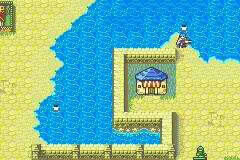
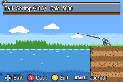

# District Fishing

  

---

## 📑 Index
- [Introduction](#introduction)
- [How to Play](#how-to-play)
- [Controls](#controls)
- [The Fish](#the-fish)
- [Bait](#bait)
- [Reeling and Bonuses](#reeling-and-bonuses)
- [Effects](#effects)
- [Species, the Catch Card and the Journal](#species-the-catch-card-and-the-journal)
- [Fishing Spots](#fishing-spots)
- [The Screen](#the-screen)
- [Adding a Fishing Spot](#adding-a-fishing-spot)
- [Art](#art)
- [Enabling and Disabling](#enabling-and-disabling)
- [Code Locations](#code-locations)
- [Limitations](#limitations)

---

## 🧩 Introduction

Every [district](../Districts.md) has a pool of water with a fishing spot next to it. A red and white bobber floats on the
water beside each spot. Stand on the spot and press A: the map fades out, and the unit walks in from the right onto a
grassy bank with a rod.

The water is deep: the screen scrolls down with the hook, to 40 m. Five kinds of fish swim at the depths that suit them,
the bigger ones deeper down, and a rare golden fish. Buy a bait, cast, wait for a bite, hook the fish and keep the line's
tension in the green zone until it is landed. A landed fish pays gold. Fast hooks and clean landings pay up to double.

Each district's water has its own five species, from minnows to a golden fish. Every catch gets a size and a catch card,
stamped **NEW!** for a first catch or **RECORD!** for the biggest yet, and goes into the **fish journal**: 20 species in
all, each shown as a silhouette until it is caught.

---

## 🎣 How to Play

1. **Pick a bait** with Left and Right. Each bait costs gold, paid when you cast. A bait you didn't lose stays on the hook,
   and casting it again is free.
2. **Cast** with A. The hook drops to the depth of your last cast.
3. **Set the depth** with Up and Down. The screen follows the hook. Small fish swim near the surface, huge ones near the
   bottom.
4. **Wait.** A fish that likes the bait and swims near the hook may turn to it and **nibble**: the bobber twitches. Don't
   press A and don't move the hook now, or it swims off ("You scared it off!").
5. **Hook it.** "!" shows over the unit and the bobber dips. Press A at once: within 8 frames is a **perfect hook**
   (+50%), within 14 a **good hook** (+25%). Wait too long and the fish swims away with the bait.
6. **Reel it in.** Keep the tension needle in the green zone (see [Reeling and Bonuses](#reeling-and-bonuses)). The fish
   and the hook rise as you make progress.
7. **Land it.** A splash, CAUGHT!, then the **catch card**: the species, its size and the payout ("Sea Bass!  +567G
   (x2.0)" on the top line). The bait is used up. See
   [Species, the Catch Card and the Journal](#species-the-catch-card-and-the-journal).

A reels the line in while you wait (the bait stays on). A fish that bites and then gets away takes the bait with it.
A fish you scare off during its nibble leaves the bait on the hook.

---

## 🎮 Controls

The buttons that do something right now float at the bottom of the screen, with no window behind them (as in the prep
screens). The window at the top keeps one line: what is going on.

| When | Buttons |
|---|---|
| Choosing a bait | Left/Right: bait, A: cast, B: exit, START: journal |
| Waiting | Up/Down: depth, A: reel in, B: exit, START: journal |
| A bite | A: hook it, B: exit |
| Reeling | A: reel, B: exit |
| The catch card | A: fish again, B: exit, START: journal |
| A message | A: OK, B: exit |
| Journal | Left/Right: water, B or START: close |

**B ends the minigame at any time** (a fish on the line is lost). The walk-in is the only moment it is ignored.

---

## 🐟 The Fish

Eight fish swim at a time. Each new fish rolls its kind from the odds below. They enter from the left edge, turn around
at the bank and leave on the left again.

| Fish | Shadow | Odds | Depth | Prize | Bite window | Green zone | Pull | Runs | Reel time |
|---|---|---|---|---|---|---|---|---|---|
| Small | 16x8 | 45% | 2 to 13 m | 40G | 30 frames | 25-85% | 0.31%/frame | none | 90 frames |
| Medium | 32x16 | 28% | 7 to 24 m | 120G | 24 frames | 30-75% | 0.44%/frame | 1 in 150 frames | 150 frames |
| Large | 64x32 | 15% | 18 to 34 m | 350G | 20 frames | 35-70% | 0.56%/frame | 1 in 120 frames | 220 frames |
| Huge | 64x32 | 7% | 28 to 39 m | 900G | 16 frames | 40-65% | 0.69%/frame | 1 in 100 frames | 300 frames |
| **Golden** | 32x16, gold | 5% | 13 to 38 m | **9000G** | 14 frames | 44-60% | 0.75%/frame | 1 in 80 frames | 360 frames |

- The **golden fish** is 5% of all fish. It is drawn in solid gold, not as a shadow, and swims fast. It only bites the
  golden lure, and pays 10 times the huge fish's prize.
- Depth is metres below the surface, 8 pixels to the metre.
- "Reel time" is how long the needle must stay in the green zone. The time limit is twice that plus 2 seconds.
- The table is `sFishTypes` in `Kernel/Wizardry/Minigames/Fishing/Source/FishingScreen.c`. Change the odds, the prizes
  and the difficulty there. The journal shows the same prizes.
- These are the five **kinds** of fish. Which species a kind is depends on the district's water (see below).

---

## 🪱 Bait

| Bait | Price | Small | Medium | Large | Huge | Golden |
|---|---|---|---|---|---|---|
| Worm | 10G | 100 | 50 | 15 | 5 | never |
| Shrimp | 40G | 40 | 100 | 70 | 35 | never |
| Golden lure | 150G | 10 | 35 | 100 | 100 | 100 |

The numbers are how readily each fish takes the bait: a fish near the hook turns to it on 1 frame in 40 at 100, and
never at 0. The price is paid on the cast. If you can't afford the bait, "You can't afford that bait." shows and nothing
is paid. The table is `sBaitTypes` in `FishingScreen.c`.

---

## 💪 Reeling and Bonuses

Three meters show at the top left while you reel:

| Meter | What it shows |
|---|---|
| **Tension** (the line icon) | The needle is the line's tension, 0 to 100%. The green part is the fish's zone. |
| **Progress** (the fish icon) | Fills while the needle is in the green zone. Full: the fish is landed. |
| **Time** (the clock icon) | Empties as you reel. It turns yellow while the fish runs. |

- Each A press raises the tension by 11%. The fish pulls it down every frame by its pull rate.
- During a **run** the fish pulls twice as hard, shakes on the line, and (large, huge and golden fish) jerks the tension
  by up to 6% either way every 8 frames. Runs last 40 frames.
- **100% tension snaps the line.** At **0% tension for a second** the line goes slack and the fish gets away. When the
  time runs out the fish wears you out and gets away. Each loses the bait.
- Bigger fish have smaller green zones and pull harder: a huge fish needs about 4 presses a second, at the right moments.

The payout is the fish's prize times the bonuses:

| Bonus | How | Adds |
|---|---|---|
| Perfect hook | A within 8 frames of the bite | +50% |
| Good hook | A within 14 frames | +25% |
| Clean landing | landed within 1.25 times its reel time (in the zone almost all the time) | +50% |
| Quick landing | landed within 1.5 times its reel time | +25% |

So the multiplier is x1.0 to x2.0, shown on the result line. The **size** then scales the payout from x0.75 (the
smallest of its species) to x1.25 (the biggest): an average catch pays the prize as before. A perfect catch of the
biggest golden fish pays 22500G.

---

## ✨ Effects

| When | What |
|---|---|
| A fish is hooked | A word zooms in, overshoots and settles, floats, then rises and blinks out: **PERFECT!** (gold) for a perfect hook, **GREAT!** (orange) for a good one, **HOOKED!** (blue) otherwise. Sparks burst from the hook and the screen jolts (longer for a perfect hook). |
| A fish is landed | **CAUGHT!** (green) and coins flying from the bobber. The golden fish gets **JACKPOT!** (gold), more coins, sparks and a long shake. |
| Casting | The rod swings back and forward as the hook drops. |
| Waiting | The rod sways slowly. It twitches while a fish nibbles. |
| A bite | The rod is yanked down, in jerks. |
| Reeling | The rod rises with the tension and bucks while the fish runs. Each A press gives it a small pull up. |

- **The rod** is an affine sprite turned about the unit's hand. Its angle eases a step towards the angle the moment wants
  each frame (1/8 of the way), so it moves smoothly and never jumps. The line hangs from the rod's tip: it slants from the
  tip to the bobber, then drops straight down.
- **The pop-up words** are two 64x32 affine halves sharing one scale matrix. Their art is in ROM and is copied into OBJ
  VRAM when a word pops (64 tiles), with its own palette.
- **The particles** (up to 16 sparks and coins) live in screen space, with gravity. The **shake** moves BG3 and the scene's
  sprites together; the window, the buttons, the meters and the pop-ups stay still.
- The pop-up and the particles are cleared when the journal opens.

---

## 📖 Species, the Catch Card and the Journal

  

**The waters.** Each district's water has its own species, one for each kind of fish. The water is chosen by the chapter
(`Fishing_WaterOf`); any other chapter fishes Serafew Pond.

| Water | Small | Medium | Large | Huge | Golden |
|---|---|---|---|---|---|
| Serafew Pond | Minnow, 4-9 cm | Perch, 15-35 cm | Carp, 35-80 cm | Pike, 70-130 cm | Gold Koi, 30-70 cm |
| Port Kiris Harbour | Sardine, 10-20 cm | Mackerel, 25-45 cm | Sea Bass, 40-90 cm | Tuna, 100-250 cm | Gold Bream, 25-55 cm |
| Caer Pelyn Pond | Loach, 8-15 cm | Trout, 25-50 cm | Char, 35-70 cm | Salmon, 70-120 cm | Golden Trout, 25-55 cm |
| Jehanna Oasis | Pupfish, 3-7 cm | Tilapia, 15-40 cm | Catfish, 60-140 cm | Arapaima, 150-250 cm | Gold Arowana, 60-100 cm |

- The kind still sets everything about the catch (odds, depth, bait, the fight, the prize). The species adds its name,
  its look and its size.
- **The size** is rolled when the fish is landed: two rolls in its range, averaged, so the middle is common and the ends
  are rare. It scales the payout (x0.75 to x1.25).

**The catch card.** Half a second after CAUGHT! (or at once with A) a card opens over the water: the fish's portrait, its
name (in gold for a golden species), its size, the best before it ("First catch!", "Best 43cm", or "Old best 28cm" when
it beats it) and the payout. A first catch is stamped **NEW!** in green, the biggest yet **RECORD!** in gold: the stamp
slams down tilted, with a fanfare, a jolt and sparks. A fishes again, START opens the journal, B leaves.

**The journal.** START opens it (while choosing a bait, while waiting, and on the catch card). It shows one water a page,
the district's own first; Left and Right turn the pages. The top line shows the water and how many of the 20 species are
found.

| Column | What |
|---|---|
| (icon) | The species, or its dark silhouette until it is caught |
| Fish | Its name, or "???" |
| Prize | Its kind's base prize |
| Caught | How many you have landed (up to 255) |
| Best | The biggest you have landed |

The journal is kept in the save: `gFishingRecords` (`struct FishingRecords`, 0x2C bytes, `include/kernel/fishing.h`), a
magic word, the catches and the best sizes of the 20 species. It is one chunk in both save lists
(`Kernel/Wizardry/SaveData/data.event`, `FishingRecords_Save` / `FishingRecords_Load`), and `FishingRecords_NewGame`
clears it on a new game.

- It replaced the prize table's records (catches and best payouts of the five kinds, 0x20 bytes). The magic changed, so
  a save from before the journal loads an empty journal. The old RAM slot is kept as `gFishingRecordsV1` so that no
  address after it moved; the journal's is at the end of the region.
- The suspend save has 16 bytes free after the chunks (0x3140 of 0x3150 used), the game save 0x4BD.
- The species' looks and sizes are drawn by `Tools/fishing/fish_species.py` (see [Art](#art)); their names are
  `MSG_FISHING_SP_*`, in `sSpeciesNames` (`FishingScreen.c`).

---

## 📍 Fishing Spots

| District | Spot (x, y) | Water | The pool |
|---|---|---|---|
| Serafew | (12, 2) | above | A pool added to the north-east corner (11..14, 0..1) |
| Port Kiris | (4, 16) | right | The harbour, from the west shore |
| Port Kiris | (13, 12) | above | The harbour, from the pier |
| Caer Pelyn | (3, 13) | above | A pond added on the west grass (2..4, 11..12) |
| Jehanna Hall | (9, 5) | above | The oasis |

- Serafew and Caer Pelyn had no water, so a pool was added to each map in its compose spec
  (`Tools/district/compose/<Name>.json`). The metatiles were picked with `Tools/district/pond.py`
  (see [Tools/district/README.md](../../../Tools/district/README.md)).
- The Caer Pelyn item giver used to stand where the pond is. She now starts at (9, 13).
- In free movement, A on a fishing spot runs the spot before any talk event, so a townsperson next to the spot does not
  get in the way. NPCs never step on a spot (a trap tile).

---

## 🖥️ The Screen

| Layer | What |
|---|---|
| BG3 | The scene, 240 x 448 (BG palette 8, tiles at `0x06008000`, a 256x512 map at `0x06007000`), scrolled with the hook |
| BG1 | The window frames (the one-line window at the top, the catch card, the journal) |
| BG0 | Their text |
| OBJ (1D) | The fish (shadows semi-transparent over BG3, the golden fish solid), the rod (affine), the line, the hook, the bait, the bobber, the splash, the unit, "!", the particles, the meters, the pop-up words (affine), the button icons, the card's portrait and stamp (affine), and the journal's icons |
| BG0 (bottom) | The button labels, rows 18-19, with no window behind them |

- **The unit** is the active unit (Eirika in the districts). It is drawn from its class's moving map sprite (walking
  sheet), decompressed straight into OBJ VRAM at tile `0x180`: it walks in with the side-walking frames and then stands
  facing the water. A class whose sheet is missing or bigger than 0x2200 bytes falls back to its standing sprite.
- **OBJ tiles**: the art from tile 0 (272 tiles), the pop-up word at `0x120` (64 tiles), the three meters at `0x160`
  (repainted every frame), the unit at `0x180`, the card's portrait (32 tiles) or the journal's five icons (8 tiles each)
  at `0x290`, and the card's stamp word at `0x2B0` (64 tiles). Tiles from `0x380` up are left alone: the map's moving
  units keep their graphics there. OBJ palettes 2 to 5 are the art's (FX, UI, GOLD, and the pop-up word's), 6 the
  portrait (6 to 10 the journal's icons), 11 the stamp, 12 to 15 the unit sprites'. Affine slots 0 (the rod), 1 (the
  pop-up) and 2 (the stamp).
- **The map** of BG3 is not at `0xF000` and up: the map's tile animations (the Port Kiris water) keep writing there while
  the map is suspended. Rows 0..31 of the scene map go through the BG3 buffer, rows 32..55 straight to VRAM.
- **Sprites** for the UI (the meters, the pop-up and the buttons) are pushed last, so they come first in OAM: the GBA lets a
  sprite earlier in OAM hide a later one even when the later one has the higher priority.
- The state is `gFishingState` (`struct FishingState`, 0x1A0 bytes, `include/kernel/fishing.h`), in the
  `_kernel_malloc2` region (`include/link/config-memmap.s`). It is RAM only, not saved. The window's eight texts live in
  it, not in the proc (a proc has no room for them).
- The screen runs as a blocking child of the map event: `ProcScr_FishingDistrict` fades the map out, suspends it, runs
  `ProcScr_FishingScreen` and brings the map back, as the district Hex matches do.

---

## ➕ Adding a Fishing Spot

1. Pick a walkable tile next to water. It must not be a door or a gate.
2. Add `FISHING_SPOT(x, y, dir)` to the district's `events/traps.c`, before `TRAP_NONE`. `dir` is the side the water is on:
   0 left, 1 right, 2 up, 3 down (`FISHING_DIR_*`, `include/kernel/fishing.h`). It places the bobber on the map.
3. Rebuild. The chapter's `events.lyn.event` must be regenerated: `traps.c` is included by `events.c`.

The trap works on any free-movement map, not only in districts. The bobber is drawn by the district NPC proc, so it only
shows in districts. To add water to a map, see `Tools/district/pond.py`.

---

## 🎨 Art

All the art is drawn by `Tools/fishing/gen_fishing_art.py`, pixel by pixel in Python. Nothing is read from an image file.

- It writes `Kernel/Wizardry/Minigames/Fishing/Source/FishingArt.c` (the scene's tiles, map and palette, the sprite tiles
  and three sprite palettes, the map bobber, the pop-up words and their four palettes, and the species) and
  `include/kernel/fishing-art.h` (the scene geometry, the rod's pivot and length, and the sprite tile offsets).
- **The species** are described in `Tools/fishing/fish_species.py`: each one's shape (length, depth, snout, tail),
  fins, pattern (stripes, bars, spots, scales, patches...), colours and size range. One painter draws each twice, a 64x32
  portrait for the card and a 32x16 icon for the journal, with its own 16-colour palette. They are in ROM
  (`gFishingSpeciesPics`, `gFishingSpeciesIcons`, `gFishingSpeciesPals`, `gFishingSpeciesCm`) and copied into OBJ VRAM
  when shown. Five species a water, in the order of the kinds; the names are texts (`MSG_FISHING_SP_*`).
- The sprite palettes: FX (the fish shadows, the rod, the line, the bobber, the bait, the sparks), UI (the button icons
  and the meters) and GOLD (the golden fish, the coins). The pop-up words (PERFECT!, GREAT!, HOOKED!, CAUGHT!, JACKPOT!,
  and the card's stamps NEW! and RECORD!) have four palettes of their own: gold, orange, blue and green.
- The rod is drawn at 45 degrees in a 64x64 sprite with the hand at the centre, so it can turn about the hand without
  leaving its sprite.
- Don't edit the two output files. Change the script and run it again.
- `--check` exits 1 if the files are out of date. `--preview PATH.png` writes a 2x preview of the whole scene with the
  sprites.

---

## ⚙️ Enabling and Disabling

The switch is `CONFIG_DISTRICT_FISHING` in `include/configs/configs.h` (on by default). Comment it out to remove the
fishing screen, the A-press trap entry, the map bobbers and the records save chunk from the build. The spots stay in the
trap data, but nothing happens on them. Removing the switch also removes the chunk from the end of both save lists.

---

## 🗂️ Code Locations

| Feature | Location | Description |
|--------|----------|-------------|
| Installer | [`Fishing_Installer.event`](../../../Kernel/Wizardry/Minigames/Fishing/Fishing_Installer.event) | Included from `Kernel/Wizardry/wizardry.event` (`WIZARDRY_CUSTOM`) |
| Screen | [`FishingScreen.c`](../../../Kernel/Wizardry/Minigames/Fishing/Source/FishingScreen.c) | `ProcScr_FishingScreen`, the states, the fish, `sFishTypes`, `sBaitTypes`, `sSpeciesNames`, the catch card, the journal |
| Records | [`FishingRecords.c`](../../../Kernel/Wizardry/Minigames/Fishing/Source/FishingRecords.c) | The journal's save chunk, the new-game hook, `FishingRecords_Add` |
| Species | [`fish_species.py`](../../../Tools/fishing/fish_species.py) | The species' looks and sizes (art) |
| District glue | [`FishingDistrict.c`](../../../Kernel/Wizardry/Minigames/Fishing/Source/FishingDistrict.c) | `Fishing_OnPressA`, `StartDistrictFishingASMC`, the map bobbers |
| Art | [`FishingArt.c`](../../../Kernel/Wizardry/Minigames/Fishing/Source/FishingArt.c) | Generated by `Tools/fishing/gen_fishing_art.py` |
| Header | [`fishing.h`](../../../include/kernel/fishing.h) | `struct FishingState`, `struct FishingRecords`, `FISH_*`, `BAIT_*`, `FISHING_DIR_*` |
| Save lists | [`data.event`](../../../Kernel/Wizardry/SaveData/data.event) | The journal chunk in both lists, and the new-game hook |
| Trap type | [`bmtrick.h`](../../../Tools/FE-CLib-Mokha/include/bmtrick.h) | `TRAP_FISHING_SPOT` (29) and `FISHING_SPOT(x, y, dir)` |
| Trap loader | [`TrapData.c`](../../../Kernel/Wizardry/TrapData/TrapData.c) | Adds the trap with its direction |
| A-press hook | [`HookList.event`](../../../Kernel/Wizardry/FreeMovement/cFreeMU/HookList.event) | `HookListFMU_TrapList_OnPressA` entry, and the A-press order |
| Map bobbers | [`DistrictNpc.c`](../../../Kernel/Wizardry/EnterTown/DistrictNpc.c) | Loads and draws them with the gate arrows |
| Texts | [`Districts.txt`](../../../Contents/Texts/Source/texts/Districts.txt) | `MSG_FISHING_*` |
| RAM | [`config-memmap.s`](../../../include/link/config-memmap.s) | `gFishingState`, `gFishingRecords` (and the unused `gFishingRecordsV1`) |
| Switch | [`configs.h`](../../../include/configs/configs.h) | `CONFIG_DISTRICT_FISHING` |

---

## ⚠️ Limitations

- The rewards are gold only. There are no fish items.
- A species' size changes only its payout and the journal: a big fish fights no harder than a small one of its kind.
- The bobbers on the map are only drawn in districts (by the district NPC proc).
- The scene is the same for every pool: a grassy bank and deep open water, also for the Jehanna oasis and the small ponds.
- Gold is capped at 999999, catches at 9999 per fish.
- The suspend save is nearly full (44 bytes left after the records chunk, see [Prize Table and Records](#prize-table-and-records)).
