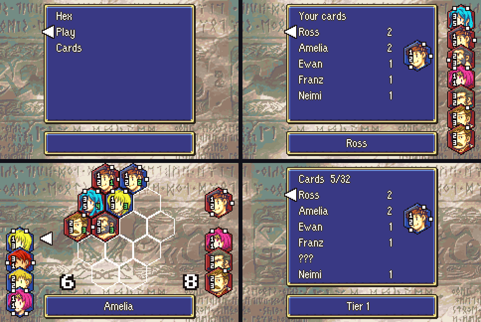

# Hex Card Minigame

<p align="center">
  
</p>

---

## 📑 Index
- [Introduction](#introduction)
- [How to Play](#how-to-play)
- [Controls](#controls)
- [Cards as Items](#cards-as-items)
- [Stakes](#stakes)
- [Opponents](#opponents)
- [Card List](#card-list)
- [Enabling and Disabling](#enabling-and-disabling)
- [Code Locations](#code-locations)
- [Limitations](#limitations)

---

## 🧩 Introduction

**Hex** is a card game for two players, played on a board of hexagon cells. You play it with your own army: each card is a
character, and the cards you win and keep are items in your convoy or in your units' inventories.

Hex is started from the **Hex** row of the preparations menu. The row's help text is "Play Hex with your army and view your
cards." The game is optional: it is controlled by the compile-time switch `CONFIG_HEX_CARDS` (see [Enabling and Disabling](#enabling-and-disabling)).

## 🎲 How to Play

- The board has 14 hexagon cells, in 5 rows of 2, 3, 4, 3 and 2 cells.
- Each player has 7 cards in hand. The player is blue, the opponent is red.
- The players take turns, and each turn places one card from the hand on an empty cell. The game ends when the board is full
  (14 placements).
- Each card has an **attack**, an **HP** (maximum hit points) and a **reach**: the directions in which it attacks. The reach
  directions are up-left, up-right, right, down-right, down-left and left.
- **Placement** works in three steps:
  1. **Attack:** every enemy card in a neighbour cell in the placed card's reach directions loses HP equal to the placed card's attack.
  2. **Counterattack:** the placed card loses the attack of every enemy neighbour whose reach points back at it.
  3. **Flip:** every card with 0 HP or less changes owner. A flipped card gets its full HP back; a card that was only damaged keeps its HP.
- **Scoring:** a player's score is the number of cards that player owns on the board, plus the cards still left in hand.
- **Winner:** when the board is full, the player with the higher score wins. Equal scores are a draw.

## 🎮 Controls

The Hex screen has several states. The controls for each are below. **A** confirms, **B** cancels or goes back.

### Front menu

| Input | Action |
|------|--------|
| UP / DOWN | Choose `Play` or `Cards` |
| A | Open the highlighted row: `Play` opens the opponent list, `Cards` opens the collection |
| B | Leave for the preparations menu |

### Opponent list (`Choose an opponent`)

| Input | Action |
|------|--------|
| UP / DOWN | Move the cursor over your living units (held keys repeat) |
| A | Start the hand picker against the highlighted unit |
| B | Back to the front menu |

### Collection (`Cards  N/32`)

| Input | Action |
|------|--------|
| UP / DOWN | Scroll the list of the 32 card types |
| B | Back to the front menu |

### Hand picker (`Your cards`, `Your hand`)

| Input | Action |
|------|--------|
| UP / DOWN | Move the list cursor (held keys repeat) |
| A | Add a copy of the highlighted card to your hand |
| B | Remove the last card from your hand. With no card in hand, back to the opponent list (no match, no penalty) |

When your hand has 7 cards, the list shows `Accept` and `Change`:

| Input | Action |
|------|--------|
| UP / DOWN | Choose `Accept` or `Change` |
| A | Confirm the choice |
| B | Same as `Change`: remove the last card and go back to the hand picker |

`Accept` shows the opponent's hand (`Your opponent's hand`) and then starts the match. A skips the wait.

### Match: choosing a card (`Blue begins`, your turn)

| Input | Action |
|------|--------|
| UP / DOWN | Step over the cards in your hand that are not placed yet |
| A | Choose the highlighted card and go to cell choice |
| B | Nothing: a match is played to its end |

### Match: choosing a cell

| Input | Action |
|------|--------|
| D-pad | Move to a neighbouring cell. UP goes to up-left or up-right, DOWN to down-left or down-right, LEFT and RIGHT to left or right. An empty neighbour is preferred. When there is none, the cursor moves to the cell before or after in reading order |
| A | Place the card. A full or illegal cell plays the error sound |
| B | Back to card choice |

The opponent's turn is announced with `<Name> is thinking`. After a placement the board stays as it was for 30 frames, then the
attack shows with a shake and a hit sound (if anything changed).

### Match end and stakes

| Input | Action |
|------|--------|
| A (at the result banner) | Decide the stakes, see [Stakes](#stakes) |
| UP / DOWN (take screen) | Choose one of the opponent's 7 starting cards |
| A (take screen) | Take the chosen card into your convoy |
| A (reward banner) | Skip the banner and go back to the front menu |

## 🃏 Cards as Items

- Every card is one item: the **Hex Card** item, with item index `CONFIG_ITEM_INDEX_HEX_CARD` (`0xEC` in the default config).
- The card's **type** (0 to 31, see the [Card List](#card-list)) is stored in the item's uses byte. The item word is
  `(type << 8) | CONFIG_ITEM_INDEX_HEX_CARD`.
- The item name is the name of the character the card is named after.
- The icon is the hexagonal card picture in item icon slot `ITEM_ICON_HEX_CARD` (`0x8E`, `Data/CustomItems/HexCard/`), the same for every card type; the row's `iconId` is that slot.
- Cards are stored in the convoy or in the inventory of a living unit. There is no extra save data: your collection is
  whatever cards you hold.
- Cards cannot be equipped. A card that is moved into an inventory counts the same as one in the convoy.
- **Starter gift:** when the Hex screen opens and you own no cards at all, 7 starter cards are put in the convoy:
  2 Ross, 2 Amelia, 1 Ewan, 1 Franz and 1 Neimi.

## 🏆 Stakes

Stakes are settled when the match ends (you press A at the result banner).

| Result | What happens |
|------|-----|
| Win | If you hold fewer than 3 copies of at least one card type in the opponent's starting hand, you take one of those cards (`TAKE`). You choose the card with UP / DOWN and take it into the convoy with A. Otherwise you gain no card (`No card gained.`). |
| Loss | If you own more than 7 cards, the opponent takes your best card from the hand you just played: the highest tier, then the highest attack + max HP, with the first card in hand order winning a tie. If you own 7 or fewer cards, nothing changes (`Your cards are safe this time.`). |
| Draw | Nothing changes hands (`Draw. No cards change hands.`). |

Other rules:

- You can hold at most 3 copies of one card type. A take of a type you already hold 3 of is refused (`You can't hold more`).
- If the convoy is full, the take is refused (`Convoy is full`). B then skips the take and you gain no card.
- Gains and losses are shown in the banner: `Gained <card>!` or `Lost <card>...`.

## 👥 Opponents

The opponents are the living units of your army. Each unit gives you one opponent, with a deck and an AI level, based on the
unit's **effective level**: its level, plus 20 if the unit is promoted.

- **AI level:** 1 if the effective level is below 10, otherwise 2. An army opponent never plays random moves.
- **Tier cap:** 1 if the effective level is below 10, 2 if below 20, otherwise 3.
- **Deck:** the first card is the card of the unit's own character (when there is one, even above the tier cap). The other
  7 slots are drawn from the card types of tier at or below the cap, with at most 2 copies of one type in the deck.
- The deck is always the same for the same unit at the same level and promotion. A unit that gains a level, or is promoted, may get a
  different deck and AI level the next time you pick it.
- **Opponent's moves:** the opponent picks the move with the best score difference (level 1: right after the move; level 2: after
  your best reply). On a tie it prefers the move that does more damage to your cards (the HP your cards lose, a card that changes
  owner counting its full HP), then the move next to more of your cards, then a seeded pick.

## 🂠 Card List

All 32 card types. The "Starter copies" column is the number of copies in the starter gift (7 cards in total). Reach
directions: UL up-left, UR up-right, R right, DR down-right, DL down-left, L left.

| # | Character | Attack | HP | Reach | Tier | Starter copies |
|---:|---|---:|---:|---|---:|---:|
| 0 | Ross | 1 | 2 | UR R DL | 1 | 2 |
| 1 | Amelia | 1 | 3 | UL UR | 1 | 2 |
| 2 | Ewan | 3 | 1 | R L | 1 | 1 |
| 3 | Franz | 2 | 2 | DR DL | 1 | 1 |
| 4 | Colm | 2 | 1 | UL UR DR | 1 | 0 |
| 5 | Neimi | 1 | 1 | UL UR DR DL | 1 | 1 |
| 6 | Lute | 4 | 1 | R | 1 | 0 |
| 7 | Garcia | 2 | 3 | L | 1 | 0 |
| 8 | Natasha | 1 | 2 | UR R DR | 1 | 0 |
| 9 | Moulder | 2 | 3 | UR | 1 | 0 |
| 10 | Gilliam | 3 | 2 | DR | 1 | 0 |
| 11 | Vanessa | 2 | 1 | UL R L | 1 | 0 |
| 12 | Kyle | 3 | 2 | UL UR R | 2 | 0 |
| 13 | Forde | 3 | 3 | R L | 2 | 0 |
| 14 | Dozla | 1 | 5 | DR DL | 2 | 0 |
| 15 | Joshua | 4 | 2 | UR DL | 2 | 0 |
| 16 | Tethys | 2 | 2 | UL UR DR DL | 2 | 0 |
| 17 | Gerik | 2 | 4 | UL UR | 2 | 0 |
| 18 | Marisa | 4 | 3 | R | 2 | 0 |
| 19 | L'Arachel | 2 | 2 | UL R DR L | 2 | 0 |
| 20 | Innes | 3 | 2 | UR DR L | 2 | 0 |
| 21 | Cormag | 3 | 4 | UR | 2 | 0 |
| 22 | Saleh | 4 | 1 | UR R DR | 2 | 0 |
| 23 | Tana | 2 | 4 | UL DL | 2 | 0 |
| 24 | Seth | 4 | 4 | UL UR | 3 | 0 |
| 25 | Myrrh | 2 | 4 | UL UR R L | 3 | 0 |
| 26 | Duessel | 2 | 5 | UL UR R | 3 | 0 |
| 27 | Ephraim | 4 | 4 | R L | 3 | 0 |
| 28 | Glen | 2 | 5 | UL R DL | 3 | 0 |
| 29 | Valter | 2 | 5 | UL DR L | 3 | 0 |
| 30 | Lyon | 4 | 2 | UL UR DR DL | 3 | 0 |
| 31 | Eirika | 3 | 5 | UL UR | 3 | 0 |

The collection screen (`Cards`) shows the same 32 types. A type you have never owned is shown as `???`.

## ⚙️ Enabling and Disabling

The switch is in [`include/configs/configs.h`](../../../include/configs/configs.h):

```c
/* Hex cards: the Hex Card item (one card per type, the type is the uses byte) and the Hex minigame code.
 * Comment out the next line to remove the Hex minigame and the card item from the build. */
#define CONFIG_HEX_CARDS
```

To remove the minigame, comment out `#define CONFIG_HEX_CARDS`. To turn it back on, restore the line.

The compile-time switch removes the code and the card item. To keep the card item and only hide the menu row, use the runtime
switch `prep_menu_hex` in [`designer-config.c`](../../../Data/DesignerConfig/designer-config.c). It defaults to `true`. Set it to
`false` to hide the Hex row in the preparations menu (the other prep rows are switched the same way). It has no effect when
`CONFIG_HEX_CARDS` is off, because the row is not compiled then.

**Cloud sessions** (`Tools/cloud/build.sh`) do not regenerate tracked `.lyn.event` files whose `.c` file is unchanged in git. After
you turn the switch on or off, delete the guarded outputs before you build, or the build fails (for example with
`Undefined identifier: HexCard_NameId` when the switch is off):

```
rm -f Data/ItemSys/Source/Items.lyn.event \
  Kernel/Wizardry/ItemSys/ItemInfoRemap/Source/DuraItem.lyn.event \
  Kernel/Wizardry/ItemSys/ItemInfoRemap/Source/ItemInfos.lyn.event \
  Kernel/Wizardry/SkillEffects/MenuSkills/Reinforce.lyn.event \
  Kernel/Wizardry/SkillSys/PrepSkill/Source/AtMenu.lyn.event \
  Data/Hex/HexCardTypes.lyn.event
Tools/cloud/build.sh
```

`build.sh` regenerates the deleted files. Afterwards, `git diff` on those files should show only the changes for this feature
(`AtMenu.lyn.event` in particular).

## 🗂️ Code Locations

| Feature | Location | Description |
|--------|----------|-------------|
| Switch | [`include/configs/configs.h`](../../../include/configs/configs.h) | `CONFIG_HEX_CARDS` and `CONFIG_ITEM_INDEX_HEX_CARD` |
| Preparations menu row | [`Kernel/Wizardry/SkillSys/PrepSkill/Source/AtMenu.c`](../../../Kernel/Wizardry/SkillSys/PrepSkill/Source/AtMenu.c) | The `Hex` row and its help text |
| Entry point | [`Kernel/Wizardry/Minigames/Hex/Source/HexPrep.c`](../../../Kernel/Wizardry/Minigames/Hex/Source/HexPrep.c) | `StartHexScreen_FromPrep` starts the screen from the menu |
| Screen | [`Kernel/Wizardry/Minigames/Hex/Source/HexScreen.c`](../../../Kernel/Wizardry/Minigames/Hex/Source/HexScreen.c) | Menus, opponent list, hand picker, match, stakes |
| Rules and AI | [`Kernel/Wizardry/Minigames/Hex/Source/HexCore.c`](../../../Kernel/Wizardry/Minigames/Hex/Source/HexCore.c) | Placement, scoring, winner, computer opponent |
| Rules header | [`include/kernel/hex-core.h`](../../../include/kernel/hex-core.h) | Board layout, directions, tile rules |
| Cards | [`Kernel/Wizardry/Minigames/Hex/Source/HexCards.c`](../../../Kernel/Wizardry/Minigames/Hex/Source/HexCards.c) | Card item, collection, starter gift |
| Card header | [`include/kernel/hex.h`](../../../include/kernel/hex.h) | Card type struct and card helpers |
| Card table | [`Data/Hex/HexCardTypes.c`](../../../Data/Hex/HexCardTypes.c) | The 32 card types |
| Card art | [`Kernel/Wizardry/Minigames/Hex/Source/HexArt.c`](../../../Kernel/Wizardry/Minigames/Hex/Source/HexArt.c) | Tiles, digits, cursors, frame and palettes |
| Item name | [`Kernel/Wizardry/ItemSys/ItemInfoRemap/Source/DuraItem.c`](../../../Kernel/Wizardry/ItemSys/ItemInfoRemap/Source/DuraItem.c) | Shows the character's name for a card |
| Text | [`Contents/Texts/Source/texts/Hex.txt`](../../../Contents/Texts/Source/texts/Hex.txt) | Item name and description, preparations row and help text |
| Developer notes | [`Kernel/Wizardry/Minigames/Hex/README.md`](../../../Kernel/Wizardry/Minigames/Hex/README.md) | Detailed notes for developers |

## ⚠️ Limitations

- **Uses number on the card.** The uses byte holds the card type, not a durability. The item code reports a uses value of 1 for
  Hex Cards (`GetItemUses` in `ItemInfos.c`), so a menu that shows an item's uses can show `1` on a card.
- **Flipped cells.** The developer notes list the flashing of flipped cells as not done.
- **Starter gift.** It is handed out whenever the screen opens with no cards owned, so a player who loses every card gets the starter set again on the next open.
- **Convoy full.** If the convoy is full, a take is refused and you gain no card.
- **Living units only.** Opponents and card counts use living units of your army. A dead unit's cards are not counted.
- **No quitting a match.** Once a match starts, B does nothing until it ends.
