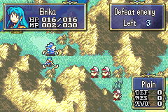

# Snek Minigame

<p align="center">
  
</p>

---

## 📑 Index
- [Introduction](#introduction)
- [Plan](#plan)
- [Code Locations](#code-locations)
- [Event Usage](#event-usage)
- [TODO](#todo)
- [Limitations & Bugs](#limitations--bugs)

---

## 🧩 Introduction

**Snek** (the Pied Piper's game) is a snake minigame run from an event. In Port Kiris, an old man next to the
[guild board](../GuildBoard.md) (character `0x7E`, at (17, 14)) offers it: Yes starts a game, No ends the talk.

Eat the coins; running into the edge or the snake's own body ends the game, and so does B. Each game pays the guild
board's tokens, 1 per 8 points, sets the high score that the board's Records page and its two Snek quests read ("Score
40 at Snek" in Port Kiris, "Score 100 at Snek" on every board), and ends with one of three conversations: a new record,
a tie with it, or short of it. Each says what the game paid ("That's 10 tokens for the guild board.").

---

## 🛠️ Plan

| Stage | Behavior |
|------|----------|
| Opening | `GAME_SNEK_CONVO_BEGIN`, then Yes or No. |
| Accept | Yes plays `GAME_SNEK_CONVO_YES` and starts the game (`CallSnekMinigameASMC`). |
| Decline | No plays `GAME_SNEK_CONVO_NO` and ends the event. |
| End of the game | `Snek_EndProc`: sets the result in `EVT_SLOT_7` and the tokens as the talk number, updates the high score, pays the tokens, then the map comes back. |
| Result | The event branches on `EVT_SLOT_7` to `GAME_SNEK_CONVO_END_WIN`, `_DRAW` or `_LOSE`; `[G]` prints the tokens. |

| Result | Slot 7 | Meaning |
|--------|--------|---------|
| Win | `0` | The score beat the high score |
| Draw | `1` | The score matched it |
| Lose | `2` | The score was below it |

`Snek_SetOutcomeEventSlots` (an ASMC after the game) sets `EVT_SLOT_8` to `0` and `EVT_SLOT_9` to `1` for scripts that
compare against them. The result itself is set when the game ends: before, it compared the score after it had been
reset to 0, so every game read as a loss.

---

## 🗂️ Code Locations

| Feature | Location | Description |
|--------|----------|-------------|
| Minigame runtime | `CallSnekMinigameASMC` in [`Kernel/Wizardry/Minigames/Snek/Snek.c`](../../../Kernel/Wizardry/Minigames/Snek/Snek.c) | Starts the blocking Snek proc from events. |
| Result slot writer | `Snek_SetOutcomeEventSlots` in [`Kernel/Wizardry/Minigames/Snek/Snek.c`](../../../Kernel/Wizardry/Minigames/Snek/Snek.c) | Compares current score to the high score and writes the result to event slots. |
| Snek declarations | [`Kernel/Wizardry/Minigames/Snek/Snek.h`](../../../Kernel/Wizardry/Minigames/Snek/Snek.h) | Exposes the Snek entry points and shared globals. |
| Port Kiris event | `EventScr_District_PortKiris_Snek` in [`CustomCampaign/Chapters/PortKiris/events/events.c`](../../../CustomCampaign/Chapters/PortKiris/events/events.c) | The Pied Piper's talk: the conversation, the game and the result text. The NPC is in `units.c`. |
| Dialogue text | [`CustomCampaign/Text/Games/Snek.txt`](../../../CustomCampaign/Text/Games/Snek.txt) | The opening and the three result conversations. The accept and decline lines (`GAME_SNEK_CONVO_YES`, `_NO`) are at the end of `Contents/Texts/Source/texts/Districts.txt`, so adding them shifted no message IDs. |

## 🎮 Event Usage

Use the ASMC directly from a talk event or any other event list when you only want to start the minigame:

```event
static const EventListScr EventScr_Talk_SNEK[] = {
    ASMC(CallSnekMinigameASMC)
    NOFADE
    ENDA
};
```

The expected flow is simply:

1. A talk event or house event starts.
2. `ASMC(CallSnekMinigameASMC)` runs the minigame.
3. Execution returns to the event after the proc ends.

## 📝 TODO

- Nothing outstanding.

---

## 🐛 Limitations & Bugs

- The game has no end screen of its own: the score shows in its top bar while playing, and the tokens in the result
  conversation.
- `python3 Tools/cloud/smoketest.py --only snek` plays it in Port Kiris: Yes, 80 points, B, and checks the 10 tokens and
  the high score.
