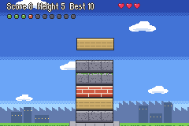

# Tower Stack

  

---

## 📑 Index
- [Introduction](#introduction)
- [How to Play](#how-to-play)
- [Controls](#controls)
- [Score, Chains and Fever](#score-chains-and-fever)
- [Game Feel](#game-feel)
- [Tower Stack Spots](#tower-stack-spots)
- [The Screen](#the-screen)
- [Art](#art)
- [Enabling and Disabling](#enabling-and-disabling)
- [Code Locations](#code-locations)
- [Limitations](#limitations)

---

## 🧩 Introduction

**Tower Stack** is a block-stacking minigame in the [districts](../Districts.md). A small white tower with a red roof
marks a Tower Stack spot in each district. Stand on it and press A: the map fades to a stone plinth with one block on
it. Blocks slide in one at a time from the left or the right; press A to drop each one onto the tower. Land them well,
build as high as you can, and chain perfect landings into a fever.

---

## 🎮 How to Play

1. Press A to start. A block slides in above the tower, from a random side.
2. Press A to drop it. It falls straight down onto the top of the tower.
   - **At least half of it (24 of its 48 pixels) over the block below:** it lands where it is. +1 point. The tower can
     lean: the next block lands on this one.
   - **Lined up with the block below:** a **perfect** landing. It snaps exactly into line. +2 points.
   - **Less than half over the block below:** it tips off the side and falls. You lose a life.
3. If you don't press A, the block slides off the far side: that is a miss too, and costs a life.
4. You have three lives. With none left, the game is over.

A block's path always passes exactly over the block below, so a perfect landing is always possible. "Lined up" means
within the block's slide speed (1 pixel at first, up to 4): the three frames around the exact one count, at any speed.

The blocks slide faster as the tower grows: 1 pixel a frame for the first 6 blocks, then 2, 3 and at most 4. The screen
climbs with the tower. Past the top of the sky the background stays put and only the tower moves.

---

## 🕹️ Controls

| When | Buttons |
|---|---|
| Before you start | A: start, B: exit, START: pause |
| Playing | A: drop, B: exit, START: pause |
| Paused | START: resume, B: exit |
| Game over | A or B: done |

**B leaves at any time** and pays out the score so far. The buttons show at the bottom of the screen, with no window
behind them, before you start, while paused and at the end.

The top line shows the score, the tower's height and your best score. The hearts are your lives. During a fever the
gold bar at the top right is the time left.

---

## ⭐ Score, Chains and Fever

| Landing | Points | Pop-up |
|---|---|---|
| Plain (at least half over) | 1 | "+1" in white, rising from the block |
| Perfect | 2 | **PERFECT!** zooms in, with the chain beside it ("x3") and sparks |
| Missed (tipped off or slid past) | 0 | **MISS!** in red, a shake, and a life lost (none during a fever) |

- **The chain** is your perfect landings in a row. A plain landing or a miss ends it. The PERFECT! pop-up and its chain
  number change colour with the chain: green at 1, through orange around 5, to gold at 10. The sound climbs with it.
- **Fever:** a chain of 10 starts a 10-second fever. **FEVER!** pops up in gold with a fanfare, a burst of sparks and a
  shake. While it lasts, missed blocks cost no lives, and the blocks are gold. The chain starts again from 0, and
  another 10 in a row starts another fever.
- **Gold:** at the end of the game (or when you leave with B) the score is paid out at 10 points to 1 gold, rounded down.
- **Best score:** saved. It is `gTowerRecords` (`struct TowerRecords`, 4 bytes, `include/kernel/tower.h`): a magic word
  and the best score (up to 65535). It is one chunk at the end of both save lists (`Kernel/Wizardry/SaveData/data.event`),
  and `TowerRecords_NewGame` clears it on a new game. A save made before the chunk existed loads no record. The suspend
  save has 28 bytes free after it.

The numbers are near the top of `Kernel/Wizardry/Minigames/Tower/Source/TowerScreen.c`: `FEVER_FRAMES`, `CHAIN_MAX`, the
slide speeds in `Tower_Speed`, and the points in `Tower_Land`.

---

## 💥 Game Feel

| Moment | What happens |
|---|---|
| Plain landing | The block squashes a little and springs back, with a 1-pixel thump. |
| Perfect landing | The game freezes for 4 frames (hit-stop), the block squashes deeply and springs back, the background flashes, the screen jolts 2 pixels, and the chain's note plays. |
| Fever | 8 frames of hit-stop, a 3-pixel shake and a fanfare. |
| A miss | A 2-pixel shake. |
| Every 10 floors | "10 FLOORS!" in blue, with the number beside it. |
| Passing your best score | "NEW BEST!" in gold with a fanfare, the first time in a game. |

- **The chain meter**: ten pips under the score. Each perfect landing lights one: green for the first three, orange up to
  seven, gold for the last three. During a fever they all blink gold.
- **The chain's note** climbs a major scale, one step per perfect landing (the root, then 2, 4, 5, 7, 9, 11, 12, 14 and
  16 semitones up). It is one sound effect (`SE_NOTE`) with its pitch raised through the m4a player
  (`m4aMPlayPitchControl` on the sound effect's player in `gMPlayTable`).
- **The squash**: the newest block's two sprites share one affine matrix (slot 2). They widen and flatten about the block's
  base, then overshoot a little taller and settle, over 10 frames (`sSquashCurve`).
- **The flash** brightens BG3 only (the blend unit's brighten effect), so the pop-ups and the blocks stay as they are.
- **Milestones** wait for the pop-up on screen to end before they show. NEW BEST! comes before a floors milestone if
  both happen on one landing.

---

## 📍 Tower Stack Spots

| District | Spot (x, y) |
|---|---|
| Serafew | (6, 16), the south street |
| Port Kiris | (16, 15), east of the harbour |
| Caer Pelyn | (11, 16), south of the plaza |
| Jehanna Hall | (8, 12), west of the hall |

- A spot is `TOWER_SPOT(x, y)` in the district's `events/traps.c` (`TRAP_TOWER_SPOT`, 31, `bmtrick.h`). Rebuild the
  chapter's `events.lyn.event` after adding one: `traps.c` is included by `events.c`.
- The tower on the map is drawn by `DistrictNpc.c`, with the gate arrows, the fishing bobbers and the River Crossing flags.
  Its tile is OBJ tile `0x19B` (the map's OBJ VRAM there holds title-screen leftovers, unused on the map). It only shows in
  districts.
- A in free movement runs the trap before any talk event, so an NPC next to the spot does not get in the way.

---

## 🖥️ The Screen

| Layer | What |
|---|---|
| BG3 | The scene, 240 x 256 (BG palette 8, tiles at `0x06008000`): sky, clouds, a far town, the ground and the plinth |
| BG0 | The status line (top) and the button labels (bottom), with no window behind them |
| OBJ (1D) | The blocks, sparks, the pop-up word and its digits, the hearts, the fever meter and the buttons |

- **OBJ tiles**: the art from 0 (131 tiles), the pop-up word at `0x100` (64 tiles), the fever meter at `0x140`.
- **Affine slots**: 1 the pop-up word, 2 the squashing block.
- **Palettes**: OBJ 2 the blocks, 3 the sparks and hearts, 4 the buttons and the meter, 5 the pop-up (the chain's colour,
  white or red).
- **The tower** keeps the last 16 blocks' positions and looks (`xs`, `styles`): enough to fill the screen.
- The state is `gTowerState` (`struct TowerState`, 0x100 bytes, RAM only).

---

## 🎨 Art

All the art is drawn by `Tools/tower/gen_tower_art.py`, pixel by pixel. It uses the fishing art's helpers
(`Tools/fishing/gen_fishing_art.py`): the button icons, the sparks and the pop-up font, which now has digits, "+" and "x".

- **Blocks:** granite, sandstone, brick and mossy granite in turn up the tower, and gold during a fever.
- **Chain palettes:** ten, from green (a chain of 1) through orange to gold (10), plus white, red and blue.
- **Chain meter pips:** unlit, green, orange and gold.
- **Pop-up words:** PERFECT!, FEVER!, MISS!, GAME OVER, NEW BEST! and FLOORS!.
- It writes `Kernel/Wizardry/Minigames/Tower/Source/TowerArt.c` and `include/kernel/tower-art.h`. Don't edit them: change
  the script and run it again. `--check` exits 1 if they are out of date; `--preview PATH.png` writes a 3x preview.

---

## ⚙️ Enabling and Disabling

The switch is `CONFIG_DISTRICT_TOWER` in `include/configs/configs.h` (on by default). Comment it out to remove the game,
the A-press trap entry, the map towers and the record chunk. The spots stay in the trap data but do nothing.

---

## 🗂️ Code Locations

| Feature | Location | Description |
|--------|----------|-------------|
| Installer | [`Tower_Installer.event`](../../../Kernel/Wizardry/Minigames/Tower/Tower_Installer.event) | Included from `Kernel/Wizardry/wizardry.event` (`WIZARDRY_CUSTOM`) |
| Game | [`TowerScreen.c`](../../../Kernel/Wizardry/Minigames/Tower/Source/TowerScreen.c) | `ProcScr_TowerScreen`, the states, the scoring, chains and fever |
| Record | [`TowerRecords.c`](../../../Kernel/Wizardry/Minigames/Tower/Source/TowerRecords.c) | The save chunk and the new-game hook |
| District glue | [`TowerDistrict.c`](../../../Kernel/Wizardry/Minigames/Tower/Source/TowerDistrict.c) | `Tower_OnPressA`, `StartDistrictTowerASMC`, the map towers |
| Art | [`TowerArt.c`](../../../Kernel/Wizardry/Minigames/Tower/Source/TowerArt.c) | Generated by `Tools/tower/gen_tower_art.py` |
| Header | [`tower.h`](../../../include/kernel/tower.h) | `struct TowerState`, `struct TowerRecords` |
| Trap type | [`bmtrick.h`](../../../Tools/FE-CLib-Mokha/include/bmtrick.h) | `TRAP_TOWER_SPOT` (31) and `TOWER_SPOT(x, y)` |
| A-press hook | [`HookList.event`](../../../Kernel/Wizardry/FreeMovement/cFreeMU/HookList.event) | `HookListFMU_TrapList_OnPressA` entry |
| Map towers | [`DistrictNpc.c`](../../../Kernel/Wizardry/EnterTown/DistrictNpc.c) | Loads and draws them |
| Texts | [`Districts.txt`](../../../Contents/Texts/Source/texts/Districts.txt) | `MSG_TOWER_*` |
| RAM | [`config-memmap.s`](../../../include/link/config-memmap.s) | `gTowerState`, `gTowerRecords` |
| Switch | [`configs.h`](../../../include/configs/configs.h) | `CONFIG_DISTRICT_TOWER` |

---

## ⚠️ Limitations

- There is one course for every district; only the slide speed changes, with the tower's height.
- A landed block keeps its full width (it is not trimmed), so a leaning tower can drift off the screen's edge after many
  plain landings in the same direction.
- The towers on the map are only drawn in districts.
