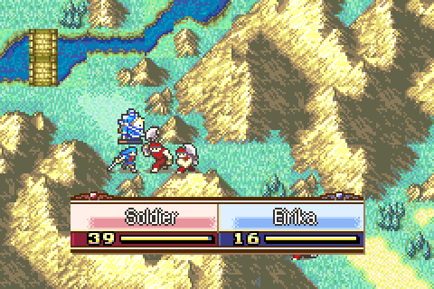

# Minimum Damage

*With minimum damage on, Eirika's Iron Sword still chips a soldier with 30 Def from 40 HP to 39.*

Every hit that lands deals at least 1 damage, however high the defender's Def or Res. Without it, a hit that doesn't
beat the defence deals 0.

## Rules

- The minimum applies to every hit that lands, from either side, including critical hits and counters. A miss still
  deals nothing.
- It applies last, after every skill that changes damage. Damage that skills reduce to 0 (Equilibrium halving 1 hit
  point, Equalizer coming out negative) becomes 1.
- Hits a skill nullifies still deal 0: a Great Shield (Pavise) block, and a physical hit on a unit with Levitate from a
  unit that doesn't fly.
- The battle forecast shows the attack and defence figures, not the damage per hit, so it doesn't change.

## Config

- Designer config: `min_damage_on_hit` in [`designer-config.c`](../../Data/DesignerConfig/designer-config.c), off by
  default. On, every hit that lands deals at least 1.

## Code locations

| Rule | Location |
| :--- | :------- |
| The minimum | The end of `BattleHit_CalcDamage` in [`BattleDamage.c`](../../Kernel/Wizardry/BattleSys/Source/BattleDamage.c), before the maximum-damage cap |
| Levitate's immunity | The same function sets `nullified` where Levitate makes a hit deal 0 |

`Tools/cloud/smoketest.py --only mindamage` checks it with the toggle off and on (a test ROM).

## Limitations

- `min_damage_on_hit` is not in the FEBuilder layout (`Patches/PATCH_DesignerConfig.txt`), which is out of date.
