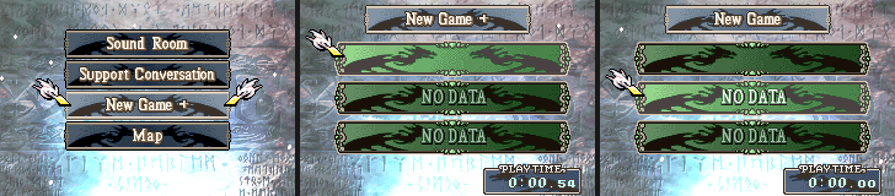

# New Game+

   New Game+, the save it starts from, and the empty file for the new game" width="720"/>

---

## 📑 Index
- [Introduction](#introduction)
- [What carries over](#what-carries-over)
- [How it works](#how-it-works)
- [Testing](#testing)
- [Code Locations](#code-locations)
- [Limitations & Bugs](#limitations--bugs)

---

## 🧩 Introduction

**Extras > New Game+** starts a new game from a save that has been to the Creature Campaign (the postgame). The row
shows once any of the three save files has: the save made at the end of the game ("Creature Campaign") and any save
made in the postgame have the postgame bit in their play state (`PLAY_FLAG_POSTGAME`). A cleared save from before the
Creature Campaign save ("Epilogue") counts once it has been loaded and saved again.

1. Extras > New Game+, then the save to start from. A save that has not been to the postgame says "Select data that has
   been to the Creature Campaign."
2. The difficulty, as for New Game.
3. An empty file for the new game, as for New Game. With no empty file, the save picker says so: erase one first.

The game then starts from the prologue, as a new game does.

---

## 🎁 What carries over

Per character (by character id):

- **The skill list**: the skills the character has learned, the list the prep screen's skill menu equips from. All of
  it is copied at the start of the new game, for every character, whether they have joined yet or not.
- **The equipped skills**: the skills the character had equipped in that save. They are equipped again when the
  character joins the army: loaded as a player unit (the prologue's Eirika and Seth, later joins), or recruited (Talk,
  Persuade, an event that turns them blue). A character who was never in that save's army starts with their usual
  skills.

Nothing else carries over: levels, stats, items, gold, supports and the convoy start fresh.

---

## 🛠️ How it works

### The Extras row

Vanilla's Extras list has a row it never shows: bit 3, "Battle History". New Game+ uses it
(`EXTRA_MENU_OPTION_NEW_GAME_PLUS`), so it sits between Support Conversation and Map.

- `InitSaveMenuChoice` (`ExtrasMenu/Source/SupportMenu.c`) adds it when `NewGamePlus_IsExtraEnabled()`.
- The row's label is drawn in vanilla's label sheet: `Gfx/Img_NgpMenuObjs.png` is `Img_GameMainMenuObjs` with
  "New Game +" (the main menu's "New Game" letters and a plus) in place of "Battle History" (and the Gallery's
  "Gallery" in place of "Map", see [Gallery](./Gallery.md)). The installer points
  vanilla's three loads of the sheet at it and `SpriteArray_08A2099C[3]` at a 112-pixel sprite like the other labels'.
- The Extras list (`sub_80A9B90`), the save picker after it (`sub_80A9E1C`) and the picker's header label
  (`sub_80ABF74`) are vanilla's, rewritten with a case for the row.
- After the save, a small proc fades out and goes to New Game's difficulty select (`PL_SAVEMENU_DIFFICULTY_SEL`) with
  the menu set as New Game leaves it. The chosen save is kept in `gNewGamePlusArmed`; back on the main menu
  (`NewGamePlus_SaveMenuMainLoop`, in place of `SameMenu_CtrlLoop` in `ProcScr_SaveMenu`) it is dropped.

### The new game

`NewGamePlus_OnNewGame` is the last entry of `gNewSaveHooks`, after `ResetUnitLearnedSkillLists`. With a save chosen it
reads each player unit's skill bytes (`EmsPackedSavUnit::skills`, the unit's `supports`) into
`gNewGamePlus.equips[pid]`, then that save's learned skills straight from SRAM into `gLearnedSkills`
(`LoadLearnedSkillsFor`; a save from before the packed list keeps the lists of the characters in its army). A plain new game clears
`gNewGamePlus`.

### Joining

The carried skills go on a player unit of that character once (`pending` bit), from:

- `gLoadUnitHooks`, after `UnitAutoLoadSkills`: a character loaded as a player unit;
- `gPostActionFuncs` and `gPrePhaseFuncs`: a sweep of the army for recruits.

FE8's opening scene loads Eirika and Seth and takes them off again before the prologue. `gClearUnitHooks` marks a
character pending again when their player unit is cleared and no other unit is them (a Replicate copy keeps its
original's).

### Saving

`gNewGamePlus` (`struct NewGamePlusCarry`, 0x1D8 bytes) goes in the bytes after the save tables: `gpMsa_Saver` and
`gpMsa_Loader` in `Preload/Reloc.event`. The game save holds all of it. The suspend save (`gpMsu_Saver`) holds only who
is still pending; its loader takes the rest from the game save the suspended game belongs to
(`gPlaySt.gameSaveSlot`), checking the playthrough id.

These bytes are not a save chunk, so the **save layout and its signature do not change**: saves from before New Game+
still load, and carry nothing. A magic word (`NGP+`) and the playthrough id tell a New Game+ game's bytes from
leftovers.

---

## 🧪 Testing

`python3 Tools/cloud/smoketest.py --only newgameplus`:

- a cleared save alone: Extras has no New Game+ row;
- a save with the postgame bit, Eirika with Str Bonus and Vantage equipped and one skill in her list: the row shows;
  New Game+, that save, Normal and the empty file start a new game, and in its prologue Eirika has Str Bonus and
  Vantage equipped and the skill in her list.

By hand (gbarun), also checked: the suspend save and the game save (the debugger's "Save & restart ch.") bring the
carried skills back; a player unit marked pending gets them after another unit's action; the picker's refusal on a
save that has not been to the postgame; a plain New Game after backing out of New Game+ carries nothing.

---

## 🗂️ Code Locations

| What | Where |
|---|---|
| Carried skills, hooks, the save bytes | `Kernel/Wizardry/NewGamePlus/Source/NewGamePlus.c` |
| Extras list, save picker, header label, main-menu loop | `Kernel/Wizardry/NewGamePlus/Source/NgpSaveMenu.c` |
| LynJump, the label sheet and sprite, the proc patch | `Kernel/Wizardry/NewGamePlus/Source/LynJump.event`, `NewGamePlus_Installer.event` |
| The label sheet | `Kernel/Wizardry/NewGamePlus/Gfx/Img_NgpMenuObjs.png` |
| Struct, constants | `include/kernel/new-game-plus.h` |
| The Extras row | `InitSaveMenuChoice` in `Kernel/Wizardry/ExtrasMenu/Source/SupportMenu.c` |
| Hook entries | `gNewSaveHooks` (`SaveData/data.event`), `gLoadUnitHooks` and `gClearUnitHooks` (`UnitHooks/data.event`), `gPrePhaseFuncs`, `gPostActionFuncs` |
| Save bytes | `gpMsa_Saver`, `gpMsa_Loader`, `gpMsu_Saver`, `gpMsu_Loader` in `Preload/Reloc.event` |
| RAM | `gNewGamePlus`, `gNewGamePlusArmed` in `include/link/config-memmap.s` |
| Messages | `MSG_NewGamePlus_*` at the end of `Contents/Texts/Source/texts/Districts.txt` |
| Smoke test | `test_newgameplus` in `Tools/cloud/smoketest.py` |

---

## 🐛 Limitations & Bugs

- Equipped skills carry for characters 1-0x3F, skill lists for characters 1-40 (`LEARNED_SKILLS_PID_MAX`).
- From a save written before the packed learned list, skills from 0x100 up in the lists are not carried (the old
  lists stored them under other characters); equipped ones are.
- New Game+ needs an empty file, as New Game does; it never writes over the save it starts from.
- A recruit who joins in the middle of an action gets the skills when the action ends, and one turned blue by an event
  at the next phase.
- The bytes after the save tables are shared: `SaveTail.c` (`Kernel/Wizardry/SaveData/Source/`) gives New Game+ the
  first `sizeof(struct NewGamePlusCarry)` (the suspend save: `sizeof(struct NewGamePlusSusCarry)`), and the
  [Bestiary](./Bestiary.md) the bytes after them. Growing New Game+'s structs moves the Bestiary's share.
