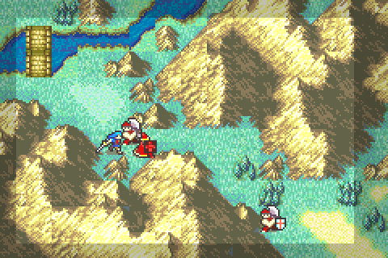

# Pair-Up Supports in Battle Animations

  

---

## 📑 Index
- [Introduction](#introduction)
- [How it works](#how-it-works)
- [Code Locations](#code-locations)
- [Limitations & Bugs](#limitations--bugs)

---

## 🧩 Introduction

`gpKernelDesignerConfig->pair_up_banim` (on by default)

In a battle animation, a [pair-up](./PairUp.md) leader's support stands behind the leader, in its own standing pose,
in its own colours (its faction palette, or its character palette for its class's animations). It grows in from the
map with its leader as the battle opens, and shrinks back to the map with it as the battle ends. The pose does not move:
it stays put while the leader attacks, dodges or casts. Both sides can show a support at once.

A support shows only when the leader really is paired (`PairUp_GetSupport`): before Pair Up is unlocked, a rescued
unit is not drawn, as in vanilla. Promotions, arena and link-arena battles show none.

---

## 🛠️ How it works

**Once a battle, as the units zoom in.** The zoom from the map (`ProcScr_ekrUnitKakudai`) has its first step
(`UnitKakudaiPrepareAnimScript`, ROM `0x5B9CF0`) point at `PairUpBanim_KakudaiPrepare`. After vanilla's step has
unpacked the leaders' animations, it:

1. Picks the support's animation as the battle does for its fighters (`GetUnitBattleAnimDef`,
   `GetBattleAnimationId` with its equipped weapon, else its first item, else unarmed).
2. Unpacks the animation's script and finds the standing mode's first frame (the mode the battle's distance uses:
   `BanimDefaultModeConfig[BanimDefaultStandingTypes[gEkrDistanceType] * 4]`), then unpacks the right-facing OAM and the
   frame's sheet. `BanimUnComp` handles both LZ77 and the custom animations' Huffman format. The leaders' animation
   buffers are borrowed for this (`gBanimScrLeft`, `gBanimOamr2`, `gBanimOaml`), and `UpdateBanimFrame` unpacks the
   leaders' data into them again right after.
3. Draws the frame into a 128x96 canvas (mirrored for the left side, as the left OAM is), cuts it into 16x16 pieces
   (8x8 where a piece has only one or two tiles with pixels), and copies the pieces into free OBJ tiles.

The pieces' places are counted from the leader's position (24 pixels behind it, 4 up), so the pose scales with it.

**The zooms.** The zoom's loop (`UnitKakudaiMain`, `0x5B9CF8`) points at `PairUpBanim_KakudaiLoop`: after vanilla has
drawn the leaders for the frame, it draws each pose the same way, through `BanimUpdateSpriteRotScale` with the
leader's scale and place, so it comes after them in OAM. The same proc zooms back out to the map as the battle ends
(`ProcScr_ekrBattleEnding`, its step at `0x5B9B40` points at `PairUpBanim_ekrBattleEnding`).

**In the battle.** `gProc_ekrBattle`'s first step (`ekrBattle_Init`, `0x5B938C`) points at
`PairUpBanim_ekrBattle_Init`: vanilla's makes the leaders' animations, then each pose becomes a frozen `struct Anim` with
draw layer 1 (made there if the zoom did not make it). The animation system writes higher layers to OAM first, so the pose comes last: behind the leaders, the
opponent and the spell effects. A proc (`ProcScr_PairUpBanim`) keeps it on the leader's position, hides it while both of
the leader's animations are hidden, and deletes it when the leader's animation goes (the ending clears them all). During a spell, vanilla hides the
caster's animations and draws the caster itself, so the pose stays.

**Tiles.** The battle's OBJ VRAM is in 2D mapping (32 tiles a row). Spells load their sprites at tiles 64-319, the "xN"
badge uses 320-323 and 352-355 (DoubleBadge), the HP bars and their text 384 and up, and the two animations' sheets
512-1023. That leaves rows 0-1 (tiles 0-63) and rows 10-11 from column 4 (324-351 and 356-383): 60 columns of two
tiles, shared by both sides' supports. The zooms' turning platform (`NewEkrBaseKaiten`) unpacks its sprites over tiles
0-255, so while the units zoom in or out the first 32 columns are in rows 8-9 (tiles 256-319) instead, which nothing
uses then (`PairUpBanim_MoveLow`): the pose moves to rows 0-1 once the platform is gone, and back to rows 8-9 as soon as
the battle's ending starts. A ground unit's standing frame takes about 6-16 columns, a flier's up to about 50.

**Palettes.** OBJ palette 8 for a left support (the Triangle Attack palette, which `UpdateBanimFrame` writes over, so
the proc puts it back when it changes) and 1 for a right one. No battle sprite uses either.

**RAM.** No kernel RAM pool has room, so the state (the palettes and up to 62 OBJs) lives in the last 0x354 bytes before
`gBanimOamr2 + 0x57F0`, where vanilla keeps a word. The largest OAM of the ROM's animations (0xE1, 0x5094 bytes)
stops well short of it. Every OAM the feature or the battle unpacks there is checked first (`PairUpBanim_OamFits`): an
animation whose OAM would reach it means no pose for that battle, or no pose from then on if one is switched in
mid-battle.

---

## 🗂️ Code Locations

| Feature | Location | Description |
|---------|----------|-------------|
| Toggle | `pair_up_banim` in [`designer-config.c`](../../Data/DesignerConfig/designer-config.c) / [`kernel-lib.h`](../../include/kernel/kernel-lib.h) | Turns the poses on or off |
| Hooks | [`PairUpBanim_Installer.event`](../../Kernel/Wizardry/PairUpBanim/PairUpBanim_Installer.event) | `gProc_ekrBattle`'s first step, the zoom's first step and loop, the ending's zoom-out step |
| Pose setup | `PairUpBanim_Prepare`, `PairUpBanim_PrepareSide` in [`PairUpBanim.c`](../../Kernel/Wizardry/PairUpBanim/Source/PairUpBanim.c) | Finds the standing frame, draws and places it |
| Pose display | `PairUpBanim_Start`, `PairUpBanim_Loop` | The frozen anim and the proc that moves and hides it |
| Zooms | `PairUpBanim_KakudaiPrepare`, `PairUpBanim_KakudaiLoop`, `PairUpBanim_KakudaiDraw`, `PairUpBanim_MoveLow` | The pose scaling with its leader, and its tiles kept clear of the turning platform's |

---

## 🐛 Limitations & Bugs

- The pose is the standing frame only: the support does not attack, dodge or react.
- A frame wider than 128 pixels or taller than 96 is not shown, nor one whose pieces don't fit in the 60 columns that
  are left (two large fliers on both sides can run out).
- The pose hides for good once the level-up box shows (it draws over tiles 0-63), and doesn't zoom out.
- If a map unit is still moving when the zoom starts, the pose joins it a few frames later.
- The support doesn't flash, darken or fade with its leader's palette effects. When the leader dies, its animation
  hides and the support goes with it.
- A future animation whose OAM is larger than 0x549C bytes turns the pose off in its battles (see RAM above).

Please report issues in the repository's **Issues** tab.
