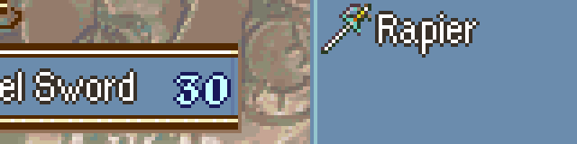

# Popup Item Icon Shine

  

---

## 📑 Index
- [Introduction](#introduction)
- [How It Plays](#how-it-plays)
- [Tuning](#tuning)
- [Code Locations](#code-locations)
- [Limitations & Bugs](#limitations--bugs)

---

## 🧩 Introduction

When a popup shows the icon of an item the player has just got, a white glint sweeps across the icon, so a new item catches the eye. That covers an item got from a village, chest or drop, an item a player thief steals, a scroll or reward, and a weapon infused in the Infuse menu (shown above).

The shine is gated behind `gpKernelDesignerConfig->popup_item_icon_shine` (on by default). With it off, popup icons are drawn as in vanilla.

## 🎬 How It Plays

- The first sweep starts 8 frames after the popup's icon appears, then one sweep plays every 64 frames (about once a second) for as long as the popup stays up.
- The glint is a 3-pixel "\" band that crosses the icon from left to right in 19 frames. Most weapon icons point "/", so the glint runs up the blade from hilt to tip.
- Only the icon's opaque pixels light up. They take the brightest colour in the icon's palette, which is white in the vanilla item icon palette.
- Popups that show any other icon (weapon rank ups, skills, combat arts) keep a plain icon.
- Popups about an item the player isn't gaining keep a plain icon too:

| Popup | Why |
|-------|-----|
| "[Item] broke!" | Its message is `0x003` |
| "[Item] was pilfered." / "[Item] was stolen." | Its message is `0x009` / `0x00B` |
| "[Unit] used [Tonic]" | Its message is `MSG_USED` |
| "[Enemy] pilfered/stole [item]" | The popup names a unit that isn't a player unit |

## 🎚️ Tuning

The timing and size are the enum at the top of [`PopupIconShine.c`](../../Kernel/Wizardry/PopupIconShine/Source/PopupIconShine.c):

| Constant | Default | Meaning |
|----------|---------|---------|
| `SHINE_DELAY` | `8` | Frames from the icon appearing to the first sweep |
| `SHINE_PERIOD` | `64` | Frames from one sweep to the next. Must be a power of two |
| `SHINE_WIDTH` | `3` | Width of the glint, in pixels |
| `SHINE_SPEED` | `2` | Pixels the glint moves each frame |

## 🗂️ Code Locations

| Feature | Location | Description |
|--------|----------|-------------|
| Designer config field | `popup_item_icon_shine` in [`kernel-lib.h`](../../include/kernel/kernel-lib.h) | On/off. |
| Default value | `gKernelDesigerConfig` in [`designer-config.c`](../../Data/DesignerConfig/designer-config.c) | On by default. |
| Shine | `PopupIconUpdateProc_Loop` in [`PopupIconShine.c`](../../Kernel/Wizardry/PopupIconShine/Source/PopupIconShine.c) | Replaces the vanilla loop of the popup's icon proc (`ProcScr_PopupUpdateIcon`, LynJump at `$11254`). It still puts the icon sprite each frame, then draws the glint. |
| Acquired item check | `PopupShowsAcquiredItem`, `sPopupIconShineLossMsgs` in the same file | The parent popup's script must contain `POPUP_ITEM_ICON`, no message from `sPopupIconShineLossMsgs`, and, if it names a unit (`POPUP_UNIT_NAME`), `gpPopupUnit` must be a player unit. Add a message to the list to keep another popup plain. |
| Glint drawing | `PopupIconShine_PutTiles` in the same file | Rewrites the icon's four OBJ tiles from the icon sheet (`GetIconGfx`) with the glint drawn in, and writes the plain icon back when the sweep ends. |
| Installer | [`PopupIconShine_Installer.event`](../../Kernel/Wizardry/PopupIconShine/PopupIconShine_Installer.event) | Included from `WIZARDRY_CUSTOM` in `wizardry.event`, so the module lives in `FreeSpaceDEMO`. |

The icon proc's frame counter lives in its own unused padding (`0x34`-`0x39`). Procs don't clear their memory, so the counter restarts whenever the proc wasn't updated in the last 4 frames.

## 🐛 Limitations & Bugs

- Battle animation popups (`NewEkrPopup`, such as weapon broke or weapon rank up during a battle) draw their icon a different way and don't shine.
- The glint colour comes from the icon's own palette. An item icon palette with no light colour gives a dimmer glint.
- The glint writes straight to the icon's OBJ VRAM tiles, so another sprite drawn from the same tiles at the same time would shine too.
- Telling gains from losses goes by the popup's messages and unit, so a new popup about losing an item needs its message added to `sPopupIconShineLossMsgs`.

Please report any issues in the repository's Issues tab.
