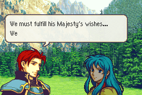

# Portrait Expressions

<p align="center">
  
</p>

---

## 📑 Index
- [Introduction](#introduction)
- [Using an Expression in Dialogue](#using-an-expression-in-dialogue)
- [The Expressions](#the-expressions)
- [Expressions in Quotes](#expressions-in-quotes)
- [Adding an Expression](#adding-an-expression)
- [The Portrait Tool](#the-portrait-tool)
- [Making It Look Hand-Made](#making-it-look-hand-made)
- [Code Locations](#code-locations)
- [Limitations](#limitations)

---

## 🧩 Introduction

FE7's lords have extra portraits for strong moments: a sad Lyn, an angry Hector, an Eliwood looking down. This feature
does the same for any character. An **expression** is an alternate portrait of a character. `[Angry]`, `[Sad]` and the
rest swap the speaker's portrait for it **in place**: the same slot, flip, nameplate and voice, with no fade. The
mouth and eyes keep moving, because each expression portrait has its own talking and blinking frames.

An expression is a normal portrait (`setMugEntry`) plus one row in a table. The example is an angry Eirika, portrait
`0xB0`.

---

## 💬 Using an Expression in Dialogue

```
[OpenMidRight][LoadFace][FID_0x02]
[OpenMidRight][Angry]Don't be foolish, Seth.[.][A]
[OpenMidRight][Neutral]Yes, of course. You're right.[A][X]
```

| Command | Byte code | What it does |
|---|---|---|
| `[Expression][0xNN]` | `0x80 0x63 NN` | The speaking portrait shows its character's expression `NN` |
| `[Neutral]` | `0x80 0x63 0x01` | Back to the character's base portrait |
| `[Angry]` | `0x80 0x63 0x02` | |
| `[Sad]` | `0x80 0x63 0x03` | |
| `[Happy]` | `0x80 0x63 0x04` | |
| `[Surprised]` | `0x80 0x63 0x05` | |
| `[Determined]` | `0x80 0x63 0x06` | |
| `[Hurt]` | `0x80 0x63 0x07` | |

- It acts on the speaker: the face slot the last `[OpenX]` chose. After a move (`[MoveRight]` and the like) the
  face is in its new slot, so open that one: `[OpenRight][Angry]`. On an empty slot nothing changes.
- A character with no portrait for that expression keeps the one they have, so a script can use `[Angry]` for anyone.
- From one expression to another works directly (`[Angry]` then `[Sad]`); `[Neutral]` always goes back to the base.
- The nameplate and the chat log keep the character's name. A variant loaded with `[LoadFace]` also shows the base
  character's name.
- `[Anger]` and `[Sweat]` (the marks) combine well with it: `[Angry][Anger]`.

`[LoadFace]` on a slot that already has a face also swaps in place (the vanilla face-change proc). Without a fade.
`[Expression]` is the same swap, found by character and expression instead of by portrait id.

---

## 🎭 The Expressions

| Portrait | Character | Expression | Changes from the base | Used in |
|---|---|---|---|---|
| `0xB0` | Eirika (`0x02`) | Angry | Brows down toward the nose, lids over the iris, a flat frown | Battle quote against Saar: "No matter who I am, you presume much to command me" |
| `0xB1` | Eirika (`0x02`) | Sad | Inner brow up, outer end down, lid lower, a small downturned mouth | Prologue: "...Yes... Father is strong" to the end of the scene; poor level-ups; battle quote against Novala |
| `0xB2` | Ephraim (`0x14`) | Angry | Brows down toward the nose, the upper lid over the eye's highlight, a flat frowning mouth | Chapter 9: "And who are you supposed to be ugly?" |
| `0xB3` | Seth (`0x04`) | Hurt | Inner brow up (pain), the eye narrowed, a wider grimace | Prologue: "Argh...! N-No!" when Valter strikes him; "Your Highness, I can't allow an injury..." until "King Fado will not be taken down"; battle quote against Tirado: "..." |
| `0xB4` | Lyon (`0x46`) | Sad | Inner brow up, a heavier lid, a downturned mouth | Not yet: Lyon's present-day portrait is not in the campaign so far |

Each was exported from its vanilla portrait and changes only the eyes, brows and mouth (25 to 40 face pixels); its blink
and talking frames carry the same changes, and its smile frames are copies of its talking frames, so none of them
smiles. They are in `Data/CustomPortraits/Portraits/` (`eirika_angry.png`, `eirika_sad.png`, `ephraim_angry.png`,
`seth_hurt.png`, `lyon_sad.png`).

The scenes' lines are in `CustomCampaign/Chapters/00/text/opening.txt` and `CustomCampaign/Chapters/09/text/opening.txt`.
Each tag follows the `[OpenX]` of the face's slot at that point.

---

## 🗨️ Expressions in Quotes

The level-up, battle and defeat quotes already carry tags. A character with no portrait for a tag keeps their base
portrait, so a new expression shows up in every quote that asks for it as soon as its table row exists.

| Quotes | File | Tags |
|---|---|---|
| Level-up | `CustomCampaign/Text/LevelUpQuotes/LevelUpQuotes.txt` | Every `_Poor_Level_Up` opens with `[Sad]`, every `_Great_Level_Up` with `[Happy]`. `_Good_` has none |
| Battle | `CustomCampaign/Text/Quotes/BattleQuotes.txt` | Per line, by what is said: `[Angry]`, `[Sad]`, `[Surprised]`, `[Determined]`, `[Hurt]` |
| Defeat | `CustomCampaign/Text/Quotes/DefeatQuotes.txt` | Every dying unit opens with `[Hurt]` |

With the portraits so far, these show: sad Eirika on a poor level-up and in her battle quote with Novala, angry Eirika
against Saar ("No matter who I am..."), and hurt Seth against Tirado ("...").

- The level-up quote speaks through the level-up portrait. Its `[OpenMidRight][LoadFace_X]` reuses that face, and the
  tag changes it in place.
- `[LoadFaceFancy_X]` takes eight bytes of arguments, but its alias holds only the first two; the `[FlipLeft]` or
  `[FlipRight]` that always follows it is the rest (options, font, colour, box, pitch). Put a tag after the pair:
  `[LoadFaceFancy_Eirika][FlipLeft][Sad]`. A tag between them is read as arguments.
- `[LoadFace]` on a slot that already has a face starts the vanilla face change too. A tag right after it in the same
  frame retargets that change instead of starting a second one, which would load after it and win
  (`TextEngine_ChangeFace`).

`python3 Tools/cloud/smoketest.py --only battle battlequote` checks both cases in the emulator: Eirika's level-up quote
shows the expression its tier asks for, and O'Neill's battle quote shows her `[Surprised]` (a test ROM maps her sad
portrait to it).

---

## ➕ Adding an Expression

1. **Export the base portrait** as an editable sheet (vanilla FE8U portrait ids are in `textdefs.txt` as `FID_0xNN`):
   ```bash
   python3 -I Tools/portraits/portrait_tool.py export fe8.gba 0x02 Data/CustomPortraits/Portraits/eirika_angry.png
   ```
   It prints the portrait's `setMugEntry` coordinates: Eirika's are `2, 6, 3, 4`.
2. **Edit the face** in an indexed-colour editor (Aseprite, GraphicsGale, Usenti) with the palette locked. See
   [Making It Look Hand-Made](#making-it-look-hand-made).
3. **Carry the edit into the animation frames**:
   ```bash
   python3 -I Tools/portraits/portrait_tool.py sync-frames base.png edit.png out.png --mouth 2,6 --eyes 3,4
   ```
   Then look over the talking and blinking frames (step 5) and fix what needs a human eye: the smile frames, for an
   angry face.
4. **Check it**:
   ```bash
   python3 -I Tools/portraits/portrait_tool.py check out.png --base base.png
   ```
5. **Preview the talking and blinking**:
   ```bash
   python3 -I Tools/portraits/portrait_tool.py animate out.png preview.gif --mouth 2,6 --eyes 3,4
   ```
6. **Install it** in `Data/CustomPortraits/CustomPortraits.event` with a free id (`0xB1` to `0xFF`) and the base's
   coordinates:
   ```
   Portrait_0xB0:
      #incext PortraitFormatter "Portraits/eirika_angry.png"
   setMugEntry(0xB0,Portrait_0xB0,2,6,3,4)
   ```
7. **Add a row** to `gPortraitExpressions` in `Data/CustomPortraits/PortraitExpressions.c`:
   ```c
   { .basePortrait = 0x02, .expression = EXPRESSION_ANGRY, .portrait = 0xB0 },
   ```

New expression kinds: add a number to `enum portrait_expression` (`include/kernel/portrait-expressions.h`) and an
alias to `textdefs.txt`. Numbers start at 1: a 0 byte would end the dialogue.

---

## 🛠️ The Portrait Tool

`Tools/portraits/portrait_tool.py` (Python 3 and Pillow) works on the 128x112 sheets `PortraitFormatter` reads.

| Command | What it does |
|---|---|
| `export ROM ID OUT.png [--table ADDR]` | A portrait from a ROM, as an indexed sheet in its own palette. `--table` reads this project's built ROM (the table's address is the word at `0x5524`) |
| `check SHEET [--base BASE]` | The format (size, at most 16 colours). Against a base: what changed where, colours not in the base palette (a warning), speckle, face edits the frames don't carry (the blink or the talking would snap back), and the resting mouth |
| `sync-frames BASE EDIT OUT --mouth X,Y --eyes X,Y` | Copies the face's edits into the blink frames, mouth frames and resting mouth, wherever a frame still shows the base's face |
| `animate SHEET OUT.gif --mouth X,Y --eyes X,Y` | Talking, blinking and smiling as the game draws them |
| `diff BASE EDIT OUT.png` | Base, edit and the changed pixels, side by side at 4x |
| `recolor SHEET OUT OLD=NEW ...` | Palette swaps (hex colours), for outfit or hair variants |
| `format SHEET OUT.bin` | The bytes `PortraitFormatter` writes, for checking |

**The sheet.** Pixels, from the top-left:

| Part | Where | Notes |
|---|---|---|
| Face | 96x80 at (0, 0) | The top corners (x 0-15 and 80-95, y 0-47) are not used |
| Minimug | 32x32 at (96, 16) | |
| Blink frames | 32x16 at (96, 48) and (96, 64) | Half shut, shut; drawn at the eye coordinates |
| Mouth frames | 32x16 at (0, 80), (32, 80), (64, 80), (0, 96), (32, 96), (64, 96) | Talking, then smiling; drawn at the mouth coordinates |
| Resting mouth | 32x16 at (96, 80) | A copy of the face at the mouth coordinates |

`setMugEntry`'s coordinates are 8-pixel tiles from the face's top-left corner. The pixel at (0, 0) is the transparent
colour. The layout is `PortraitFormatter.hs`'s (`Tools/EventAssembler/.Sources/EAFormattingSuite`); `export` was
checked against it by exporting a built custom portrait and matching its source PNG pixel for pixel.

---

## ✍️ Making It Look Hand-Made

Expressions in the FE style are small: a few pixels of brow, eyelid and mouth.

- **Keep everything else identical**: hair, outline, clothes, palette, light from the upper left. Only the eyes, brows
  and mouth area (about 32x32 of the 96x80) change for an expression.
- **Use the base's colours.** `check` lists any new colour. A new colour is a choice, not an accident.
- **Angry**: brows a pixel or two lower toward the nose, the upper lids over the top of the iris, a short flat mouth.
  **Sad**: the inner ends of the brows up, the lids lower, sometimes a one- or two-pixel tear highlight.
  **Determined**: flatter brows, a set mouth. Keep the pupils' size.
- **Borrow from vanilla.** FE6-8 portraits have plenty of frowns and half-shut eyes; recolour them to the character's
  palette and fit them by hand.
- **No soft gradients, dithering or blur.** `check` flags speckle: lone pixels unlike all their neighbours.
- **Head turns** redraw most of the face and hair. Start from a vanilla portrait already at that angle and paint the
  character over it, sketching at 2-4x first.
- AI image tools repaint everything (hair texture, colours, the pixel grid). If used at all, use them for reference.

The Eirika example changes 25 face pixels: the near brow tilts down and thickens, a furrow line, the near eye's upper
lid over the iris and its lower lid up a pixel, the far brow and lid, and the mouth as a short line with its corners
down. `sync-frames` carried those into 64 frame pixels, and the smile frames became copies of the talking ones.

---

## 🗂️ Code Locations

| Feature | Location | Description |
|--------|----------|-------------|
| Command | `TextEngine_CommandExpression` in [`TextEngineRework.c`](../../Kernel/Wizardry/TextEngineRework/Source/TextEngineRework.c) | `0x80 0x63 NN`: finds the expression and changes the face |
| Face change | `TextEngine_ChangeFace` in the same file | Starts the vanilla face change (`sub_80066E0`), or retargets one that has not loaded yet; `[LoadFace]` on an occupied slot uses it too |
| Names | `TextEngine_ExpressionBase` in the same file | A variant names its base character (nameplate, chat log) |
| Table | [`PortraitExpressions.c`](../../Data/CustomPortraits/PortraitExpressions.c) | `gPortraitExpressions`: base portrait, expression, variant |
| Header | [`portrait-expressions.h`](../../include/kernel/portrait-expressions.h) | `enum portrait_expression`, `struct PortraitExpression` |
| Portraits | [`CustomPortraits.event`](../../Data/CustomPortraits/CustomPortraits.event) | `Portrait_0xB0`, angry Eirika |
| Aliases | [`textdefs.txt`](../../Contents/Texts/textdefs.txt) | `[Expression]`, `[Neutral]`, `[Angry]`, `[Sad]`, `[Happy]`, `[Surprised]`, `[Determined]`, `[Hurt]` |
| Face-change loader | `sub_8006650` in [`HalfBodyPortraits.c`](../../Kernel/Wizardry/HalfBodyPortraits/Source/HalfBodyPortraits.c) | Reloads graphics and palettes, halfbody and 32-colour included |
| Tool | [`portrait_tool.py`](../../Tools/portraits/portrait_tool.py) | Export, check, sync-frames, animate, diff, recolor, format |

---

## ⚠️ Limitations

- An expression must be the same kind of portrait as its base: a normal portrait for a normal one, a halfbody for a
  halfbody. The face change reloads the graphics but not the face's layout.
- The minimug is the variant's. Copy the base's (the tool's `export` already does) unless the expression should show
  in menus.
- The swap takes the face-change proc's three frames. The talk goes on meanwhile, so the new face shows as the next
  letters print.
- Only the speaker changes. To change a listener, `[OpenX]` them first.
- `[Neutral]` after a quote's `[LoadFace_X]` is never needed: `[LoadFace]` loads the base portrait.
