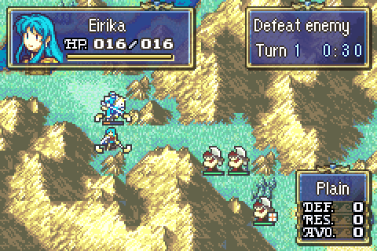

# Real-Time Battle

  

Enemies no longer wait for their own phase. The player phase runs on a clock, and every few seconds an enemy (or green or fourth-allegiance unit) that has not acted yet interrupts the cursor, takes its normal AI action and hands control back.

## How a turn plays out

- A turn lasts a fixed amount of map time, 30 seconds by default. The goal window's second line shows the turn number and the time left. The time turns gold for the last 10 seconds.
- Each player unit can act once per turn, as in vanilla.
- Each AI unit can also act once per turn. The units take turns in order, with one acting every **RT Enemy Delay** (1 second by default). A unit that acted is greyed out until the next turn, like a player unit.
- An AI unit only acts while the player is on the free map cursor. If its delay runs out while you are choosing a destination, in a menu, or watching a battle, it acts as soon as you are back on the cursor. After you return to the cursor you always get at least a third of a second first.
- The turn ends when the clock runs out. It also ends early once you have nothing left to do and every AI unit has acted. "Nothing left to do" means you chose **End** from the map menu, or every unit has moved and auto end turn is on.
- At the end of a turn, the enemy, green and fourth-allegiance phases pass instantly with no phase banner. Their start-of-phase effects still apply: status recovery, terrain healing, poison, traps, pre-phase skills and phase-switch events. Then the next turn starts with the usual Player Phase banner. Turn-based events and reinforcements therefore still work.

## What stops the clock

The clock only runs while you are on the free cursor or picking where a unit moves. It stops for:

- menus, the stat screen and the minimap
- battles, events and AI actions
- the end-of-turn phase passes

## Battle animations

AI actions that interrupt the player always use map animations, so the game keeps moving. Your own attacks follow the animation option as usual.

## Config

In [designer-config.c](../../Data/DesignerConfig/designer-config.c):

| Field | Description |
| :---- | :---------- |
| `real_time_battle` | Master switch. When `false`, the game uses vanilla phases and the options menu hides the real-time entries. |
| `real_time_enemy_interval_frames` | Default delay between AI actions, in frames (60 = 1 second). New games set **RT Enemy Delay** to the closest of 1s, 2s, 3s or 5s. |
| `real_time_turn_frames` | Length of one turn, in frames. `0` means 30 seconds. |

The options menu has two entries for players:

- **Real-Time Mode**: ON/OFF. OFF restores vanilla phases from the next phase change.
- **RT Enemy Delay**: 1s, 2s, 3s or 5s between AI actions.

## Limitations

- Each AI decision runs without yielding and takes 5 to 15 frames. The cursor freezes for that long before each AI action, including for units that decide to stay put.
- Suspend data is written when a turn starts and after each of your actions, not after AI actions. If the console is switched off without suspending, the AI actions since your last action are lost.
- The turn clock is not saved. Resuming a suspended chapter starts the current turn's clock again from full.
- The clock is drawn in the goal window. It is hidden when the goal window is turned off in the options, and when the chapter timer (`goal_timer`) already uses the goal window.
- Enemies that are still waiting when the clock runs out lose their action for that turn.

## Code locations

- [RealtimeScheduler.c](../../Kernel/Wizardry/RealtimeBattle/Source/RealtimeScheduler.c): the turn and enemy clocks, picking the next AI unit, running one AI unit through `CpDecide_Main`/`CpPerform`, and ending the turn
- [RealtimeCore.c](../../Kernel/Wizardry/RealtimeBattle/Source/RealtimeCore.c): config and option lookups
- [RealtimeHooks.c](../../Kernel/Wizardry/RealtimeBattle/Source/RealtimeHooks.c): skips the AI phase banner and cursor reset, and keeps the map music during AI actions
- [RealtimeHud.c](../../Kernel/Wizardry/RealtimeBattle/Source/RealtimeHud.c): the goal window turn clock
- [Usability.c](../../Data/MapMenus/Usability.c): `PlayerPhase_MainIdle` hands control to the scheduler
- [AI.c](../../Kernel/Wizardry/AI/Source/AI.c): `BmMain_StartPhase` skips the AI phases
- [CommonProtection.event](../../Kernel/Preload/CommonProtection.event): points `gProc_BMapMain` and `gProcScr_CpPerform` at the wrappers in `RealtimeHooks.c`
