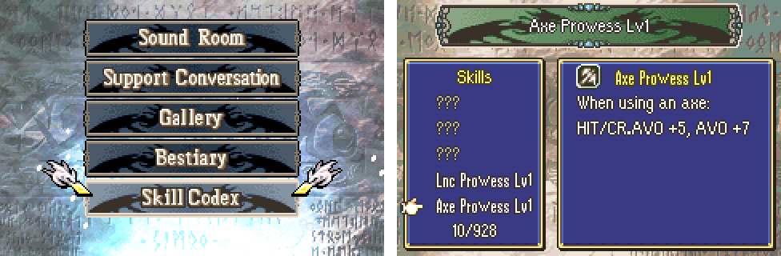

# Skill Codex

  

---

## 📑 Index
- [Introduction](#introduction)
- [Which skills](#which-skills)
- [Meeting](#meeting)
- [How it works](#how-it-works)
- [Testing](#testing)
- [Code Locations](#code-locations)
- [Limitations & Bugs](#limitations--bugs)

---

## 🧩 Introduction

**Extras > Skill Codex**, the last Extras row, lists every skill in the game and describes the ones the player has met:

- **The banner** on top (the Sound Room's song banner) shows the name of the skill under the cursor, or "???" for one
  not met yet.
- **The list** on the left, in a window: "Skills", five names (a skill not met yet shows as "???", in grey), and how
  many are met (10/928). Up and down move the hand; left and right move five rows; **L and R go to the previous or
  next skill met**, so the met ones are quick to find among the hundreds.
- **The info** on the right, in a window: the skill's icon and name, and its description, wrapped to the window with
  8 pixels free on each side (the icon is in line with it), up to six lines. The name at the start of a description ("Axe Prowess Lv1: ...") is left out, as the line above says it.
- B goes back to Extras.

---

## 📋 Which skills

Every skill id from 1 to 0x3FE that is valid (`COMMON_SKILL_VALID`) and has a description (`SkillInfo::desc`), in id
order (`SkillCodex_Listed`). A new skill with a description shows up on its own; nothing to add.

---

## 👁️ Meeting

At the start of every phase (`gPrePhaseFuncs`):

- every unit on the map that the player can see (alive, deployed, not hidden, and not in fog unless it is the
  player's) marks every skill in its skill list: personal, class, equipped and item skills (`GenerateSkillListExt`);
- every skill the army has learned (`gLearnedSkills`) is marked.

`SkillCodex_MarkSeen(sid)` marks one from other code (an event's ASMC, a scroll).

The bits are kept the way the [Bestiary](./Bestiary.md#meeting)'s are: in RAM while playing (`gSkillCodexSeen`,
`struct SkillCodexBits`: a magic word and 1024 bits), and in the bytes after the save tables of the game save and the
suspend save, after the Bestiary's share (`Kernel/Wizardry/SaveData/Source/SaveTail.c`). **The save layout and its
signature do not change.** Starting a new game, loading a game save or resuming takes in every other save's bits; the
title's screen shows what the three game saves and the suspend save hold together.

---

## 🛠️ How it works

- **The Extras row.** Bit 7 of the Extras list's byte (`EXTRA_MENU_OPTION_SKILL_CODEX`), which vanilla never used
  (the list walks all 8 bits). `InitSaveMenuChoice` (`ExtrasMenu/Source/SupportMenu.c`) always adds it; the Extras list
  (`sub_80A9B90`), `SaveMenuStartExtraMiscScreen` and `SaveMenuPostExtraMiscScreen` have a case for it. With Link Arena
  removed (`RemoveLinkArena.event`) the list has at most 7 rows, which vanilla's layout fits.
- **The row's label.** "Skill Codex" is made of vanilla's own letters, pixel for pixel (the "S" of Sound Room, the
  "k" and "i" of Link Arena, the "l" of Gallery, the "Co" of Copy Data, the "d" of Select Mode, the "e" of Battle
  History, the "x" of Extras) by `Tools/extras-labels/labels.py` (see the
  [Bestiary](./Bestiary.md#how-it-works)), in the Extras label sheet (`NewGamePlus/Gfx/Img_NgpMenuObjs.png`), in
  three pieces in the free tiles of Link Arena's sheet row (tiles 14-17, 28-31 and 26-27), centred 64 pixels from
  its sprite's origin. Link Arena's sprite in `gExtrasLabelSprites` is cut to its
  letters (tiles 18-25) to leave them free.
- **The list** is not kept as a table: the cursor and the top row are skill ids, and moving walks the ids
  (`SkillCodex_Step`). The screen's state lives in the Bestiary screen's RAM (`gBestiaryScreen`): the Extras screens
  never run together.
- **The screen** (`SkillCodexScreen.c`): BG0 the text; BG1 the two windows; BG2 the banner and the icon
  (`DrawIcon`, `SKILL_ICON(sid)`, BG palettes 4-5 with the skill's palette bank); BG3 the mural. The hand is the only
  sprite. The banner, the text helpers and the wrapping are shared with the Bestiary
  (`Bestiary/Source/ExtrasUi.c`, `include/kernel/extras-ui.h`).

---

## 🧪 Testing

`python3 Tools/cloud/smoketest.py --only skillcodex`: the prologue's first phase marks the skills of the units on the
map in `gSkillCodexSeen`; the debugger's "Save & restart ch." writes them to the game save; after a reset Extras has
the Skill Codex row; it lists every skill with a description, as many met as were marked, the cursor on the first; R
goes to the first skill met, then the next; DOWN moves a row; B goes back to the save menu.

---

## 🗂️ Code Locations

| What | Where |
|---|---|
| The bits, the phase sweep, the save tail | `Kernel/Wizardry/SkillCodex/Source/SkillCodex.c` |
| The screen | `Kernel/Wizardry/SkillCodex/Source/SkillCodexScreen.c` |
| Shared screen helpers | `Kernel/Wizardry/Bestiary/Source/ExtrasUi.c`, `include/kernel/extras-ui.h` |
| The bytes after the save tables | `Kernel/Wizardry/SaveData/Source/SaveTail.c` |
| The Extras row | `InitSaveMenuChoice` (`ExtrasMenu/Source/SupportMenu.c`); `sub_80A9B90` (`NewGamePlus/Source/NgpSaveMenu.c`); `SaveMenuStartExtraMiscScreen` (`Gallery/Source/Gallery.c`) |
| The label | `NewGamePlus/Gfx/Img_NgpMenuObjs.png`; `gExtrasLabelSprites` in `NgpSaveMenu.c` |
| Hook entries | `gPrePhaseFuncs` (`PrePhaseHook/data.event`), `gNewSaveHooks` (`SaveData/data.event`) |
| Struct, constants | `include/kernel/skill-codex.h` |
| RAM | `gSkillCodexSeen` in `include/link/config-memmap.s`; the screen in `gBestiaryScreen` |
| Messages | `MSG_CODEX_*` at the end of `Contents/Texts/Source/texts/Districts.txt` |
| Smoke test | `test_skillcodex` in `Tools/cloud/smoketest.py` |

---

## 🐛 Limitations & Bugs

- Skills are listed in id order, not by name.
- A skill met after the last save is lost if the game is reset without saving (or suspending).
- Only skills on units on the map at a phase start, and learned ones, are marked: a skill seen only in a shop or on an
  item in the convoy is not.
- A description longer than six lines is cut short.
