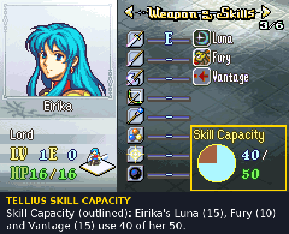

# Tellius Skill Capacity

  

---

## 📑 Index
- [Introduction](#introduction)
- [Plan](#plan)
- [Code Locations](#code-locations)
- [TODO](#todo)
- [Limitations & Bugs](#limitations--bugs)

---

## 🧩 Introduction

One thing I've never really seen any GBA hacks do is introduce a **skill capacity system**.  
This project implements one.

For those unfamiliar, skill capacity is a concept introduced in the **Tellius games (FE9/FE10)**.  
It adds another strategic layer to skill assignment by giving each unit:

- A **capacity meter**
- Each skill a **capacity cost**

Even if a unit has an empty skill slot, the **remaining capacity** must be high enough to equip the skill.  
This forces players to consider meaningful tradeoffs instead of stacking many powerful skills on a single unit.

---

## 🛠️ Plan

The system works as follows:

### ✔️ Skill Rules
- Every **skill** receives a **capacity cost** from its **tier**, E (weakest) to S (strongest) by usefulness:

  | Tier | E | D | C | B | A | S |
  |---|---|---|---|---|---|---|
  | Cost | 3 | 5 | 8 | 10 | 15 | 20 |

  Both are editable in [`Skills_Capacity.h`](../../include/kernel/Skills_Capacity.h): the `SKILL_TIER_*` costs at the top,
  and each skill's tier on its line (`#define MSG_SKILL_Astra_CAPACITY SKILL_TIER_S`). After an edit, rebuild
  `Data/SkillSys/Source/SkillInfo.lyn.event` (`make -B`), which the header does not trigger.

### ✔️ Unit Rules
- Every **unit** starts with **50 capacity**
- Promoted units gain **+25 capacity**

### ✔️ Learning Rules
- A unit **cannot learn a skill** if it would exceed their remaining capacity

---

## 🗂️ Code Locations

| Feature | Location | Description |
|--------|----------|-------------|
| **Skill capacity definitions** | [`Skills_Capacity.h`](../../include/kernel/Skills_Capacity.h) | Defines capacity values per skill |
| **Skill capacity getter** | `GetSkillCapacity(u16 sid)` in [`Infos.c`](../../Kernel/Wizardry/SkillSys/kernel/Infos.c) | Retrieves a skill’s capacity cost |
| **Scroll usability + capacity check** | `ItemUseAction_SkillScroll` in [`SkillScroll.c`](../../Kernel/Wizardry/SkillSys/SkillScroll/Source/SkillScroll.c) | Prevents scroll use when over capacity |
| **Skill capacity wheel GFX** | Labels in [`SkillPageGfx_Installer.event`](../../Kernel/Wizardry/StatScreen/DrawSkillPage/Source/MokhaPlanB/SkillPageGfx_Installer.event) | The labels for the wheel graphics |
| **Skill capacity wheel label externs** | externs for labels in [`custom-functions.h`](../../include/jester_headers/custom-functions.h) | The externed labels for the GFX so they can be called in C code |
| **Skill capacity wheel display** | The ``if(gStatScreen.page == 2)`` block in the ``PageNumCtrl_DisplayMuPlatform`` function in [`DrawMorePage.c`](../../Kernel/Wizardry/StatScreen/DrawMorePage/Source/DrawMorePage.c) | The code to display the wheel |
| **Skill capacity wheel title/numbers** | Bottom of the ``DrawSkillPage_MokhaPlanB`` function in [`SkillPageGfx_Installer.event`](../../Kernel/Wizardry/StatScreen/DrawSkillPage/Source/MokhaPlanB/disp.c) | The display of the skill capacity title as well as the unit's used/max skill capacity |

---

## 📝 TODO

- Make the wheel scroll with the rest of the background when transitioning between pages/units

---

## 🐛 Limitations & Bugs

Please report any issues in the repository’s **Issues** tab.

### ⚠️ Known Concerns

#### 1. Capacity-reducing skills may cause overflow conditions  
Some skills reduce the capacity required for other skills.  
If the reducing skill is removed, the unit may remain **over capacity** yet still retain skills they normally could not equip.

This is currently unresolved.

#### 2. Skills learned outside a scroll

A skill a player unit learns from a level-up, a promotion or an event (`Evt_AddSkill` and its forms) goes through
`AddSkillWithinCapacity` (`LoadSkill.c`): it is learned, but equipped only if it fits the unit's capacity
(`SkillFitsCapacity`); otherwise the player can equip it later in the skill menu, once there is room. A unit's
starting skills (`UnitAutoLoadSkills`), the preparations' skill menu, the skill shop, the skill tree and Predation still
equip without the check. The Skill Capacity tutorial shows a scroll that fits, one that does not, and a skill taught in
a talk that does not fit.

---
