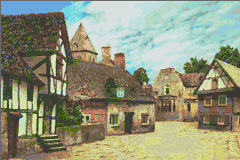
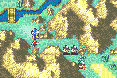
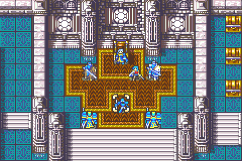
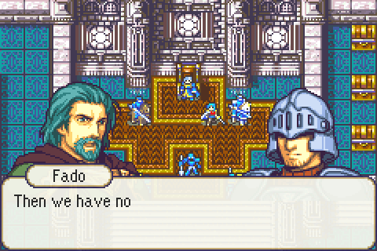

# FE8 Text Engine Rework

<p align="center">
  
</p>

<p align="center">
  
</p>

---

## 📑 Index
- [Introduction](#introduction)
- [Plan](#plan)
- [Supported Control Codes](#supported-control-codes)
  - [Scene layout](#scene-layout)
  - [Big text](#big-text)
  - [Popups](#popups)
  - [Auto-advance](#auto-advance)
  - [Rainbow text](#rainbow-text)
  - [Listener dimming](#listener-dimming)
- [Code Locations](#code-locations)
- [TODO](#todo)
- [Limitations & Bugs](#limitations--bugs)

---

## 🧩 Introduction

This rework expands the FE8 dialogue interpreter while keeping existing text functional. It is a C port of Tequila's text-engine hack (with help from Zahlman), wired through LynJump hooks so the game always runs the extended interpreter.

Player-facing impact:

- Dialogue can switch fonts, colors, box styles, and print speed from script commands.
- Dialogue can apply a horizontal scanline wave to its background layers.
- Printed letters can bounce in, wave into place, scramble then resolve, drip from above, or leave a ghost echo.
- Speaker nameplates can show the active character’s name above the dialogue box, with a matching BG1 frame; they are off by default and toggled per dialogue.
- A scene layout swaps the floating speech bubbles for one full-width box along the bottom of the screen. Portraits stand behind it and the speaker's name sits on a tab across the box's top-left edge, like a classic cutscene. It is off by default and toggled per dialogue.
- Big text, inspired by Paper Mario, prints letters at twice their usual size across two dialogue lines for shouted or emphasised words. Each letter bursts in, overshoots, springs back into place and jolts the box. It is toggled per dialogue.
- Popups cut in over the scene like a courtroom "Objection!": the box closes, a white flash hits, a jagged burst with big slanted lettering slams in and shakes, then dialogue resumes in a fresh box. "Objection!", "Hold it!" and "Take that!" ship as examples; more can be added to a table.
- Text boxes can move on by themselves after a set number of frames, once or at every `[A]` until toggled off, for timed cutscenes and interrupted lines.
- Rainbow text gives each letter a colour in turn, and the colours keep turning around the colour wheel.
- Portraits of characters who aren't speaking dim slightly and light up again when they speak (`dim_listener_portraits` in the designer config, on by default).
- A rolling screen tear, a separate corruption-static effect, and a whole-screen earthquake rumble can be toggled from dialogue or `ASMC`; all three are off by default.
- A one-shot white impact flash can fire from dialogue or `ASMC` and decays on its own.
- Portraits remember per-slot attributes (font, color group, box palette, box type, boop pitch) and reuse them when the speaker changes.
- Portraits can load with flip / eyes-closed options, move at custom speeds, use remapped screen positions, and jump, vibrate, or shimmy continuously while speaking.
- Portraits can dissolve into drifting 16×16 chips instead of pal-fading out (`[ClearFaceAsh]`).
- `[Sweat]` drops a 16×16 sweat bead onto the active portrait's cheek and holds there. `[Anger]` shows a 16×16 anger mark on the forehead and pulses it by growing and shrinking four times before the next text box. Each plays through fully before the following text box continues.
- Existing vanilla text remains readable and compatible with the new parser.

A standalone version for clean FE8U, installable through FEBuilder's Insert EA, is in [`Standalone/text_engine`](../../Standalone/text_engine/).

This feature is intended for **standard cutscene text**. It has not been validated against every alternate dialogue path the game can use.

---

## 🛠️ Plan

The rework is a small set of C hooks plus shared tables.

| Layer | Behavior | Result |
|-------|----------|--------|
| Interpreter dispatch | Replaces the vanilla talk interpreter with `TalkInterpret` | Extended `0x80` commands parse safely |
| Text measurement | Recalculates box width with `GetStringTextWidthWithDialogueCodes` | Control codes and font changes no longer break width math |
| Presentation state | Copies and updates face attributes before the box appears | Palette, box, and font settings follow the active speaker |
| Face / box hooks | C replacements for load, move, open, clear, and promotion UI | Variable-speed moves, 1–3 line boxes, fancy face load, and ash-dissolve clear work on the main dialogue path |
| Dialogue wave | Secondary HBlank callback updates BG0–BG3 horizontal offsets from a packed 160-line table | Text, textbox, and background layers move with a continuous horizontal wave |
| Screen earthquake | Secondary HBlank callback adds a 2px XY rumble from a looping offset table | Backgrounds, portraits, and map sprites shake together until toggled off |
| Speaker nameplate | Draws the speaking face’s name on BG0 with a matching BG1 talk-bubble frame above the box | Off by default; `[ToggleOnNameplate]` enables per dialogue |
| Scene layout | Replaces the talk-open proc with a full-width bottom box, raises newly loaded portraits so their lower 16px stand behind it, and pins the nameplate to the box's top-left edge | Off by default; `[ToggleOnSceneLayout]` enables per dialogue, `[ToggleOffSceneLayout]` returns to speech bubbles |
| Big text | Doubles each glyph into the active line and the line below; each letter lands first as a scaling affine OBJ, then bakes into the text | Off by default; `[ToggleOnBigText]` / `[ToggleOffBigText]` around the words |
| Popups | Closes the box and shows a full-screen cut-in on BG0 using the dialogue font's tiles and palette, with a flash, sound and shake | `[Objection]`, `[HoldIt]`, `[TakeThat]` or `[Popup][XX]` from `TextEnginePopupTable` |
| Auto-advance | `[A]` starts the vanilla wait-for-input proc plus a timer proc that ends it after a set number of frames | `[AutoAdvance][XX]` once, or `[ToggleOnAutoAdvance][XX]` for every `[A]` |
| Rainbow text | Letters take three text colour groups in turn; a VSync proc rewrites those groups' colours every frame | Off by default; `[ToggleOnRainbow]` / `[ToggleOffRainbow]` around the words |
| Listener dimming | A VSync proc darkens the palettes of talk portraits other than the speaker's, worked out from each portrait's own palette data, and fades them back when they speak | `gpKernelDesignerConfig->dim_listener_portraits` |
| Script-facing aliases | Friendly names in `Contents/Texts/textdefs.txt` plus table data in `Text_Engine_Tables.event` | Text writers can use macros instead of raw bytes |

### Attribute model

When a portrait is loaded (`LoadFace` / `LoadFaceFancy`), the engine assigns default attributes to that face slot:

| Attribute | Default index | Meaning |
|-----------|---------------|---------|
| Font | `0x01` | Normal FE8 font |
| Color group | `0x02` | Default conversation text colors |
| Box background palette | `0x01` | Default box palette |
| Box type | `0x01` | Default speech bubble |
| Boop pitch | `0x0D` | Default pitch |

Updates stick to the face until you change them again, clear the face, or end the dialogue. Moving a portrait copies attributes to the new slot, so speaker switches do not require re-setting every style command.

### Build wiring

1. `TextEngineRework_Installer.event` includes `Source/LynJump.event`, generated `Source/TextEngineRework.lyn.event`, `Text_Engine_Tables.event` and `Popups/Popups.event`.
2. `Source/LynJump.event` installs whole-function trampolines and a few call-sites.
3. Tables define fonts, text palettes, box palettes, box graphics, boop timing data, and the popup graphics.
4. `Contents/Texts/textdefs.txt` exposes author-facing aliases such as `[Font]`, `[LoadFaceFancy]`, `[MML2]`, `[ToggleOnSceneLayout]`, `[ToggleOnBigText]`, `[Objection]`, `[AutoAdvance]` and `[ToggleOnRainbow]`.
5. `include/link/config-memmap.s` reserves `sTextEngineNameplateState`, `sTextEngineSceneLayoutState`, `sTextEngineBigTextState` and `sTextEngineAutoAdvanceState`; the last three sit at the end of the kernel RAM pool.

---

## 🎛️ Supported Control Codes

All extended commands use the `[0x80][XX]...` form. **Arguments must be non-zero**: `0x00` terminates copied text. Portrait IDs are written as little-endian shorts with `0x100` added (portrait `0x02` → `[0x02][0x01]`). Write an argument as a raw byte such as `[0x3C]`: the text compiler turns any `[0x01]`–`[0xFF]` that `textdefs.txt` doesn't define into that byte.

| Code | Alias | Arguments | Summary |
|------|-------|-----------|---------|
| `0x26` | `[Font]` | `XX` font index (`0x01`–`0xFF`) | Switches the active font from `FontGlyphsPointerTable` (1 normal, 2 bold, 3 italics by default) |
| `0x27` | `[TextPalette]` | `XX` color group, `YY` palette index | Updates one 3-color text group in the active palette |
| `0x28` | `[ColorGroup]` | `XX` color group (`0x01`–`0x05`) | Selects which color group draws new text (`0x05` ≈ `[ToggleRed]`) |
| `0x29` | `[BoxBgPalette]` | `XX` palette index | Swaps the text-box background palette |
| `0x2A` | `[BoxType]` | `XX` type index; bit `0x80` controls tails | Changes box graphics / speech-tail behavior before the next bubble opens |
| `0x2B` | `[BoxHeight]` | `XX` lines (`0x01`–`0x03`) | Sets 1-, 2-, or 3-line box height |
| `0x2C` | `[BoopPitch_*]` | `XX` pitch (`0x01`–`0x19`, default `0x0D`) | Sets the active face's letter-blip pitch. `0x01` is one octave below the default, `0x19` is one octave above |
| `0x2D` | `[PlaySound]` | four nybble bytes | Plays sound `0xABCD` encoded little-endian with each nybble OR'd with `0x80` |
| `0x2E` | `[MugLoc]` | `XX` slot (`0x01`–`0x08`), `YY` signed X tiles | Remaps a face-slot X position (`YY = 0x80` means tile 0) |
| `0x2F` | `[LoadFaceFancy]` | options + attrs + portrait id | Loads a face with flip / eyes-closed options and explicit attributes |
| `0x30`–`0x37` | `[MFL2]` … `[MFFR2]` | `YY` frames | Moves a portrait to that slot over `YY` frames |
| `0x38` | `[TextSpeed]` | `XX` frames, or `0xFF` | Overrides print delay; `0xFF` restores the Options menu speed |
| `0x39` | `[ToggleOnJumping]` | none | Starts continuous jumping on the active portrait |
| `0x3A` | `[ToggleOffJumping]` | none | Stops jumping and restores the portrait's resting Y |
| `0x3B` | `[ToggleOnShakePrint]` | none | Each printed glyph briefly jitters the dialogue text layer |
| `0x3C` | `[ToggleOffShakePrint]` | none | Disables shake-on-print |
| `0x3D` | `[ToggleOnBouncePrint]` | none | Each letter floats down into place as an OBJ, then bakes into the text |
| `0x3E` | `[ToggleOffBouncePrint]` | none | Disables bounce-on-print |
| `0x3F` | `[ToggleOnWave]` | none | Applies a continuous horizontal wave to BG0–BG3 |
| `0x40` | `[ToggleOffWave]` | none | Restores the dialogue background layers' normal horizontal offsets |
| `0x41` | `[ToggleOnVibrating]` | none | Starts a fast, one-pixel vertical vibration on the active portrait |
| `0x42` | `[ToggleOffVibrating]` | none | Stops vibration and restores the portrait's resting Y |
| `0x43` | `[ToggleOnShimmy]` | none | Starts a fast, one-pixel horizontal shimmy on the active portrait |
| `0x44` | `[ToggleOffShimmy]` | none | Stops shimming and restores the portrait's resting X |
| `0x45` | `[ToggleOnNameplate]` | none | Enables speaker nameplates (default off); redraws if a box is already open |
| `0x46` | `[ToggleOffNameplate]` | none | Disables speaker nameplates and clears any active plate |
| `0x47` | `[ToggleOnGlitch]` | none | Starts a horizontal screen tear on BG0–BG3 (a rolling vsync split) |
| `0x48` | `[ToggleOffGlitch]` | none | Stops the screen tear |
| `0x49` | `[ToggleOnStatic]` | none | Starts white horizontal scanline static over the screen |
| `0x4A` | `[ToggleOffStatic]` | none | Stops the scanline static |
| `0x4B` | `[ClearFaceAsh]` / `[AshDissolve]` | none | ClearFace variant: the active portrait dissolves into drifting 16×16 chips, then fades |
| `0x4C` | `[ToggleOnWavyPrint]` | none | Each letter settles with a decaying sine wobble |
| `0x4D` | `[ToggleOffWavyPrint]` | none | Disables wavy-on-print |
| `0x4E` | `[ToggleOnScramblePrint]` | none | Each letter cycles random A–Z glyphs, then resolves to the real character |
| `0x4F` | `[ToggleOffScramblePrint]` | none | Disables scramble-on-print |
| `0x50` | `[ToggleOnDripPrint]` | none | Each letter hangs, then drops into place |
| `0x51` | `[ToggleOffDripPrint]` | none | Disables drip-on-print |
| `0x52` | `[ToggleOnGhostPrint]` | none | Each letter appears with a trailing ghost echo, then bakes |
| `0x53` | `[ToggleOffGhostPrint]` | none | Disables ghost-echo-on-print |
| `0x54` | `[ToggleOnEarthquake]` | none | Starts a 2px screen rumble on BG0–BG3 and matching OBJ |
| `0x55` | `[ToggleOffEarthquake]` | none | Stops the rumble and restores resting offsets |
| `0x56` | `[ImpactFlash]` | none | One-shot white screen flash that peaks for 2 frames, then fades over 10 more |
| `0x57` | `[Sweat]` | none | One-shot 16×16 sweat drop on the active portrait's cheek. Falls into place, holds, then blinks out. The next text waits until it finishes |
| `0x58` | `[Anger]` | none | One-shot 16×16 anger mark on the active portrait's forehead. Grows and shrinks four times, then the next text box continues |
| `0x59` | `[ToggleOnSceneLayout]` | none | Starts the scene layout: a full-width box along the bottom of the screen, portraits behind it, and a speaker name tab on the box's top-left edge. Closes any open bubble so the next text reopens in the new layout |
| `0x5A` | `[ToggleOffSceneLayout]` | none | Returns to normal speech bubbles, moves portraits back to their normal height, and restores the nameplate setting from before the layout was turned on |
| `0x5B` | `[ToggleOnBigText]` | none | Following letters print at twice their size, filling the active line and the line below it. Each one lands explosively, and printing slows to at least 5 frames per letter |
| `0x5C` | `[ToggleOffBigText]` | none | Returns to normal-size letters and the previous print speed. The rest of that line stays on the big letters' baseline |
| `0x5D` | `[Popup]` / `[Objection]` / `[HoldIt]` / `[TakeThat]` | `XX` popup index (`0x01`+) | Closes the box and shows popup `XX` from `TextEnginePopupTable` with a flash, sound and shake for 60 frames (A or B skips after 24), then the next text opens a new box |
| `0x5E` | `[AutoAdvance]` | `XX` frames (`0x01`–`0xFF`) | Used in place of `[A]`: no arrow, and the box moves on by itself after `XX` frames (a button press moves on sooner) |
| `0x5F` | `[ToggleOnAutoAdvance]` | `XX` frames (`0x01`–`0xFF`) | Every following `[A]` shows its arrow as usual but moves on by itself after `XX` frames |
| `0x60` | `[ToggleOffAutoAdvance]` | none | `[A]` waits for the player again |
| `0x61` | `[ToggleOnRainbow]` | none | Following letters take three colour groups in turn, and the groups' colours turn around a colour wheel |
| `0x62` | `[ToggleOffRainbow]` | none | Back to the colour from before `[ToggleOnRainbow]`. Rainbow letters already printed keep changing colour until the dialogue ends |

`ASMC(EnableScreenGlitch)` / `ASMC(DisableScreenGlitch)`, `ASMC(EnableScreenStatic)` / `ASMC(DisableScreenStatic)`, and `ASMC(EnableScreenEarthquake)` / `ASMC(DisableScreenEarthquake)` toggle the same effects outside dialogue. All three stay on until turned off; they are not cleared when talk ends. Earthquake also plays vanilla rumble `SONG_26A` on start and fades sound effects on stop. `ASMC(StartScreenImpactFlash)` fires the same one-shot flash as `[ImpactFlash]`; firing it again while a flash is still decaying restarts the hit.

### Fancy LoadFace options

`[LoadFaceFancy]` expects options with bit `0x80` always set (avoids an accidental terminator), then font / color group / bg palette / box type / pitch, then the portrait id:

- bit `0x01`: flip the portrait to face right; if unset, the portrait always faces left
- bit `0x02`: load with eyes closed

Helpers like `[FlipRight]` / `[FlipLeft]` and portrait-specific `[LoadFaceFancy_*]` aliases live in `textdefs.txt`.

### Color groups

A text palette is 16 colors. Dialogue glyphs are 2bpp (4 colors, first transparent). With a shared transparent color there are five usable groups:

| Group | Colors used | Vanilla role |
|-------|-------------|--------------|
| 1 | 1–4 | World map text |
| 2 | 1, 5–7 | Default conversation text |
| 3 | 1, 8–10 | Unused by default (blue, hard to read) |
| 4 | 1, 11–13 | Unused by default (yellow, hard to read) |
| 5 | 1, 14–16 | `[ToggleRed]` |

`[ToggleOnRainbow]` borrows groups 1, 3 and 4 (see [Rainbow text](#rainbow-text)).

`[TextPalette]` rewrites one group's three opaque colors. Any on-screen text already using that group updates immediately.

### Examples

```text
[TextSpeed][0xFF]
[LoadFaceFancy][0x04][0x01][0x02][0x01][0x02][0x01][0x01][0x0D]
[Font][0x02]Eirika: I can change the text style mid-sentence.
[ColorGroup][0x05][TextPalette][0x02][0x05]Another color is now active.
[BoxType][0x03][BoxHeight][0x03]A different textbox shape can appear on the next line.
[PlaySound][0x8D][0x8C][0x8B][0x8A]That sound effect fires before the next message.
[MML2][0x10]Move me more slowly than vanilla.
[ToggleOnJumping]I can't sit still!
[ToggleOffJumping]Okay, I'm calm again.
[ToggleOnVibrating]This portrait is trembling.
[ToggleOffVibrating]Now it is steady again.
[ToggleOnShimmy]This portrait is shimmying.
[ToggleOffShimmy]Now it is centered again.
[ToggleOnShakePrint]Every letter hits a little harder now.
[ToggleOffShakePrint]Back to a steady print.
[ToggleOnBouncePrint]These letters drop into place.
[ToggleOffBouncePrint]And now they don't.
[ToggleOnWavyPrint]These letters wobble into place.
[ToggleOffWavyPrint]Steady again.
[ToggleOnScramblePrint]These letters decode themselves.
[ToggleOffScramblePrint]Plain type once more.
[ToggleOnDripPrint]These letters drip down.
[ToggleOffDripPrint]No more dripping.
[ToggleOnGhostPrint]These letters leave an echo.
[ToggleOffGhostPrint]The echo is gone.
[ToggleOnWave]The dialogue scene ripples gently.
[ToggleOffWave]And now it is steady again.
[ToggleOnNameplate]This line shows a speaker plate.
[ToggleOffNameplate]And now the nameplate is off again.
[ToggleOnGlitch]The picture tears across the screen.
[ToggleOffGlitch]And now it is aligned again.
[ToggleOnStatic]The picture is breaking up.
[ToggleOffStatic]And now it is stable again.
[ToggleOnEarthquake]The ground will not hold still.
[ToggleOffEarthquake]And now it is still again.
[ImpactFlash]That hit lands all at once.
[Sweat]I was not ready for that.
[Anger]That is enough.
[ToggleOnSceneLayout]Emperor Vigarde's forces are within the castle walls.
[ToggleOffSceneLayout]Back to speech bubbles.
[ToggleOnBigText]HALT![ToggleOffBigText] Who goes there?
Wait, I didn't[AutoAdvance][0x1E][N]
[ToggleOnAutoAdvance][0x78]These lines move on by themselves.[A][ToggleOffAutoAdvance]
[ToggleOnRainbow]Rainbow text![ToggleOffRainbow] And back to normal.
[ClearFaceAsh]
```

### Scene layout

`[ToggleOnSceneLayout]` changes how every following text box opens until `[ToggleOffSceneLayout]` or the end of the dialogue:

| Element | Normal bubbles | Scene layout |
|---------|----------------|--------------|
| Box | Sized to the text, floats beside the speaker, with a tail | Always 30 tiles wide, pinned to the bottom edge (`[BoxHeight]` sets 1–3 lines), no tail |
| Speaker change | Old bubble closes, new one slides in | Box redraws in place without the open animation; the text and name tab change |
| Portraits | Top at Y 80 | Newly loaded mugs, and mugs already on screen when the toggle runs, move up so their lower 16px stand behind the box (half-body portraits keep their normal height) |
| Nameplate | Off unless `[ToggleOnNameplate]` | On. A 2-tile tab starts at tile column 2 and straddles the box's top border; its bottom corners are merged with the box edge so the box line and fill continue behind the tab instead of the scene showing through |
| Unnamed speakers | No plate | A portrait with no character entry is named after a class: first from the generic event portrait table (soldiers, fighters, civilians), then the class that lists the portrait as its default. The generic soldier mug shows "Soldier" |

Put the toggle at the start of a box. Portrait slots keep their usual X positions, so a two-person scene usually pairs `[OpenMidLeft]` with `[OpenMidRight]`. The box opens with the usual slide-up the first time, and again after `[CloseSpeechSlow]` or a `[ClearFace]` that closes it.

```text
[ToggleOnSceneLayout][OpenMidLeft][LoadFace][0x02][0x01]
[OpenMidRight][LoadFace][0x14][0x01]Emperor Vigarde's forces are within
the castle walls.[A][OpenMidLeft]Then we hold the throne room.[A]
[ToggleOffSceneLayout]
```

### Big text

<p align="center">
  
</p>

`[ToggleOnBigText]` pixel-doubles every following letter, Paper Mario style, until `[ToggleOffBigText]`:

| Situation | Result |
|-----------|--------|
| Big letters | Twice as wide and twice as tall. The top half prints on the active line and the bottom half on the line below |
| Landing | Each letter bursts out of a speck to 2.5x its normal size with a quick tilt, springs back under its big size, and settles over 10 frames. The box and its text jolt when it lands. Then it is baked into the lines |
| Print speed | At least 5 frames per big letter so each landing reads; the previous speed returns at `[ToggleOffBigText]`. Skipping ahead with A prints the rest at once with no landings |
| Normal letters after `[ToggleOffBigText]` on the same line | Print on the lower line so they share the big letters' baseline |
| `[N]` after a big line | Moves past both lines. If the box has no line left under them, the box clears instead of scrolling half a letter away |
| `[A]` after a big line | The wait arrow sits on the big letters' baseline |
| Big text on the box's last line | Prints at normal size, because there is no line below to hold the lower half |
| Box width | Measured with big letters at double width |

Start big text at the beginning of a line with a free line under it: the first line of the default 2-line box, or either of the first two lines of a 3-line box.

```text
[ToggleOnBigText]Your Majesty![ToggleOffBigText][A][N]
[ToggleOnBigText]What?![ToggleOffBigText] Already...?[A]
```

### Popups

<p align="center">
  
</p>

`[Objection]` (`[Popup][0x01]`), `[HoldIt]` (`0x02`) and `[TakeThat]` (`0x03`) cut in over the scene:

| Frame | What happens |
|-------|--------------|
| Command | The box, text and nameplate close. Any big-text landings in flight are dropped |
| +1 | The popup is drawn on BG0, centered, above the portraits. The table entry's sound plays and the screen flashes white |
| +1 to +10 | BG0 shakes hard, then settles |
| +24 | A or B can dismiss it |
| +60 | It ends by itself. The text tiles and palette it borrowed are restored and the next text opens a new box (with its open animation) |

```text
[OpenMidLeft]Then we lay down our arms and...[A]
[OpenMidRight][Objection]
[ToggleOnBigText]Never![ToggleOffBigText][A]
```

**Adding a popup**

1. Draw a 16-color indexed PNG, color 0 transparent, at most 240×160. `Popups/generate_popups.py` draws the shipped burst-and-lettering style; add an entry to its `POPUPS` list, or draw your own.
2. Keep it to 240 unique 8×8 tiles after flip reduction (the script prints the count). The popup borrows the dialogue text tiles, which hold no more.
3. Convert it with the makefile's grit rule: `grit Name.png -gB 4 -gzl -m -mLf -mR4 -mzl -pn 16 -ftb -fh! -o Name.img.bin` (this writes `Name.img.bin`, `Name.map.bin`, `Name.pal.bin`).
4. Add a line to `TextEnginePopupTable` in `Popups/Popups.event` with its width and height in tiles and a sound effect (`0` for none), before the closing `WORD 0 0 0 0`. Its index is its position in the table, starting at `0x01`.

### Auto-advance

`[AutoAdvance][XX]` goes where an `[A]` would. The box holds for `XX` frames with no arrow, then carries on as if the player had pressed A. Use it to cut a line off, or for a cutscene that plays itself:

```text
[OpenMidRight]Your Majesty, the gate[AutoAdvance][0x1E]
[OpenMidLeft]I know. Go.[A]
```

`[ToggleOnAutoAdvance][XX]` makes every following `[A]` move on by itself after `XX` frames, until `[ToggleOffAutoAdvance]` or the end of the dialogue. The arrow still shows.

| Situation | Result |
|-----------|--------|
| The player presses A or the D-Pad during the wait | Moves on straight away, as with `[A]`. The first 8 frames ignore input, as vanilla does. B still skips the whole dialogue |
| The conversation log is open | The timer pauses until it closes |
| `[A]` with the toggle off | Waits for the player as usual |
| A new dialogue starts | The toggle is off |

60 frames is one second. Arguments are single bytes, so the longest wait is `[0xFF]` (about 4 seconds); chain two for longer.

### Rainbow text

`[ToggleOnRainbow]` gives each following letter one of three colour groups in turn (spaces don't take a turn). Every frame the three groups' colours move along a red, orange, gold, green, teal, blue, violet, magenta wheel, a third of a turn apart, so the word shimmers through the rainbow.

```text
[OpenMidLeft]It's the [ToggleOnRainbow]Sacred Stone[ToggleOffRainbow] of Renais![A]
```

| Situation | Result |
|-----------|--------|
| `[ToggleOffRainbow]` | New letters go back to the colour from before `[ToggleOnRainbow]`. Rainbow letters already on screen keep changing colour |
| The dialogue ends | The three groups get their colours back |
| Letter-print effects or big text | They work with it; the letters land in rainbow colours |
| A popup or the conversation log is showing | The colours hold still, since both swap the text palette for their own |

The hues are `sTextEngineRainbowHues` in `TextEngineRework.c`, picked to stay readable on the light box. The edge and shadow pixels blend towards the default text colour's, so a different `[BoxBgPalette]` still suits them.

### Listener dimming

With `dim_listener_portraits` on in the designer config (the default), whenever someone is speaking, every other portrait in the conversation darkens by about a third over 8 frames. When the speaker changes, the new speaker lights up and the old one dims at the same time. Nothing needs adding to scripts.

| Situation | Result |
|-----------|--------|
| The active slot has no portrait (narration, an off-screen voice) | Everyone is lit |
| A portrait fades in or out | Left to the fade. A newly loaded listener fades in, then dims |
| Half-body and 32-colour portraits | Their second palette dims with the first |
| The dialogue ends with portraits still on screen | They are lit again |

How dark and how fast are `TEXT_ENGINE_DIM_STRENGTH` (in 32nds) and `TEXT_ENGINE_DIM_FRAMES` in `TextEngineRework.c`.

### Custom fonts

1. Create a PNG using `Fonts/FE8_Text_Norm.png` as a reference.
2. Edit and run `Fonts/generate_font.py` (Python 3) to emit an installer.
3. Include the installer from `Text_Engine_Tables.event`.

Glyph width lives in the 6th header byte of each glyph entry; adjust kerning there if bold/italic spacing looks too wide.

---

## 🗂️ Code Locations

| Feature | Location | Description |
|--------|----------|-------------|
| Dialogue interpreter | `TalkInterpret` in [`Source/TextEngineRework.c`](../../Kernel/Wizardry/TextEngineRework/Source/TextEngineRework.c) | Parses vanilla and extended control codes; LynJump at `$6FD0` |
| Width calculation | `GetStringTextWidthWithDialogueCodes` in [`Source/TextEngineRework.c`](../../Kernel/Wizardry/TextEngineRework/Source/TextEngineRework.c) | Measures dialogue including rework codes and font switches; LynJump at `$8B44` |
| Font / color / box helpers | `UpdateFontGlyphSet`, `ChangeTextColorID`, `UpdateTextBoxBgPalette`, `Copy_Text_Attributes`, `DecompressTextBoxGraphics` in [`Source/TextEngineRework.c`](../../Kernel/Wizardry/TextEngineRework/Source/TextEngineRework.c) | Apply presentation state and drive `gProc_DialogueBoxAppearingAnimation` |
| Talk init / face X table | `Talk_OnInit_C`, `GetTalkFaceHPos` in [`Source/TextEngineRework.c`](../../Kernel/Wizardry/TextEngineRework/Source/TextEngineRework.c) | Seeds remappable face positions/default attrs; reads the face X table |
| Talk open / clear | `InitTalk_C`, `StartTalkOpen_C`, `TalkShiftClearAll_OnInit_C`, `TalkShiftClear_OnInit_C` in [`Source/TextEngineRework.c`](../../Kernel/Wizardry/TextEngineRework/Source/TextEngineRework.c) | Supports 1–3 line boxes and clear origins |
| Variable-speed face move | `StartTalkFaceMove_C`, `TalkFaceMove_OnInitOverride` in [`Source/TextEngineRework.c`](../../Kernel/Wizardry/TextEngineRework/Source/TextEngineRework.c) | Full C replacement for face moves with custom duration |
| Fancy / normal face load | `TextEngine_LoadFace` in [`Source/TextEngineRework.c`](../../Kernel/Wizardry/TextEngineRework/Source/TextEngineRework.c) | Shared loader used by `LoadFace` and `LoadFaceFancy` |
| Continuous face motion | `TextEngine_StartFaceJump`, `TextEngine_StartFaceVibrate`, `TextEngine_StartFaceShimmy`, `TextEngine_StopFaceJump`, `TextEngine_StopFaceVibrate`, `TextEngine_StopFaceShimmy`, `gProcScr_TextEngineFaceJump` in [`Source/TextEngineRework.c`](../../Kernel/Wizardry/TextEngineRework/Source/TextEngineRework.c) | Child proc that jumps, vibrates, or shimmies the active portrait until toggled off |
| Shake / letter-print FX | `TextEngine_OnCharacterPrinted`, `TextEngine_TryStartGlyphFloat`, `gProcScr_TextEnginePrintFx`, `gProcScr_TextEngineGlyphFloat` in [`Source/TextEngineRework.c`](../../Kernel/Wizardry/TextEngineRework/Source/TextEngineRework.c); hooked from `Talk_OnIdle` in [`MiscFunctions.c`](../../Kernel/Wizardry/MiscFunctions/Source/MiscFunctions.c) | Shake = BG0 micro-jitter; bounce / wavy / scramble / drip / ghost = per-letter OBJ that bakes into dialogue text |
| Horizontal dialogue wave | `TextEngineWave_OnHBlank`, `TextEngineWave_BuildBuffer`, `gProcScr_TextEngineWave` in [`Source/TextEngineRework.c`](../../Kernel/Wizardry/TextEngineRework/Source/TextEngineRework.c) | Uses the secondary HBlank slot to offset BG0–BG3 per scanline while preserving and restoring the previous secondary handler |
| Speaker nameplates | `TextEngine_DrawSpeakerNameplate`, `TextEngine_ClearSpeakerNameplate`, `TextEngine_BuildSceneTabCornerTile`, `TextEngine_FindClassNameByPortrait`, `sTextEngineGenericPortraitClasses`, `TextEngine_CommandStartNameplate`, `TextEngine_CommandStopNameplate` in [`Source/TextEngineRework.c`](../../Kernel/Wizardry/TextEngineRework/Source/TextEngineRework.c) | BG0 name text + BG1 talk-bubble frame above the box; default-off with `0x45`/`0x46` toggles. In the scene layout it becomes a tab on the box's top-left edge with merged corners, and unnamed generic speakers are named after a class. Redrawn on the next letter after a page scroll |
| Whole-screen glitch | `EnableScreenGlitch`, `DisableScreenGlitch`, `gProcScr_TextEngineScreenGlitch` in [`Source/TextEngineRework.c`](../../Kernel/Wizardry/TextEngineRework/Source/TextEngineRework.c) | Horizontal screen tear: a rolling split shifts BG0–BG3 (and matching OBJ) on the X axis; `ASMC(EnableScreenGlitch)` and `[ToggleOnGlitch]`/`[ToggleOffGlitch]` |
| Whole-screen static | `EnableScreenStatic`, `DisableScreenStatic`, `gProcScr_TextEngineScreenStatic` in [`Source/TextEngineRework.c`](../../Kernel/Wizardry/TextEngineRework/Source/TextEngineRework.c) | White scanline streaks drawn as OBJ over the picture (backgrounds do not wobble); `ASMC(EnableScreenStatic)` and `[ToggleOnStatic]`/`[ToggleOffStatic]` |
| Whole-screen earthquake | `EnableScreenEarthquake`, `DisableScreenEarthquake`, `gProcScr_TextEngineScreenEarthquake` in [`Source/TextEngineRework.c`](../../Kernel/Wizardry/TextEngineRework/Source/TextEngineRework.c) | 2px XY rumble on BG0–BG3 plus portraits, float glyphs, and map sprites; `ASMC(EnableScreenEarthquake)` and `[ToggleOnEarthquake]`/`[ToggleOffEarthquake]` |
| Impact flash | `StartScreenImpactFlash`, `gProcScr_TextEngineImpactFlash` in [`Source/TextEngineRework.c`](../../Kernel/Wizardry/TextEngineRework/Source/TextEngineRework.c) | One-shot full-screen white brighten that decays over 12 frames; `ASMC(StartScreenImpactFlash)` and `[ImpactFlash]` |
| Portrait ash dissolve | `TextEngine_StartAshDissolve`, `gProcScr_TextEngineAshDissolve` in [`Source/TextEngineRework.c`](../../Kernel/Wizardry/TextEngineRework/Source/TextEngineRework.c) | `[ClearFaceAsh]` hides the live mug and rebuilds it as 16×16 OBJ chips that drift up and fade; not a screen FX. Exceed-portrait pieces ([ExceedPortraitBox](./ExceedPortraitBox.md)) dissolve with the mug |
| Scene layout | `TextEngine_SetSceneLayout`, `TextEngine_IsSceneLayoutActive`, `TextEngine_GetTalkFaceY`, `TextEngineSceneOpen_PutBox`, `gProcScr_TextEngineSceneOpen` in [`Source/TextEngineRework.c`](../../Kernel/Wizardry/TextEngineRework/Source/TextEngineRework.c) | `StartTalkOpen_C` starts the scene-open proc instead of `gProcScr_TalkOpen`; box width is forced in `UpdateFontBeforeBoxWidthCalc` and `TalkInterpret`; `DecompressTextBoxGraphics` skips to the final tile frame when the box is redrawn for a new speaker. State lives in `sTextEngineSceneLayoutState` (`include/link/config-memmap.s`) |
| Big text | `TextEngine_TryDrawBigGlyph`, `TextEngine_DoubleGlyphQuarter`, `TextEngine_StartBigPop`, `gProcScr_TextEngineBigPop`, `gProcScr_TextEngineBigJolt` in [`Source/TextEngineRework.c`](../../Kernel/Wizardry/TextEngineRework/Source/TextEngineRework.c) | Called first from `TextEngine_TryStartGlyphFloat` (the `Talk_OnIdle` print hook). Splits each doubled letter into up to four 16×16 glyphs drawn into the active and following line's `Text`. The landing is a double-size 16×16 affine OBJ that bakes the letter when it ends. `TalkInterpret` handles `[N]` / `[A]` after a big line; `TextEngine_WidthInternal` doubles big letters' widths. State lives in `sTextEngineBigTextState` (`include/link/config-memmap.s`) |
| Popups | `TextEngine_CommandPopup`, `TextEnginePopup_Show`, `gProcScr_TextEnginePopup` in [`Source/TextEngineRework.c`](../../Kernel/Wizardry/TextEngineRework/Source/TextEngineRework.c); table and art in [`Popups/`](../../Kernel/Wizardry/TextEngineRework/Popups/) | Closes the box, then a blocking proc decompresses the popup into the dialogue font's tiles, maps it on BG0 with the font palette swapped for the popup's, flashes and shakes, and restores the tiles and palette when it ends |
| Portrait emotion marks | `TextEngine_StartEmotion`, `gProcScr_TextEngineEmotion` in [`Source/TextEngineRework.c`](../../Kernel/Wizardry/TextEngineRework/Source/TextEngineRework.c) | `[Sweat]` / `[Anger]` draw one 16×16 OBJ on the active mug. One mark at a time. Cleared when talk ends |
| Promotion UI box fix | `ClassChgLoadUI_C` in [`Source/TextEngineRework.c`](../../Kernel/Wizardry/TextEngineRework/Source/TextEngineRework.c) | Keeps class-change UI box graphics compatible |
| Explicit hooks | [`Source/LynJump.event`](../../Kernel/Wizardry/TextEngineRework/Source/LynJump.event) | Whole-function trampolines and callHack sites |
| Generated Lyn output | [`Source/TextEngineRework.lyn.event`](../../Kernel/Wizardry/TextEngineRework/Source/TextEngineRework.lyn.event) | Auto-generated from the C object; do not edit by hand |
| Installer | [`TextEngineRework_Installer.event`](../../Kernel/Wizardry/TextEngineRework/TextEngineRework_Installer.event) | Pulls LynJump, lyn output, tables and popups into the build |
| Tables | [`Text_Engine_Tables.event`](../../Kernel/Wizardry/TextEngineRework/Text_Engine_Tables.event), [`Text_Boop_Table.event`](../../Kernel/Wizardry/TextEngineRework/Text_Boop_Table.event), [`Popups/Popups.event`](../../Kernel/Wizardry/TextEngineRework/Popups/Popups.event) | Fonts, palettes, box graphics, boop timing, popup graphics |
| Font assets / tools | [`Fonts/`](../../Kernel/Wizardry/TextEngineRework/Fonts/), [`Text_Box_Graphics/`](../../Kernel/Wizardry/TextEngineRework/Text_Box_Graphics/), [`Popups/generate_popups.py`](../../Kernel/Wizardry/TextEngineRework/Popups/generate_popups.py) | Editable font/box/popup assets and generation scripts |
| Auto-advance | `TextEngine_StartWaitForInput`, `TextEngine_CommandAutoAdvance`, `TextEngine_CommandStartAutoAdvance`, `gProcScr_TextEngineAutoAdvance` in [`Source/TextEngineRework.c`](../../Kernel/Wizardry/TextEngineRework/Source/TextEngineRework.c) | `[A]` and `[AutoAdvance]` start the vanilla `gProcScr_TalkWaitForInput` (so the skip listener still ignores presses), plus a timer proc that ends it. The toggle's frame count lives in `sTextEngineAutoAdvanceState` (`include/link/config-memmap.s`) |
| Rainbow text | `TextEngine_RainbowColorLetter`, `TextEngine_RainbowApply`, `gProcScr_TextEngineRainbow`, `sTextEngineRainbowHues`, `sTextEngineRainbowGroups` in [`Source/TextEngineRework.c`](../../Kernel/Wizardry/TextEngineRework/Source/TextEngineRework.c) | `TextEngine_TryStartGlyphFloat` (the `Talk_OnIdle` print hook) sets each letter's colour group. A `PROC_TREE_VSYNC` proc writes the groups' colours into the text palette and the float-glyph OBJ palette just before the palette upload, because `SetInitTalkTextFont` reloads the text palette whenever it runs |
| Listener dimming | `TextEngine_StartDim`, `TextEngineDim_OnIdle`, `TextEngine_GetFacePalettes`, `TextEngine_PutFaceDim`, `gProcScr_TextEngineDim` in [`Source/TextEngineRework.c`](../../Kernel/Wizardry/TextEngineRework/Source/TextEngineRework.c); `HalfBody_UsesTwoPalettes` in [`HalfBodyPortraits.c`](../../Kernel/Wizardry/HalfBodyPortraits/Source/HalfBodyPortraits.c) | Started by `Talk_OnInit_C` on `PROC_TREE_VSYNC`, ended by `Talk_OnEnd_C`. Each frame it compares every `gFaces` portrait with `faces[activeFaceSlot]` and writes dimmed or lit colours from the portrait data (main palette, half-body second palette, `Portrait32_GetOverlayOam2` overlay), skipping palettes a `ProcScr_PalFade` fade is working on |
| Raw bytes in text | `text_to_utf8_u16_array` in [`Contents/Texts/Scripts/textprocess-chax.py`](../../Contents/Texts/Scripts/textprocess-chax.py) | `[0xNN]` that isn't defined in `textdefs.txt` is written as that byte |
| Text aliases | [`Contents/Texts/textdefs.txt`](../../Contents/Texts/textdefs.txt) | `[Font]`, `[LoadFaceFancy]`, move-speed macros, scene layout / big text / auto-advance / rainbow toggles, popup names, and related helpers |

---

## 📝 TODO

- Add more author-facing example scripts beyond the control-code matrix above.
- Consider punctuation-pause and heavier typewriter variants now that letter-print FX exist.
- Consider horizontal or compound portrait effects now that the engine lives in C.
- Optional ash-dissolve SFX and a slower/faster duration argument if scripts need per-scene timing.
- `ASMC` toggles for the scene layout, so one event can keep it on across several `TEXTSHOW`s.
- Confirm the popup sound (`0xD8`) by ear, and consider a zoom-in or slide for popups (BG0 cannot scale, so it would need OBJ space).
- Name the remaining generic portraits (messenger, shopkeepers, Anna) once there are text entries for them.

---

## 🐛 Limitations & Bugs

- Meant for **standard cutscene text** only. World map text, tutorial boxes, scroll/parchment boxes, brown location boxes, and other alternate interpreters are untested and may no-op or crash.
- **Not compatible** with Zeta's AutoNewLine hack.
- All script arguments must be **non-zero**; `0x00` terminates text copies.
- Custom box types have limited tile variety; new shapes do not include the vanilla multi-frame expand animation.
- World-map text still uses the vanilla blip. `[BoopPitch_*]` applies on the standard dialogue path, where each drawn glyph restarts that face's entry in `TextBoopTable`.
- Shake-on-print jitters the whole BG0 text layer. Bounce, wavy, scramble, drip, and ghost-echo each float letters in as OBJs (up to 4 at once) before baking into the dialogue text. Only one of those letter styles is active at a time; sprite-talk mode is skipped. Wide glyphs are clipped to 8px while they are sprites.
- The wave affects regular background layers only; portraits, cursors, and other OBJ sprites remain rigid. It temporarily occupies the secondary HBlank handler and is intended for the standard dialogue path.
- Speaker nameplates reuse the loaded talk-bubble tiles on BG1 and temporarily enable BG0 outside WIN0 so the plate above the box is visible. The BG1 frame is sized to the speaker name, centered over the dialogue bubble, and drawn 16px above it; in the scene layout it is instead a tab starting at tile column 2 that straddles the box's top edge (see [Scene layout](#scene-layout)). Sprite-talk / no-bubble modes skip nameplates.
- The screen glitch is a horizontal tear: scanlines below a rolling split jump sideways on BG0–BG3. Portrait mouths/eyes and map sprites use the same offset so they tear with the picture. It is off until `[ToggleOnGlitch]` or `ASMC(EnableScreenGlitch)` starts it, and it is not cleared automatically when talk ends. It shares the dialogue wave's secondary HBlank slot.
- The screen static flashes scattered scanlines toward white (a few uneven clusters plus stray sparks). Backgrounds do not slide. It is off until `[ToggleOnStatic]` or `ASMC(EnableScreenStatic)` starts it, and it is not cleared automatically when talk ends. It shares the dialogue wave's secondary HBlank slot.
- The screen earthquake is a 2px XY rumble: BG0–BG3, portraits (including mouths/eyes), float glyphs, and map sprites share the same offset. It is off until `[ToggleOnEarthquake]` or `ASMC(EnableScreenEarthquake)` starts it, and it is not cleared automatically when talk ends. It shares the dialogue wave's secondary HBlank slot and plays vanilla rumble `SONG_26A` until `[ToggleOffEarthquake]` / `ASMC(DisableScreenEarthquake)` fades it. This is independent of event-script `EARTHQUAKE_START`, which only jitters the map camera or BG3.
- `[ImpactFlash]` is a one-shot hardware brighten of BG0–BG3, OBJ, and the backdrop. It does not use the secondary HBlank slot, so it can stack with wave / glitch / static / earthquake. It saves and restores the previous blend config, including talk-window blend bits. Firing it during `[ClearFaceAsh]` will temporarily steal OBJ alpha. It is cleared when talk ends. It plays no sound; pair it with `[PlaySound]` if a hit SFX is needed.
- `[ClearFaceAsh]` is a portrait effect, not a screen FX. It rebuilds the mug from its live OBJ tiles as about 24–30 16×16 chips (a 96×80 talk face). Chip motion is derived each frame from a seed on the effect proc, so it does not reserve extra EWRAM. Chips stay still for a few frames so the mug does not pop away, then drift upward with a light hardware mosaic and an OBJ blend fade. Map sprites should be quiet; 32-color overlays double the sprite count and are skipped on very large mugs. Hardware mosaic is global for mosaic-bit sprites.
- Page scrolls clear BG0, nameplate included, so the plate is redrawn on the next printed letter. Generic portraits without a class mapping (messenger, shopkeepers, Anna) still get no plate; add them to `sTextEngineGenericPortraitClasses` to name them.
- The scene layout is cleared when a dialogue starts, like nameplates, so each `TEXTSHOW` that should use it needs its own `[ToggleOnSceneLayout]`. Sprite talk, no-bubble talk, and battle quotes ignore it. Portraits stand behind the box because face OBJ use priority 2 and the box's BG1 uses priority 1; a mug loaded with a different `FACE_DISP_HLAYER` draws over the box. Portraits are placed for the box height when they load or when the toggle runs; changing `[BoxHeight]` later does not move them. The name tab's text is on BG0, so it does not slide up with the box during the first open.
- Big-text landings use OBJ tiles 0x3B-0x3E / 0x5B-0x5E (two slots, 2D mapping), OBJ palette 0xA and affine slots 29-30. A third letter arriving while both slots are busy prints straight into the text. The jolt moves BG0 and BG1, so it fights any other effect moving those layers for its 6 frames.
- Popups borrow the dialogue font's tiles (240), BG0 and the text palette, and decompress the tilemap through `gGenericBuffer`. A popup that needs more tiles is skipped. They always close the box, so they work between boxes, not mid-line. Sprite talk skips them. The shipped entries play sound `0xD8` (a vanilla hit sound); change it per entry. Portraits stay visible around the burst, and BG0's priority puts the popup above them.
- Big text is cleared when a dialogue starts. It takes priority over the letter-print effects (bounce, wavy, scramble, drip, ghost) and skips sprite talk. Letters scaled past the end of the line's 30 text tiles are clipped, so keep a big line to roughly 14 average-width letters.
- Auto-advance and rainbow text are cleared when a dialogue starts. Rainbow text skips sprite talk and world map text, which draw letters another way.
- Rainbow text borrows text colour groups 1, 3 and 4 for the rest of the dialogue once it is turned on, so text using those groups (`[ColorGroup][0x01]`, `[0x03]` or `[0x04]`) changes colour with it until the dialogue ends.
- Listener dimming writes portrait palettes from their portrait data, so anything else that recolours a talk portrait mid-dialogue (other than the portrait fades) is overridden while that portrait is dimmed. It is skipped for sprite talk and pauses while the conversation log is open.
- Some features only apply when dialogue uses the hooked vanilla talk path.

Please report issues in the repository’s **Issues** tab.

---
