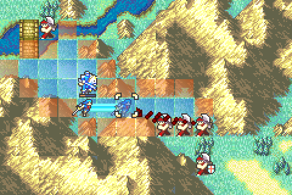

# Threat Arrows

While you pick where to move a unit (the blue range is up and the movement arrow follows the cursor), every enemy that
could attack a unit standing on the cursor's tile in the next enemy phase shows a thin, flashing red arrow: a line of
dots from the enemy to the cursor's tile, with an arrowhead at the cursor's end. Moving the cursor updates the arrows;
confirming the move (A), cancelling it (B) or opening the stat screen (R) takes them away.

## What counts as a threat

- Every unit the player's unit is not allied with (`AreUnitsAllied`): the enemy faction, and the fourth allegiance
  when it is on. Green units are allies and never count.
- Only the enemies the map shows, by the danger zone's rules (`GenerateDangerZoneRange`): alive and deployed, not
  hidden, not rescued, not under a roof, and in fog only on a tile the player can see.
- An enemy's threat area is the range the game draws when you select that enemy (`DisplayUnitEffectRange` in
  `Kernel/Wizardry/WeaponRange/Source/MiscHooks.c`): its movement map (`GenerateUnitMovementMapExt` with `MovGetter`,
  so Pass, terrain skills and the kernel's movement rework apply), a 2x2 unit's block expanded
  (`BigUnit_ExpandMovementMap`), the Physical Seal map (`GeneratePhysicalSealMap`) and its complete attack range
  (`GenerateUnitCompleteAttackRange`: every usable weapon's reach from every tile it can stop on, with the kernel's
  range rework). An enemy that cannot fight (no usable weapon, no Unarmed Combat) never counts.
- Two rules of the danger zone rather than of the single-enemy display: the enemy's own tile counts as a tile it can
  attack from, and the selected unit does not block the enemies from its starting tile (it is moving away).
- Arrows show only on tiles the selected unit can stop on: in its blue range, with no other unit there.
- A 2x2 unit counts once, from its first standing corner.

The masks were checked against the game's own range display of every enemy (A on the enemy, with the selected unit
taken off its tile) on the prologue: with two fighters, a third fighter and a bow user that cannot move (a tile only it
reaches, at range 2), and with 20 enemies. Every tile and enemy matched.

## Toggle

- Designer config: `threat_arrows` in [`designer-config.c`](../../Data/DesignerConfig/designer-config.c) (on: the
  feature is available). Off, the feature never starts and the Options row is hidden.
- Options screen: the last row, **Threat Arrows** (ON/OFF), **OFF by default**, backed by
  `gPlaySt.config.threat_arrows_on` (bit 6 of `PLAYST + 0x43`, the second bit of the old `unk43_4`; 1 = ON, so a zeroed
  config is OFF). `InitPlayConfig` sets it to 0; the player turns it on in Options.
  The bit is in the play state that every save already keeps: the save layout signature does not change.

## How it works

1. `DrawUpdatedPathArrow` (`Kernel/Wizardry/RemoveMovePath/Source/RemoveMovePath.c`, a vanilla replacement) runs each
   frame of a move selection: vanilla's `PlayerPhase_RangeDisplayIdle` (`0x0801CD1C`) calls it only when
   `GetPlayerSelectKind(gActiveUnit)` is 2 (a unit the player controls), so not for an enemy's range, nor the danger
   zone. It calls `ThreatArrows_OnMoveSelect`, which starts `ProcScr_ThreatArrows` as a child of the player phase proc
   (`gProcScr_PlayerPhase`) if it is not running, and marks it seen for this frame.
2. The proc ends on the first frame it was not seen (A, B, R, the end of the phase); its end callback clears its four
   OBJ tiles and puts the two palette colours back.
3. Once, at the start: the selected unit's move range is split into rows of tiles (at most 32 rows and 384 tiles,
   outward from the unit's row), and the shown enemies are sorted by distance to the unit (the nearest 32 are kept).
4. Then one step a frame, at most about 0.4 frames each, while the frame has used fewer than 100 scanlines: the
   Physical Seal check once, then per enemy its stats (`MovGetter`, `GetUnitMaxRange`, whether it can fight; an enemy
   that cannot get near the move range is skipped), its movement flood (kept as a bitmap) and its attack range, which
   sets the enemy's bit in the mask of every tile it reaches.
5. Each step borrows the maps: `gBmMapMovement`, `gBmMapRange` and `gBmMapOther` point at maps in `gGenericBuffer`
   (0x800, 0x1000, 0x1800; the first 0x800 bytes are the skill list's scratch), and everything the move selection needs
   is put back after the step: the three map pointers, `gWorkingBmMap`, `gActiveUnit`, the selected unit's tile in
   `gBmMapUnit`, the flood state (`gMovMapFillState`), the working move costs and the kernel's flood flags. A step waits
   for a later frame if a VBlank copy out of `gGenericBuffer` is queued.
6. When all enemies are done, a cursor move only looks up the tile's mask; each frame draws the arrows.

### Drawing

- OBJ tiles `0x70`, `0x71`, `0x7A`, `0x7B` (2D mapping): a dot, and an arrowhead pointing right, down and down-right; the
  other directions are flips. The system sheet (`LoadObjUIGfx`, 0x00-0x7F) leaves these tiles blank, nothing on the map
  uses them (the text engine's float glyphs and emotion marks, in dialogue only, use `0x72-0x79` and `0x7C-0x7F`), and the
  feature clears them when it ends.
- OBJ palette 6 (vanilla's first portrait palette, `OBJPAL_FACE_DEFAULT0`): no portrait is up during a move selection.
  Colours 1 (bright) and 2 (dark) pulse over 32 frames.
- Sprite layer 12: pushed after the cursor (layer 4), the moving unit and the movement arrow (layer 11), so those stay on
  top, and before the map sprites. OBJ priority 2: above the map and the range (BG2, BG3), below the windows (BG0, BG1).
- At most 8 arrows (nearest enemies first) and 56 sprites: a long line's dots spread out to fit. Sprites off the
  screen are skipped, and the positions follow the camera.

## RAM

`gThreatArrows` (`struct ThreatArrowsData`, `include/kernel/threat-arrows.h`), 0x780 bytes from
`_kernel_malloc_overlay0` (`include/link/config-memmap.s`): the rows (128 bytes), 384 tile masks (u32, one bit an enemy)
and the bitmap of the enemy being worked on (256 bytes). It is live only during a move selection, never during a battle
animation. `_kernel_malloc2` had 60 bytes left. The rest of the state (enemy list, rows' place, cursor, saved colours) is
in the proc.

## Cost

Measured with `gbarun`'s `prof` on the prologue:

| Map | Enemies | Ready after | One-time work | Dropped frames |
|---|---|---|---|---|
| The prologue as it is | 3 | about 16 VBlanks after A (the first 5 are vanilla's) | 9 steps | 6 in the first 40 VBlanks (36 game frames off, 30 on) |
| The prologue with 17 more fighters | 20, all within reach | about 85 VBlanks | 61 steps, 21 frames of CPU (`MovGetter` alone is about 0.24 a frame per enemy) | 17 in the first 80 VBlanks (67 game frames off, 50 on) |

No step is longer than 0.43 frames, and no frame of the work takes more than two VBlanks, so a two-frame key tap (B) is
still read: B was read at every point of the work that vanilla reads it. Once ready, a frame costs about 7,300 cycles
(0.03 frames). The selection itself is unchanged: the blue and red ranges, the movement arrow, the unit, terrain and
seal maps, the flood state and BG2 were byte for byte the same with the feature on and off.

## Code locations

| Feature | Location | Description |
|---|---|---|
| Proc, steps, drawing | [`ThreatArrows.c`](../../Kernel/Wizardry/ThreatArrows/Source/ThreatArrows.c) | `ThreatArrows_OnMoveSelect`, `ProcScr_ThreatArrows`, `ThreatArrows_Step` |
| Installer | [`ThreatArrows_Installer.event`](../../Kernel/Wizardry/ThreatArrows/ThreatArrows_Installer.event) | `WIZARDRY_CUSTOM` block of `Kernel/Wizardry/wizardry.event` |
| Header, RAM struct | [`threat-arrows.h`](../../include/kernel/threat-arrows.h) | `struct ThreatArrowsData`, `gThreatArrows` |
| Hook | [`RemoveMovePath.c`](../../Kernel/Wizardry/RemoveMovePath/Source/RemoveMovePath.c) | `DrawUpdatedPathArrow` calls `ThreatArrows_OnMoveSelect` |
| Options row | [`MenuOptions.c`](../../Kernel/Wizardry/MenuOptions/MenuOptions.c) | `GAME_OPTION_THREAT_ARROWS` (`uiconfig.h`), icon 0x50 in `FE8_All_System_Icons.png` |
| Config bit | `Tools/FE-CLib-Mokha/include/types.h` | `threat_arrows_on` in `struct PlaySt_OptionBits` |
| Designer toggle | [`designer-config.c`](../../Data/DesignerConfig/designer-config.c), `include/kernel/kernel-lib.h` | `threat_arrows` |
| Text | `Contents/Texts/Source/texts/Districts.txt` | `MSG_MENU_OPTION_THREAT_ARROWS_TITLE`, `_DESC` |
| Smoke test | `Tools/cloud/smoketest.py` | `test_threat` (`--only threat`) |

## Limitations

- The work is done once per move selection, so it does not see changes during it. With real-time battle on
  (`real_time_battle`), enemies that act while you pick a move are not followed until the next selection.
- The arrows appear only once every enemy is done: up to about 1.4 seconds on a crowded map, during which the game runs
  at 30 frames a second. No arrow before that is not "safe".
- The tile under the cursor does not block the enemies' movement (the unit will stand there), and other player units
  that will move later this phase still block them. Like the danger zone, it shows where enemies could attack this
  turn, not what the AI will do (a boss that never moves still counts its movement range).
- At most 32 enemies (the nearest to the selected unit), 8 arrows on a tile and 56 sprites. Of a move range taller
  than 32 rows or larger than 384 tiles, the rows farthest from the unit get no arrows.
- Maps whose borrowed maps would not fit in 0x800 bytes (`(height + 4) * (width + 6)`, every vanilla map fits) get no
  arrows.
- Arrows from enemies in a line toward the cursor overlap.
