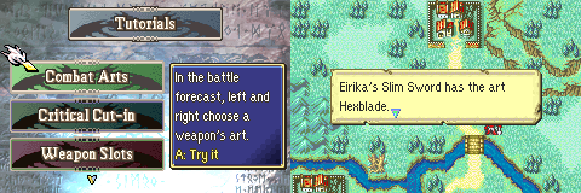

# Tutorials

<p align="center">
  
</p>

*Extras > Tutorials, the last Extras row, lists the README's gameplay features on Select Mode's banners. A starts the
chosen one's map: a test map that explains the feature, then lets you try it.*

---

## 📑 Index
- [Introduction](#introduction)
- [The tutorials](#the-tutorials)
- [The maps](#the-maps)
- [Adding a tutorial](#adding-a-tutorial)
- [How it works](#how-it-works)
- [Testing](#testing)
- [Code Locations](#code-locations)
- [Limitations](#limitations)

---

## 🧩 Introduction

**Extras > Tutorials**, the last Extras row (under the Skill Codex), lets the player try the hack's own features, one
per README entry:

- **The banners** on the left are Select Mode's, three on screen in its green, teal and red; the cursor's banner is
  lit, with Select Mode's hand beside it. Each shows a tutorial's title in the letters of the menus' labels (the
  Extras list's, the header's "Tutorials").
- **Scrolling.** Up and down choose a tutorial. Past the third banner the list scrolls under them; a gold arrow above
  or below the banners shows there are more that way. Down on the last tutorial goes around to the first, and up on
  the first to the last (on a press, not while the key is held).
- **The box** on the right is Select Mode's description box. It sums the chosen tutorial up in four lines, with
  "A: Try it" in gold on the fifth. Every summary fits the box; a longer one would show four lines a page, with the
  page count on the last line ("2/3"), right showing the next page and left the one before.
- **A** starts the tutorial's map (below). When the map ends, the game comes back to this screen, on that tutorial.
- **The header** is Select Mode's, with "Tutorials" in the Extras labels' letters, centred in it.
- B goes back to Extras.

---

## 📚 The tutorials

The README's features that are on in this build and that a player sees or uses on a map, in the README's order
(menus, graphics, text and system features are left out):

| Section | Tutorial | Its map |
|---|---|---|
| Battle & Combat | Combat Arts | Eirika with a Slim Sword (Hexblade) against two soldiers |
| | Critical Cut-in | Joshua with a Killing Edge and the Crit skill |
| | Weapon Slots | Colm, a thief: his weapon ranks on the stat screen |
| | Expanded HP | Gilliam with 120 HP |
| | Gaiden Magic | Lute (level 8: Fire, Thunder, Elfire) and Natasha (Heal, Mend) |
| | MP System | The same, for the MP page |
| | Kill Rewards | Artur against Novala (Artur wins the Divine tome) |
| | Magic Seal | A fighter with Magic Seal near Lute |
| | Tonics | Eirika with two tonics |
| Staves | Staff EXP | Natasha heals a hurt Eirika |
| Maps, Fog & AI | AI Rescue | A paladin next to a soldier at 2 HP |
| | Enemy Promotion | A level 10 fighter that can reach Ross |
| | Enemy Fog Vision, Fog Stages, Fog Vision | The map in fog (vision 2), with Colm the thief |
| | Fancy Teleport | An assassin warps in after the explanation |
| | Free Movement | Free movement on (`EnableFreeMovementASMC`) |
| | Move Ghost | Translucent Unit Sprite: any move |
| | Traps | A heal tile and a pair of teleport tiles |
| | Threat Arrows | The Options row turned on |
| Growth & Progression | Prestige | Franz, a level 10 cavalier |
| | Skill Capacity | Eirika's skills page |
| | Trainee Promotion | Ross at level 9 with 99 EXP, next to a soldier |
| Towns & Minigames | Districts, Fishing, Hex Cards, River Crossing, Snek, Tower Stack, Guild Board | Port Kiris, which has every game (Snek is its old man's) |

Left out:

- **Off in this build:** Anima Triangle, Biorhythm, Laguz Bars, Mokha Gambits, Real-Time Battle, Shield Item,
  Weapon Rank Skills, the Escape and Timer goals, Menu Skill AI, Start Map Effects, Weapon Traits, Minimum Damage,
  Allocate Stat Points, Arena Roster, Class Growths, Infuse and Skill Synthesis (locked), the Skill Tree, Timing Stat
  Level-Up, the World Map Skill Shop, Pair-Up (nothing in the story unlocks it) and 2x2 Units (no unit is listed).
- **The Arbalest, Aum, Phoenix and Skill staves:** with Three Houses magic no unit keeps a staff item (they are
  removed at every phase start, `PrePhase_RemoveThreeHousesMagicItems`), and no unit learns them as spells, so a
  player can't use them.
- **Bonus EXP:** a preparations menu; the tutorials' map has no preparations.

---

## 🗺️ The maps

- **Starting.** A on a tutorial fades the screen out and starts its map as a game of its own: a new game's state in
  RAM only (as `WriteNewGameSave` sets one up, without writing it), vanilla's tutorial flag (`PLAY_FLAG_TUTORIAL`) set,
  and the tutorial's chapter. The map's title card reads "Tutorial".
- **The tutorials' map** is chapter row 0x43 (`TUTORIAL_MAP`, `CustomCampaign/Chapters/TutorialMap`), a vanilla filler
  row with no title that nothing used, with vanilla Chapter 4's map. Its opening puts the tutorial's units on it and
  runs its set-up (`TutorialMap_Setup`), fades in, explains the feature in a box in the middle of the screen (as the
  in-map tutorials do), then runs the tutorial's after-explanation step, if any (the teleport's effect). Then the
  player tries it. The towns' tutorials start Port Kiris instead, whose opening shows the explanation in tutorial mode
  (`EventScr_TutorialMap_DistrictIntro`).
- **Ending.** Defeating every enemy ("Tutorial complete!"), losing Eirika ("Eirika has fallen", no Game Over), the map
  menu's **Retreat** (enabled on a tutorial's map, "Retreat?" then Yes), and a district's own ways out all come back
  to Extras > Tutorials, on the tutorial just played. The map's own endings leave as the skirmish retreat does (MNCH -1,
  then `StartRetreatProcessing`): a chapter change (MNC2) or a game over would start the map again in tutorial mode.
- **The save memory is never written.** Vanilla's tutorial flag already stops the suspend saves; the game save between
  chapters is never reached (the way back leaves first). The writes that happen outside a save are skipped on a
  tutorial's map: the Gallery's unlocks (`Gallery_UnlockBackground`), the
  game over's boot type (`EventCallGameOverExt`, in case one happens) and the Sound Room's unlocks
  (`UnlockSoundRoomSong`). The new game's
  hooks run, except `NewGameSaveGenericHook`, whose RAM parts are done by hand (it clears the suspend save and the
  world map in the save memory). Achievements, which write as they unlock, are off in this build
  (`vesly_achievements`); turned on, `CannotUnlockAchievements` would need the same check.

---

## ➕ Adding a tutorial

1. Add three messages at the end of `Contents/Texts/Source/texts/Districts.txt` (a message anywhere else moves every
   later message's id, CLAUDE.md):

   ```
   ## MSG_TUT_EXAMPLE_TITLE
   Example[X]
   ## MSG_TUT_EXAMPLE
   The box's summary, as one paragraph. The screen wraps it to the box.[X]
   ## MSG_TUT_EXAMPLE_MAP
   The explanation on the map, in the middle of the screen.[A][N]About 30 characters a line, [A] every two.[A][X]
   ```

   - The title must fit a banner: 128 pixels. It may use any letter `Tools/tutorial-titles/titles.py` has (the
     script stops on one it lacks: draw it in `DRAWN` there).
   - The summary is wrapped at 88 pixels (`TEXT_PX`). Keep it to four lines, about 70 characters (the fifth is "A: Try
     it"). The smoke test fails on a summary that does not fit. Control codes such as `[LF]` count as spaces.
2. Run `python3 Tools/tutorial-titles/titles.py fe8.gba` (a second argument writes a preview PNG of every title). It
   draws each title into `Tutorials/Source/TutorialTitles.c` and `.h` (generated: don't edit them).
3. In `Kernel/Wizardry/Tutorials/Source/TutorialsData.c`, add its units (`BLUE`, `RED`, `RED_STILL`; the players round
   (4, 5), the enemies round (9-11, 4-6) of the 15x15 map), a set-up function if it needs one (an option, a skill, fog,
   HP...), and its row in `gTutorials`, where it should show in the list, before the `{ 0 }` that ends it:

   ```c
   MAP_TUTORIAL(MSG_TUT_EXAMPLE_TITLE, MSG_TUT_EXAMPLE, Img_TutTitle_EXAMPLE, MSG_TUT_EXAMPLE_MAP,
                TutUnits_Example, Setup_Example, NULL),
   ```

   `TOWN_TUTORIAL(...)` (the four messages only) starts Port Kiris instead. Loading a unit leaves out its staves and
   tomes, and every phase start takes them away again (Three Houses magic): a mage's spells come from its level.

---

## 🛠️ How it works

- **The Extras row.** Bit 0 of the Extras list's byte (`EXTRA_MENU_OPTION_TUTORIALS`), vanilla's Link Arena row, which
  this hack never sets (`RemoveLinkArena.event`). `InitSaveMenuChoice` (`ExtrasMenu/Source/SupportMenu.c`) always adds
  it; the Extras list (`sub_80A9B90`), `SaveMenuStartExtraMiscScreen` and `SaveMenuPostExtraMiscScreen` have a case for it.
- **Its place, last.** Vanilla lists a menu's rows in bit order, so bit 0 would be first. `SaveMenuGetBitfile` (a row's
  bit) and `SaveMenuGetBitfileByMask` (a bit's row) are replaced (`Tutorials/Source/TutorialsExtras.c`): when bit 7 is
  set they walk bits 1-7, then 0. Bit 7 is the Skill Codex's, always in the Extras list; the main menu never sets bit 7
  (`MAIN_MENU_7`), so its order (Resume Chapter, bit 0, first) is vanilla's. Every routine that draws or picks the
  Extras rows goes through these two.
- **Eight rows.** With New Game+ and the Bonus Claim both showing, the Extras list has 8 rows; vanilla's layout
  (`sub_80AAF6C`) holds 7 (from y 2, 21 pixels apart; fewer are centred, 25 apart), and the last two were drawn off the
  screen. Its replacement (`TutorialsExtras.c`) is vanilla's with a case for 8: from y 2, 19 pixels apart. The hand
  follows the same spacing.
- **The row's label.** "Tutorials" is made of vanilla's own letters by `Tools/extras-labels/labels.py`: the "T" of
  Transfer Data, the "u" of Resume Chapter, the "t" and "a" of Battle History, the "o" of Copy Data, the "r" of Restart,
  the "i" of Link Arena, the "l" of Gallery and the "s" of Easy. It is in the Extras label sheet
  (`NewGamePlus/Gfx/Img_NgpMenuObjs.png`) in three pieces: label row 0, tiles 26-29 and 30-31, and row 1, tiles 12-13.
  Row 0's tiles 26-27 were the empty fourth piece of New Game+'s sprite, which now has three; row 1's 12-13 lie between
  the Bestiary's last piece and Support Conversation's sprite (row 0's 12-13 are inside the Bonus Claim's "Transfer
  Data" sprite). The "u" is Resume's, columns 34-38 of the save sheet (both its stems). The header's sprite is drawn
  8 pixels down from Select Mode's header, as vanilla's "Select Mode" is, which centres it. Its sprite is `Sprite_TutorialsExtrasLabel` in `gExtrasLabelSprites` (`NgpSaveMenu.c`), in place of
  Link Arena's.
- **The screen** (`Tutorials/Source/TutorialsScreen.c`) is vanilla's Select Mode screen rebuilt
  (`InitDifficultySelectScreen` and `DrawDifficultySprites_Loop`): the same palettes, `Img_DifficultyMenuObjs` at OBJ
  tile 0x40, the box's tilemap (`gUnknown_08A29558`) on BG1 at (17, 6), the banners (`gSprite_08A20AC2`) at x 8, y 48,
  80 and 112 on OBJ palettes 5-10 (lit and unlit for each), their glow (`sub_80AC4F8`), the header (`gSprite_DifficultyMenuSelectModeBg`)
  and the hand (`gSprite_08A20A98`), which slides to its banner in 4 frames and bobs as vanilla's. The save menu's
  background stays behind it. The box's lines are BG0 text at (18, 7), two rows apart.
- **The titles** are images, not text: `Tools/tutorial-titles/titles.py` draws each title message as
  `labels.py` draws the Extras labels, from vanilla's own letters (the main menu's, the save menu's and Select Mode's
  words), and centres it in 128x16 (`Img_TutTitle_<KEY>`, in `TutorialTitles.c`). Vanilla's words have no U, W, O, V,
  F, I, P, K, b, w, q or g: those are drawn in the script (`DRAWN`) in the same strokes. The screen copies the three
  shown titles into OBJ tiles 0x2C0-0x33F (two 16-tile rows each, under the Extras label sheet) whenever the list
  moves, and draws each as four 32x16 pieces 8 pixels down its banner, on the label palette (OBJ palette 11). The scroll arrows are `DisplayUiVArrow`, their
  tiles (`UnpackUiVArrowGfx`) at OBJ tile 0x180 on palette 12. The header's "Tutorials" is the
  Extras label sheet loaded at OBJ tile 0x200, as the Extras list has it, on OBJ palette 11 with the label palette
  (`Pal_SaveScreenSprits`' third).
- **Wrapping.** The text is decoded into `gGenericBuffer`, and the line starts are worked out word by word with
  `GetStringTextLen` (`Tutorials_Wrap`); a page draws its four lines from them.
- **RAM.** The screen's state lives in the Bestiary screen's (`gBestiaryScreen`): the Extras screens never run together.
- **Starting a map** (`Tutorials/Source/TutorialMap.c`, `TutorialMap_Launch`). After the fade, the save menu is sent to
  its last step (`PL_SAVEMENU_EXIT`, `PostSaveMenuHandler`) with `main_sel_bitfile` 0x40, for which it sets no action,
  so the action set here (1) stands; `save_menu_type` 2 makes the game control go straight to the map
  (`GameCtrl_CheckNewGameAndBranch`). The tutorial's index is kept in `gPlaySt.config2.unused_22[1]` (0 in every save,
  written only here).
- **Coming back.** Every end of a map reaches the game control's label 9 (`GameControl_PostChapterSwitch`). Its
  proc-script pointer (`$591900`) is `TutorialMap_PostChapterSwitch`: in tutorial mode it clears the flag, marks
  `unused_22[0]`, starts the title's music and goes to label 5, the save menu. The save menu's first
  `SaveMenu_LoadExtraMenuGraphics` (pointer `$A200EC`, `TutorialMap_LoadExtraMenuGraphics`) sees the mark and jumps
  to Extras > Tutorials, as choosing it in Extras does.

---

## 🧪 Testing

`python3 Tools/cloud/smoketest.py --only tutorialmap` boots, saves and resets, opens Tutorials, and presses A on Combat
Arts: it checks the map is chapter 0x43 in tutorial mode with its units, that the map menu's Retreat comes back to
Tutorials on that tutorial, out of tutorial mode, and that the save memory is byte for byte as it was.

`python3 Tools/cloud/smoketest.py --only tutorials` boots, saves and resets, then opens Extras and presses UP once from
the top row: going around to the last row opens Tutorials. It checks that the Extras byte has bit 0, that every
tutorial of `TutorialsData.c` is listed with the first on its first page, that RIGHT turns the page, that DOWN
chooses the next tutorial on its first page, that DOWN past the third banner scrolls the list a row, that every
tutorial's summary fits its box (one page, four lines at most), that DOWN on the last tutorial goes around to the first
and UP back to the last, and that B goes back to the save menu. The Gallery, Bestiary and Skill Codex tests count their rows from the bottom of Extras, one more now.

---

## 🗂️ Code Locations

| Part | File | What |
|---|---|---|
| Row order, 8 rows | [`TutorialsExtras.c`](../../Kernel/Wizardry/Tutorials/Source/TutorialsExtras.c) | `SaveMenuGetBitfile`, `SaveMenuGetBitfileByMask`, `sub_80AAF6C` |
| Screen | [`TutorialsScreen.c`](../../Kernel/Wizardry/Tutorials/Source/TutorialsScreen.c) | Set-up, sprites, wrapping, keys |
| List | [`TutorialsData.c`](../../Kernel/Wizardry/Tutorials/Source/TutorialsData.c) | `gTutorials` |
| Titles | [`titles.py`](../../Tools/tutorial-titles/titles.py), `TutorialTitles.c` (generated) | The titles' images and the letters vanilla lacks |
| Text | [`Districts.txt`](../../Contents/Texts/Source/texts/Districts.txt) | `MSG_TUT_*`, at the end |
| Header | [`tutorials.h`](../../include/kernel/tutorials.h) | `EXTRA_MENU_OPTION_TUTORIALS`, `struct Tutorial` |
| Extras row | [`SupportMenu.c`](../../Kernel/Wizardry/ExtrasMenu/Source/SupportMenu.c), [`NgpSaveMenu.c`](../../Kernel/Wizardry/NewGamePlus/Source/NgpSaveMenu.c), [`Gallery.c`](../../Kernel/Wizardry/Gallery/Source/Gallery.c) | Adding the row, its label sprite, starting the screen and coming back |
| Label | [`labels.py`](../../Tools/extras-labels/labels.py) | The word and its tiles |
| Maps | [`TutorialMap.c`](../../Kernel/Wizardry/Tutorials/Source/TutorialMap.c) | Starting a map, coming back, the opening's ASMCs, Retreat, the Sound Room's unlocks |
| The map's chapter | [`TutorialMap/events`](../../CustomCampaign/Chapters/TutorialMap/events/events.c) | Row 0x43, its opening and ending; Port Kiris calls `EventScr_TutorialMap_DistrictIntro` |
| Save memory | [`Gallery.c`](../../Kernel/Wizardry/Gallery/Source/Gallery.c), [`C_Code.c`](../../Kernel/Wizardry/VeslyDebugger/C_Code.c), `TutorialMap.c` (`UnlockSoundRoomSong`) | Their writes skipped on a tutorial's map |

---

## 🐛 Limitations

- The page count is one digit: a tutorial of 10 or more pages would show the wrong count (none has more than one).
- The list jumps a row at a time; it does not scroll smoothly.
- The tutorials are English only, like the rest of `Districts.txt`.
- The map menu's Retreat is the way out of a tutorial's map before it is won; Suspend stays greyed out (tutorial mode).
- The units, set-ups and texts were checked on the map (units, items, menus, fog, traps, the teleport, Port Kiris), but
  each feature's own behaviour (an enemy promoting, the AI rescuing, a trainee promoting...) is the feature's: the maps
  only set the scene for it.
