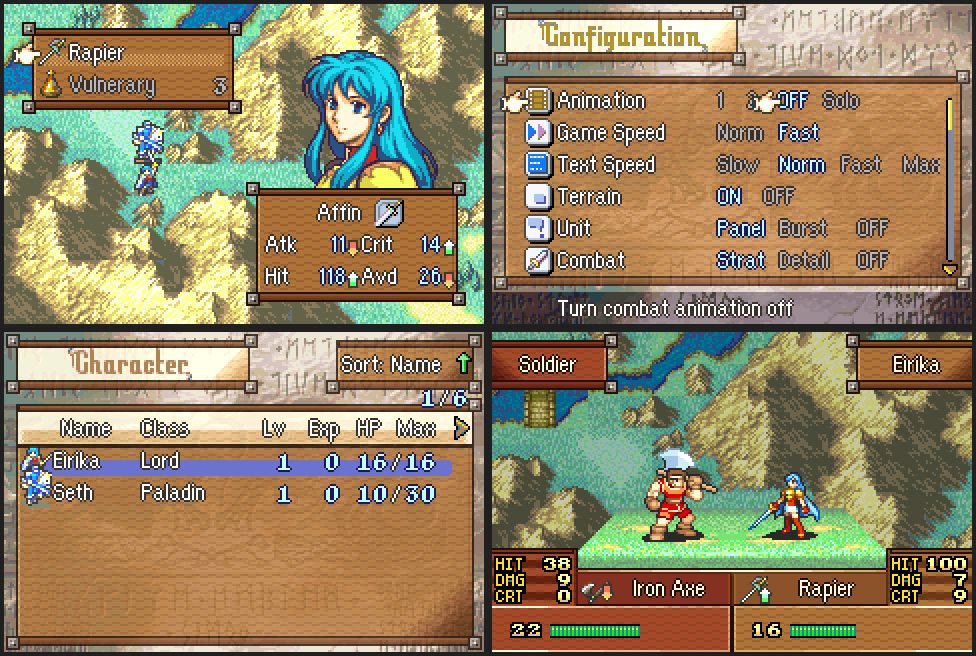
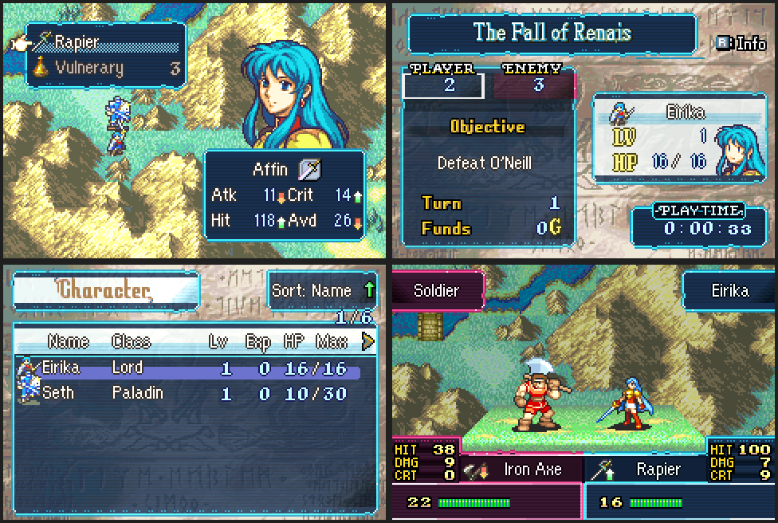
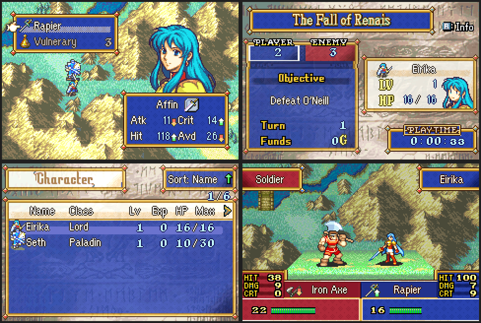
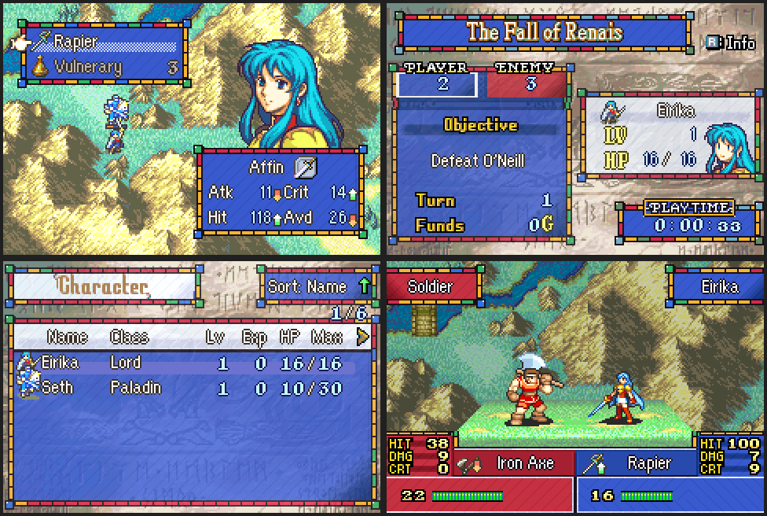
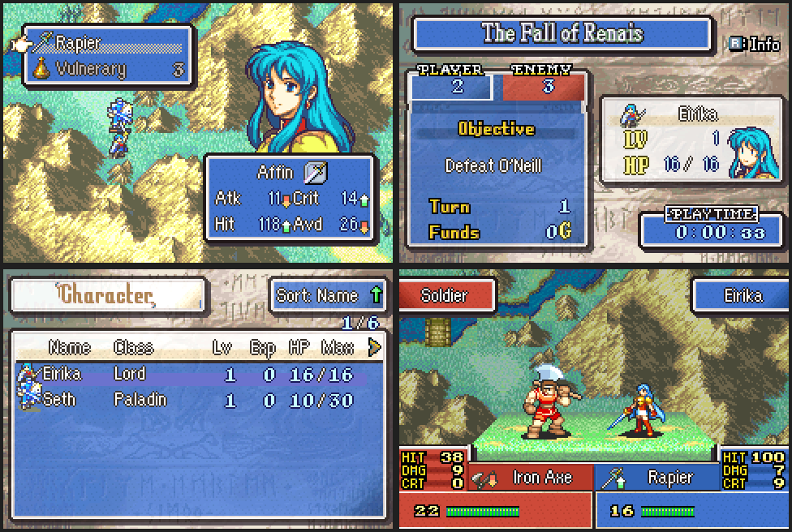
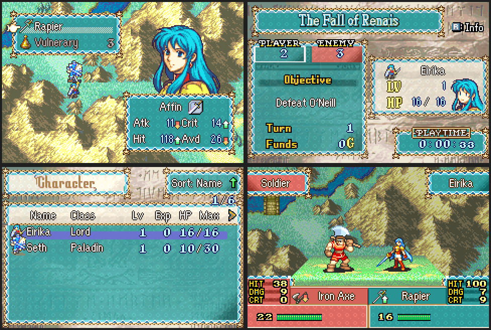
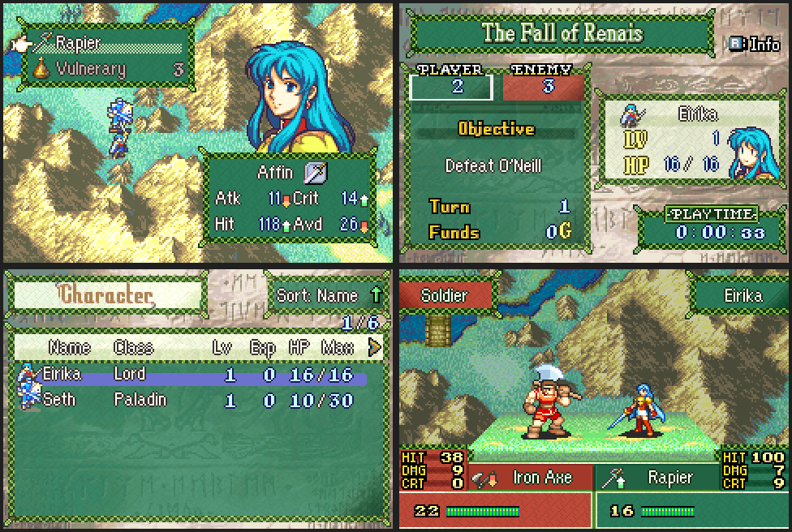

# VeslyUI Styles

  

  

  

  

  

  

  

---

## 📑 Index
- [Introduction](#introduction)
- [Plan](#plan)
- [Code Locations](#code-locations)
- [TODO](#todo)
- [Limitations & Bugs](#limitations--bugs)

---

## 🧩 Introduction

VeslyUI swaps the game's menu and battle UI graphics for alternative styles. Every style keeps vanilla's tile layouts, so the game's own tilemaps still work; only the art and palettes change.

Player-facing impact:

- Window frames (unit, item and map menus, the unit list, guide, options, help and info windows, the map HUD) change look together.
- The battle screen's name plates, weapon boxes and HIT/DMG/CRT panels follow the style, tinted by faction.
- Prep screens, the prep popup, the funds/items sprites and the shop gold box follow the style.
- Faction-coloured frames (battle forecast, status screen counters, world map) use the style's palettes.
- The status screen's chapter title banner and play-time box can follow the style (the generated styles have their own; the other styles keep vanilla's).

**Wood**, **Tech**, **Royal**, **Stained Glass**, **Paper**, **Ocean** and **Forest** are the newest styles, all built by the generator described below.

**Wood** Its windows are grained boards framed by dark, black-outlined wooden planks. The edges are chipped and cracked, and at each corner the top and bottom planks run past the window and end in a broken, splintered tip. Vanilla's gold bars, scroll curls and gem crests are gone, including the crest on the battle name plates and the scrollwork on the HP panel. Four woods replace vanilla's window colours.

| Window colour | Vanilla | Wood | Faction it tints |
|---------------|---------|------|------------------|
| 0 | Blue | Oak | Player |
| 1 | Red | Mahogany | Enemy |
| 2 | Green | Moss-stained | Allied (green) |
| 3 | Sepia | Weathered grey | Other |

**Tech** has a techno-futuristic look. Its windows are dark glass panels with scanlines. Each edge is one bright neon line, the same thickness on all four sides, with a dim glow just outside it and no black outline. Inside the line is a 2-pixel band of panel: invisible on dark panels, an even inset line on light ones. Corners are rounded, the line cutting across them in two white-hot steps. The edges are otherwise plain and symmetrical. Light panels such as title plates and help boxes become pale glass. The chapter name on the status screen is white and cyan.

| Window colour | Vanilla | Tech | Faction it tints |
|---------------|---------|------|------------------|
| 0 | Blue | Cyan | Player |
| 1 | Red | Magenta | Enemy |
| 2 | Green | Green | Allied (green) |
| 3 | Sepia | Violet | Other |

**Royal** is gilded. Its windows are velvet panels woven with a small damask diamond, framed by a gold moulding 4 pixels thick on every side, with a jewel set in a gold diamond on each corner. Light panels such as title plates are ivory. The chapter name on the status screen is gold.

| Window colour | Vanilla | Royal | Jewel | Faction it tints |
|---------------|---------|-------|-------|------------------|
| 0 | Blue | Royal blue | Ruby | Player |
| 1 | Red | Crimson | Sapphire | Enemy |
| 2 | Green | Emerald | Ruby | Allied (green) |
| 3 | Sepia | Purple | Ruby | Other |

**Stained Glass** frames each window in a border of amber, ruby, emerald and sapphire glass pieces set in lead, 4 pixels thick on every side, with a square emerald or sapphire pane on each corner. The piece colours vary from tile to tile, so they fall irregularly like a real window. Panels are coloured glass with faint diagonal seams and no lead lines, so text stays readable. Light panels are frosted glass. The chapter name on the status screen is white and amber.

| Window colour | Vanilla | Stained Glass | Faction it tints |
|---------------|---------|---------------|------------------|
| 0 | Blue | Blue glass | Player |
| 1 | Red | Red glass | Enemy |
| 2 | Green | Green glass | Allied (green) |
| 3 | Sepia | Purple glass | Other |

**Paper** is a storybook / Paper Mario look. Each window is a paper cutout, like a sticker. It has a thick black outline, a white paper border with a cardstock edge and rounded corners, the same on all four sides. A drop shadow falls down the right and along the bottom, as if the cutout were lifted off the page. Panels are construction paper with a faint fibre speckle; light panels are cream paper. The chapter name on the status screen is white outlined in black.

| Window colour | Vanilla | Paper | Faction it tints |
|---------------|---------|-------|------------------|
| 0 | Blue | Sky blue | Player |
| 1 | Red | Tomato | Enemy |
| 2 | Green | Grass | Allied (green) |
| 3 | Sepia | Plum | Other |

**Ocean** is an Ocean / Coral look. Each window has a twisted rope edge outside a band of wave crests, rows of foam-capped arcs over aqua. The border is 5 pixels thick on every side, with a starfish on each corner. Soft bubbles drift across the panels; light panels are sand. The chapter name on the status screen is white and aqua.

| Window colour | Vanilla | Ocean | Faction it tints |
|---------------|---------|-------|------------------|
| 0 | Blue | Teal | Player |
| 1 | Red | Coral | Enemy |
| 2 | Green | Kelp green | Allied (green) |
| 3 | Sepia | Pearl | Other |

**Forest** is a Forest / Leaf look that pairs well with Wood. Each window is framed by two vines woven over and under each other, 4 pixels thick on every side, with a small leaf on each corner. The panels carry a leaf-vein texture, a midrib and side veins in every tile; light panels are pale parchment. The chapter name on the status screen is white and leaf green.

| Window colour | Vanilla | Forest | Faction it tints |
|---------------|---------|--------|------------------|
| 0 | Blue | Pine | Player |
| 1 | Red | Maple red | Enemy |
| 2 | Green | Leaf green | Allied (green) |
| 3 | Sepia | Autumn amber | Other |

---

## 🛠️ Plan

### Choosing a style

A style is picked by a permanent event flag, checked in this order:

| Order | Style | Flag | ID |
|-------|-------|------|----|
| 1 | Wood | `WoodStyleFlag` (`0xAB`) | 4 |
| 2 | Tech | `TechStyleFlag` (`0xAD`) | 5 |
| 3 | Royal | `RoyalStyleFlag` (`0xAE`) | 6 |
| 4 | Stained Glass | `GlassStyleFlag` (`0xAF`) | 7 |
| 5 | Paper | `PaperStyleFlag` (`0xB0`) | 8 |
| 6 | Ocean | `OceanStyleFlag` (`0xB1`) | 9 |
| 7 | Forest | `ForestStyleFlag` (`0xB2`) | 10 |
| 8 | Stephano menus / Sokaballa battle | `StephanoStyleFlag` (`0xAA`) | 1 |
| 9 | Gamma | `GammaStyleFlag` (`0xB4`, the guide flag) | 2 |
| 10 | Pikmin menus / Fenreir battle | `PikminStyleFlag` (`0xAC`) | 3 |
| — | Vanilla | none set | 0 |

Set the flag from an event (for example `ENUT 0xAB` for wood, `ENUT 0xAD` for tech, `ENUT 0xAE` for royal, `ENUT 0xAF` for stained glass, `ENUT 0xB0` for paper, `ENUT 0xB1` for ocean or `ENUT 0xB2` for forest, `ENUF` to turn it off), or from C with `SetFlag`. The change shows the next time a screen loads its UI graphics, such as after opening the stat screen or entering battle. `gpKernelDesignerConfig->vesly_custom_ui` must be on.

The generated styles (Wood, Tech, Royal, Glass, Paper, Ocean, Forest) are checked first because the campaign sets the guide flag early, which would otherwise always select Gamma.

### What a style supplies

Each getter in `C_Code.c` indexes a table by the style ID (one entry per style). A style that has no art for an entry reuses vanilla's. The other generated styles' files follow the same names with `Tech_`, `Royal_`, `Glass_`, `Paper_`, `Ocean_` and `Forest_` prefixes in their own `png/` folders.

| Area | Wood asset | Vanilla it replaces |
|------|------------|---------------------|
| Window frame tiles | `Wood_Main.png` | `gUiFrameImage` |
| Menu palettes (8 rows) | `Wood_MenuPal.pal` | `gUiFramePaletteA`-row block |
| Prep screen extras | `Wood_Preps.png`, `Wood_PrepsUseGfx.png` | `gUnknown_08A1B730`, `Img_PrepItemUseScreen` |
| Prep funds/items sprites | `Wood_PrepItems.png`, `Wood_PrepItemsPal.pal` | `gUnknown_08A1B1FC`, `gUnknown_08A1B638` |
| Prep popup | `Wood_PrepPopupWindow.png` | `Img_PrepPopupWindow` |
| Shop gold box | `Wood_ShopGoldDisplay.png` | `Img_ShopGoldBox` |
| Battle frame | `Wood_Battle.png`, `Wood_BattlePal.pal` | `Img_08801C14`, `gUnknown_08802558` |
| Battle name/item boxes | `Wood_Left*.png`, `Wood_Right*.png` | `Img_EfxLeft/Right Name/ItemBox` |
| Status screen banner and play-time box | `Wood_PlayStatus.png`, `Wood_PlayStatusPal.pal` | `Img_PlayStatusSprites`, `Pal_PlayStatusSprites` |

### Building the generated styles' art

`png/style_tools.py` holds the shared redraw. Each style's script (`png/Wood/generate_wood.py`, `png/Tech/generate_tech.py`, `png/Royal/generate_royal.py`, `png/Glass/generate_glass.py`, `png/Paper/generate_paper.py`, `png/Ocean/generate_ocean.py`, `png/Forest/generate_forest.py`) sets the look and calls `build_style`, which builds every file for that style from the vanilla images in `png/Vanilla`. It keeps each image's tile layout and window outline, so the game's tilemaps still line up, and redraws what is inside:

- Gold trim bars are redrawn by the style's `beam`, from each pixel's position across the bar: wooden beams for wood; for tech, the neon edge line and its band, with the rest of the bar left transparent (a neon line on a dark rail between two panels); for royal, the gold moulding; for glass, lead and glass pieces; for paper, the black-and-white cutout border; for ocean, rope and waves; for forest, woven vines.
- Every edge that meets the transparent backdrop gets the style's `OUTLINE`: black for wood, the neon line for tech (which also adds a glow outside it).
- Ornament tiles (curls, crests, the battle gem) are replaced with the plain tile of the same role (`PLAIN_COPIES`, `BATTLE_COPIES`).
- Corner tiles come from the style's `CORNER_ART`: broken plank ends for wood, rounded neon corners for tech, jewels in gold diamonds for royal, square panes for glass, rounded corners with a drop shadow for paper, starfish for ocean, leaves for forest (`CORNERS`, `BATTLE_CORNERS`).
- The status screen's chapter title banner and play-time box are rebuilt from the finished frame tiles, so they match the windows. The play-time box keeps vanilla's letters on a small plate (`play_status`). It is 96 pixels wide instead of 80 so the clock fits, so `StatusScreenSpriteDraw_Loop` in `C_Code.c` draws it with a wider sprite for these styles.
- Beam and edge tiles get the style's details (`edge_details`): chips, cracks and grain streaks for wood (`EDGE_CHIPS`, plus an occasional small dent on other tiles); for tech, the side lines move one pixel out to leave the band, and every lit edge gets its glow; for royal and glass, the side borders push out to 4 pixels, and glass colours each tile's piece (`PIECES`); paper does the same and adds its drop shadow; ocean and forest lay out their own borders (`OUTLINE = None`).

For these styles, `DrawUiFrame` (replaced in `C_Code.c`) picks each top beam, bottom beam and left edge tile from a set of interchangeable ones by position. So wood's chips and glass's piece colours along a window don't repeat every 8 pixels. Tech's beam tiles all look the same, so the mixing makes no difference there. The tile sets in `C_Code.c` (`sFrameTopBeams` and friends) must match `TOP_BEAMS` and friends in `style_tools.py`.

Last, it swaps in the style's palettes and adds its fill texture: wood grain, tech scanlines, royal damask, glass seams, paper fibres, ocean bubbles or forest leaf veins. Both repeat every 8×8 tile, so repeated tiles join up. The installer converts the PNGs with `Png2Dmp --lz77` at build time.

To retune the look, edit the colour lists at the top of the script and rerun it. `Png2Dmp` maps pixels by colour, so each PNG palette must keep 16 distinct colours (the script checks this).

### Adding another style

1. Add art matching the vanilla tile counts, plus palettes. The quickest way is a new `png/<Name>/generate_<name>.py` modelled on the tech or wood script; `style_tools.py` lists the names a style script defines.
2. Add labels for it in `VeslyUI_Installer.event` and a flag.
3. Add an entry to every table in `C_Code.c` and a flag check in `GetUI_id`.
4. Add a case to `GetMMBWindowPaletteRow` in `ModularMinimugBox.c`.
5. For a generated style, add its ID to `IsGeneratedStyle` in `C_Code.c` (frame tile mixing and the wide play-time box) and an entry to `sChapterTitlePal`.

---

## 🗂️ Code Locations

| Feature | Location | Description |
|--------|----------|-------------|
| Style selection | `GetUI_id`, `GetUIPalID` in [`C_Code.c`](../../Kernel/Wizardry/VeslyUI/C_Code.c) | Reads the style flags in priority order |
| Window frames | `GetUiFrame`, `UnpackUiFrameImage`, `UnpackUiFrameBuffered`, `UnpackUiFramePalette` in [`C_Code.c`](../../Kernel/Wizardry/VeslyUI/C_Code.c) | Frame tiles and the window-colour palette |
| Prep screens | `PrepInitGfxHook`, `Decompress_Img_PrepItemUseScreen`, `DrawFundsSprite_Init`, `PutImg_PrepPopupWindow`, `PrepUiPalHook_2`, `PrepUiPalHook_3` in [`C_Code.c`](../../Kernel/Wizardry/VeslyUI/C_Code.c) | Prep art, funds/items sprite and palettes |
| Shop | `StartUiGoldBox`, `StartUiGoldBox_New` in [`C_Code.c`](../../Kernel/Wizardry/VeslyUI/C_Code.c) | Gold box sprite and palette |
| Battle screen | `EfxPrepareScreenFx`, `ekrDispUPMain`, `GetBPal_8802558` in [`C_Code.c`](../../Kernel/Wizardry/VeslyUI/C_Code.c) | Battle frame, name/item boxes, faction palettes |
| Status screen banners | `ChapterStatus_ShowAllLayers`, `StatusScreenSpriteDraw_Init`, `StatusScreenSpriteDraw_Loop` in [`C_Code.c`](../../Kernel/Wizardry/VeslyUI/C_Code.c) | Chapter title banner, play-time box and chapter name colours |
| Faction palettes | `GetFactionBattleForecastFramePalette`, `StatusScreenUIPal_Hook`, `sub_80BE5B4` in [`C_Code.c`](../../Kernel/Wizardry/VeslyUI/C_Code.c) | Forecast, status screen and world map tints |
| Minimug box | `GetMMBWindowPaletteRow` in [`ModularMinimugBox.c`](../../Kernel/Wizardry/ModularMinimugBox/ModularMinimugBox.c) | Map HUD unit window palette per style |
| Assets | [`VeslyUI_Installer.event`](../../Kernel/Wizardry/VeslyUI/VeslyUI_Installer.event), [`png/`](../../Kernel/Wizardry/VeslyUI/png/) | Style flags, art and palettes |
| Style generators | [`png/style_tools.py`](../../Kernel/Wizardry/VeslyUI/png/style_tools.py), [`png/Wood/generate_wood.py`](../../Kernel/Wizardry/VeslyUI/png/Wood/generate_wood.py), [`png/Tech/generate_tech.py`](../../Kernel/Wizardry/VeslyUI/png/Tech/generate_tech.py), [`png/Royal/generate_royal.py`](../../Kernel/Wizardry/VeslyUI/png/Royal/generate_royal.py), [`png/Glass/generate_glass.py`](../../Kernel/Wizardry/VeslyUI/png/Glass/generate_glass.py), [`png/Paper/generate_paper.py`](../../Kernel/Wizardry/VeslyUI/png/Paper/generate_paper.py), [`png/Ocean/generate_ocean.py`](../../Kernel/Wizardry/VeslyUI/png/Ocean/generate_ocean.py), [`png/Forest/generate_forest.py`](../../Kernel/Wizardry/VeslyUI/png/Forest/generate_forest.py) | Build the generated styles' art from `png/Vanilla` |
| Frame tile mixing | `DrawUiFrame`, `PickFrameTile`, `IsGeneratedStyle` in [`C_Code.c`](../../Kernel/Wizardry/VeslyUI/C_Code.c) | Mixes interchangeable beam tiles for the generated styles |

---

## 📝 TODO

- Bring the screens below under the style system so every style covers them.
- A player-facing way to pick a style (an Options entry) instead of event flags.
- More styles built the same way.

---

## 🐛 Limitations & Bugs

- Styles only reach the screens listed above. Still vanilla in every style: the unit stat screen, the map battle HP windows and EXP bar (shown when battle animations are off), and the phase banners. The status screen's chapter title banner and play-time box only change for the generated styles (wood, tech, royal, glass, paper, ocean, forest).
- A style change does not redraw windows already on screen; it shows when a screen next loads its UI graphics.
- The generated styles' prep screen, prep popup and shop gold box art follow vanilla's tile layout but have not been checked in-game yet.
- Each style adds roughly the size of its compressed art to the ROM.

Please report issues in the repository’s **Issues** tab.
