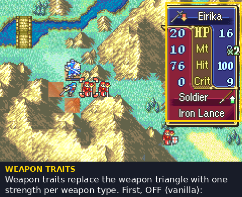
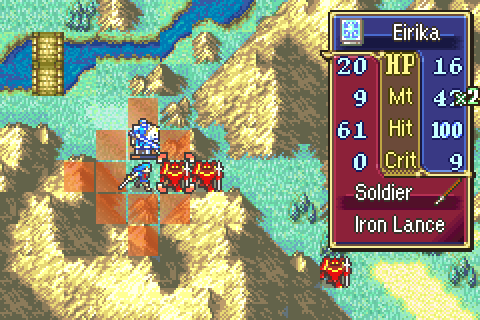

# Weapon Traits

  

*The toggle off (vanilla) and then on, in a test ROM: the sword loses the triangle arrows, lances and Fire become effective against Cavaliers and Knights, an axe hit the forecast calls 0 deals 5, and a sword follow-up hits harder.*

*With weapon traits on, Eirika's Fire against an Armor Knight is effective: Mt 42 instead of 16.*

Weapon traits replace the weapon triangle with one trait per weapon type. With the designer toggle on, there are no
triangle bonuses, no penalties and no triangle arrows in the forecast. Each weapon type has its own strength instead:

| Weapon | Trait |
| :----- | :---- |
| Swords | A follow-up attack deals 1.2x damage. Swords are the balanced option. |
| Spears (lances) | Effective against cavalry: might x3, as a Horseslayer. |
| Axes | A hit always deals at least 5 damage. Axes trade accuracy for power. |
| Magic (anima, light and dark) | Effective against heavily armoured units: Armor Knights, Generals, Marshalls, Great Knights and Wyvern Lords. |

## Rules

- **Swords.** A follow-up is any attack phase after the unit's first in the same battle. That covers an ordinary
  double (A, B, A), a Desperation double (A, A, B) and the repeated round of Accost. Each hit of the follow-up phase
  gets the bonus, including both hits of a brave sword's second phase. The first phase never does, so a brave sword's
  first pair of hits is normal. The bonus multiplies the damage before real damage (Ruined Blade and similar) is added.
- **Spears and magic.** These use the game's effectiveness, as a slayer weapon does. The damage is the weapon's
  effectiveness scale (300%, or the weapon's row in `gWeaponEffectivenessConfigs`), Resourceful and Solid Rock apply,
  and Nullify cancels it. The forecast shows the effective marker, and the AI sees it.
- **Axes.** The minimum is applied after critical hits and damage-reducing skills such as Rampart, and before
  Decadon, Levitate, Equalizer and Equilibrium. A Great Shield (Pavise) block still deals 0, and a miss deals nothing.
- **Classes.** Cavalry is vanilla's Horseslayer list (Cavalier, Paladin, Great Knight, Troubadour, Valkyrie, Ranger,
  Mage Knight, Tarvos, Maelduin and the two Master Lords, both genders). Armour is vanilla's Armorslayer list (Armor
  Knight, General, Great Knight) plus the Wyvern Lords and the Marshall. Great Knights are both, so spears and magic
  are effective against them.

## Config

- Designer config: `weapon_traits` in [`designer-config.c`](../../Data/DesignerConfig/designer-config.c). It is
  **off** by default, which keeps the weapon triangle. On, weapon traits replace the triangle.
- Battle designer config, in [`battle-designer-config.c`](../../Data/DesignerConfig/battle-designer-config.c):
  - `weapon_trait_sword_followup_perc`: the sword follow-up damage in percent (default 120).
  - `weapon_trait_axe_min_damage`: an axe hit's minimum damage (default 5).
- Class table: [`Data/BattleSys/Source/WeaponTraits.c`](../../Data/BattleSys/Source/WeaponTraits.c). Each class
  holds `WEAPON_TRAIT_CLASS_CAVALRY` (spears are effective), `WEAPON_TRAIT_CLASS_ARMOR` (magic is effective) or both.

## Code locations

| Rule | Location |
| :--- | :------- |
| Triangle off | `PreBattleGenerate_SetupWtaStatus` in [`WeaponTriangle.c`](../../Kernel/Wizardry/BattleSys/Source/WeaponTriangle.c) returns before the triangle handlers |
| Spears, magic | `IsWeaponTraitEffective` and `IsItemEffectiveAgainst` in [`CheckEffective.c`](../../Kernel/Wizardry/BattleSys/Source/CheckEffective.c) |
| Sword follow-ups | `BattleGenerateRoundHits` in [`BattleOrder.c`](../../Kernel/Wizardry/BattleSys/Source/BattleOrder.c) counts each unit's attack phases (`attack_phases` in `struct BattleGlobalFlags`); `BattleHit_CalcDamage` in [`BattleDamage.c`](../../Kernel/Wizardry/BattleSys/Source/BattleDamage.c) applies the bonus |
| Axe minimum | `BattleHit_CalcDamage` in [`BattleDamage.c`](../../Kernel/Wizardry/BattleSys/Source/BattleDamage.c) |
| Class table, toggle | `gpWeaponTraitJConf` and `WeaponTraitsEnabled()` in [`battle-system.h`](../../include/kernel/battle-system.h) |

`Tools/cloud/smoketest.py --only weapontraits` checks each rule with the toggle off and on (a test ROM).

## Limitations

- The forecast's damage figure doesn't include the sword follow-up bonus or the axe minimum, because both are worked
  out per hit. Effectiveness does show in the forecast.
- With traits on, everything that depends on the triangle does nothing: the [Anima Triangle](./AnimaTriangle.md),
  reaver weapons' reversal, per-weapon triangle rows (`gpWeaponTriangleItemConf`) and the skills Triangle Adept,
  Triangle Adept+, Nonconforming, Poise and Onimaru.
- `weapon_traits` is not in the FEBuilder layout (`Patches/PATCH_DesignerConfig.txt`), which is out of date.
