<!-- markdownlint-disable MD033 MD041 -->

  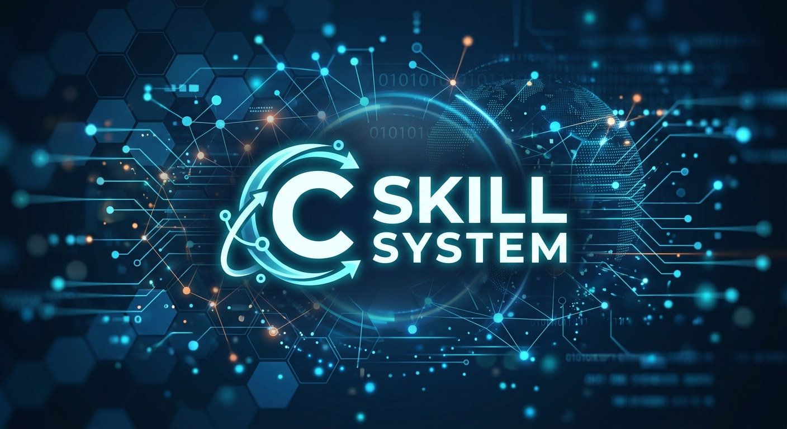

<h1 align="center">FE8U C-SkillSystem</h1>

  <b>A modern, C-based buildfile for Fire Emblem: The Sacred Stones (FE8U)</b> 
  Hundreds of skills and dozens of new systems, written in C and toggled at runtime.

  <a href="./Documentation/Setup.md">Setup Guide</a> ·
  <a href="./Documentation/CONTRIBUTING.md">Contributing</a> ·
  <a href="https://feuniverse.us/t/fe8-modern-c-skillsystem-release/24614">FEUniverse Thread</a> ·
  <a href="./Data/DesignerConfig/designer-config.c">Runtime Config</a> ·
  <a href="#-guides--reference">Guides</a>

---

## ✨ What is this?

This buildfile turns FE8U into a playground for new mechanics. It started from Mokha's
[master C-SkillSystem kernel](https://github.com/MokhaLeee/fe8u-cskillsys-kernel/) and has been heavily extended with
the features below.

- **900+ skills** that units get from their character, class, items, weapons and level-ups.
- **New gameplay systems:** pair-ups, gambits, gaiden magic, MP, shields, real-time battle, free movement and more.
- **New menus and screens:** base chapters, skill trees, augury, infuse, skill synthesis, a scrollback chatlog and more.
- **Towns and minigames:** explorable districts, fishing, River Crossing, Tower Stack, the Hex card game and Snek.
- **A campaign you can play to the end:** a world map driven by the story, placeholder battles for the chapters not
  written yet (Chapters 10–22), the ending and the postgame.
- **Runtime toggles:** about 180 designer-config switches in
  [`designer-config.c`](./Data/DesignerConfig/designer-config.c) turn features on or off without touching their code.
- **Readable code:** game logic is written in C and built with devkitARM, `lyn` and Event Assembler.

## 🚀 Getting started

1. Follow the [Setup Guide](./Documentation/Setup.md) to install devkitPro and the tools.
2. Put a clean FE8U ROM named `fe8.gba` at the repository root.
3. Run `make` to build `fe8-kernel-dev.gba`.
4. Turn features on or off in [`designer-config.c`](./Data/DesignerConfig/designer-config.c)
   (see [System Config](./Documentation/Features/SystemConfig.md) for what each switch does).

## 🎮 Features

Every feature links to its documentation. Click a preview to open it.

### ⚔️ Battle & Combat

<table>
  <tr>
    <td align="center" valign="top" width="50%"><a href="./Documentation/Features/AnimaTriangle.md">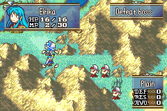</a> <b><a href="./Documentation/Features/AnimaTriangle.md">Anima Triangle</a></b></td>
    <td align="center" valign="top" width="50%"><a href="./Documentation/Features/BanimFeatures.md">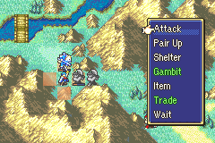</a> <b><a href="./Documentation/Features/BanimFeatures.md">Battle Animations</a></b></td>
  </tr>
  <tr>
    <td align="center" valign="top" width="50%"><a href="./Documentation/Features/Biorhythm.md">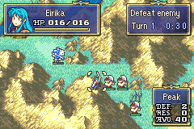</a> <b><a href="./Documentation/Features/Biorhythm.md">Biorhythm</a></b></td>
    <td align="center" valign="top" width="50%"><a href="./Documentation/Features/CombatArt.md">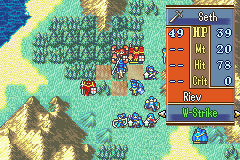</a> <b><a href="./Documentation/Features/CombatArt.md">Combat Art</a></b></td>
  </tr>
  <tr>
    <td align="center" valign="top" width="50%"><a href="./Documentation/Features/CritCutin.md">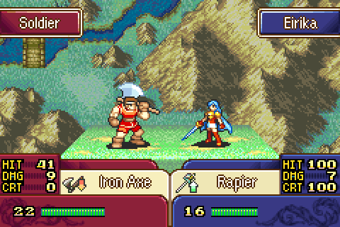</a> <b><a href="./Documentation/Features/CritCutin.md">Critical Cut-in</a></b></td>
    <td align="center" valign="top" width="50%"><a href="./Documentation/Features/DynamicWeaponSlots.md">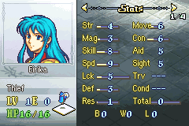</a> <b><a href="./Documentation/Features/DynamicWeaponSlots.md">Dynamic Weapon Slots</a></b></td>
  </tr>
  <tr>
    <td align="center" valign="top" width="50%"><a href="./Documentation/Features/ExpandedHP.md">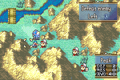</a> <b><a href="./Documentation/Features/ExpandedHP.md">Expanded HP</a></b></td>
    <td align="center" valign="top" width="50%"><a href="./Documentation/Features/GaidenMagic.md">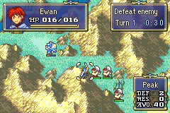</a> <b><a href="./Documentation/Features/GaidenMagic.md">Gaiden Magic</a></b></td>
  </tr>
  <tr>
    <td align="center" valign="top" width="50%"><a href="./Documentation/Features/KillRewards.md">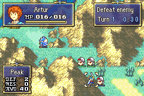</a> <b><a href="./Documentation/Features/KillRewards.md">Kill Rewards</a></b></td>
    <td align="center" valign="top" width="50%"><a href="./Documentation/Features/LaguzBars.md">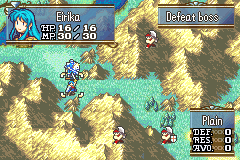</a> <b><a href="./Documentation/Features/LaguzBars.md">Laguz Bars</a></b></td>
  </tr>
  <tr>
    <td align="center" valign="top" width="50%"><a href="./Documentation/Features/MagicSeal.md">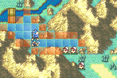</a> <b><a href="./Documentation/Features/MagicSeal.md">Magic Seal</a></b></td>
    <td align="center" valign="top" width="50%"><a href="./Documentation/Features/MokhaAOE.md">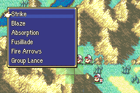</a> <b><a href="./Documentation/Features/MokhaAOE.md">Mokha Gambits</a></b></td>
  </tr>
  <tr>
    <td align="center" valign="top" width="50%"> <b><a href="./Documentation/Features/MpSystem.md">MP System</a></b></td>
    <td align="center" valign="top" width="50%"><a href="./Documentation/Features/PairUp.md">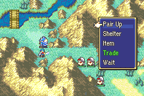</a> <b><a href="./Documentation/Features/PairUp.md">Pair-Up Commands</a></b></td>
  </tr>
  <tr>
    <td align="center" valign="top" width="50%"> <b><a href="./Documentation/Features/RealTimeBattle.md">Real-Time Battle</a></b></td>
    <td align="center" valign="top" width="50%"><a href="./Documentation/Features/ShieldItem.md">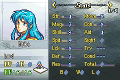</a> <b><a href="./Documentation/Features/ShieldItem.md">Shield Item</a></b></td>
  </tr>
  <tr>
    <td align="center" valign="top" width="50%"><a href="./Documentation/Features/Tonics.md">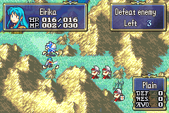</a> <b><a href="./Documentation/Features/Tonics.md">Tonics</a></b></td>
    <td align="center" valign="top" width="50%"> <b><a href="./Documentation/Features/WeaponRankSkills.md">Weapon Rank Skills</a></b></td>
  </tr>
</table>

### 🪄 Staves

<table>
  <tr>
    <td align="center" valign="top" width="50%"><a href="./Documentation/Features/CustomStaves/ArbalestStaff.md">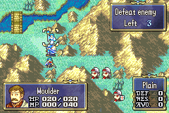</a> <b><a href="./Documentation/Features/CustomStaves/ArbalestStaff.md">Arbalest Staff</a></b></td>
    <td align="center" valign="top" width="50%"><a href="./Documentation/Features/CustomStaves/AumStaff.md">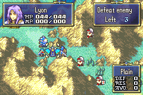</a> <b><a href="./Documentation/Features/CustomStaves/AumStaff.md">Aum Staff</a></b></td>
  </tr>
  <tr>
    <td align="center" valign="top" width="50%"><a href="./Documentation/Features/CustomStaves/PhoenixStaff.md">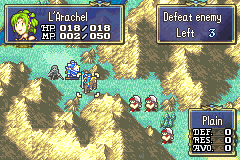</a> <b><a href="./Documentation/Features/CustomStaves/PhoenixStaff.md">Phoenix Staff</a></b></td>
    <td align="center" valign="top" width="50%"><a href="./Documentation/Features/CustomStaves/SkillStaff.md">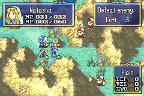</a> <b><a href="./Documentation/Features/CustomStaves/SkillStaff.md">Skill Staff</a></b></td>
  </tr>
  <tr>
    <td align="center" valign="top" width="50%"><a href="./Documentation/Features/ModularStaffEXP.md">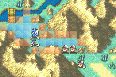</a> <b><a href="./Documentation/Features/ModularStaffEXP.md">Modular Staff EXP</a></b></td>
    <td width="50%"></td>
  </tr>
</table>

### 🗺️ Maps, Fog & AI

<table>
  <tr>
    <td align="center" valign="top" width="50%"><a href="./Documentation/Features/AIRescueRetreat.md">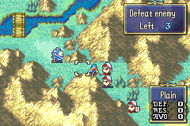</a> <b><a href="./Documentation/Features/AIRescueRetreat.md">AI Rescue Retreat</a></b></td>
    <td align="center" valign="top" width="50%"><a href="./Documentation/Features/ChapterGoals/Escape.md">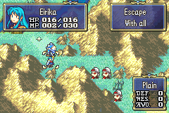</a> <b><a href="./Documentation/Features/ChapterGoals/Escape.md">Chapter Goal: Escape</a></b></td>
  </tr>
  <tr>
    <td align="center" valign="top" width="50%"><a href="./Documentation/Features/ChapterGoals/Timer.md">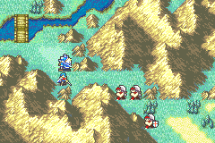</a> <b><a href="./Documentation/Features/ChapterGoals/Timer.md">Chapter Goal: Timer</a></b></td>
    <td align="center" valign="top" width="50%"><a href="./Documentation/Features/EnemiesPromoteWhenKillingUnit.md">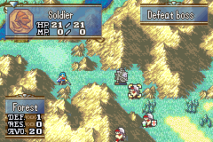</a> <b><a href="./Documentation/Features/EnemiesPromoteWhenKillingUnit.md">Enemies Promote When Killing Unit</a></b></td>
  </tr>
  <tr>
    <td align="center" valign="top" width="50%"><a href="./Documentation/Features/EnemyFogVision.md">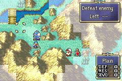</a> <b><a href="./Documentation/Features/EnemyFogVision.md">Enemy Fog Vision</a></b></td>
    <td align="center" valign="top" width="50%"><a href="./Documentation/Features/FE7FancyTeleport.md">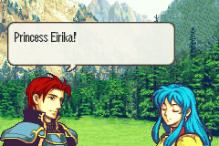</a> <b><a href="./Documentation/Features/FE7FancyTeleport.md">FE7 Fancy Teleport</a></b></td>
  </tr>
  <tr>
    <td align="center" valign="top" width="50%"><a href="./Documentation/Features/FogStages.md">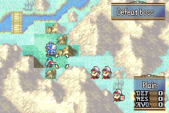</a> <b><a href="./Documentation/Features/FogStages.md">Fog Stages</a></b></td>
    <td align="center" valign="top" width="50%"><a href="./Documentation/Features/FogVision.md">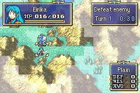</a> <b><a href="./Documentation/Features/FogVision.md">Fog Vision</a></b></td>
  </tr>
  <tr>
    <td align="center" valign="top" width="50%"><a href="./Documentation/Features/FreeMovement.md">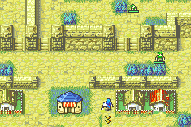</a> <b><a href="./Documentation/Features/FreeMovement.md">Free Movement</a></b></td>
    <td align="center" valign="top" width="50%"><a href="./Documentation/Features/MenuSkillAI.md">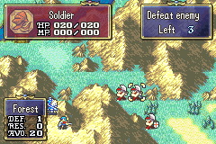</a> <b><a href="./Documentation/Features/MenuSkillAI.md">Menu Skill AI</a></b></td>
  </tr>
  <tr>
    <td align="center" valign="top" width="50%"><a href="./Documentation/Features/StartMapEffects.md">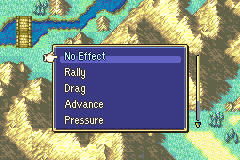</a> <b><a href="./Documentation/Features/StartMapEffects.md">Start Map Effects</a></b></td>
    <td align="center" valign="top" width="50%"><a href="./Documentation/Features/TranslucentUnitSprite.md">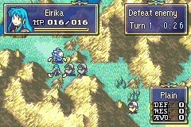</a> <b><a href="./Documentation/Features/TranslucentUnitSprite.md">Translucent Unit Sprite</a></b></td>
  </tr>
  <tr>
    <td align="center" valign="top" width="50%"> <b><a href="./Documentation/Features/TrapRework.md">Trap Rework</a></b></td>
    <td width="50%"></td>
  </tr>
</table>

### 📈 Growth & Progression

<table>
  <tr>
    <td align="center" valign="top" width="50%"><a href="./Documentation/Features/AllocateStatPoints.md">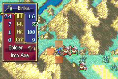</a> <b><a href="./Documentation/Features/AllocateStatPoints.md">Allocate Stat Points</a></b></td>
    <td align="center" valign="top" width="50%"><a href="./Documentation/Features/ArenaRoster.md">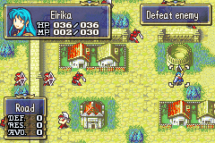</a> <b><a href="./Documentation/Features/ArenaRoster.md">Arena Roster</a></b></td>
  </tr>
  <tr>
    <td align="center" valign="top" width="50%"><a href="./Documentation/Features/BonusEXPMenu.md">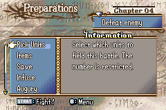</a> <b><a href="./Documentation/Features/BonusEXPMenu.md">Bonus EXP Menu</a></b></td>
    <td align="center" valign="top" width="50%"><a href="./Documentation/Features/ClassGrowths.md">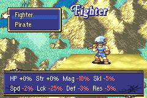</a> <b><a href="./Documentation/Features/ClassGrowths.md">Class Growths</a></b></td>
  </tr>
  <tr>
    <td align="center" valign="top" width="50%"><a href="./Documentation/Features/InfuseMenu.md">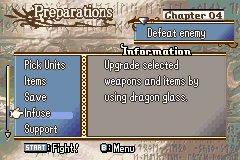</a> <b><a href="./Documentation/Features/InfuseMenu.md">Infuse Menu</a></b></td>
    <td align="center" valign="top" width="50%"><a href="./Documentation/Features/Prestige.md">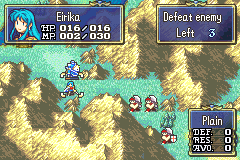</a> <b><a href="./Documentation/Features/Prestige.md">Prestige</a></b></td>
  </tr>
  <tr>
    <td align="center" valign="top" width="50%"><a href="./Documentation/Features/SkillSynthesis.md">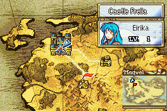</a> <b><a href="./Documentation/Features/SkillSynthesis.md">Skill Synthesis Menu</a></b></td>
    <td align="center" valign="top" width="50%"><a href="./Documentation/Features/SkillTree.md">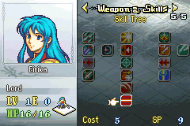</a> <b><a href="./Documentation/Features/SkillTree.md">Skill Tree</a></b></td>
  </tr>
  <tr>
    <td align="center" valign="top" width="50%"><a href="./Documentation/Features/TelliusSkillCapacity.md">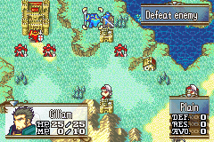</a> <b><a href="./Documentation/Features/TelliusSkillCapacity.md">Tellius Skill Capacity</a></b></td>
    <td align="center" valign="top" width="50%"><a href="./Documentation/Features/TimingStatLevelUp.md">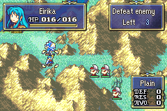</a> <b><a href="./Documentation/Features/TimingStatLevelUp.md">Timing Stat Level-Up</a></b></td>
  </tr>
  <tr>
    <td align="center" valign="top" width="50%"><a href="./Documentation/Features/TraineeInChapterPromotion.md">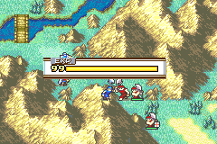</a> <b><a href="./Documentation/Features/TraineeInChapterPromotion.md">Trainee In-Chapter Promotion</a></b></td>
    <td width="50%"></td>
  </tr>
</table>

### 🧭 Menus, Screens & UI

<table>
  <tr>
    <td align="center" valign="top" width="50%"><a href="./Documentation/Features/AuguryMenu.md">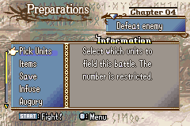</a> <b><a href="./Documentation/Features/AuguryMenu.md">Augury Menu</a></b></td>
    <td align="center" valign="top" width="50%"><a href="./Documentation/Features/BaseChapters.md">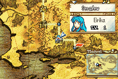</a> <b><a href="./Documentation/Features/BaseChapters.md">Base Chapters</a></b></td>
  </tr>
  <tr>
    <td align="center" valign="top" width="50%"><a href="./Documentation/Features/BaseConversationsMenu.md">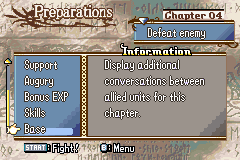</a> <b><a href="./Documentation/Features/BaseConversationsMenu.md">Base Conversations Menu</a></b></td>
    <td align="center" valign="top" width="50%"><a href="./Documentation/Features/CharacterBiographies.md">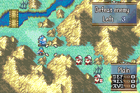</a> <b><a href="./Documentation/Features/CharacterBiographies.md">Character Biographies</a></b></td>
  </tr>
  <tr>
    <td align="center" valign="top" width="50%"><a href="./Documentation/Features/ConversationViewer.txt">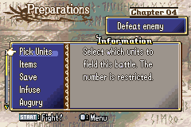</a> <b><a href="./Documentation/Features/ConversationViewer.txt">Conversation Viewer</a></b></td>
    <td align="center" valign="top" width="50%"><a href="./Documentation/Features/KonamiCode.md">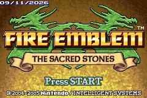</a> <b><a href="./Documentation/Features/KonamiCode.md">Konami Code</a></b></td>
  </tr>
  <tr>
    <td align="center" valign="top" width="50%"> <b><a href="./Documentation/Features/LanguageSelect.md">Language Select</a></b></td>
    <td align="center" valign="top" width="50%"> <b><a href="./Documentation/Features/LimitedShopStock.md">Limited Shop Stock</a></b></td>
  </tr>
  <tr>
    <td align="center" valign="top" width="50%"> <b><a href="./Documentation/Features/MenuOptions.md">Menu Options</a></b></td>
    <td align="center" valign="top" width="50%"> <b><a href="./Documentation/Features/PaginatedHelpBoxes.md">Paginated Help Boxes</a></b></td>
  </tr>
  <tr>
    <td align="center" valign="top" width="50%"> <b><a href="./Documentation/Features/PopupItemIconShine.md">Popup Item Icon Shine</a></b></td>
    <td align="center" valign="top" width="50%"> <b><a href="./Documentation/Features/QualityOfLife.md">Quality Of Life</a></b></td>
  </tr>
  <tr>
    <td align="center" valign="top" width="50%"> <b><a href="./Documentation/Features/StatScreenChapterLocks.md">Stat Screen Chapter Locks</a></b></td>
    <td align="center" valign="top" width="50%"> <b><a href="./Documentation/Features/StatScreenPromotions.md">Stat Screen Promotions</a></b></td>
  </tr>
  <tr>
    <td align="center" valign="top" width="50%"> <b><a href="./Documentation/Features/UnlimitedPrepMenuOptions.md">Unlimited Prep Menu Options</a></b></td>
    <td align="center" valign="top" width="50%"> <b><a href="./Documentation/Features/VariableCharacterDescriptions.md">Variable Character Descriptions</a></b></td>
  </tr>
  <tr>
    <td align="center" valign="top" width="50%"> <b><a href="./Documentation/Features/VeslyUIStyles.md">VeslyUI Styles</a></b></td>
    <td align="center" valign="top" width="50%"> <b><a href="./Documentation/Features/ExpBarStyles.md">EXP Bar Styles</a></b></td>
  </tr>
  <tr>
    <td align="center" valign="top" width="50%"> <b><a href="./Documentation/Features/MapColors.md">Map Colors</a></b></td>
    <td align="center" valign="top" width="50%"> <b><a href="./Documentation/Features/NewGamePlus.md">New Game+</a></b> Extras > New Game+: a new game where each character keeps their equipped skills and skill list</td>
  </tr>
  <tr>
    <td align="center" valign="top" width="50%"> <b><a href="./Documentation/Features/Gallery.md">Gallery</a></b> Extras > Gallery: the CGs seen in game, 3x3 to a page, and full size</td>
    <td align="center" valign="top" width="50%"> <b><a href="./Documentation/Features/Bestiary.md">Bestiary</a></b> Extras > Bestiary: every character and class met, with their bases, growths and descriptions</td>
  </tr>
</table>

### 💬 Story, Text & World Map

<table>
  <tr>
    <td align="center" valign="top" width="50%"> <b><a href="./Documentation/Features/Chatlog.md">Chatlog</a></b></td>
    <td align="center" valign="top" width="50%"> <b><a href="./Documentation/Features/CustomBattleQuotes.md">Custom Battle Quotes</a></b></td>
  </tr>
  <tr>
    <td align="center" valign="top" width="50%"> <b><a href="./Documentation/Features/CustomDefeatQuotes.md">Custom Defeat Quotes</a></b></td>
    <td align="center" valign="top" width="50%"> <b><a href="./Standalone/gameover_quotes/README.md">Game Over Quotes</a></b></td>
  </tr>
  <tr>
    <td align="center" valign="top" width="50%"> <b><a href="./Documentation/Features/LevelUpQuotes.md">Level Up Quotes</a></b></td>
    <td align="center" valign="top" width="50%"> <b><a href="./Documentation/Features/TextEngineRework.md">Text Engine Rework</a></b></td>
  </tr>
  <tr>
    <td align="center" valign="top" width="50%"> <b><a href="./Documentation/Features/UnitSelectionQuotes.md">Unit Selection Quotes</a></b></td>
    <td align="center" valign="top" width="50%"> <b><a href="./Documentation/Features/WorldMapEditor.md">World Map Editor</a></b></td>
  </tr>
  <tr>
    <td align="center" valign="top" width="50%"> <b><a href="./Documentation/Features/WorldMapSkillShop.md">World Map Skill Shop</a></b></td>
    <td align="center" valign="top" width="50%"> <b><a href="./Documentation/Features/WorldMapStoryChapters.md">World Map Story Chapters</a></b></td>
  </tr>
  <tr>
    <td align="center" valign="top" width="50%"> <b><a href="./Documentation/Features/WorldMapThoughts.md">World Map Thoughts</a></b></td>
    <td align="center" valign="top" width="50%"> <b><a href="./Documentation/Features/StoryStubs.md">Story Stubs</a></b> Placeholder battles to the end, the postgame, and <code>new_chapter.py</code></td>
  </tr>
</table>

### 🎨 Portraits & Graphics

<table>
  <tr>
    <td align="center" valign="top" width="50%"> <b><a href="./Documentation/Features/Portrait32Color.md">32-Color Portraits</a></b></td>
    <td align="center" valign="top" width="50%"><a href="./Documentation/Features/ExceedPortraitBox.md"><b><a href="./Documentation/Features/ExceedPortraitBox.md">Exceed Portrait Box</a></b></a> No preview yet</td>
  </tr>
  <tr>
    <td align="center" valign="top" width="50%"> <b><a href="./Documentation/Features/Halfbodies.md">Halfbodies</a></b></td>
    <td align="center" valign="top" width="50%"> <b><a href="./Documentation/Features/MaxColorBackgrounds.md">Max Color Backgrounds</a></b></td>
  </tr>
  <tr>
    <td align="center" valign="top" width="50%"> <b><a href="./Documentation/Features/PortraitExpressions.md">Portrait Expressions</a></b></td>
    <td></td>
  </tr>
</table>

### 🏘️ Towns & Minigames

<table>
  <tr>
    <td align="center" valign="top" width="50%"> <b><a href="./Documentation/Features/Districts.md">Districts</a></b></td>
    <td align="center" valign="top" width="50%"> <b><a href="./Documentation/Features/Minigames/Fishing.md">District Fishing</a></b></td>
  </tr>
  <tr>
    <td align="center" valign="top" width="50%"> <b><a href="./Documentation/Features/Minigames/Hex.md">Hex Card Minigame</a></b></td>
    <td align="center" valign="top" width="50%"> <b><a href="./Documentation/Features/Minigames/Crossing.md">River Crossing</a></b></td>
  </tr>
  <tr>
    <td align="center" valign="top" width="50%"> <b><a href="./Documentation/Features/Minigames/Snek.md">Snek</a></b></td>
    <td align="center" valign="top" width="50%"> <b><a href="./Documentation/Features/Minigames/Tower.md">Tower Stack</a></b></td>
  </tr>
  <tr>
    <td align="center" valign="top" width="50%"> <b><a href="./Documentation/Features/GuildBoard.md">Guild Board</a></b></td>
    <td align="center" valign="top" width="50%"> <b><a href="./Documentation/Features/Districts.md#entering">District Flags</a></b> Green flags on the world map and minimap mark open districts</td>
  </tr>
  <tr>
    <td align="center" valign="top" width="50%"> <b><a href="./Documentation/Features/BigUnits.md">2x2 Units</a></b> Bosses and monsters on four tiles, drawn at double size, with an HP bar per corner</td>
    <td></td>
  </tr>
</table>

## 📚 Guides & reference

| Guide | What it covers |
|---|---|
| [Overview](./Documentation/Features/Abstract.md) | A high-level map of the kernel's systems |
| [How To Make A Chapter](./Documentation/Features/HowToMakeAChapter.md) | Building a chapter in C, step by step |
| [Story Stubs](./Documentation/Features/StoryStubs.md) | The placeholder chapters, and turning one into a real chapter with `Tools/chapter/new_chapter.py` |
| [World Map Story Chapters](./Documentation/Features/WorldMapStoryChapters.md) | How the story picks its next chapter and node, and the postgame |
| [System Config](./Documentation/Features/SystemConfig.md) | Every runtime toggle in the designer config |
| [Wizardry](./Documentation/Features/Wizardry.md) | How the kernel's code modules are installed |
| [Skill System](./Documentation/Features/SkillSys.md) | How units, classes and items get skills |
| [Skills Glossary](./Documentation/Features/SkillInfo.md) | Every skill with its icon and description |
| [Battle System](./Documentation/Features/BattleSystem.md) | The battle call stack and where it is hooked |
| [Item System](./Documentation/Features/ItemSys.md) | Item usability and effects (IER) |
| [Debuffs](./Documentation/Features/Debuff.md) | The expanded unit status system |
| [Misc Skill Effects](./Documentation/Features/MiscSkillEffect.md) | Notes on skill effects outside battle |
| [Popup System](./Documentation/Features/PopupR.md) | How skill and item popups are queued |
| [Save System](./Documentation/Features/Save.md) | The save data layout |
| [Save Data](./Documentation/FeatureTypes/SaveData.md) | Adding a save chunk, and the layout guard that refuses saves from another layout |
| [Cloud Build & Smoke Tests](./Tools/cloud/README.md) | Building in a cloud session, and the emulator smoke tests (`smoketest.py`, run side by side with `--jobs`) |
| [Skill Icon Palettes](./Documentation/Features/SkillIconPalettes.md) | Palette banks for skill icons |
| [Fonts](./Documentation/Features/Fonts.md) | Choosing a font with CONFIG_FONT_* |
| [Voice Acted Intros](./Documentation/Features/VoiceActedIntros.md) | Installing WAV voice lines |
| [Credits](./Documentation/Features/Credits.md) | Who made what |

## 🤝 Community & contributing

- Read [How to contribute](./Documentation/CONTRIBUTING.md) before opening a pull request.
- Join the discussion on the [FEUniverse thread](https://feuniverse.us/t/fe8-modern-c-skillsystem-release/24614).
- See [Credits](./Documentation/Features/Credits.md) for everyone whose work is in this buildfile.
<!-- markdownlint-enable MD033 MD041 -->
