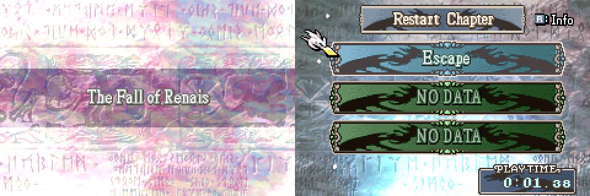

# Chapter Names

<p align="center">
  
</p>

FE7-style chapter titles: instead of a pre-drawn title graphic per chapter, the chapter title is **drawn as text** from the chapter's title text ID. New chapters get a correct title just by setting their text in FEBuilder, with no title graphics to draw.

The text replaces every chapter title vanilla draws through `PutChapterTitleGfx`, including the chapter intro title card, the save/load menu slots and suspend slot, and the status screen.

| Title | Text shown |
|-------|-----------|
| Story chapter | The chapter's title text (chapter data `+0x70`, "Chapter title text" in FEBuilder's chapter editor) |
| Skirmish (title IDs `$46`..`$53`) | `Skirmish Map` |
| Epilogue (title ID `$55`) | Text `$7CF` |
| Creature Campaign (title ID `$57`) | Text `$7D0` |
| No data (empty save slot, title ID `$54` or `-1`) | Text `$CC` |

The patch also includes the C Skill System's **save menu chapter title fix** (on by default):

- A save made on the world map shows the chapter at the world-map destination (taking skirmish and dungeon detours into account) instead of the chapter on the node the army stands on.
- Opening the save menu no longer rewrites `gPlaySt.chapterIndex` for the menu title. Vanilla does, and that value is then written into the next save.

Delete `#define CHAPTER_NAMES_SAVE_MENU_FIX` at the top of `Installer.event` to install only the text titles.

## Target ROM

- **FE8U (USA)** clean ROM
- Hooks: vanilla `PutChapterTitleGfx` (`0x08089624`); with the save menu fix also `SaveMenu_SetLcdChapterIdx` (`0x080A8AF0`) and `SaveMenuInitSaveSlotData` (`0x080ABC14`)
- Free space: `$1000000` (about 4.4 KB, mostly the font)

## Build

No build step is required to install the patch. `Source/ChapterNames.dmp`, `Source/SaveMenuChapterTitle.lyn.event` and `Data/font.dmp` are checked in.

Run `make` if you edit `Source/ChapterNames.s`, `Source/SaveMenuChapterTitle.c` or `Data/font.png`:

```bash
make -C Standalone/chapter_names
```

That requires [devkitARM](https://devkitpro.org/wiki/Getting_Started) and this repo's [FE-CLib](https://github.com/MokhaLeee/FE-CLib-Mokha) / [Event Assembler](https://github.com/MokhaLeee/EventAssembler/tree/mokha-fix) tools. See [Documentation/Setup.md](../../Documentation/Setup.md) for full setup.

## Installation

This folder is self-contained. It does not include `EAstdlib.event` or `Hack Installation.txt`. FEBuilder's bundled Event Assembler is enough.

### FEBuilderGBA

1. Copy the `chapter_names` folder (or download this standalone package).
2. Open a clean FE8U ROM in FEBuilder.
3. Go to **Advanced Editors → Insert EA**.
4. Click **Select File**, choose `Installer.event`, then click **Load Script**.

### Event Assembler

From a copy of clean `fe8.gba`, with this folder as the working directory:

```bash
EA_DIR=<repo>/Tools/EventAssembler
{
  echo '#include "Extensions/Hack Installation.txt"'
  echo '#include "Installer.event"'
} > _install.event
"$EA_DIR/ColorzCore" A FE8 -input:_install.event -I:"$EA_DIR" -output:/path/to/fe8-chapter-names.gba
```

## Files

| File | Purpose |
|------|---------|
| `Installer.event` | EA installer: save menu fix toggle, hooks, and free-space placement |
| `Source/ChapterNames.s` | Title text renderer (FE7's chapter title routine adapted to FE8U), replaces `PutChapterTitleGfx` |
| `Source/ChapterNames.dmp` | Checked-in assembled binary of `ChapterNames.s` (position-independent) |
| `Source/SaveMenuChapterTitle.c` | Save menu chapter title fix |
| `Source/SaveMenuChapterTitle.lyn.event` | Checked-in lyn output |
| `Data/font.png`, `Data/font.dmp` | Title font (LZ77-compressed `.dmp` built from the PNG) |
| `Data/chartable.dmp` | Per-glyph position and size table for the font (8 bytes per glyph) |
| `makefile` | Assembles the `.s`, compiles the C, converts the font |

## Hooks & Free Space

| Function | Hook (`ORG`) | Overwritten |
|----------|--------------|-------------|
| `PutChapterTitleGfx` | `$89624` | 8 bytes |
| `SaveMenu_SetLcdChapterIdx` (save menu fix) | `$A8AF0` | 8 bytes |
| `SaveMenuInitSaveSlotData` (save menu fix) | `$ABC14` | 8 bytes |

**Free space:** `$1000000` (body continues at `CURRENTOFFSET` after install).

**RAM:** no new RAM. The renderer uses vanilla's own chapter title state (`gChapterTitleFxSt`, `0x0203E78C`) and decompresses the font into vanilla's `gGenericBuffer` (`0x02020188`), like the title graphics it replaces.

## Conflicts

- Any patch that replaces vanilla `PutChapterTitleGfx` (`$89624`), such as other text chapter title patches, and the full C Skill System ChapterNames module.
- With the save menu fix: any patch that replaces `SaveMenu_SetLcdChapterIdx` (`$A8AF0`) or `SaveMenuInitSaveSlotData` (`$ABC14`).
- Free space at `$1000000` overlaps with other standalone patches from this repo. Install only one body at `$1000000`, or move this patch's `ORG` to the next free region after any already-installed standalone code.

`Installer.event` uses `PROTECT` on the hook sites and the free-space body. Overlapping patches should fail assembly with a clear EA error.

## Limitations

- The font has `A`-`Z`, `a`-`z`, `0`-`9`, space, `-`, `'`, `:` and `.`. Any other character is drawn as a space (vanilla Chapter 1's "Escape!" shows as "Escape").
- The text is centred in the vanilla title graphic's area (192 pixels); longer titles are cut off.
- The chapter's title ID is used as its chapter index to find the title text. In vanilla FE8U every story chapter's title ID equals its chapter index; if you give a chapter a different title ID, the title text of the chapter with that index is shown.
- Vanilla's chapter number ("Ch.1:") is part of the title graphics, not the text, so it is gone unless you add it to the chapter's title text.
- The save menu fix was not runtime-tested with a world-map save; the text titles were tested on the chapter intro, the save menu after the prologue and the title screen's load menu.

## Credits

Chapter title text routine ported from FE7 (see the header of `Source/ChapterNames.s`); extracted from [C Skill System](https://github.com/JesterWizard/C-SkillSystem-Jester). See [SystemConfig.md](../../Documentation/Features/SystemConfig.md) (`chapter_names`) for the integrated option.
