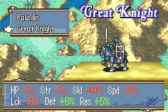

# Class Growths

<p align="center">
  
</p>

A unit's **class growths** are merged into its personal growths whenever it levels up:

| Mode | Growth used for each stat |
|------|---------------------------|
| `0` | Personal growth (vanilla) |
| `1` | Personal + class growth (default) |
| `2` | Average of personal and class growth, `(personal + class) / 2` |

Class growths are the **growth fields of the vanilla class data** (FEBuilder: **Class** editor, the HP/Str/Skl/Spd/Def/Res/Luck growths), the same values vanilla uses to autolevel generic units. Edit them there; there is no separate table to install. FE8 has no separate magic stat, so there is no Mag growth (Mag is Str).

The merge applies to every level-up: battles and the arena, staff and dance EXP, `UnitAutolevelRealistic` (player units loaded above their base level) and the route-split level-ups of the other twin (`AutolevelSecondaryLord`). Metis Tome's +5% is added on top of the merged growth, as in vanilla. A merged growth is capped at 255.

**Promotion screen preview:** while the mode is not `0`, the class description box on the promotion screen (Master Seal, crests, trainee promotions) shows how each class would change the unit's growths, gains in green and losses in red. **R** swaps the box between the growth changes and the vanilla class description.

## Target ROM

- **FE8U (USA)** clean ROM
- Hooks: see [Hooks & Free Space](#hooks--free-space)
- Free space: `$1000000`
- RAM: 128 bytes at `0x0203AF00` (preview text)

## Settings

In `Installer.event` (no rebuild needed):

| Define | Default | Meaning |
|--------|---------|---------|
| `CLASS_GROWTHS_MODE` | `1` | `0` off, `1` personal + class, `2` average of personal and class |
| `CLASS_GROWTHS_PREVIEW` | `1` | `1` promotion screen growth preview, `0` vanilla class descriptions only |

## How it works

Vanilla FE8U has no growth getters: `CheckBattleUnitLevelUp` (and every patch that replaces it) reads the growths straight from `bu->unit.pCharacterData`. This package replaces the five vanilla functions that call `CheckBattleUnitLevelUp` with copies (from the decomp) that, for the duration of the call only, point the battle unit (and the real unit) at a stack copy of its character data with the class growths merged in. `CheckBattleUnitLevelUp` itself is not touched, so whatever is installed there still runs and rolls on the merged growths:

- `Standalone/levelup_modes` (all modes, including fixed growths, which reads the real unit's growths)
- `Standalone/guaranteed_lvup`
- `Standalone/two_random_number_growths` (hooks `GetStatIncrease`, which gets the merged growth)

The promotion screen preview replaces three small vanilla promotion-screen functions so the description box can show the growth changes and the class menu gets an R handler.

## Build

No build step is required to install the patch. `Source/ClassGrowths.lyn.event` is checked in, so you can install `Installer.event` as-is.

Run `make` only if you edit `Source/ClassGrowths.c` or `Source/RamAlloc.s`:

```bash
make -C Standalone/class_growths
```

That requires [devkitARM](https://devkitpro.org/wiki/Getting_Started) and this repo's [FE-CLib](https://github.com/MokhaLeee/FE-CLib-Mokha) / [Event Assembler](https://github.com/MokhaLeee/EventAssembler/tree/mokha-fix) tools. See [Documentation/Setup.md](../../Documentation/Setup.md) for full setup.

## Installation

This folder is self-contained. It does not include `EAstdlib.event` or `Hack Installation.txt`. FEBuilder's bundled Event Assembler is enough.

### FEBuilderGBA

1. Copy the `class_growths` folder (or download this standalone package).
2. Open a clean FE8U ROM in FEBuilder.
3. Go to **Advanced Editors → Insert EA**.
4. Click **Select File**, choose `Installer.event`, then click **Load Script**.

### Event Assembler

From a copy of clean `fe8.gba`, with this folder as the working directory:

```bash
ColorzCore A FE8 -input:Installer.event -output:/path/to/fe8-class-growths.gba
```

## Files

| File | Purpose |
|------|---------|
| `Installer.event` | EA installer, settings, hooks and free-space placement |
| `Source/ClassGrowths.c` | Level-up caller replacements and the promotion screen preview |
| `Source/RamAlloc.s` | EWRAM address of the preview text buffer |
| `Source/ClassGrowths.lyn.event` | Checked-in lyn output |
| `makefile` | Compiles C + RAM object to `.lyn.event` |
| `image.png` | Screenshot of the promotion screen preview |

## Hooks & Free Space

| Function | Hook (`ORG`) | Overwritten |
|----------|--------------|-------------|
| `UnitAutolevelRealistic` | `$18160` | 8 bytes |
| `BattleApplyExpGains` | `$2B92C` | 8 bytes |
| `BattleApplyItemExpGains` | `$2C5B8` | 8 bytes |
| `BattleApplyMiscActionExpGains` | `$2C6A0` | 8 bytes |
| `AutolevelSecondaryLord` | `$8659C` | 8 bytes |
| `sub_80CCF60` (`PromoSel_StartClassDesc`) | `$CCF60` | 8 bytes |
| `ClassChgMenuItem_OnChange` | `$CDD00` | 8 bytes |
| `ClassChgMenuExec` | `$CDD78` | 8 bytes |

Each hook is `jumpToHack` to a full C replacement.

**Free space:** `$1000000`, about 3 KB.

**RAM:** `ClassGrowthPreviewText`, 128 bytes at `0x0203AF00` .. `0x0203AF7F` (inside FreeRamSpace2, `0x0203AAA4` .. `0x0203DDE0`). The talk system keeps a pointer to the preview string while it prints, so it cannot live on the stack. Change `Source/RamAlloc.s` and run `make` if another hack uses that range.

## Conflicts

- Any patch that hooks or rewrites one of the functions above. In this repo's `Standalone/` folder none do; `modular_staff_exp` hooks `GetBattleUnitStaffExp` (`$2C638`), which `BattleApplyItemExpGains` still calls, so both work together.
- Works with `levelup_modes`, `guaranteed_lvup` and `two_random_number_growths` (they hook `CheckBattleUnitLevelUp` / `GetStatIncrease`, see [How it works](#how-it-works)). Install them at a different free-space `ORG`.
- Patches that change EXP gains by editing `BattleApplyExpGains`, `BattleApplyItemExpGains` or `BattleApplyMiscActionExpGains` (including the full C Skill System) replace the same functions.
- A level-up routine that reads growths from somewhere other than `bu->unit.pCharacterData` or the real unit's `pCharacterData` (for example a growth getter of its own) will not see the class growths.
- **EWRAM** `0x0203AF00` .. `0x0203AF7F` must be free.
- Free space at `$1000000` overlaps with other standalone patches from this repo. Install only one body at `$1000000`, or move this patch's `ORG` after any already-installed standalone code.

`Installer.event` uses `PROTECT` on every hook site and the free-space body, so overlapping ROM writes fail assembly with a clear EA error.

## Limitations

- Differences from the integrated version: no Mag growth (vanilla has no magic stat); the setting is a byte in `Installer.event` instead of the designer config; skill and status growth bonuses from the Skill System do not exist here (vanilla's Metis Tome bonus still applies); the Vesly reclass screen preview is not ported (it is a Skill System screen).
- The integrated version reads class growths as signed bytes; this one reads them as unsigned (0-255), so a class growth above 127 counts as a large growth instead of a negative one.
- The preview colours use vanilla's text colour code (`0x80 0x01 colour`) and recolour the talk font's gold and red groups while the promotion screen is open (restored when it closes).
- The preview needs a unit (`GetUnitFromCharId` of the promoting character); when there is none, the box shows the vanilla description.

## Credits

Extracted from [C Skill System](https://github.com/JesterWizard/C-SkillSystem-Jester) (`Kernel/Wizardry/ClassGrowths`).
