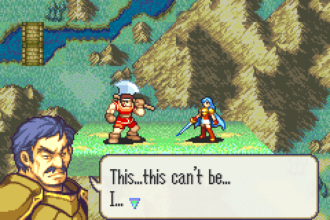

# Custom Defeat Quotes

<p align="center">
  
</p>

Replaces vanilla `CheckBattleDefeatTalk` and `DisplayDefeatTalkForPid` so defeat (death) quotes can depend on **who landed the killing blow**, not just on who died. It is the defeat-quote sibling of [`custom_battle_quotes`](../custom_battle_quotes).

Each table entry can restrict by:

| Field | Purpose |
|-------|---------|
| `pidA` | Character ID of the unit that is defeated |
| `pidB` | Character ID that must be the current battle actor or target (`$FFFF` = any opponent) |
| `route` | Not a filter (see below). `$01` together with flag `$65` plays the Game Over song |
| `chapter` | Chapter index, `$FF` for any chapter, `$FE` for triangle attacks |
| `flag` | Flag set after the quote plays; the entry is skipped once it is set (`$65` = game over) |
| `msg` | Text ID (`$0000` = use `event` instead) |
| `event` | Custom battle event script (used when `msg` is `$0000`) |

Example: O'Neill can say one line when Eirika defeats him and another when Seth does. The screenshot above is a test where O'Neill's defeat by Eirika was pointed at text `$0936`; defeating him with Seth still played his vanilla quote through the fallback.

The first matching entry wins, so put specific (`pidA` + `pidB`) entries before wildcard entries for the same character.

With `USE_VANILLA_FALLBACK` enabled (default), vanilla `gDefeatTalkList` (through vanilla `GetDefeatTalkEntry`) is searched when no custom entry matches, so clean FE8U boss and lord quotes keep working until you override them.

As in vanilla, when a quote plays for a player unit, the music changes to *In Sorrow's Shroud*, and an entry with route `$01` and flag `$65` plays the *Game Over* song instead.

## Configuration

Edit `DefeatTalkTable.event`, then reinstall the patch. No C recompile is needed.

| Setting | Default | Meaning |
|---------|---------|---------|
| `USE_VANILLA_FALLBACK` | `1` | Also search vanilla `gDefeatTalkList` when no custom entry matches |

Example table entries:

```text
CustomDefeatQuoteEntry($68, $01, $FF, $00, $02, $XXXX, 0) // O'Neill killed by Eirika, prologue
CustomDefeatQuoteEntry($68, $02, $FF, $00, $02, $YYYY, 0) // O'Neill killed by Seth, prologue
```

`$68` = O'Neill, `$01` = Eirika, `$02` = Seth, `$FF` = route (unused), `$00` = prologue, `$02` = the "boss defeated" flag the prologue checks, `$XXXX` = your text ID from FEBuilder.

Keep the same `flag` the vanilla entry used for that character (bosses usually use `$02`, lords `$65`), because chapter events check it.

## Target ROM

- **FE8U (USA)** clean ROM
- Hooks: vanilla `CheckBattleDefeatTalk` (`0x080835A8`) and `DisplayDefeatTalkForPid` (`0x080835DC`)
- Free space: `$1000000` (about 0.5 KB with an empty table)

## Build

No build step is required to install the patch. `Source/CustomDefeatQuotes.lyn.event` is checked in, so you can install `Installer.event` as-is.

Run `make` only if you edit `Source/CustomDefeatQuotes.c`:

```bash
make -C Standalone/custom_defeat_quotes
```

That requires [devkitARM](https://devkitpro.org/wiki/Getting_Started) and this repo's [FE-CLib](https://github.com/MokhaLeee/FE-CLib-Mokha) / [Event Assembler](https://github.com/MokhaLeee/EventAssembler/tree/mokha-fix) tools. See [Documentation/Setup.md](../../Documentation/Setup.md) for full setup.

## Installation

This folder is self-contained. It does not include `EAstdlib.event` or `Hack Installation.txt`. FEBuilder's bundled Event Assembler is enough.

### FEBuilderGBA

1. Copy the `custom_defeat_quotes` folder (or download this standalone package).
2. Open a clean FE8U ROM in FEBuilder.
3. Go to **Advanced Editors → Insert EA**.
4. Click **Select File**, choose `Installer.event`, then click **Load Script**.

### Event Assembler

From a copy of clean `fe8.gba`, with this folder as the working directory:

```bash
EA_DIR=<repo>/Tools/EventAssembler
{
  echo '#include "Extensions/Hack Installation.txt"'
  echo '#include "Installer.event"'
} > _install.event
"$EA_DIR/ColorzCore" A FE8 -input:_install.event -I:"$EA_DIR" -output:/path/to/fe8-custom-defeat-quotes.gba
```

## Files

| File | Purpose |
|------|---------|
| `Installer.event` | EA installer, hooks, and free-space placement |
| `DefeatTalkTable.event` | Fallback toggle and editable defeat quote table (no C rebuild needed) |
| `Source/CustomDefeatQuotes.c` | Lookup and display logic |
| `Source/CustomDefeatQuotes.lyn.event` | Checked-in lyn output (rebuild with `make` after editing `.c`) |
| `makefile` | Compiles C to `.lyn.event` |

## Hooks & Free Space

| Function | Hook (`ORG`) | Overwritten |
|----------|--------------|-------------|
| `CheckBattleDefeatTalk` | `$835A8` | 8 bytes |
| `DisplayDefeatTalkForPid` | `$835DC` | 8 bytes |

**Free space:** `$1000000` (body continues at `CURRENTOFFSET` after install). No RAM is used.

## Conflicts

- Any patch that replaces vanilla `CheckBattleDefeatTalk` (`$835A8`) or `DisplayDefeatTalkForPid` (`$835DC`), including the full C Skill System Quotes module.
- Patches that only repoint or edit vanilla `gDefeatTalkList` still work through the fallback.
- Free space at `$1000000` overlaps with other standalone patches from this repo. Install only one body at `$1000000`, or move this patch's `ORG` to the next free region after any already-installed standalone code.

`Installer.event` uses `PROTECT` on the hook sites and the free-space body. Overlapping patches should fail assembly with a clear EA error.

## Limitations

- `route` is not checked when matching a custom entry (as in the C Skill System). Use `chapter` to restrict an entry. Vanilla fallback entries still check their route like vanilla does.
- `pidB` is matched against the current battle's actor and target, so it only makes sense for deaths in battle.

## Credits

Extracted from [C Skill System](https://github.com/JesterWizard/C-SkillSystem-Jester). See [CustomDefeatQuotes.md](../../Documentation/Features/CustomDefeatQuotes.md) for integrated documentation.
