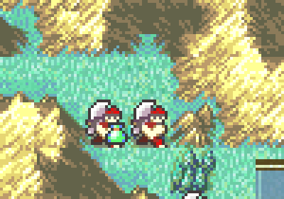

# Custom Droppable Item Icon

<p align="center">
  
</p>

Shows a small potion icon on the bottom-right corner of every map unit that will drop its last item when defeated (`US_DROP_ITEM`, the "Drop item" checkbox in FEBuilder's unit placement editor). The icon blinks with the same timing and position as the vanilla boss / rescue / protection icons.

This matches the integrated C Skill System `custom_droppable_item_icon` config flag, but installs on **clean FE8U** without the kernel. The integrated version draws the icon inside its full `PutUnitSpriteIconsOam` rewrite; this package uses the same wrapper technique as [`custom_talk_icon`](../custom_talk_icon/) instead: MapTask's `PROC_CALL(PutUnitSpritesOam)` pointer is repointed to a wrapper that pushes the drop icons and then calls vanilla `PutUnitSpritesOam` (which still runs vanilla `PutUnitSpriteIconsOam`).

## Target ROM

- **FE8U (USA)** clean ROM
- Hook: `gProc_MapTask` `PROC_CALL(PutUnitSpritesOam)` pointer at `$59D934`
- Vanilla restore: first 8 bytes of `PutUnitSpriteIconsOam` at `$275E8` (same as `custom_talk_icon`)
- Graphics: `LoadObjUIGfx` sheet pointer at `$156AC`
- Free space: `$1000000`

## Graphics

The icon uses OBJ tile `0x64` (`0xC80 / 0x20`), as in the integrated build. On vanilla that tile of the `LoadObjUIGfx` sheet is empty, so the package ships `Gfx/ObjUISheet_DropItem.png`: the **vanilla** OBJ UI sheet (18x4 tiles, unchanged width) with only that tile replaced by the potion from the integrated `WarningHpSheet_Jester.png`. The palette is the vanilla OBJ UI palette (not changed).

## Build

No build step is required to install the patch. `Source/CustomDroppableItemIcon.lyn.event` and `Gfx/ObjUISheet_DropItem.dmp` are checked in, so you can install `Installer.event` as-is.

Run `make` only if you edit `Source/CustomDroppableItemIcon.c`. Run `make gfx` if you edit the PNG:

```bash
make -C Standalone/custom_droppable_item_icon
make -C Standalone/custom_droppable_item_icon gfx
```

That requires [devkitARM](https://devkitpro.org/wiki/Getting_Started) and this repo's [FE-CLib](https://github.com/MokhaLeee/FE-CLib-Mokha) / [Event Assembler](https://github.com/MokhaLeee/EventAssembler/tree/mokha-fix) tools. See [Documentation/Setup.md](../../Documentation/Setup.md) for full setup.

## Installation

This folder is self-contained. It does not include `EAstdlib.event`, `Hack Installation.txt`, or a Png2Dmp step. FEBuilder’s bundled Event Assembler is enough.

### FEBuilderGBA

1. Copy the `custom_droppable_item_icon` folder (or download this standalone package).
2. Open a clean FE8U ROM in FEBuilder.
3. Go to **Advanced Editors → Insert EA**.
4. Click **Select File**, choose `Installer.event`, then click **Load Script**.

### Event Assembler

From a copy of clean `fe8.gba`, with this folder as the working directory:

```bash
ColorzCore A FE8 -input:Installer.event -output:/path/to/fe8-drop-icon.gba
```

## Files

| File | Purpose |
|------|---------|
| `Installer.event` | EA installer, MapTask hook, vanilla restore, free-space placement |
| `Gfx.event` | Repoints the `LoadObjUIGfx` sheet to the preconverted DMP |
| `Gfx/ObjUISheet_DropItem.dmp` | LZ77 OBJ UI sheet used at install time |
| `Gfx/ObjUISheet_DropItem.png` | Source art (`make gfx` rebuilds the DMP) |
| `Source/CustomDroppableItemIcon.c` | C implementation |
| `Source/CustomDroppableItemIcon.lyn.event` | Checked-in lyn output (rebuild with `make` after editing `.c`) |
| `makefile` | Compiles C to `.lyn.event`, PNG to DMP |

## Hooks & Free Space

| Location | `ORG` | Overwritten |
|----------|-------|-------------|
| `gProc_MapTask` `PROC_CALL(PutUnitSpritesOam)` argument | `$59D934` | 4 bytes (`POIN`) |
| `PutUnitSpriteIconsOam` prologue (vanilla bytes rewritten) | `$275E8` | 8 bytes (no change on a clean ROM) |
| `LoadObjUIGfx` sheet pointer | `$156AC` | 4 bytes (`POIN`) |

**Free space:** `$1000000` (about 1.5 KB: code + LZ77 sheet; continues at `CURRENTOFFSET`).

No RAM is used.

## Conflicts

- **[`custom_talk_icon`](../custom_talk_icon/)**: both packages take over the same MapTask `PutUnitSpritesOam` call at `$59D934` (and both rewrite the `PutUnitSpriteIconsOam` prologue and `LoadObjUIGfx` sheet). Install only one of them; the one installed last wins and the other's icon disappears. The integrated C Skill System draws both from one `PutUnitSpriteIconsOam` rewrite.
- Any patch that replaces vanilla `PutUnitSpritesOam` (`0x080273A5`) or the MapTask proc pointer at `$59D934`, including the full C Skill System MapTask rewrite.
- Patches that `jumpToHack` the start of `PutUnitSpriteIconsOam` (`$275E8`): this installer writes the vanilla prologue back there (so an old hook that calls `PutUnitSpritesOam` cannot recurse), which disables such a hook. FEBuilder's HP bar patch hooks `$276B4`, not `$275E8`, but it also replaces the OBJ UI sheet (see next point).
- Any patch that changes the `LoadObjUIGfx` sheet at `$156AC` / `$15690` (HP bars, other OBJ UI sheet hacks). If you need both, add the potion tile to that sheet at row 3, column 4 (OBJ tile `0x64`) instead of installing `Gfx.event`.
- Free space at `$1000000` overlaps with other standalone patches from this repo. Install only one body at `$1000000`, or move this patch's `ORG` after any already-installed standalone code.

`Installer.event` uses `PROTECT` on the hook sites, `LoadObjUIGfx` pointer, and the free-space body. Overlapping patches should fail assembly with a clear EA error.

## Limitations

- The drop icon is skipped on units that already show a vanilla corner icon (rescuing, enemy/NPC boss, chapter protection target). In the integrated build the icon is drawn underneath that icon, so the result looks the same.
- The icons are pushed before the map sprites so they draw on top of them, like vanilla icons. Icons are only drawn from MapTask (normal map play), same as the vanilla icons.
- Hidden while event flag `0x84` (`EVFLAG_HIDE_BLINKING_ICON`) is set, like vanilla blinking icons.

## Credits

Extracted from [C Skill System](https://github.com/JesterWizard/C-SkillSystem-Jester) (`Kernel/Wizardry/MapTask`). Potion tile from the integrated `Data/MapTask/Gfx/WarningHpSheet_Jester.png`.
