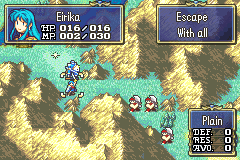

# Goal Escape

<p align="center">
  
</p>

Adds an **Escape** chapter objective (goal window type `6`). In an escape chapter, a player unit that ends its move with **Wait** on one of the chapter's escape tiles says a short line and leaves the map. It stays in the army; only its map presence is removed. A unit it is carrying leaves with it. When the last deployed player unit has escaped, the chapter is won and the chapter's own ending scene plays, the same way a Seize does.

The map goal window shows `Escape` / `With all` in escape chapters. Other chapters are unchanged.

## Target ROM

- **FE8U (USA)** clean ROM
- Free space: `$1000000`

## Configuration

### Make a chapter an escape chapter

In FEBuilder's chapter editor (**Map Settings**), set the chapter's goal window data type (the "objective" type next to the goal text) to **6**. Vanilla only uses 0 to 4; 6 is the escape type, as in the C Skill System (`GOAL_TYPE_ESCAPE`). The chapter's goal text ID is still used by the **Status** screen.

### Escape tiles

Edit `EscapeTiles.event` without recompiling C. Each entry is `chapter ID, x, y`, and a chapter can have as many tiles as you like:

```
EscapeTile($03, 1, 12) // Ch3, tile (1, 12)
EscapeTile($03, 2, 12) // Ch3, tile (2, 12)
```

End the table with `EscapeTilesEnd`. The defaults copy the integrated test table: tile (3, 3) on every chapter from the Prologue to Ephraim Ch18. Tiles only count in chapters whose goal type is 6.

Tip: put a trap or tile change on the escape tiles (as the integrated documentation suggests) so the player can see them.

### Escape line

`GOAL_ESCAPE_QUOTE_TEXT` in `Installer.event` is the text shown when a unit escapes. The default is text ID `$409` (an unused vanilla dummy item-name slot), which this package fills with:

```
[OpenMidLeft][LoadFace][0xFF][0xFF][OpenMidLeft]Time to get out of here![A][X]
```

Face `$FFFF` is the active unit. To use your own text, set `GOAL_ESCAPE_QUOTE_TEXT` to a text ID you edit in FEBuilder and delete the `setText` line in `Text.event`. Set it to `0` to escape without a line.

## Build

No build step is required to install the patch. `Source/GoalEscape.lyn.event` is checked in, so you can install `Installer.event` as-is.

Run `make` only if you edit `Source/GoalEscape.c`:

```bash
make -C Standalone/goal_escape
```

That requires [devkitARM](https://devkitpro.org/wiki/Getting_Started) and this repo's [FE-CLib](https://github.com/MokhaLeee/FE-CLib-Mokha) / [Event Assembler](https://github.com/MokhaLeee/EventAssembler/tree/mokha-fix) tools. See [Documentation/Setup.md](../../Documentation/Setup.md) for full setup.

Edits to `EscapeTiles.event` or `Installer.event` do not need `make`.

## Installation

This folder is self-contained. It does not include `EAstdlib.event` or `Hack Installation.txt`. FEBuilder's bundled Event Assembler is enough.

### FEBuilderGBA

1. Copy the `goal_escape` folder (or download this standalone package).
2. Open a clean FE8U ROM in FEBuilder.
3. Go to **Advanced Editors → Insert EA**.
4. Click **Select File**, choose `Installer.event`, then click **Load Script**.

### Event Assembler

From a copy of clean `fe8.gba`, with this folder as the working directory:

```bash
ColorzCore A FE8 -input:Installer.event -output:/path/to/fe8-goal-escape.gba
```

## Files

| File | Purpose |
|------|---------|
| `Installer.event` | EA installer, addresses, hooks, escape-line text ID, and free-space placement |
| `EscapeTiles.event` | Per-chapter escape tiles (edit without compiling C) |
| `Text.event` | Huffman-compressed default escape line for text ID `$409` |
| `Source/GoalEscape.c` | C implementation |
| `Source/GoalEscape.lyn.event` | Checked-in lyn output (rebuild with `make` after editing `.c`) |
| `makefile` | Compiles C to `.lyn.event` |

## Hooks & Free Space

All three hooks repoint one routine pointer inside a vanilla proc script. The vanilla functions stay intact, and the new routines call them for everything that is not an escape.

| Proc command | Pointer (`ORG`) | Vanilla routine | Replaced by |
|--------------|-----------------|-----------------|-------------|
| `gProcScr_PlayerPhase` `PROC_CALL_2` | `$59ABE4` | `HandlePostActionTraps` | `PostActionTraps_GoalEscape` |
| `gProcScr_PlayerPhase` `PROC_CALL` | `$59ABFC` | `PlayerPhase_FinishAction` | `PlayerPhase_FinishAction_GoalEscape` |
| `gProcScr_GoalDisplay` `PROC_CALL` | `$A01A00` | `GoalDisplay_Init` | `GoalDisplay_Init_GoalEscape` |

Each overwrites 4 bytes (one pointer).

- `PostActionTraps_GoalEscape`: on an escape, skips traps and shows the escape line (a blocking event); otherwise runs vanilla `HandlePostActionTraps`.
- `PlayerPhase_FinishAction_GoalEscape`: on an escape, takes the unit (and its rescuee) off the map instead of placing it, then sets the win flag (`EVFLAG_WIN`, flag 3) when no deployed player unit is left. Vanilla's end-of-action check then calls the chapter's ending scene. Otherwise runs vanilla `PlayerPhase_FinishAction`.
- `GoalDisplay_Init_GoalEscape`: runs `GoalDisplay_Init`, then redraws the window for escape chapters.

**Text:** text table entry `$409` (`$15E4B0`, 4 bytes).

**Free space:** `$1000000` (code, tile table and text continue at `CURRENTOFFSET`).

**RAM / save:** none. Escaped units get `US_HIDDEN | US_NOT_DEPLOYED | US_UNSELECTABLE`, position `-1, -1`, and unit state bit 28 (`US_GOAL_ESCAPED`, unused by vanilla) as a marker. Suspend saves store the whole state word, so escapes survive suspend/resume. When the chapter is won, escaped units lose `US_NOT_DEPLOYED` and the marker again, so the chapter change treats them as deployed and they appear in the next chapter as usual. Vanilla's chapter-change cleanup clears bit 28 anyway.

## Conflicts

- Any patch that repoints the `HandlePostActionTraps` or `PlayerPhase_FinishAction` calls of `gProcScr_PlayerPhase` (`$59ABE4`, `$59ABFC`), or the `GoalDisplay_Init` call of `gProcScr_GoalDisplay` (`$A01A00`). This includes the C Skill System post-action hook, which rewrites the same proc script.
- Any patch that uses text ID `$409`. Change `GOAL_ESCAPE_QUOTE_TEXT` if it collides.
- Any patch that uses unit state bit 28 (`0x10000000`). Vanilla does not; change `US_GOAL_ESCAPED` in `Source/GoalEscape.c` and run `make` if yours does.
- Free space at `$1000000` overlaps with other standalone patches from this repo. Install only one body at `$1000000`, or move this patch's `ORG` after any already-installed standalone code.
- Do not install this on a ROM that already has the C Skill System kernel.

Works alongside other standalone packages that hook the same vanilla functions directly, because this package calls the vanilla entry points:

- `Standalone/refuge` (`jumpToHack` on `PlayerPhase_FinishAction` at `$1D344`): its version runs for every non-escape action. Both can be installed (move one body's `ORG`).
- `Standalone/goal_timer` (`jumpToHack` on `GoalDisplay_Init` at `$8D288`): its window is drawn first, then replaced in escape chapters. Do not give an escape chapter a timer, or the timer's window is hidden. Both can be installed (move one body's `ORG`).

`Installer.event` uses `PROTECT` on the three pointers, the text-table slot and the free-space body. Overlapping ROM writes should fail assembly with a clear EA error.

## Differences from the integrated feature

- **Escape tiles** come from the `EscapeTiles.event` table instead of the hardcoded tile (3, 3) in `IsEscapeTile`.
- **Ending:** the integrated code calls a hardcoded per-chapter ending event (`EventScr_Ch00_Ending` ... `EventScr_Ch09_Ending` from this repo's custom campaign, nothing for later chapters). The standalone sets the win flag, so vanilla runs each chapter's own ending scene (`endingSceneEvents`) for every chapter.
- **Escaped unit removal:** the integrated code switches `gActiveUnit` to another player unit so that vanilla `PlayerPhase_FinishAction` does not put the escaped unit back on the map. That marks the other unit as having moved, and a typo (`state &= US_HIDDEN`) clears the state bits of the units it looks at. The standalone replaces `PlayerPhase_FinishAction` for the escape action instead, so no other unit is touched.
- **Player phase only:** the integrated post-action hook also runs during the AI phases, so an enemy or NPC waiting on an escape tile would "escape". The standalone only handles the player phase.
- **Traps** on the escape tile do not trigger for the escaping unit (the integrated code ran them on the unit it switched to).
- **Rescued units** leave with their rescuer (the integrated code left them attached to a unit that was no longer on the map).
- **Next chapter:** the integrated code leaves escaped units marked `US_NOT_DEPLOYED` when the chapter ends. Vanilla carries that into the next chapter as "not deployed last time", so in a chapter without a preparations screen they stay hidden (tested: Seth missing from Chapter 1). The standalone clears it when the chapter is won, so the next chapter matches vanilla.

## Limitations

- Only **Wait** (including a forced wait) on an escape tile escapes. Other actions on the tile do nothing.
- The goal window text (`Escape` / `With all`) is hardcoded English, as in the integrated feature.
- Escaped units stay off the map for the rest of the chapter.
- Escaped units are restored for the next chapter when the chapter is won by escaping, or by any win (`EVFLAG_WIN`) noticed at the end of a player action. A chapter that ends in another way (for example an enemy-phase event) leaves them marked not deployed, as in the integrated feature.
- Tested on the Prologue with its goal type set to 6 and escape tiles on both starting units: escape line with the active unit's portrait, unit removed from the map and the unit list, the vanilla Prologue ending scene after the last unit, and Chapter 1 starting with the same unit states as a vanilla Prologue clear.

## Credits

Extracted from [C Skill System](https://github.com/JesterWizard/C-SkillSystem-Jester). See [Escape.md](../../Documentation/Features/ChapterGoals/Escape.md) for the integrated documentation.
