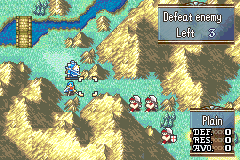

# Map Menu Character Biographies

<p align="center">
  
</p>

Adds a **Biography** command to the map menu (the menu you get by pressing A on an empty tile), between **Guide** and **Records**. It opens a scrolling list of characters, each shown with a gold subtitle. Pressing A on a character plays that character's biography: up to four pages, each a CG-style text box over a conversation background, with the character's own music. After the last page the list comes back. B returns to the map.

The GIF shows the integrated version with this repo's custom biography art and text. The package ships placeholder pages (see [Biography table](#biography-table)).

## Target ROM

- **FE8U (USA)** clean ROM
- Free space: `$1000000`

## Biography table

Edit `Biographies.event` without recompiling C:

```
BiographyEntry($01, BioSubtitle_Eirika, $1C, $7D6, $02, 0, 0, 0, 0, 0, 0) // Eirika
...
BiographyTableEnd

BioSubtitle_Eirika:
    String("Restoration Lady"); BYTE 0
```

| Field | Meaning |
|-------|---------|
| character ID | The list shows this character's name (from the character table). |
| subtitle | Label of a `String(...)` drawn in gold after the name, or `0` for none. About 13 characters fit. |
| song ID | Music for the biography. `0` picks a random song, like the integrated feature. |
| text / background × 4 | Up to four pages. Each page is a text ID shown in a CG text box over a conversation background (BACG ID). A text ID of `0` ends the biography early. |

End the table with `BiographyTableEnd`. The list shows five rows and scrolls when there are more entries.

### What you need to supply

- **Text:** one FEBuilder text entry per page. Write them for the CG text box (short lines, about 26 characters wide) and end each page with `[A]` so it waits for the player.
- **Backgrounds:** a conversation background ID per page (vanilla or added with FEBuilder's background editor).

The integrated feature uses this repo's own "Heroes cards" text and backgrounds, which are not part of this package. The sample table keeps the integrated characters, subtitles and music (Eirika, Seth, Franz, Gilliam, Tana with *Powerful Foe*), but each has a single page with the character's **vanilla epilogue text** over a vanilla background. Those lines are wider than the CG box and get cut off; they are only there so the command works out of the box. Replace them with your own.

### Menu text

The command name ` Biography` is a raw string in `MapMenu.event`. The R-button help (*Read character / biographies.*) uses text ID `$40A` (`TEXT_BIOGRAPHY_HELP` in `Installer.event`), an unused vanilla dummy item-name slot, filled with Huffman-compressed text by `Text.event`. To use your own help text, set `TEXT_BIOGRAPHY_HELP` to a text ID you edit in FEBuilder and delete the `setText` line in `Text.event`.

## Build

No build step is required to install the patch. `Source/CharacterBiographies.lyn.event` is checked in, so you can install `Installer.event` as-is.

Run `make` only if you edit `Source/CharacterBiographies.c`:

```bash
make -C Standalone/map_menu_character_biographies
```

That requires [devkitARM](https://devkitpro.org/wiki/Getting_Started) and this repo's [FE-CLib](https://github.com/MokhaLeee/FE-CLib-Mokha) / [Event Assembler](https://github.com/MokhaLeee/EventAssembler/tree/mokha-fix) tools. See [Documentation/Setup.md](../../Documentation/Setup.md) for full setup.

Edits to `Biographies.event`, `MapMenu.event` or `Installer.event` do not need `make`.

## Installation

This folder is self-contained. It does not include `EAstdlib.event` or `Hack Installation.txt`. FEBuilder's bundled Event Assembler is enough.

### FEBuilderGBA

1. Copy the `map_menu_character_biographies` folder (or download this standalone package).
2. Open a clean FE8U ROM in FEBuilder.
3. Go to **Advanced Editors → Insert EA**.
4. Click **Select File**, choose `Installer.event`, then click **Load Script**.

### Event Assembler

From a copy of clean `fe8.gba`, with this folder as the working directory:

```bash
ColorzCore A FE8 -input:Installer.event -output:/path/to/fe8-biographies.gba
```

## Files

| File | Purpose |
|------|---------|
| `Installer.event` | EA installer, addresses, menu pointer, help text ID, and free-space placement |
| `MapMenu.event` | New map-menu item list: the vanilla commands plus Biography |
| `Biographies.event` | Character biography table and subtitles (edit without compiling C) |
| `Text.event` | Huffman-compressed R-button help for text ID `$40A` |
| `Source/CharacterBiographies.c` | C implementation (list screen, event, command) |
| `Source/CharacterBiographies.lyn.event` | Checked-in lyn output (rebuild with `make` after editing `.c`) |
| `makefile` | Compiles C to `.lyn.event` |

## Hooks & Free Space

| Data | Address (`ORG`) | Overwritten |
|------|-----------------|-------------|
| `gMapMenuDef.menuItems` | `$59D21C` | 4 bytes (pointer to the new item list) |
| Text table entry `$40A` | `$15E4B4` | 4 bytes (help text pointer) |

No vanilla code is changed. The new item list copies the eight vanilla map-menu entries byte for byte (`MM_Unit` ... `MM_End` in `MapMenu.event`) and inserts the Biography command after Guide. Reorder the lines to move it.

**Free space:** `$1000000` (code, menu list, table and text continue at `CURRENTOFFSET`).

**RAM:** none. The integrated feature keeps the list cursor and page in kernel EWRAM (`gCharacterBiographyPage`, `gCharacterBiographyListNumber`, and the shared `gTopVisibleListIndex`); the standalone keeps them in its own proc. The list screen borrows vanilla's prep-screen text slots (`PrepItemSuppyTexts`), which are unused on the map.

## Conflicts

- Any patch that repoints or edits the map-menu item list (`gMapMenuDef.menuItems` at `$59D21C`, or the vanilla list at `$59CE6C`), or that replaces `PlayerPhase_MainIdle` to open its own map menu (for example the C Skill System kernel). Other map-menu patches have to be merged into `MapMenu.event` by hand.
- Any patch that uses text ID `$40A`. Change `TEXT_BIOGRAPHY_HELP` if it collides.
- Free space at `$1000000` overlaps with other standalone patches from this repo. Install only one body at `$1000000`, or move this patch's `ORG` after any already-installed standalone code.
- Do not install this on a ROM that already has the C Skill System kernel.

No other package in `Standalone/` touches the map menu. (`refuge` and `item_stack` change the *unit action* menu at `$59D1F8`, a different menu, and can be installed alongside this one after moving one body's `ORG`.)

`Installer.event` uses `PROTECT` on the menu pointer, the text-table slot and the free-space body. Overlapping ROM writes should fail assembly with a clear EA error.

## Differences from the integrated feature

- **List scrolling:** the integrated list always draws the first five table entries, whatever the scroll position, and reads past the end of a table with fewer than five entries. The standalone draws the visible window of the table and leaves unused rows blank.
- **Scroll bar:** sized from the real entry count (the integrated code passes fixed values).
- **Pages:** a text ID of `0` ends a biography early; the integrated event always shows four pages.
- **Subtitles** are drawn as plain ASCII. The integrated build runs them through its narrow-font UTF-8 helper, which is not part of vanilla.
- **Help text:** the integrated build adds `MSG_MAP_MENU_BIOGRAPHY_TITLE` / `_DESC` through the repo text pipeline. Here the name is a raw string and the help uses dummy text slot `$40A`.

## Limitations

- Every biography is always available; there are no unlock conditions (same as the integrated feature).
- The list header (`Biography`, `Select a character to view`) is hardcoded English.
- The biography event cannot be skipped (same as the integrated feature).
- Tested in the Prologue: the command appears in the map menu with its R-button help, the list scrolls, a biography plays with its background and music and returns to the list, and B returns to the map with the side windows and cursor working.

## Credits

Extracted from [C Skill System](https://github.com/JesterWizard/C-SkillSystem-Jester). See [CharacterBiographies.md](../../Documentation/Features/CharacterBiographies.md) for the integrated documentation.
