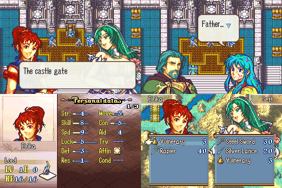

# Half-Body and 32-Colour Portraits

<p align="center">
  
</p>

Two new portrait formats for vanilla FE8U, from the C Skill System's `half_body_portraits` and `portrait_32_color`:

- **Half-body portraits** (FE9/FE10 style, originally by Ryrumeli, redesigned by Kirb): a 128x128 portrait that stands on the bottom edge of the screen in dialogue. Its speech bubble runs along the bottom of the screen with the tail pointing up at the face. Map menus and level-up screens show its top 128x80, and the stat screen shows a wider head.
- **32-colour portraits**: a vanilla-layout mug with up to 31 colours. The first 15 colours are drawn as usual. The rest go into a second "overlay" mug with its own OBJ palette, drawn on top of the first.

The patch recognises both formats from their portrait table entries, so every other portrait keeps its vanilla behaviour. You can convert portraits one at a time and mix them in a scene. With no new-format portraits installed, dialogue and menus look exactly as in vanilla.

Both formats are in one package because they share their face hooks (`StartFace`, `Face_OnInit`, the face change and fade code). Each also needs the same extra block of face VRAM. Two separate packages would hook the same functions and could never be installed together.

If you use [`Standalone/text_engine`](../text_engine/), don't install this package. Turn on that package's `TEXT_ENGINE_HALF_BODY_PORTRAITS` setting instead. It installs the same code (built from this folder's `Source/Portraits.c`), leaves the dialogue to the text engine, and works with these tools and macros (see [Conflicts](#conflicts)).

## How it works

Each face slot has a 0x1000-byte block of OBJ VRAM and an OBJ palette (`sFaceConfig`). A new-format face also needs the **next** 0x1000 bytes of VRAM: for a half-body this holds the lower half of its 32x8-tile sheet, and for a 32-colour face it holds the overlay mug. A 32-colour face also needs the **next** OBJ palette. When a face starts, `Source/Portraits.c` checks those resources against the faces already on screen and does one of the following:

- It shows the face in its new format if there's room. Dialogue (`StartFaceAuto`) tries face slots 0 and 2 first, which have room under the default layout.
- If not, it uses another free config entry.
- If there's still no room, it shows the face as a normal portrait: the half-body's top 96x80 (the top 32x4 tiles of the sheet are a vanilla mug), or the 32-colour mug's first 16 colours.
- When a later face needs space that an earlier face's extra block or palette is using, the earlier face gives it up. A 32-colour face then loses its overlay, and a half-body drops to its top 96x80 and moves down 48 pixels to stay on the bottom edge.

A third or fourth face in a scene always shows, as in vanilla.

Half-body portraits in dialogue are placed at Y 32 instead of 80. A half-body speaker's bubble sits at the bottom of the screen (vanilla `StartTalkOpen` anchor row 18 instead of 8). Changing a portrait in place (`[LoadFace]` on a face already on screen) between a half-body and a normal portrait moves it by 48 pixels to keep its feet on the bottom edge.

Half-bodies don't animate their mouth or eyes (as in the C Skill System). 32-colour portraits blink and talk as usual, but the overlay doesn't cover the mouth and eye frames.

## Making portraits

The tools are in `Tools/` and need Python 3 with [Pillow](https://pypi.org/project/pillow/) (`pip install pillow`).

### Half-body

1. Draw a 160x160 PNG with at most 16 colours, laid out like `Tools/HalfbodyTemplate.png`. The top-left pixel's colour is transparent.

   | Sheet area (x, y) | Contents |
   |---|---|
   | 16..112, 0..48 | head (the top corners aren't drawn) |
   | 0..128, 48..128 | shoulders, chest and body |
   | 128..160, 64..96 | 32x32 chibi (map window, menus) |
   | 128..160, 96..128 | two 32x16 eye frames (half closed, closed); not animated |
   | 0..128, 128..160 | seven 32x16 mouth blocks: blocks 1-6 (top row, then bottom row) are the talking frames; block 7 (64..96, 144..160) is the closed mouth the stat screen draws at the mouth position |

2. Format it: `python3 Tools/HalfbodyFormatter.py MyPortrait.png -o MyPortrait.dmp`
3. Install it with an EA file (FEBuilder: **Advanced Editor → Insert EA**):

   ```
   #include "Tools/PortraitMacros.event"

   ALIGN 4
   MyPortrait:
   #incbin "MyPortrait.dmp"
   setMugEntry_Halfbody(0x64, MyPortrait, 3, 7, 3, 5)  // portrait ID, label, mouth X/Y, eyes X/Y
   ```

   Put it in free space that FEBuilder hasn't used, as with any EA insert. `PortraitTable` defaults to vanilla's `0x8ACBC4`. Define it before the include if your portrait table has been moved or expanded.

`HalfbodyFormatter.py` stands in for the C Skill System's `HalfbodyFormatter.exe`, Kirb's closed-source Windows tool. It writes a raw (uncompressed) sheet, mouth frames at `+0x2004`, the palette at `+0x2604` (16 colours, then 16 unused), and an LZ77 chibi at `+0x2644`. That is the layout `setMugEntry_Halfbody` expects. Sheets drawn for the original tool (like the sample) format the same way.

### 32-colour

1. Draw a vanilla-layout 128x112 indexed PNG with at most 32 colours. The first 16 palette entries are the base mug (entry 0 is transparent), and the other entries are the extra shades.
2. Format it: `python3 Tools/PortraitFormatter32.py MyPortrait.png -o MyPortrait.dmp`
3. Install it the same way with `setMugEntry_32Color(0x02, MyPortrait, 2, 6, 3, 4)`.

`PortraitFormatter32.py` is the C Skill System's `PortraitFormatter32`, with a built-in LZ77 compressor instead of Event Assembler's `compress` tool. Its output is byte-for-byte the same.

Always point the portrait table at these blobs with these macros, or with exactly the same pointers. The patch tells the formats apart by those pointers: a half-body's chibi is at `img + 0x2644` (or `+ 0x2648`), and a 32-colour portrait's card pointer is its second palette.

### Samples

`Samples/` has one portrait of each kind. Remove the `//` in front of `#define PORTRAIT_FORMATS_SAMPLES` in `Installer.event` to install them:

- `Anna_halfbody.png`: Anna (portrait `0x64`) as a half-body. This is the C Skill System's `Data/CustomPortraits/Portraits/Anna.png`, with a chibi added.
- `Eirika_32color.png`: Eirika (portrait `0x02`) as a 32-colour portrait. This is the C Skill System's test mug `eirika_32.png`, whose 9 extra colours are deliberately loud so you can see them.

`make samples` re-formats them.

## Target ROM

- **FE8U (USA)** clean ROM
- Free space: `$1000000` (about 6 KB, about 26 KB with the samples)
- EWRAM: `0x0203B800 .. 0x0203B89F` (`Source/RamAlloc.s`)

## Build

No build step is needed to install. `Source/*.lyn.event` and `Samples/*.dmp` are checked in.

Run `make` only after editing `Source/*.c` or a sample PNG:

```bash
cd Standalone/portrait_formats
DEVKITARM=/usr make
```

That requires devkitARM (or `arm-none-eabi-gcc`), Python 3 with Pillow, and this repo's FE-CLib and `lyn`. The makefile builds each C file into its own `.lyn.event`, because lyn misplaces calls between global functions of any object it links after the first one.

## Installation

### FEBuilderGBA

1. Open a clean FE8U ROM.
2. **Advanced Editor → Insert EA**, and choose `Installer.event` in this folder.
3. Install your portraits as shown in [Making portraits](#making-portraits).

### Event Assembler

```
#include "Standalone/portrait_formats/Installer.event"
```

`jumpToHack` comes from EA's `Extensions/Hack Installation.txt`, as FEBuilder provides it.

## Files

| File | Purpose |
|---|---|
| `Installer.event` | Hooks, byte changes, body at `$1000000`, optional samples |
| `Source/Portraits.c` / `.h` | Face slots and formats, sprites, fades, stat screen face, speech bubble |
| `Source/VanillaTalk.c` | Vanilla dialogue: face height and bubble row for half-body speakers |
| `Source/RamAlloc.s` | `sPortraitSlots` EWRAM address |
| `Source/*.lyn.event` | Built code (checked in) |
| `Tools/HalfbodyFormatter.py`, `Tools/HalfbodyTemplate.png` | Half-body formatter and sheet template |
| `Tools/PortraitFormatter32.py` | 32-colour formatter |
| `Tools/PortraitMacros.event` | `setMugEntry_Halfbody`, `setMugEntry_32Color` |
| `Samples/` | Sample PNGs, formatted `.dmp`s, `Samples.event` |
| `makefile` | Builds the `.lyn.event`s and the samples |

## Hooks & Free Space

Functions with four or more arguments use a 16-byte `bx pc` / `ldr r12` / `bx r12` hook (`hookViaR12`, defined in `Installer.event`), because `jumpToHack` overwrites `r3`. All the others use `jumpToHack` (8 bytes). Every hooked function is long enough for its hook.

| Address | Function | Hook |
|---|---|---|
| `$5594` | `Face_OnInit` | `jumpToHack` |
| `$55BC` | `Face_OnIdle` (draws the 32-colour overlay) | `jumpToHack` |
| `$5610` | `StartFaceAuto` (dialogue face slot choice) | 16-byte |
| `$563C` | `StartFace` | 16-byte |
| `$5738` | `EndFace` | `jumpToHack` |
| `$57C0` | `FaceRefreshSprite` | `jumpToHack` |
| `$5CA4` | `PutFace80x72_Core` (stat screen) | 16-byte |
| `$5EF0` | `StartFaceFadeIn` | `jumpToHack` |
| `$5F38` | `StartFaceFadeOut` | `jumpToHack` |
| `$64F4` | `StartFace2` (preparations, world map) | 16-byte |
| `$6650` | `sub_8006650` (face change) | `jumpToHack` |
| `$7854` | `TalkLoadFace` | `jumpToHack` |
| `$82A4` | `PutTalkBubble` | 16-byte |
| `$88A8` | `StartTalkOpen` | `jumpToHack` |

Byte changes (all `PROTECT`ed):

| Address | Change |
|---|---|
| `$1E0BC`, `$22BA2`, `$22BF8`, `$2325E`, `$23314`, `$23572`, `$2360A`, `$23AF6`, `$2998E` | Map-menu faces (item drop, ballista, weapon select, Play, Item, Staff, Repair): `movs r0, #2` → `#6`. Display kind 6 is new: a normal portrait draws as kind 2 (96x80); a half-body draws its top 128x80 |
| `$73E08`, `$7F2AC` | Battle and map level-up face display `0x1042` → `0x1046` (same kind 6) |
| `$2D2EA`, `$2D2FE` | Trade menu name boxes: OBJ tiles `0x4800` → `0x3800`, palette 8 → 10 (out of the way of a second new-format face) |
| `$205C14`, `$205C44`, `$205C70` | Preparations item, trade and item-use face VRAM `0x5800` / `0x6800` → `0x4000` / `0x6000` (room for each face's extra block) |

All of these leave vanilla portraits looking the same. The C Skill System makes the same trade-menu and preparations changes.

## Conflicts

- **`Standalone/text_engine`**: both hook `StartTalkOpen`, so Event Assembler stops with a `PROTECT` error if you install both. Use the text engine's `TEXT_ENGINE_HALF_BODY_PORTRAITS` setting instead. It has the same face, menu and stat-screen code, and the text engine handles half-body speakers itself.
- No other `Standalone/` package hooks or patches these addresses.
- Other hacks that change face drawing, face VRAM, dialogue faces or the speech bubble (for example FEBuilder's mouth/eye or portrait-position patches) will clash. Hacks that move or expand the portrait table are fine; define `PortraitTable` for the macros.
- The body starts at `$1000000`, like every package here. If you install several, change `FE8U_StandaloneFreeSpace` for each one.

## Differences from the C Skill System

The C Skill System switches the whole game between portrait formats with designer-config flags (and says that mixing formats glitches). Here each portrait is handled on its own, which changes a few things:

- **Face slots:** with either flag on, the C Skill System limits dialogue to face slots 0 and 2, so a third face never loads. Here faces are placed in free slots, and new-format faces take the space they need when it's free. Vanilla scenes with three or four faces still show them all (see [How it works](#how-it-works)).
- **Overlay location:** the 32-colour overlay uses the VRAM block and OBJ palette right after its own face's. The C Skill System uses the "paired" slot (slot 1 for slot 0), which collided with a half-body in slot 2. Here half-bodies and 32-colour faces can be on screen together.
- **Half-body palette:** a half-body loads one OBJ palette. The C Skill System loads 32 colours, but every piece of its half-body sprite uses the first palette, so the second 16 colours were never drawn. This frees that palette for other faces.
- **Fade-out:** the 32-colour overlay fades out with its face. In the C Skill System it stayed lit until the face ended.
- **Map menus and level-ups:** these use the half-body's 128x80 top through display kind 6 (byte changes above). The C Skill System changes only the three Item-menu entries and its own level-up screens. Its item-panel move (X 0x0D) went with its wider icon panel, which isn't part of this package, so it's left out.
- **Crops:** the 64x80 crop (kinds 0/1, used for battle quotes) shows a half-body's top like a normal portrait. The C Skill System drew the whole half-body for the flipped variant only.
- **Stat screen:** raised faces (Lute, Amelia, Ewan, Dozla, Myrrh) get a raised half-body layout, so the mouth tiles line up. The C Skill System used the normal layout for them. The half-body tile map's top-left column now uses tiles `0x9B` / `0xBB` (the C Skill System's had `0x9A` / `0xBA`, one column off). Other 80x72 background faces (support screen, world map, the targeted unit's face) show a half-body's top 96x80 instead of copying the whole sheet over whatever follows.
- **Speech bubble tail:** the tail of a half-body speaker's bubble sits on the row above the bubble. The C Skill System put it on fixed row 12, which is inside taller text-engine boxes.
- **Preparations and world map:** these use `StartFace2`, which the C Skill System doesn't hook. There, a second preparations face read an empty VRAM config entry.
- **Battle quotes:** vanilla `TalkLoadFace` keeps the battle-quote face kind. The C Skill System forced 96x80.
- **Half-body formatter:** `HalfbodyFormatter.py` stands in for the C Skill System's Windows-only `.exe`. Its 7-argument `setMugEntry_Halfbody` points at `+0x2648` / `+0x2608` / `+0x2008`, a layout this formatter doesn't produce. Here both macro forms use `+0x2644`, and the 7th argument is the blink kind.

## Limitations

- A face in a new format takes two of the four face slots' worth of VRAM, and a 32-colour face also takes two palettes. Under the dialogue layout, at most two of them show in full at once. A third or fourth face pushes an earlier one back to a normal portrait (see [How it works](#how-it-works)).
- At most two 32-colour overlays at once (as in the C Skill System), to keep the OAM count down.
- A half-body speaker's bubble along the bottom of the screen covers the lower part of any normal portrait there.
- In the two-portrait preparations screens, the second portrait's palette is the first portrait's overlay palette, so a 32-colour first portrait shows only its first 16 colours there.
- Half-bodies don't move their mouth or blink, and the 32-colour overlay isn't redrawn for mouth and eye frames.
- A half-body sheet must be raw (as `HalfbodyFormatter.py` writes it) to fall back to its top 96x80. A compressed sheet always loads in full.
- Runtime-tested in the Prologue: dialogue (two half-bodies; a half-body, a 32-colour and normal portraits together; three faces; `[LoadFace]` changes), the stat screen, the Item menu and the trade menu, plus pixel-identical vanilla dialogue and menus with no new-format portraits installed. The level-up, preparations and world map screens are assembled and byte-checked only.

## Credits

- Half-body portraits: Ryrumeli (original), Kirb (redesign and formatter), Jester (C Skill System integration)
- 32-colour portraits and `PortraitFormatter32`: C Skill System
- Sample sheets: C Skill System `Data/CustomPortraits`
