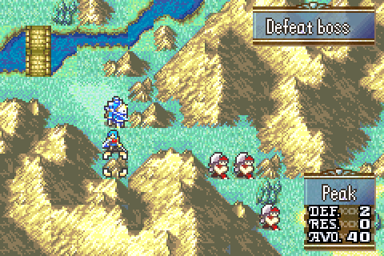

# RES Terrain Window

<p align="center">
  
</p>

The map terrain window shows the terrain's **RES** bonus between DEF and AVO. The window is one tile taller to fit the third row, and the values come from vanilla's terrain bonus tables (`TerrainTable_Def_Common`, `TerrainTable_Res_Common`, `TerrainTable_Avo_Common`), so FEBuilder's terrain editors still set them.

Snags, damaged walls and ballistae keep vanilla's HP display, placed in the new window.

## Target ROM

- **FE8U (USA)** clean ROM
- Hook: vanilla `DrawTerrainDisplayWindow` at `0x0808C964`
- Repoint: the player interface font tiles pointer in `InitPlayerPhaseInterface` (`0x0808D0AC`)
- Free space: `$1000000` (about 2.1 KB)

## Build

No build step is required to install the patch. `Source/ResTerrainWindow.lyn.event` and the `.dmp` graphics are checked in.

Run `make` if you edit `Source/ResTerrainWindow.c` or `Gfx/TerrainWindowFont.png`:

```bash
make -C Standalone/res_terrain_window
```

That requires [devkitARM](https://devkitpro.org/wiki/Getting_Started) and this repo's [FE-CLib](https://github.com/MokhaLeee/FE-CLib-Mokha) / [Event Assembler](https://github.com/MokhaLeee/EventAssembler/tree/mokha-fix) tools. See [Documentation/Setup.md](../../Documentation/Setup.md) for full setup.

The window layouts (`Gfx/*.dmp`) are TSA made from the Tiled maps (`Gfx/*.tmx`, using `Gfx/MenuTiles.png` as the tileset). To edit them, convert the `.tmx` with masterofcontroversy's [tmx2tsa](https://github.com/masterofcontroversy/ASM/tree/main/FE8/ResTerrainWindow/gfx/tmx2tsa).

## Installation

This folder is self-contained. It does not include `EAstdlib.event` or `Hack Installation.txt`. FEBuilder's bundled Event Assembler is enough.

### FEBuilderGBA

1. Copy the `res_terrain_window` folder (or download this standalone package).
2. Open a clean FE8U ROM in FEBuilder.
3. Go to **Advanced Editors → Insert EA**.
4. Click **Select File**, choose `Installer.event`, then click **Load Script**.

### Event Assembler

From a copy of clean `fe8.gba`, with this folder as the working directory:

```bash
EA_DIR=<repo>/Tools/EventAssembler
{
  echo '#include "Extensions/Hack Installation.txt"'
  echo '#include "Installer.event"'
} > _install.event
"$EA_DIR/ColorzCore" A FE8 -input:_install.event -I:"$EA_DIR" -output:/path/to/fe8-res-terrain-window.gba
```

## Files

| File | Purpose |
|------|---------|
| `Installer.event` | EA installer: hook, font repoint, free-space placement |
| `Source/ResTerrainWindow.c` | Terrain window drawing |
| `Source/ResTerrainWindow.lyn.event` | Checked-in lyn output |
| `Gfx/TerrainWindow.dmp` / `.tmx` | 7x7 window frame |
| `Gfx/TerrainWindowText.dmp` / `.tmx` | DEF / RES / AVO labels |
| `Gfx/BrokenWall.dmp` / `.tmx` | Labels for snags and damaged walls |
| `Gfx/MenuTiles.png` | Tileset the `.tmx` files are drawn with |
| `Gfx/TerrainWindowFont.png` / `.dmp` | Vanilla player interface font tiles with the RES label added |
| `makefile` | Compiles the C and converts the font PNG |

## Hooks & Free Space

| Function | Hook (`ORG`) | Overwritten |
|----------|--------------|-------------|
| `DrawTerrainDisplayWindow` | `$8C964` | 8 bytes |
| `InitPlayerPhaseInterface` literal (`gGfx_PlayerInterfaceFontTiles`) | `$8D0AC` | 4 bytes (pointer) |

**Free space:** `$1000000` (body continues at `CURRENTOFFSET` after install). No RAM is used.

The new font sheet is vanilla `gGfx_PlayerInterfaceFontTiles` with the RES label in tiles `$25`-`$27` (where AVO was) and AVO moved to tiles `$66`-`$68`, which are blank in vanilla. Everything else is unchanged.

## Conflicts

- Any patch that replaces vanilla `DrawTerrainDisplayWindow` (`$8C964`) or other terrain window patches, including the full C Skill System ResTerrainWindow module.
- Any patch that repoints the player interface font tiles at `$8D0AC` (for example a custom HP/DEF/AVO label sheet, or the C Skill System's Modular Minimug Box label sheet). Merge the RES/AVO tiles into that sheet and drop this patch's repoint.
- Patches that edit vanilla's terrain window labels (`Tsa_TerrainMapUi_Labels`) or frame (`gTSA_TerrainBox`) have no effect, since the window now uses its own.
- Free space at `$1000000` overlaps with other standalone patches from this repo. Install only one body at `$1000000`, or move this patch's `ORG` to the next free region after any already-installed standalone code.

`Installer.event` uses `PROTECT` on the hook site, the font pointer and the free-space body. Overlapping patches should fail assembly with a clear EA error.

## Limitations

- The RES value always comes from the common (non-flier) terrain table, like DEF and AVO in vanilla's window.

## Credits

RES terrain window by masterofcontroversy ([ASM/FE8/ResTerrainWindow](https://github.com/masterofcontroversy/ASM/tree/main/FE8/ResTerrainWindow)); C version from [C Skill System](https://github.com/JesterWizard/C-SkillSystem-Jester).
