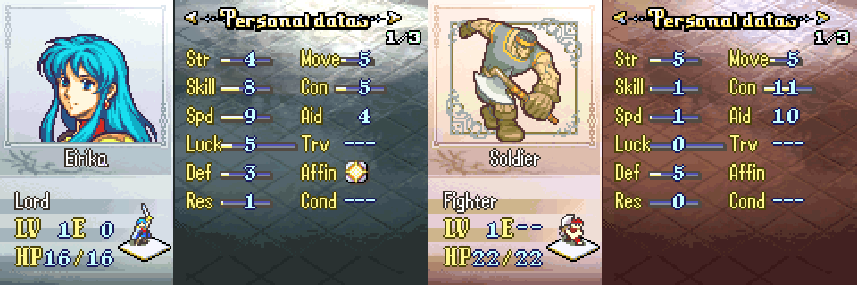

# Stat Screen Allegiance Colors

<p align="center">
  
</p>

Tints the stat screen background by the viewed unit's allegiance: **blue** for player units, **red** for enemies, **green** for NPCs and **gold** for anything else (the fourth faction used by link arena / unused purple units).

This matches the integrated C Skill System `stat_screen_allegiance_colors` config flag, but installs on **clean FE8U** without the kernel.

## Target ROM

- **FE8U (USA)** clean ROM
- Hook: inside `StatScreen_InitDisplay` at `0x0808859C` (installer ORG `$8859C`), where vanilla loads `Pal_StatscreenBG` into BG palettes 12-15. An asm stub (`StatScreen_LoadBgPal_Allegiance`) calls `GetStatScreenBgPal_Allegiance()` and resumes at the vanilla `CopyToPaletteBuffer(pal, 0x180, 0x80)` call at `0x080885A4`.
- Free space: `$1000000`

## Build

No build step is required to install the patch. `Source/StatScreenAllegianceColors.lyn.event` and the `Gfx/*Pal.dmp` palettes are checked in, so you can install `Installer.event` as-is.

Run `make` if you edit `Source/StatScreenAllegianceColors.c` or `Source/StatScreenAllegianceHook.s`. Run `make gfx` if you edit a PNG in `Gfx/` (the palette of each PNG is what gets used):

```bash
make -C Standalone/stat_screen_allegiance_colors
make -C Standalone/stat_screen_allegiance_colors gfx
```

That requires [devkitARM](https://devkitpro.org/wiki/Getting_Started) and this repo's [FE-CLib](https://github.com/MokhaLeee/FE-CLib-Mokha) / [Event Assembler](https://github.com/MokhaLeee/EventAssembler/tree/mokha-fix) tools. See [Documentation/Setup.md](../../Documentation/Setup.md) for full setup.

## Installation

This folder is self-contained. It does not include `EAstdlib.event`, `Hack Installation.txt`, or a Png2Dmp step. FEBuilder’s bundled Event Assembler is enough.

### FEBuilderGBA

1. Copy the `stat_screen_allegiance_colors` folder (or download this standalone package).
2. Open a clean FE8U ROM in FEBuilder.
3. Go to **Advanced Editors → Insert EA**.
4. Click **Select File**, choose `Installer.event`, then click **Load Script**.

### Event Assembler

From a copy of clean `fe8.gba`, with this folder as the working directory:

```bash
ColorzCore A FE8 -input:Installer.event -output:/path/to/fe8-ss-colors.gba
```

## Files

| File | Purpose |
|------|---------|
| `Installer.event` | EA installer, hook, free-space placement, palettes |
| `Source/StatScreenAllegianceColors.c` | Picks the palette from `gStatScreen.unit`'s faction |
| `Source/StatScreenAllegianceHook.s` | Mid-function hook stub that returns into `StatScreen_InitDisplay` |
| `Source/StatScreenAllegianceColors.lyn.event` | Checked-in lyn output (rebuild with `make`) |
| `Gfx/SSBlue.png`, `SSRed.png`, `SSGreen.png`, `SSGold.png` | Palette sources (stat screen background mock-ups) |
| `Gfx/SS*Pal.dmp` | Palettes extracted from the PNGs (`make gfx`); the first 0x80 bytes are loaded |
| `makefile` | Builds C + asm to `.lyn.event`, PNG palettes to DMP |

## Hooks & Free Space

| Function | Hook (`ORG`) | Overwritten |
|----------|--------------|-------------|
| `StatScreen_InitDisplay` + `0xEC` (BG palette load) | `$8859C` | 8 bytes (`ldr r0, =Pal_StatscreenBG` / `movs r1` / `lsls r1` / `movs r2`) |

**Free space:** `$1000000` (about 2.1 KB: code + four 512-byte palettes; continues at `CURRENTOFFSET`).

No RAM is used.

## Conflicts

- Any patch that changes `StatScreen_InitDisplay` around `$8859C`..`$885A3` or replaces `StatScreen_InitDisplay`, including the full C Skill System stat screen.
- Patches that edit the vanilla stat screen background palette (`Pal_StatscreenBG`, `0x08A06460`) have no effect while this patch is installed, because the palette is no longer read from there. Edit the PNGs in `Gfx/` instead.
- No other package in `Standalone/` hooks this address. [`stat_page_promotions`](../stat_page_promotions/) hooks other stat screen addresses (`$88690`, `$889A0`) and can be installed alongside (move one body off `$1000000`).
- Free space at `$1000000` overlaps with other standalone patches from this repo. Install only one body at `$1000000`, or move this patch's `ORG` after any already-installed standalone code.

`Installer.event` uses `PROTECT` on the hook site and free-space body. Overlapping ROM writes should fail assembly with a clear EA error.

## Limitations

- The palette is chosen when the stat screen is opened. Switching units with Up/Down stays inside the same faction in vanilla, so the color never needs to change while the screen is open.

## Credits

Extracted from [C Skill System](https://github.com/JesterWizard/C-SkillSystem-Jester) (`Kernel/Wizardry/StatScreenAllegianceColors`).
